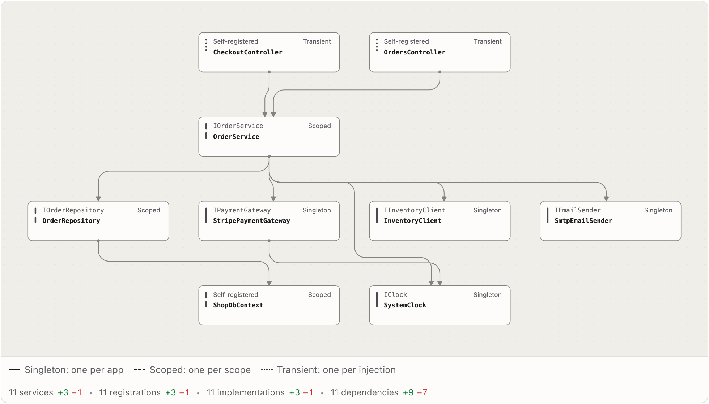
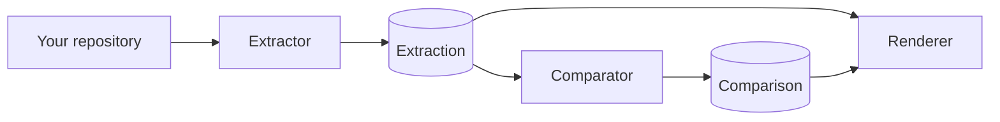
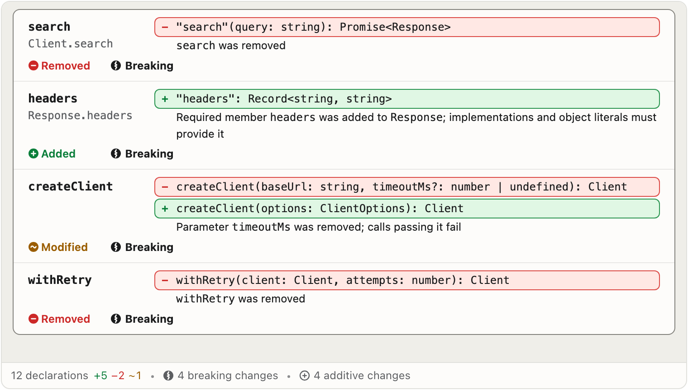
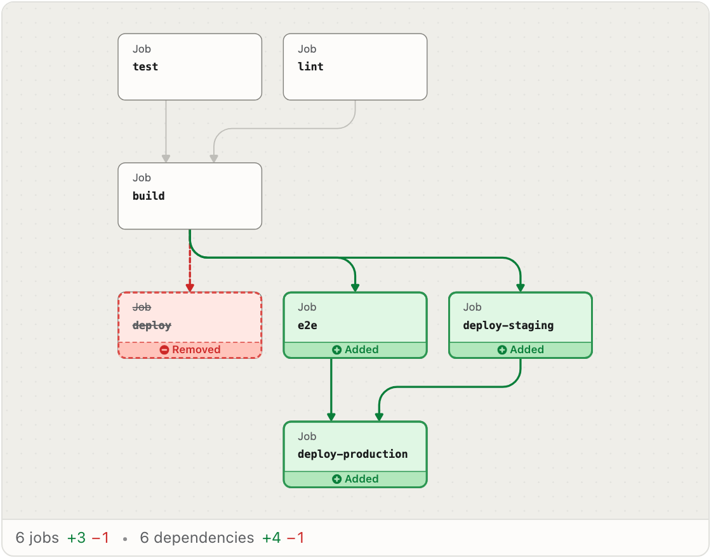
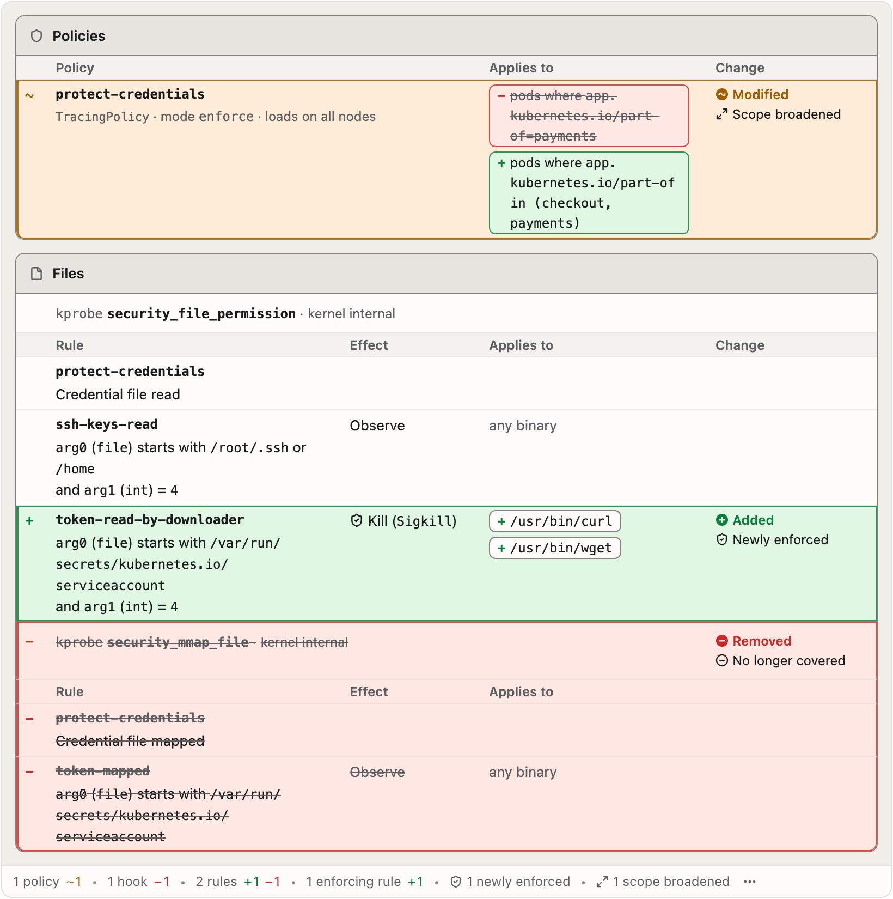

<!-- This file must be human-authored. No language model prose, please. -->

#  Projections

> **Understand your codebase (without reading every line)**

At this point, there's simply too much code to actually read it line-by-line...
but that doesn't mean we shouldn't understand the systems we create and are
responsible for. Projections is a prototype for creating repeatable,
customizable representations of your codebase, for both points in time (e.g.
commits) and changes (e.g. pull requests). You can use projections to illustrate
module dependencies, service architectures, database schemas, security policies,
tool output, and really anything you can imagine. Projections are deterministic
by default, but can contain generative aspects when useful.

To get started, you can give your agent this prompt:

```txt
Set up Projections by following https://github.com/githubnext/projections/blob/main/SETUP.md, configure/implement a few projections specifically for my codebase, and show them to me in the viewer.
```

Alternatively, head to the [quick start guide](docs/setup/quick-start.md) and
[first projection guide](docs/setup/first-projection.md).

_Projections is an early exploration by [GitHub Next](https://githubnext.com/).
Feel free to open a Discussion or chat with us on
[X](https://x.com/GitHubNext)!_

<picture>
  <source media="(prefers-color-scheme: dark)" srcset="docs/images/readme/di-split-animated-dark.png">
  
</picture>

## The Mechanics

Every projection has three components:

- **Extractor**: Creates a static JSON representation of your system. Runs on
  compute you control (e.g. GitHub Actions or dev machines), and can use any
  language, dependencies, or tools you like. You can perform static code
  analysis, run scripts, boot your server locally, etc. Determinism is strongly
  recommended but not enforced.
- **Comparator**: Diffs two extractions to determine what changed and what
  stayed the same. A default is built in, and custom ones are implemented using
  [Common Expression Language](https://cel.dev/) rules. Deterministic, and can
  run anywhere.
- **Renderer**: Displays extractions and their comparisons. Implemented in
  JavaScript (e.g. React), run in a browser.

You can mix-and-match built-in and custom implementations within a projection.
For example, you could write a custom extractor to derive the structure of your
application components based on your team's conventions, while using the default
comparator and the general graph renderer.



## Built-ins

Projections has a variety of built-in extractors, comparators, and renderers.
Here are some example projections you can make with them:

### Public API

Show what interface changes will break callers.

<picture>
  <source media="(prefers-color-scheme: dark)" srcset="docs/images/readme/api-dark.png">
  
</picture>

### Pipelines

Show the stage dependencies in your CI workflows.

<picture>
  <source media="(prefers-color-scheme: dark)" srcset="docs/images/readme/dag-dark.png">
  
</picture>

### Security policy

Show what behaviors runtime security policies will restrict.

<picture>
  <source media="(prefers-color-scheme: dark)" srcset="docs/images/readme/runtime-policy-dark.png">
  
</picture>

There are also built-ins provided for dependency injection, database schemas,
infrastructure plans, dependencies, command output, and a bunch more. Check out
[the gallery](docs/gallery.md) and [the docs](docs/builtins/README.md) for more.

## Status

Projections is an early prototype, pre-1.0. Features are incomplete, breaking
changes are basically guaranteed, and there's no way all the documentation is
correct. Nonetheless, if you're so inclined, we'd really love for you to give it
a try and let us know what you think!
