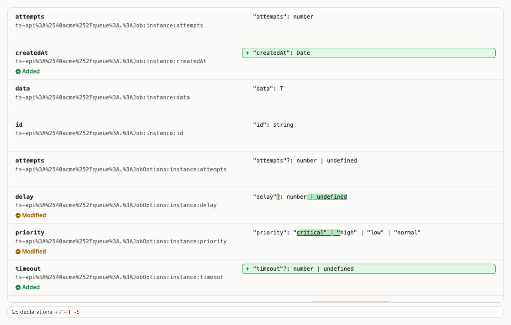
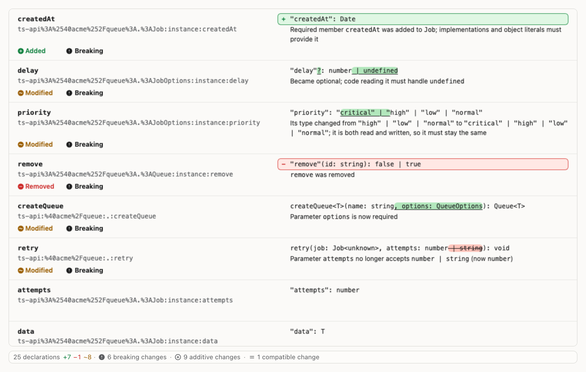

# Default comparator

The default comparator decides what changed between two extractions: which items
are the same thing, whether each was added, removed or modified, and in what
order the change is told. Every projection uses it unless its definition names a
comparator file, and a comparator file starts from its result. It knows nothing
about your domain: it matches items by ID and explicit renames, and orders
changes by the graph's structure.

## When to use it

Always, to begin with: it needs no configuration and fits every extraction. It
is enough when IDs are stable across revisions and "added, removed, modified"
says what a reviewer needs. Reach for a comparator file when a change needs a
verdict only your domain can give (breaking or compatible, newly enforced,
riskier), when renames and moves can't be declared in the extraction, or when
the story should be told in an order the structure doesn't give.

## How it decides

1. **Same ID, same item.** Items with the same ID on both sides correspond
   (`exact`). A pair is `modified` when its content differs, else unchanged.
2. **Declared renames.** The remaining items are connected by the `previousIds`
   an extraction claims, in either direction, so swapping the revisions finds
   the same connection. A definition's `correspondence` map is applied as
   `previousIds` too. Each connected group becomes one change: one item to one
   item is `declared` (a rename or move), one to several is a `split`, several
   to one a `merge`. Any other group is an `ambiguous-correspondence` error.
3. **Everything else** is `added` or `removed`.

A relationship whose endpoints were renamed is compared through the rename, so
renaming an entity doesn't also modify every relationship that touches it.
Evidence, `previousIds` and metadata never make a change. Fields an extraction
declares [volatile](../../contracts/extractions.md#volatile-data), such as
timings, only make a change when they move beyond their tolerance; within it,
the pair is `unchanged`, listed with `varied` and in no step.

**Order.** Changes connected through the change itself form one group, and
independent peers at the same depth change together. Removals go leaves first
and additions roots first, as mirror images, so reversing the comparison
reverses the steps. There are at most five removal and five addition waves
(whole adjacent layers merge to stay within them); every other change
(modifications, renames, splits and merges, and relationships between surviving
items) forms one restructure step between them. A relationship leaves with the
first of its departing endpoints and arrives with the last of its arriving ones.

## Options

The only option sorts the steps within each phase. Set it in the definition's
`comparator`:

```json
"comparator": {"options": {"order": {"by": "dependents", "direction": "descending"}}}
```

<!-- generated: options -->

| Option            | Values                       | Required                   |
| ----------------- | ---------------------------- | -------------------------- |
| `order.by`        | `dependents` or `data.<key>` | Yes, when `order` is given |
| `order.direction` | `ascending`, `descending`    | No                         |

<!-- end generated: options -->

`order.by` is `dependents` (how many relationships point at a step's items, in
the after extraction, or the before extraction for removals) or `data.<key>` (a
numeric `data` field, such as `data.size`). Steps are sorted by the largest
value among their items, `descending` by default. Ties keep the default order,
and steps without a value go last.

## What a comparison shows

- **Status** of each change: `added`, `removed`, `modified` or `unchanged` (an
  unchanged change is listed only when a rename or a volatile variation makes it
  worth showing).
- **Correspondence**: `exact`, `declared`, `split` or `merge`.
- **Steps**: removals, then one restructure step, then additions, each with its
  kind.
- **No interpretations.** It writes no summaries, classifications or summary-bar
  facts of its own; the renderer's summary bar counts each kind and its changes.
  Verdicts such as "breaking" or "newly enforced" come from a comparator file.

The same comparison drives every comparison mode (Side by side, Animated, Swipe
and Diff) and the table and text views, so they always agree.

## Start from this definition

A definition uses the default comparator when it names none. To set its options,
give `comparator` an object without `file`:

```json
{
  "id": "workspace-dependencies",
  "extractor": "workspace-dependencies",
  "renderer": "dependencies",
  "comparator": {"options": {"order": {"by": "dependents"}}}
}
```

## What a comparator file adds

The same API change, compared by the default comparator and then by the
[`api-compatibility`](../../../packages/comparators/api-compatibility/README.md)
comparator file, which classifies each change as breaking, additive or
compatible:





[Custom comparators: what they make possible](../../guides/comparators.md) shows
more, with the default comparison of each beside it.

## Limitations

- It trusts IDs. An extractor whose IDs change when nothing meaningful did (an
  index, a generated name) makes every such item removed and added; declare
  `previousIds` or a definition `correspondence`, or write identity passes in a
  comparator file.
- It can't tell how much a change matters: a whitespace edit and a breaking
  change are both `modified`.
- The order follows the graph's structure, not risk or domain priority, beyond
  what `order.by` can sort.

## Related

- Comparator files that ship with Projections:
  [`api-compatibility`](../../../packages/comparators/api-compatibility/README.md),
  [`runtime-policy`](../../../packages/comparators/runtime-policy/README.md) and
  [`agentic-workflows`](../../../packages/comparators/agentic-workflows/README.md).
- [Comparisons](../../contracts/comparisons.md): the rules every comparison
  follows, whichever comparator made it.

## How it works

The [package README](../../../packages/comparators/default/README.md) covers how
the comparator is built and sandboxed.

## Build your own

The default comparator can say _that_ something changed, not what the change
means. Write a comparator file when:

- **Your domain decides what's breaking or noteworthy.** A removed export is
  breaking, a widened selector broadens a security policy, a migration that
  drops a column needs a second look: rules classify each change and write its
  summary in your words.
- **Things move without keeping their IDs.** Identity passes pair items by a key
  you choose (a name within its new module, a path that moved), so a move reads
  as one change, not a removal and an addition.
- **The story needs another order.** Rank steps by risk, owner or priority, or
  regroup them.
- **The summary bar should state your facts.** A comparator's summaries and
  metadata reach every renderer, the text view and the JSON, so "3 breaking
  changes" is the same everywhere.

Try the lighter fix first: `order.by` sorts steps by dependents or a numeric
field, and a definition's `correspondence` declares known renames. A comparator
file never replaces the default comparator; it layers declarations over it, so
you only write what's different.

**In VS Code**, choose **+ New Projection…** in the Projections view, then
**Write a custom extractor, renderer or comparator** › **Custom comparator**,
and pick the built-in extractor it works with. It writes the definition, a
commented starter comparator file (`<id>.comparator.yaml`) and its tests
(`<id>.comparator.test.yaml`) under `.github/projections/<id>/`. Or choose **Ask
an agent to write it** and describe what the comparison should say.

**With the CLI**:

```sh
projections init <id> --extractor <extractor> --comparator custom
```

Then edit the comparator file. VS Code checks it as you type (diagnostics,
hovers and completions for its CEL), an open projection tab uses your
uncommitted edits ("Your edits") and compares again each time you save, and the
Testing view runs the comparator's tests and the projection's checks
(`projections check -p <id>` does the same in a terminal).
[Write a custom comparator](../../guides/order-of-changes.md#write-a-custom-comparator)
walks through one,
[Test a custom comparator](../../guides/order-of-changes.md#test-a-custom-comparator)
covers its tests, and
[Custom comparators](../../design/declarative-comparators.md) is the full
reference.
