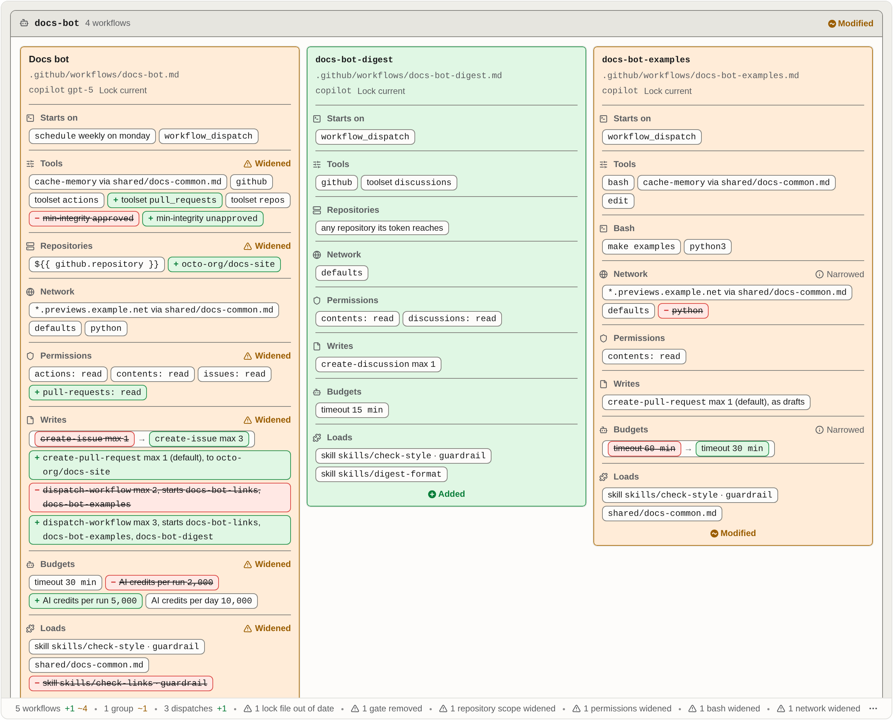

# Agentic workflows

The agentic workflows a repository runs with
[GitHub Agentic Workflows](https://github.com/github/gh-aw) (gh-aw), as what a
reviewer asks of an unattended agent: what starts it, what it can reach (tools,
repositories, bash, network, permissions), what it may write and how much, what
it costs, what it loads, and whether its compiled lock file still matches its
source. Compared across a pull request, it answers "does this change let an
agent reach more, write more or spend more, or drop a guardrail?"

<!-- generated: facts -->

- ID: `github-agentic-workflows`
- Extraction schema:
  [`architecture/v0`](../../reference/schemas/architecture.md)
- Drawn by default with:
  [`agentic-workflows`](../renderers/agentic-workflows.md)
- Needs `--trust`: No (`none`)
- Suggested when the repository has: `.github/workflows/*.md`

<!-- end generated: facts -->

## When to use it

Use it in a repository with gh-aw workflows (`.github/workflows/*.md` beside
their `.lock.yml`), to review a workflow change by what it allows rather than as
a front matter diff, where a new network domain, a second repository in
`allowed-repos` or `bash: true` is one line among many, and where a widened
allowlist can arrive through a shared import without the workflow changing at
all. It reads the checked-in markdown and lock headers, so it runs nothing and
needs no `--trust`: a projection defined on the base branch can examine a fork's
pull request safely.

It describes what the repository declares, not what a run did: which tools the
agent called, what it wrote and what it cost are a run's facts, not the
declaration's.

## What it reads

- **Workflows**: every `.md` under `.github/workflows` (`paths` and `exclude`
  change which) whose front matter has `on`; shared components and `README.md`
  are skipped.
- **Front matter**: triggers and activation (roles, bots, reactions, skip
  conditions), engine and model, tools and their scope (GitHub toolsets,
  `allowed-repos`, `min-integrity`, bash commands, MCP servers), network
  allowlist, permissions, safe outputs with their limits and target
  repositories, secrets referenced, imports and skills, budgets (timeout, turns,
  tool calls, AI credits per run and per day), custom jobs and steps,
  concurrency and strict mode.
- **Imports**, transitively, merged into the workflow as gh-aw merges them, with
  the import each merged item came from: a domain a shared file adds shows as
  added _via_ that file.
- **Lock files**: the hashes gh-aw records in each `.lock.yml`, recomputed from
  the source as gh-aw computes them, so a lock that no longer matches its
  workflow is `stale` (a missing one is `missing`).

`groups` makes units of workflows that work together, by name prefix
(`"prefix"`: `docs-bot` with `docs-bot-links` and `docs-bot-examples`) or by
glob. `classes` names imports and skills by glob, such as `guardrail` for
`skills/check-*`.

### gh-aw's changing front matter

gh-aw's front matter has been changing. The extractor pins the schema of one
gh-aw release (v1.3.0) and records it in every extraction (`metadata.ghAw`). A
field that release doesn't declare is reported as unrecognized rather than
failing or being dropped; fields gh-aw renamed (`timeout_minutes`, `on.command`,
`tools.github.repos`, …) are read under their current names and reported as
deprecated with the `gh aw fix` codemod that moves them; and a lock compiled by
a newer gh-aw is a notice. The
[package README](../../../packages/extractors/github-agentic-workflows/README.md#gh-aws-changing-front-matter)
describes how the pin moves.

## Options

<!-- generated: inputs -->
<!-- prettier-ignore -->
| Input | Meaning |
|---|---|
| `classes` | An object of class name (such as guardrail) to globs of import paths and skill references; the comparator warns when a classified import or skill is removed. |
| `exclude` | Array of globs to skip. |
| `groups` | "prefix" to group each workflow with the workflows named after it and a dash, or an object of group name to globs of workflow paths or names. |
| `paths` | Array of globs selecting workflow markdown; default .github/workflows/*.md. Files without `on` (shared components) and README.md are skipped. |

<!-- end generated: inputs -->

## What a comparison shows

The [`agentic-workflows`](../renderers/agentic-workflows.md) renderer draws a
card per workflow, in its group, with a row per section, and shows a comparison
as one Diff view or Side by side. Each workflow is one item, so a workflow whose
triggers, scope, outputs, budgets, imports or lock state change is modified:

- **Entries** that arrive or leave in a section (a domain, a repository, a
  toolset, a safe output, a skill) are pills with their sign; one that changes
  in place reads old → new (`max 1` → `max 3`).
- **Workflows** added or removed, groups that gain or lose members, and
  `dispatches` between workflows.
- **Warnings** (a stale or missing lock file, an unrecognized or renamed field)
  describe the revision they are found in.

The summary bar counts workflows, groups and dispatches, then the lock files out
of date (`1 lock file out of date`). The **Matrix** view (the renderer's `view`
control) draws workflows against what they load, use, write and reach.

### Interpreting changes: the agentic-workflows comparator

The default comparator says _that_ a workflow changed. The
[`agentic-workflows` comparator file](../../../packages/comparators/agentic-workflows/README.md)
that ships with Projections says in which direction: whether the change widens
what an unattended agent may do (a warning) or narrows it (a note). It isn't
built in: copy
`packages/comparators/agentic-workflows/agentic-workflows.comparator.yaml` into
your repository and name it in the definition:

```json
"comparator": {"file": ".github/projections/agentic-workflows.comparator.yaml", "options": {"gates": ["guardrail"]}}
```

It keeps the default comparator's matching and statuses and adds:

- **Interpretations** of each change, each a warning or a note with what moved:
  `gate-removed` (a classified import or skill, such as a `check-*` guardrail,
  is no longer loaded), `repos-widened`, `permissions-widened`, `bash-widened`,
  `network-widened`, `outputs-widened` (a new safe output, a higher `max`,
  another target repository), `tools-widened` (a tool, MCP server or toolset, a
  lower `min-integrity`), `secrets-added`, `strict-disabled`,
  `triggers-widened`, `budget-raised`, `workflow-added`, `lock-stale` and
  `unrecognized-field`, and their narrowing counterparts as notes.
- **One sentence per change**, from its most severe interpretation: "`docs-bot`
  no longer loads `skills/check-links` (`guardrail`)." or "`repo-ask` can reach
  more of the network: `*.readthedocs.io`, `python`."
- **Order**: steps by their widest change, a dropped gate first.

Rules run sandboxed and need no trust, in the CLI, VS Code and hosted views; a
hosted view runs the comparator file from the pull request's base, so a pull
request can't change how it is judged.

## Start from this definition

<!-- generated: definition -->

```json
{
  "extractor": "github-agentic-workflows",
  "id": "github-agentic-workflows",
  "renderer": "agentic-workflows",
  "title": "Agentic workflows"
}
```

<!-- end generated: definition -->



## Limitations

- gh-aw's compiler isn't run: natural-language triggers (`on: daily`,
  `push to main`) stay as written, and defaults gh-aw fills in are shown only
  for the network (`defaults`), the GitHub toolsets (`default`), roles, the
  engine (`copilot`), the timeout (20 minutes) and AI credits (1,000 per run, no
  daily limit).
- Imports from other repositories are listed but not read; gh-aw fetches them
  when it compiles. Runtime imports (`{{#runtime-import}}`) count for the lock
  check but their contents aren't modeled.
- A workflow's prompt (its markdown body) isn't modeled: only whether it changed
  since the lock was compiled.
- Renaming a workflow file is a removal and an addition unless the definition
  declares a `correspondence`.

## Related

- [`agentic-workflows`](../renderers/agentic-workflows.md), the renderer that
  draws it.
- [`github-actions-jobs`](github-actions-jobs.md), the job graph of an ordinary
  Actions workflow (such as a compiled lock file).
- [One model for agentic workflows](../../models/agentic-workflow-model.md), the
  vocabulary it writes, and the
  [`agentic-workflows` comparator file](../../../packages/comparators/agentic-workflows/README.md)
  that interprets it.
- [The default comparator](../comparators/default.md), which the comparator file
  builds on.

## How it works

The
[package README](../../../packages/extractors/github-agentic-workflows/README.md)
details what it reads, how it handles gh-aw's schema changes and how the lock
check matches gh-aw.

## Build your own

Write your own extractor when gh-aw's declarations aren't what you want to
review:

- **Another agent platform**: a coding agent's repository configuration, another
  workflow compiler's sources. Write the same
  [agentic workflow model](../../models/agentic-workflow-model.md).
- **What runs did**: the tools an agent called, the outputs it wrote and the
  credits it spent, from the Actions API or gh-aw's logs.

Try the lighter options first: `paths` and `exclude` choose the workflows,
`groups` the units and `classes` the imports and skills that matter. To change
what counts as widening or how a change is worded, edit your copy of the
comparator file rather than the extractor.

**In VS Code**, choose **+ New Projection…** in the Projections view, then
**Write a custom extractor, renderer or comparator** › **Custom extractor** (or
**Custom extractor and renderer**), and pick its language. Or choose **Ask an
agent to write it** and describe what the projection should show.

**With the CLI**:

```sh
projections init <id> --language node --renderer agentic-workflows
```

An extractor is any program that prints an extraction; here an `architecture/v0`
extraction that declares the
[`agentic-workflows/v0` vocabulary](../../reference/schemas/vocabularies-agentic-workflows.md).
Run it with `projections show -p <id> --trust` as you change it.
[Write your first extractor](../../guides/first-extractor.md) walks through one,
and [Extraction schema](../../guides/schemas.md#extraction-schema) describes
what it prints.
