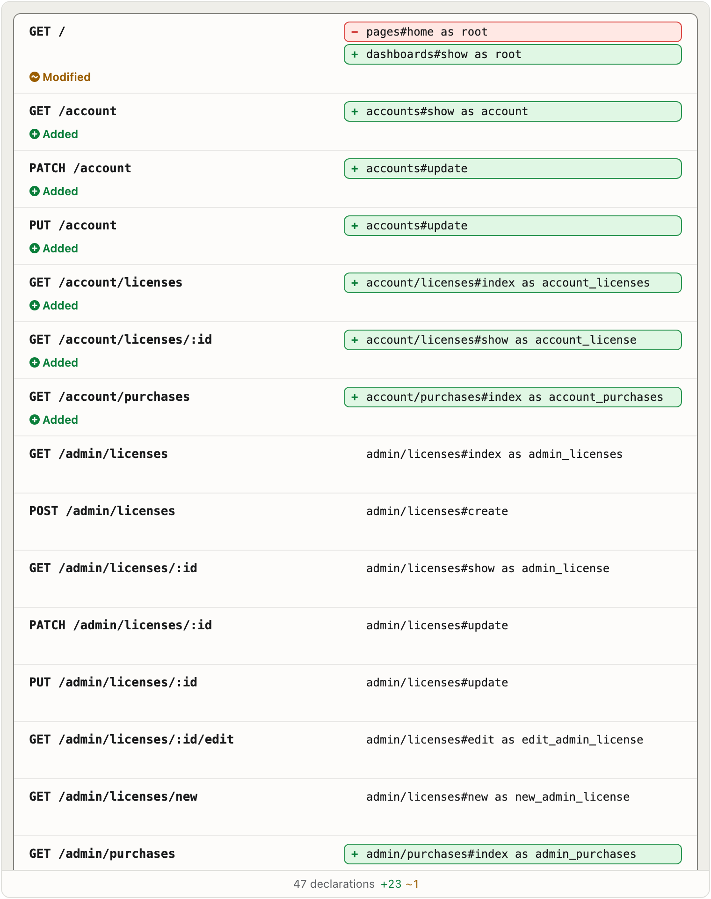

# Rails routes

This extractor reads a Rails application's `config/routes.rb` directly and lists
every declared route—its HTTP verb, path, target controller action, and route
name—just like `bin/rails routes` would. When you compare two revisions in a
pull request, it answers a simple question: which URLs does this change add,
remove, or send somewhere else?

<!-- generated: facts -->

- ID: `rails-routes`
- Extraction schema: [`api/v0`](../../reference/schemas/api.md)
- Drawn by default with: [`api`](../renderers/api.md)
- Needs `--trust`: No (`none`)
- Suggested when the repository has: `config/routes.rb`, `**/config/routes.rb`

<!-- end generated: facts -->

## When to use it

Use this extractor in any Rails application when you want to review routing
changes as the actual routes they produce rather than deciphering DSL diffs. A
`resources` block gaining `:destroy`, a new member route, a moved namespace, or
a route pointed at a different controller all show up as concrete endpoints.

Because Projections evaluates the routing DSL directly the way Rails' router
does, it needs no Ruby runtime, no gems, no app boot, and no `--trust`. It runs
quickly on any revision in your Git history—even old commits whose gems you no
longer have installed, where `bin/rails routes` would fail.

Keep in mind that it only sees what the routes file declares, not routes added
at runtime (see [what it can't see](#what-it-cant-see)). Pair it with
[`rails-schema`](rails-schema.md) to review database schema changes alongside
your routes.

## What it reads

By default, the extractor finds every application's `config/routes.rb` in the
repository, skipping engine dummy apps under `test/` or `spec/`. You can point
it at a specific file or list of files with `routes`. Each route's ID includes
its application directory, so a host app and its engines can live side by side.

It evaluates the routing DSL the same way Rails'
`ActionDispatch::Routing::Mapper` does:

- HTTP verb helpers (`get`, `post`, `put`, `patch`, `delete`, `options`) and
  `match` (`via:`), along with `to:` (`"controller#action"`, `redirect(...)`, or
  a Rack app), `as:`, `on:`, `controller:`, `action:`, `path:`, `format:`,
  `constraints:`, and `defaults:`.
- `root`, `resources`, and `resource` with `only:`, `except:`, `path:`, `as:`,
  `controller:`, `param:`, `module:`, `shallow:`, and `concerns:`, plus nested
  resources, `member`, `collection`, `new`, and `shallow`.
- Scoping blocks for `namespace`, `scope`, `controller`, `defaults`, and
  `constraints`.
- `concern` and `concerns`, `mount`, and `draw` (which loads
  `config/routes/<name>.rb`).

It also checks `config/application.rb` for `config.api_only = true` (which drops
`new` and `edit` routes on resources) and reads
`config/initializers/inflections.rb` (or the `inflections` input) so resource
names match Rails—for example, `resources :inventory` with `inventory` marked
uncountable produces `inventory_index`.

Each route becomes a `route` entity labeled with its verbs and path
(`GET /photos/:id`). Its signature shows the controller action or endpoint
followed by its name, constraints, defaults, and conditions—such as
`photos#show as photo`, `redirect("/products", status: 301) as legacy_catalog`,
or `api/v1/orders#index as api_v1_orders defaults format: :json`. Each `mount`
becomes a `mount` entity at its path (`mount Sidekiq::Web as sidekiq_web`).

The generated names, paths, controllers, and actions match Rails' own router;
our test suite checks them in order against the route tables ActionPack builds
from the same files.

### What it can't see

Some routes only exist once the application boots. Rather than guessing, the
extractor lists them as `unresolved` entities with their source location and a
reason:

- **Gem-provided helpers**, such as `devise_for :users`, an `authenticate`
  block, or any method outside Rails' built-in routing DSL. The call itself is
  recorded, but its routes and block contents aren't expanded.
- **Dynamically computed routes**, including interpolated paths, variables,
  loops (`%w[about terms].each`), and other arbitrary Ruby.
- **Routes inside mounted engines**. A mount appears as a single entity at its
  path. To inspect an engine's routes (relative to its mount point), read the
  engine's own `config/routes.rb` as a separate application.
- **Invalid declarations** that Rails itself would reject while drawing, like a
  route missing a controller or `match` without `via:`.

Conditions (`if Rails.env.development?`) and constraint objects or lambdas
aren't evaluated either. Their routes are still listed, with the condition or
constraint preserved in the signature—so a development-only route displays
`if Rails.env.development?`.

## Options

<!-- generated: inputs -->

| Input         | Meaning                                                                                      |
| ------------- | -------------------------------------------------------------------------------------------- |
| `inflections` | Inflections initializer; default config/initializers/inflections.rb beside config/routes.rb. |
| `routes`      | Routes file or files; otherwise discovers each application's config/routes.rb.               |

<!-- end generated: inputs -->

## What a comparison shows

The [`api`](../renderers/api.md) renderer sorts routes by path so all routes for
a resource stay grouped together.

- **Added or removed routes**, such as a new resource's seven routes, a new
  member route, or a route moved to a new path. Because a route's identity is
  its verb and path, changing either one shows up as a removal and an addition.
- **Modified routes**, where the same verb and path now point to a different
  controller or action, have a new name (`as:`), or gain a constraint or
  condition. Changed portions of the signature are struck through and underlined
  in place.
- **Added or removed unresolved declarations**, so a new `devise_for` call is
  still visible even though its routes aren't expanded.

The summary bar shows the total count and changes (`47 declarations +23 ~1`).

## Start from this definition

<!-- generated: definition -->

```json
{
  "extractor": "rails-routes",
  "id": "rails-routes",
  "renderer": "api",
  "title": "Rails routes"
}
```

<!-- end generated: definition -->

## Screenshot

Here is a license server gaining user accounts: the home page becomes the
account dashboard, while an account area, sessions, registration, recovery,
purchase webhooks, and a claim action for the licenses API are added
([`docs/images/sources/account-recovery`](../../images/sources/account-recovery/README.md)).



## Limitations

- Routes are ordered by path rather than Rails' matching order, so a change that
  only reorders two overlapping routes won't show up as a diff.
- Requirements, constraints, and defaults are captured verbatim rather than
  evaluated. Changing a constraint marks the route as modified, but doesn't
  analyze what the new constraint matches.
- Generated route names follow ActiveSupport's default inflections plus literal
  `irregular`, `uncountable`, `plural`, and `singular` rules from your
  initializer; inflections defined dynamically are reported and skipped.
- `config.api_only` is only picked up when `config/application.rb` assigns it as
  a literal value.
- The `api` renderer displays up to 500 routes (putting changed routes first in
  a comparison); the host's table view shows all of them.

## Related

- [`api`](../renderers/api.md) — the renderer that displays the route table.
- [`rails-schema`](rails-schema.md) — your application's database schema.
- [The default comparator](../comparators/default.md) — determines what changed
  between revisions.

## How it works

See the [package README](../../../packages/extractors/rails-routes/README.md)
for details on how the DSL is evaluated, what syntax is covered, and how the
extraction model is structured.

## Build your own

Consider writing a custom extractor if the static routes file doesn't capture
what you need:

- **The live route table**, including routes from gems and mounted engines—for
  example, running `bin/rails runner` with `--trust` to dump
  `Rails.application.routes.routes` as JSON. Keep in mind that comparing history
  then requires an environment that installs each revision's gems.
- **Route callers**, matching front-end or client requests to routes as an
  architecture graph.
- **Authorization coverage**, pairing each route with the policies or
  `before_action` callbacks its controller action runs.

**In VS Code**, open the Projections view, select **+ New Projection…**, choose
**Write a custom extractor, renderer or comparator** › **Custom extractor**, and
pick a language. You can also choose **Ask an agent to write it** and describe
what you want to see.

**With the CLI**:

```sh
projections init <id> --language node --renderer api
```

An extractor can be any program that prints an extraction. Test your changes as
you go with `projections show -p <id> --trust`.
[Write your first extractor](../../guides/first-extractor.md) walks through a
complete example, and the [`api/v0` schema](../../reference/schemas/api.md)
documents the fields the `api` renderer expects.
