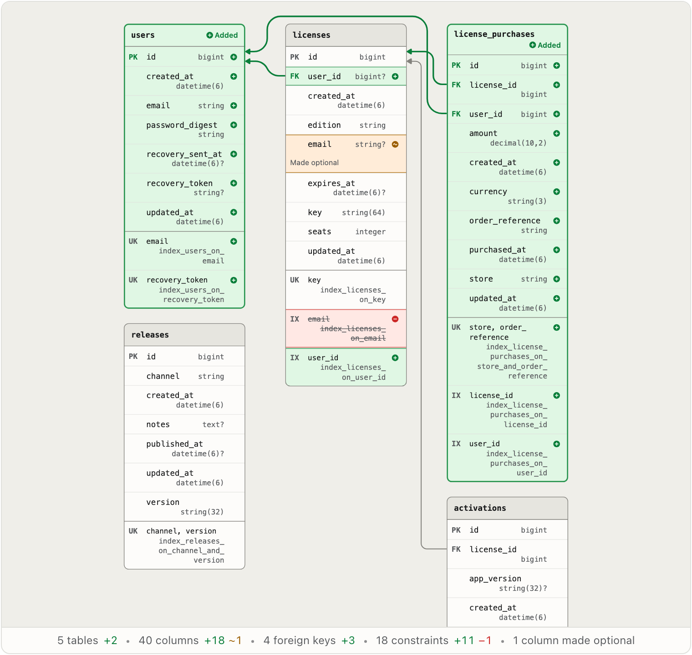

# Rails schema

This extractor reads a Rails application's `db/schema.rb` directly and maps out
its tables, columns, types, keys, indexes, check constraints, foreign keys, and
PostgreSQL enums. Compared across a pull request, it shows what a migration
actually does to your schema: which tables, columns, indexes, and foreign keys
are added or removed, and which types, defaults, or nullability rules changed.

<!-- generated: facts -->

- ID: `rails-schema`
- Extraction schema: [`database/v0`](../../reference/schemas/database.md)
- Drawn by default with: [`database`](../renderers/database.md)
- Needs `--trust`: No (`none`)
- Suggested when the repository has: `db/schema.rb`, `**/db/schema.rb`,
  `db/*_schema.rb`, `**/db/*_schema.rb`

<!-- end generated: facts -->

## When to use it

Use this extractor in any Rails app that keeps `db/schema.rb` (Active Record's
default `schema_format`) so you can review migrations as an entity-relationship
diagram instead of piecing together migration files and a noisy schema dump.

Because Projections parses the file directly, it needs no Ruby, no Bundler or
gems, no database connection, and no `--trust`. It runs quickly, works safely on
pull requests from forks, and handles any commit in your history—even older ones
whose gems you no longer have installed.

Keep in mind that it reflects the committed schema file, not a live database: it
won't connect, run migrations, or detect drift. For other frameworks, see
[`prisma-schema`](prisma-schema.md), [`django-schema`](django-schema.md), or
[`efcore-schema`](efcore-schema.md). You can also pair it with
[`rails-routes`](rails-routes.md) to review schema and routing changes side by
side.

## What it reads

By default, the extractor finds your application's `db/schema.rb` along with any
multi-database schema files beside it (`db/<database>_schema.rb`, such as
`db/queue_schema.rb`), ignoring engine dummy apps under `test/` or `spec/`. You
can override discovery with `schema` for a single file or `schemas` for a list
(when both are set, `schemas` wins). If a repository contains more than one
Rails application, it asks you to pick one with `schema`.

From those files, it extracts:

- `create_table` blocks, including every column (`t.string`, `t.jsonb`,
  `t.virtual`, `t.enum`, `t.references`, `t.timestamps`, `t.column`, and any
  adapter-specific type) with `null:`, `default:`, `limit:`, `precision:`,
  `scale:`, `array:`, and other options; implicit or explicit primary keys
  (`id:`, `primary_key:`, and composite keys); plus `t.index`,
  `t.check_constraint`, `t.unique_constraint`, and `t.exclusion_constraint`.
- Top-level `add_foreign_key`, `add_index`, `add_check_constraint`,
  `create_enum`, `enable_extension`, and Scenic's `create_view`.
- `config/initializers/inflections.rb` beside `db/` (or the `inflections`
  input), applying `irregular`, `uncountable`, `plural`, and `singular` rules so
  default foreign key columns match Rails (for instance,
  `add_foreign_key "pots", "cacti"` resolves to `cactus_id`).

Each table becomes a `table` entity and each column a `column` entity whose
`data.type` keeps the Rails type and size as written—such as `string(100)`,
`decimal(10,2)`, `datetime(6)`, `string[]` for arrays, or the enum name for
PostgreSQL enums. Keys, indexes, and foreign keys become `constraint` entities,
with foreign keys recording their target table, columns, `on_delete`, and
`on_update` behavior.

Statements outside Active Record's schema DSL (such as `execute`, a plugin's
`create_function`, or conditionals) aren't interpreted; instead they are
recorded in `metadata.skipped` and surfaced as diagnostics. If a file lacks an
`ActiveRecord::Schema.define` block or contains unbalanced Ruby, extraction
fails with the file and line number.

If you prefer, `snapshot` reads a previously exported `database/v0` extraction
from each revision instead of parsing schema files (so every revision you
compare needs its own snapshot).

## Options

<!-- generated: inputs -->

| Input         | Meaning                                                                                                    |
| ------------- | ---------------------------------------------------------------------------------------------------------- |
| `inflections` | Inflections initializer; default config/initializers/inflections.rb beside db/.                            |
| `schema`      | Schema file (db/schema.rb or db/<database>_schema.rb); otherwise discovers the application's schema files. |
| `schemas`     | Multiple schema files.                                                                                     |
| `snapshot`    | Pre-exported effective schema.                                                                             |

<!-- end generated: inputs -->

## What a comparison shows

The [`database`](../renderers/database.md) renderer draws each table as a card
showing its columns, keys, and indexes, each PostgreSQL enum as a card of its
values, and each foreign key as a link from the dependent table to the
referenced one.

- **Tables, enums, and views** that were added, removed, or modified, along with
  **columns** added or removed inside them.
- **Column changes**, including type or size updates (such as `string(100)` to
  `string(200)` or `integer` to `bigint`) and nullability changes (`null: false`
  added or removed, shown as made required or made optional).
- **Keys, indexes, and foreign keys** that were added, removed, or modified—like
  an index made unique, a partial index's `where:` clause, or a foreign key's
  `on_delete:` action.

The summary bar counts tables, columns, constraints, foreign keys, and enums
with their deltas (`5 tables +2 · 40 columns +18 ~1`), followed by column type
and nullability changes.

Noise from routine metadata is filtered out. The `define(version: ...)` version
stamp is treated as metadata, so a migration that makes no structural change
shows an empty diff. Upgrading Rails is quiet too: Rails 7 timestamps without
`precision:` and Rails 6 timestamps with `precision: 6` both normalize to
`datetime(6)`. Because renaming a table or column (`rename_column`) changes its
ID, it appears as a removal and an addition unless you map the old ID in the
definition's `correspondence`.

## Start from this definition

<!-- generated: definition -->

```json
{
  "extractor": "rails-schema",
  "id": "rails-schema",
  "renderer": "database",
  "title": "Rails schema"
}
```

<!-- end generated: definition -->

## Screenshot

Here is a migration that adds user accounts to a license server: `users` and
`license_purchases` are created, while `licenses` gains a `user_id` foreign key
and makes `email` optional
([`docs/images/sources/account-recovery`](../../images/sources/account-recovery/README.md)).



## Limitations

- `db/structure.sql` (`config.active_record.schema_format = :sql`) isn't
  supported directly. Export a `database/v0` snapshot from it or write a custom
  extractor instead.
- Column types reflect Rails types and sizes rather than database-specific SQL
  types (for example, `string` stays `string` rather than `character varying` on
  PostgreSQL or `varchar(255)` on MySQL).
- Statements outside Active Record's schema DSL are reported as skipped rather
  than rendered, so plugin-dumped functions, triggers, and policies don't appear
  on the diagram.
- `enable_extension` calls are stored in metadata rather than drawn, so enabling
  an extension won't show up as a visual diff.
- Inflections are only applied when declared literally in the initializer.
  Computed rules or regular expressions that Rust's regex engine can't compile
  are reported and skipped.
- Large schemas open at a readable zoom level and scroll rather than shrinking
  to fit the viewport.

## Related

- [`database`](../renderers/database.md) — the renderer that draws the diagram.
- [`rails-routes`](rails-routes.md) — your application's routes.
- [`prisma-schema`](prisma-schema.md), [`django-schema`](django-schema.md), and
  [`efcore-schema`](efcore-schema.md) — the same schema model for other
  frameworks.
- [The default comparator](../comparators/default.md) — determines what changed
  between revisions.

## How it works

See the [package README](../../../packages/extractors/rails-schema/README.md)
for details on what the parser covers and how the extraction model is shaped.

## Build your own

Consider writing a custom extractor if `db/schema.rb` isn't the view you need:

- **`db/structure.sql` or a live database**, to see what's actually deployed or
  spot schema drift.
- **Active Record models instead of tables**, capturing associations,
  validations, and callbacks by booting the app with `bin/rails runner` and
  `--trust`.
- **Metadata outside the schema**, such as which team owns each table or which
  columns store personal data.

Before building one, check whether the built-in options already cover you:
`schema` or `schemas` can narrow to a specific app or database, `snapshot` can
read a schema exported by your own tooling, and a custom comparator file can
flag destructive changes like dropped columns or new required columns without a
default.

**In VS Code**, open the Projections view, select **+ New Projection…**, choose
**Write a custom extractor, renderer or comparator** › **Custom extractor**, and
pick a language. You can also choose **Ask an agent to write it** and describe
what you want to see.

**With the CLI**, keep the `database` renderer:

```sh
projections init <id> --language node --renderer database
```

An extractor can be any program that prints an extraction. Test it as you go
with `projections show -p <id> --trust`.
[Write your first extractor](../../guides/first-extractor.md) walks through a
complete example, and the
[`database/v0` schema](../../reference/schemas/database.md) documents the fields
the `database` renderer expects.
