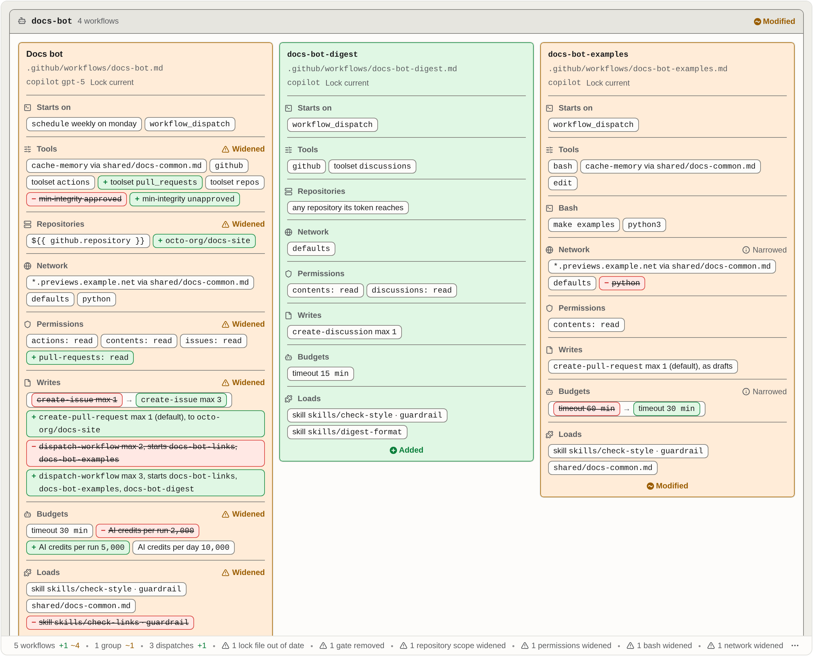

# Agentic workflows

Agentic workflows as a reviewer reads them: one card per workflow, in its group,
with what starts it, its tools and their scope, the repositories and network it
reaches, its permissions, what it writes and its limits, its budgets, what it
loads and the secrets it references, its engine and whether its lock file is
current. Compared across a pull request, it answers "what can this agent now do
that it couldn't before?"

<!-- generated: facts -->

- Name: `agentic-workflows`
- Draws: [`architecture/v0`](../../reference/schemas/architecture.md) with the
  `agentic-workflows/v0` vocabulary
- Comparison modes: Diff, Side by side; a comparison opens in Diff
- Package: `@githubnext/projections-renderer-agentic-workflows`

<!-- end generated: facts -->

## When to use it

Use it to review changes to GitHub Agentic Workflows, or any extraction written
in the [agentic workflow model](../../models/agentic-workflow-model.md): a new
domain in the network allowlist, another repository the GitHub tool may reach,
`bash: true`, a higher AI credit budget, a guardrail no longer loaded. It draws
only that model; for other `architecture/v0` extractions use
[`graph`](graph.md).

Built-in extractors that draw with it by default:

<!-- generated: extractors -->

| Built-in extractor                                                      | Its default `renderer` |
| ----------------------------------------------------------------------- | ---------------------- |
| [`github-agentic-workflows`](../extractors/github-agentic-workflows.md) | `agentic-workflows`    |

<!-- end generated: extractors -->

## What it draws

A panel per group of workflows (the extractor's `groups`), then the workflows no
group holds, each a card:

- **Its name** (or file name) and its path, its engine and model, its lock
  file's state (`Lock current`, or `Lock stale` and `Lock missing` with a
  warning icon) and whether strict mode is off.
- **A row per section**: **Starts on** (triggers, and roles when declared),
  **Tools** (tools, GitHub toolsets, MCP servers and guards such as
  `min-integrity`), **Repositories** (the GitHub tool's `allowed-repos`, or any
  repository its token reaches), **Bash**, **Network**, **Permissions**,
  **Writes** (safe outputs with their `max`, target repository and other limits,
  custom jobs), **Budgets** (timeout, turns, tool calls, AI credits per run and
  per day, when declared; in a comparison, also the default a declared budget
  moves from or to, marked `(default)`), **Loads** (skills and imports, with
  their classes, such as `guardrail`) and **Secrets**. **Permissions** says
  `none` for `permissions: {}`, which grants nothing, and is left out when the
  workflow inherits GitHub's defaults. **Starts on**, **Network** and **Writes**
  always show; the others when they have entries. An item an import added says
  so (`*.sentry.io via shared/otlp.md`), and a default gh-aw applies says so
  (`max 1 (default)`).
- **Warnings** close the card: a stale or missing lock file, fields the pinned
  gh-aw schema doesn't know, renamed fields with the `gh aw fix` codemod that
  moves them.

The **Matrix** view (below) draws the same workflows as one table: a row per
workflow under its group and a column per capability any workflow has (what it
loads, gates first, its tools, what it writes and the network it reaches).

## Options

| Control | `presentation.rendererOptions` | Values                        |
| ------- | ------------------------------ | ----------------------------- |
| View    | `view`                         | `cards` (default) or `matrix` |

## What a comparison shows

Diff (the default) and Side by side. In the diff:

- **Entries** that arrive or leave are pills with their sign, `+` or `−`, in the
  change's hue; one that changes in place reads old → new (`timeout 60 min` →
  `timeout 30 min`), or, when that's too long for a line, as the old pill
  leaving and the new one arriving. So does a card's engine, strict mode or lock
  state.
- **Cards and groups** carry their change, filled and edged, and state it in
  words (`Modified`, `Added`). In the matrix a capability that arrives or leaves
  is its sign in its hue, and each row states its change.
- **Directions**, with the
  [`agentic-workflows` comparator](../../../packages/comparators/agentic-workflows/README.md):
  a section whose change widens the agent's scope says **Widened**, with a
  warning icon, at the end of its title; one that narrows it says **Narrowed**.

Side by side, each pane draws its own revision and tints the entries that differ
from the other while the host highlights the change: one that arrives, leaves or
changes in place, in the pane's hue.

The summary bar counts workflows, groups and dispatches, then the lock files out
of date, and with the comparator its widenings, most severe first, each a
filter: `1 gate removed`, `1 repository scope widened`, `2 outputs widened`.

## Start from this definition

<!-- generated: definition -->

```json
{
  "extractor": "github-agentic-workflows",
  "id": "github-agentic-workflows",
  "renderer": "agentic-workflows",
  "title": "Agentic workflows"
}
```

<!-- end generated: definition -->

## Screenshot



## Limitations

- It draws what the extraction declares; gh-aw's compiled workflow (the lock
  file's jobs and steps) isn't drawn.
- A section whose entries are long wraps within its card; the matrix scrolls
  sideways when there are more capabilities than fit.
- Without the comparator, every entry that arrives or leaves is marked, but
  nothing says whether the change widens or narrows the agent's scope.

## Related

- [`github-agentic-workflows`](../extractors/github-agentic-workflows.md), the
  extractor that targets it.
- [The agentic workflow model](../../models/agentic-workflow-model.md) and the
  [`agentic-workflows` comparator](../../../packages/comparators/agentic-workflows/README.md).
- [`runtime-policy`](runtime-policy.md), another document-style renderer for a
  security model.

## How it works

The [package README](../../../packages/renderers/agentic-workflows/README.md)
describes the view and how it's tested.

## Build your own

Write your own renderer when cards per workflow aren't the picture you need: a
graph of which workflows dispatch which, a timeline of when each runs, or a
picture of a single workflow's compiled jobs. Start from the
[minimal template](../../../examples/renderers/minimal/README.md) or
[develop a renderer](../../guides/develop-a-renderer.md) with the
[renderer kit](../../guides/renderer-kit.md), and declare that it accepts
`architecture/v0` with the `agentic-workflows/v0` vocabulary.
