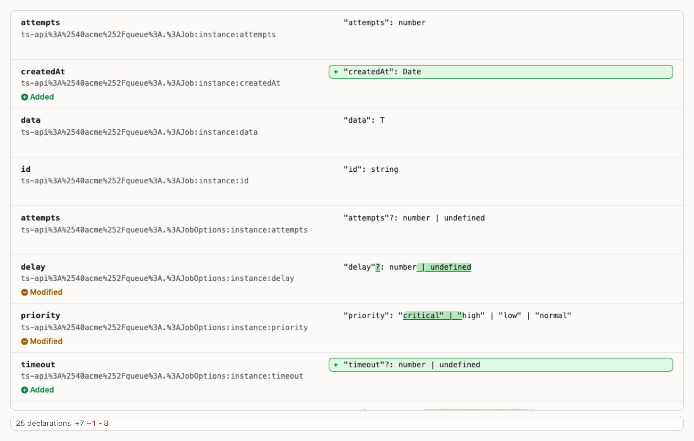

# API

The exported declarations of a library, one row each: its name beside its
signature. Compared across a pull request, it answers "which declarations did
this change add, remove or alter, and how did each signature change?", and with
the `api-compatibility` comparator file, "which of those changes break
consumers?"

<!-- generated: facts -->

- Name: `api`
- Draws: [`api/v0`](../../reference/schemas/api.md)
- Comparison modes: Diff, Side by side; a comparison opens in Diff
- Package: `@githubnext/projections-renderer-api`

<!-- end generated: facts -->

## When to use it

Use it to review a library's public surface: a removed export, a parameter
gained, a return type widened. It lists declarations rather than drawing them,
so it stays readable for hundreds of changes. It draws what the extractor
reports for TypeScript, Rust, Go and .NET alike, and lists a Rails application's
routes ([`rails-routes`](../extractors/rails-routes.md)); pair it with the
[`api-compatibility`](../../../packages/comparators/api-compatibility/README.md)
comparator file to classify each change by that ecosystem's own compatibility
rules.

It doesn't show how declarations relate (inheritance, which module uses which);
draw that with [`graph`](graph.md).

Built-in extractors that draw with it by default:

<!-- generated: extractors -->

| Built-in extractor                                                | Its default `renderer` |
| ----------------------------------------------------------------- | ---------------------- |
| [`typescript-public-api`](../extractors/typescript-public-api.md) | `api`                  |
| [`rust-public-api`](../extractors/rust-public-api.md)             | `api`                  |
| [`go-public-api`](../extractors/go-public-api.md)                 | `api`                  |
| [`swift-public-api`](../extractors/swift-public-api.md)           | `api`                  |
| [`dotnet-public-api`](../extractors/dotnet-public-api.md)         | `api`                  |
| [`rails-routes`](../extractors/rails-routes.md)                   | `api`                  |

<!-- end generated: extractors -->

## What it draws

One row per declaration, in ID order: its label in bold, its qualified name
under it when it is nested (`Response.headers`: the labels of the declarations
that contain it, then its own; the readable ID instead when two declarations
would share a name), and its signature (`data.signature`) beside them, stacked
under them in a narrow frame. An entity without a signature shows its kind
instead. Labels, names and signatures are code, in the monospace font; a long
label ends in an ellipsis only when its column can't fit it, with the whole
label as its tooltip. Relationships (containment) aren't drawn. At most 500
declarations are listed, with a notice; when a Diff has more, its changed
declarations are listed first, so the limit leaves out unchanged ones.

## Options

When the comparison was made by the `api-compatibility` comparator file, the
host draws one control; set its starting value in the definition's
`presentation.rendererOptions`:

| Control       | ID             | Values                                       | Default |
| ------------- | -------------- | -------------------------------------------- | ------- |
| Breaking only | `breakingOnly` | `true` (list only breaking changes), `false` | `false` |

It has no zoom. It presents a comparison as Side by side or Diff; it has no
Animated or Swipe mode, since a scrubbed frame between two listings would only
pop rows in and out. `presentation.mode` picks the one a comparison opens in.

## What a comparison shows

- **Diff**: one list of every declaration of both revisions, each once. A
  changed row's footer states its change (`+ Added`, `− Removed`, `~ Modified`,
  `→ Renamed`), and its signature shows the difference: an added or removed
  declaration is one `+` or `−` line; a signature that mostly survives is one
  line with its removed runs struck through and its added runs underlined in
  place; a rewritten one is a removed line above an added line. A relabelled
  declaration shows its old label struck through before the new one, and a
  changed qualified name shows `old → new`.
- **Side by side**: each pane lists one revision's declarations, in its own
  order. While the host highlights changes, each pane marks its side: the
  status, and a `−` (Before) or `+` (After) line for a changed signature with
  the runs the other revision lacks marked.

Every row reserves its footer, so status appearing never moves anything, and
removed and added runs are struck through and underlined, never color alone.
With highlighting off, the markers and runs stay without change colors or status
words.

The **summary bar** counts every declaration, whatever its kind, as one figure
(`36 declarations +10 −1 ~6`).

**With the `api-compatibility` comparator file**, each change also has a level,
and:

- The summary bar counts each level, breaking first, each with its icon and
  filtering to its changes:
  `2 breaking changes · 1 change of unknown compatibility · 5 additive changes · 1 compatible change`.
  Each fact's tooltip names the rules that classified it
  (`Rules: ApiCompat (default mode), reproduced`).
- Each changed row's footer states its level after its change
  (`~ Modified ! Breaking`, `+ Added ⊕ Additive`, `= Compatible`, `? Unknown`),
  with the reason as its tooltip; in Diff the reason is also a line under the
  signature (`Binary and source: Return type changed from …`). The
  classification's notices stay above the list.
- In Diff, breaking changes are listed first; side by side keeps each revision's
  own order.
- Parameter changes read as they affect callers. In TypeScript and Rust a
  renamed parameter is compatible ("Parameter `a` was renamed to `b`; arguments
  are passed by position"), and in TypeScript a required parameter made optional
  is additive ("Parameter `timeout` is now optional; calls may omit it"). In
  .NET, where callers can name arguments, a renamed parameter is breaking
  (`CP0017`).

Selecting a declaration selects it in every pane and in the host's table, whose
details show the comparator's summary.

## Start from this definition

<!-- generated: definition -->

```json
{
  "extractor": "typescript-public-api",
  "id": "typescript-public-api",
  "renderer": "api",
  "title": "TypeScript public API"
}
```

<!-- end generated: definition -->

## Screenshot

A TypeScript job queue's API in Diff, with the default comparator: added
declarations as one `+` line, modified ones with their added runs underlined in
place.



## Limitations

- It shows declarations and their signatures, not documentation, attributes or
  how declarations relate.
- Without the `api-compatibility` comparator file (or another that writes
  `metadata.compatibility`), every change is just added, removed or modified: it
  can't tell a breaking change from a harmless one.
- It lists at most 500 declarations (in Diff, changes first); **Breaking only**
  narrows a classified comparison, and the host's table lists everything.
- Very long signatures are compared as wholes (one removed line and one added
  line) rather than run by run.

## Related

- The extractors it draws by default:
  [`typescript-public-api`](../extractors/typescript-public-api.md),
  [`rust-public-api`](../extractors/rust-public-api.md),
  [`go-public-api`](../extractors/go-public-api.md),
  [`swift-public-api`](../extractors/swift-public-api.md) and
  [`dotnet-public-api`](../extractors/dotnet-public-api.md).
- The
  [`api-compatibility`](../../../packages/comparators/api-compatibility/README.md)
  comparator file and
  [the API compatibility model](../../models/api-compatibility.md) behind its
  rules.
- [The default comparator](../comparators/default.md), which it uses when the
  definition names no comparator file.
- The [`api/v0` schema](../../reference/schemas/api.md).

## How it works

The [package README](../../../packages/renderers/api/README.md) covers how
signatures are compared and how the compatibility classification is drawn.

## Build your own

The API renderer is a list, built for reading signatures. Write your own
renderer when the API should be seen another way:

- **Its shape**: modules, namespaces or types as a tree or a map, with members
  nested under their types rather than listed by ID.
- **Your own grouping or emphasis**: by owning team, by stability (stable,
  preview, deprecated), by how many callers each declaration has, or with your
  own badges for the facts your extractor adds.
- **A domain notation**: an HTTP API as routes and methods, a CLI as commands
  and flags, a schema language's own syntax.

Try the lighter options first. To say which changes matter, use the
`api-compatibility` comparator file, or write your own comparator file whose
`metadata.compatibility` this renderer already draws (levels, reasons, the
summary bar's counts and **Breaking only**); `presentation.mode` sets whether a
comparison opens side by side or as a diff. To see the API's structure instead
of its signatures, try [`graph`](graph.md) with an extractor that writes
`graph/v0`.

**In VS Code**, choose **+ New Projection…** in the Projections view, then
**Write a custom extractor, renderer or comparator** › **Custom renderer**, and
pick the built-in extractor it draws (one of the public API extractors). It
writes the definition (`.github/projections/<id>.json`) and a TypeScript, Vite
and React renderer package built on the renderer kit
(`.github/projections/<id>/renderer`), and opens the definition and the
projection's tab. Or choose **Ask an agent to write it** and describe what the
projection should show.

**With the CLI**:

```sh
projections init <id> --extractor typescript-public-api --renderer custom
```

Then, in the renderer package, run `npm install`, then `npm run dev` for a
development server with hot updates, `npm run workbench` to open its scenarios
in the fixtures workbench in a browser, and `npm test` to run the renderer
checks on every scenario. In VS Code an open projection tab uses your
uncommitted definition edits ("Your edits"), and saving the renderer's sources
rebuilds it (in a trusted workspace, while its tab is open, with its `watch` or
`build` script) and reloads the view; the Testing view runs each projection's
checks (`projections check -p <id>`, renderer checks included).
[Develop a renderer](../../guides/develop-a-renderer.md) walks through it; the
[renderer kit guide](../../guides/renderer-kit.md) and the
[renderer kit API](../../reference/renderer-kit.md) cover the pieces, such as
the kit's `ValueChange` for showing a value before and after.
