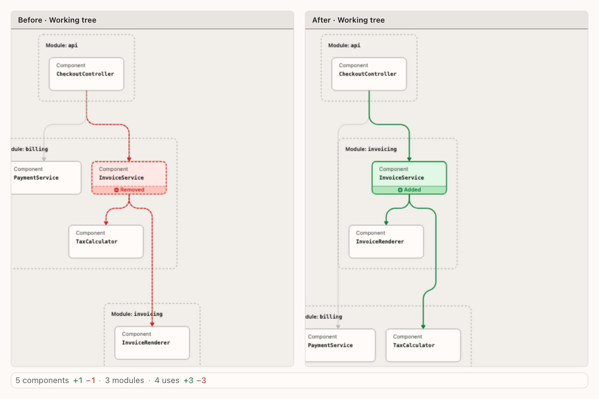

# Graph

This renderer draws entities as cards and relationships as arrows arranged in
layers, highlighting every change right where it happens. A single renderer
powers six domain presentations—`graph`, `graph-horizontal`, `dag`,
`architecture`, `infrastructure`, and `dependencies`—chosen via the `renderer`
field in your projection definition. Across a pull request, it shows what was
added, removed, or rewired, and what connects to it.

<!-- generated: facts -->

- Name: `graph`; also answers to `graph-horizontal`, `dag`, `architecture`,
  `infrastructure`, `dependencies`
- Draws: [`graph/v0`](../../reference/schemas/graph.md),
  [`dag/v0`](../../reference/schemas/dag.md),
  [`architecture/v0`](../../reference/schemas/architecture.md)
- Comparison modes: Diff, Side by side, Animated, Swipe; a comparison opens in
  Diff
- Package: `@githubnext/projections-renderer-graph`

<!-- end generated: facts -->

## When to use it

Use this renderer whenever the story lives in the connections—services and the
calls between them, pipeline jobs and what they wait on, cloud resources and
their references, or packages and what pulls them in. All six presentations
accept the same extractions and tailor the wording and layout to their domain,
so pick the one that best fits what you're reviewing.

It works best for graphs up to a few hundred entities. For weighted containment
hierarchies like file trees, use [`file-packing`](file-packing.md); for DI
container registrations, use [`dependency-injection`](dependency-injection.md);
and for database schemas, use [`database`](database.md).

Built-in extractors that use it by default:

<!-- generated: extractors -->

| Built-in extractor                                                          | Its default `renderer` |
| --------------------------------------------------------------------------- | ---------------------- |
| [`workspace-dependencies`](../extractors/workspace-dependencies.md)         | `dependencies`         |
| [`cargo-dependencies`](../extractors/cargo-dependencies.md)                 | `dependencies`         |
| [`swift-package-dependencies`](../extractors/swift-package-dependencies.md) | `dependencies`         |
| [`xcode-modules`](../extractors/xcode-modules.md)                           | `dependencies`         |
| [`nuget-dependencies`](../extractors/nuget-dependencies.md)                 | `dependencies`         |
| [`terraform-infrastructure`](../extractors/terraform-infrastructure.md)     | `infrastructure`       |
| [`azure-what-if`](../extractors/azure-what-if.md)                           | `infrastructure`       |
| [`github-actions-jobs`](../extractors/github-actions-jobs.md)               | `dag`                  |
| [`scip-file-references`](../extractors/scip-file-references.md)             | `graph`                |

<!-- end generated: extractors -->

## What it draws

Each entity renders as a card with its kind in a small header line (`component`
reads as Component) and its label in monospace underneath. Each relationship
renders as a directed arrow from source to target. Cards are arranged in layers
(top to bottom or left to right) so most arrows flow in one direction, and every
card shares a uniform width sized to its longest text. Text that still overflows
truncates with an ellipsis, with the full value available in a tooltip.

By default, the graph opens fitted to the viewport unless doing so would push
the smallest text below 8 px. When that happens, it opens at 8 px on the top row
(centered for top-to-bottom graphs, or starting from the leftmost card for
left-to-right ones) so you can scroll; **Fit to view** always zooms back out to
the full graph. In **Diff** mode, a graph that won't fit at 8 px focuses on its
changes instead—centering all changed cards and arrows if they fit, or starting
at the top-left changed card. Hosts can also request a specific opening focus
via `RendererFocus` (changes fitted at 8 px–100%, a single item with its
neighbors, or the full graph), and image exports can force-fit everything
regardless of text size (`projections compare --png … --focus changes --fit`).
At most 500 entities are drawn, with a notice if more exist.

When many arrows converge on a single hub card, each gets its own port: the card
widens (up to four times its base width) so arrowheads stay at least 12 units
apart, and incoming edges take separate tracks across the gap above it. Hovering
or selecting a card highlights all of its connected arrows with a halo.

### `graph`

The general-purpose, top-to-bottom layout. Every entity kind is a card and every
relationship kind is an arrow, with no automatic grouping.

### `graph-horizontal`

The same general layout rotated left to right—handy for long chains and wide
pipelines that would otherwise form a single tall column.

### `dag`

Top-to-bottom directed acyclic graphs for pipelines and build graphs, used by
[`github-actions-jobs`](../extractors/github-actions-jobs.md). In a single
revision of a `dag/v0` extraction made entirely of `job`s, if several jobs all
wait on the same group of upstream jobs (which lead nowhere else), their
`precedes` arrows merge at a single join point instead of crossing in a dense
mesh, and **Inspect N shared dependencies** beneath the graph lets you list and
select them. Comparisons draw each arrow individually. (`graph` applies the same
join points whenever the extraction matches—the behavior comes from the data,
not the presentation name.)

### `architecture`

Groups components by module. Any `module` whose only relationships are
`contains` edges to its children (where each child has no other parent) renders
as a dashed boundary labeled along its top edge rather than a separate card with
arrows. All other relationships remain arrows crossing boundaries. Containment
edges rendered as boundaries aren't counted in the summary bar, nor are modules
when every module is drawn as a boundary.

A single revision with up to 60 components renders fully expanded; larger graphs
open at the 8 px text floor on the top row so you can scroll without clicking
anything open. In comparisons over 40 components—or single revisions over 60,
which would be slow to lay out whole—unchanged boundaries collapse into summary
cards showing the module name and count (`extractors`, `Module · 31 components`)
while preserving the boundary's own `data` (subtitle, size, color). Incoming and
outgoing edges merge onto the summary card, one arrow per pair of cards. Any
boundary containing a changed item, touched by a changed relationship, or
holding a host-focused item stays open.

Collapsed summary cards show an expand icon in the corner: click, double-click,
or press Enter/Space on the card (or an arrow attached to it) to expand it, and
use the collapse icon to fold it back up. Cards behave as controls so clicking
them never accidentally selects text, and selecting a hidden component in the
host's table or another pane automatically expands its boundary. Toggle **Every
component** to expand all boundaries at once.

### `infrastructure`

Draws cloud resources following the
[infrastructure model](../../models/infrastructure-model.md) used by
[`terraform-infrastructure`](../extractors/terraform-infrastructure.md) and
[`azure-what-if`](../extractors/azure-what-if.md). Each card's kind line shows
its resource type (`aws_db_instance`, `virtualNetworks/subnets`, or
`data.<type>` for data sources), and its label shows the resource name. Modules,
resource groups, and parent resources with containment-only relationships (such
as a virtual network around its subnets) render as boundaries.

Changes use planned-action icons and labels directly on each card—**Create**,
**Destroy**, **Replace** (**Replace, create first** when the replacement is
created before destroying the old resource), **Update in place**, **Redeploy**,
**Read**, **Import**, **Forget**, and **Moved**—so a replacement never looks
like an in-place update. Single-revision views also display pending actions
beside the resource type (`aws_db_instance · Replace`).

With **Dependents** turned on, selecting a resource highlights everything with a
`references` path to it, dims everything else, and notes the count in the footer
(`3 resources depend on db`).

### `dependencies`

A left-to-right package dependency graph starting from workspace members
(`data.workspaceMember`), NuGet projects and target frameworks, or Swift targets
and products, showing direct and transitive dependencies. Each card displays its
kind (Workspace, Package, or an extractor-specific kind like Project) above the
package name and version in monospace.

Because lockfiles often resolve hundreds of packages, this presentation surfaces
what explains a change and summarizes the rest:

- **Always visible.** Roots, their direct dependencies, every changed package,
  both ends of every changed dependency, and the shortest path from a root to
  each of them stay expanded.
- **Collapsed subtrees.** Remaining packages group under the first visible
  package that pulls them in as a single summary card ("12 more packages").
  Selecting it expands that package by one level and turns the card into
  "Collapse 12 packages" to fold it back up (clearing any selection it hides).
  Turn on **All packages** to show everything without summary cards.
- **One arrow per package.** Shared packages keep only the arrow from the first
  package that pulls them in, plus any added or removed dependency; extra
  dependents are counted on the kind line ("Package · +3 dependents"). Turn on
  **Every dependency** to draw all edges.
- **Focus highlighting.** Selecting a package highlights both its dependents and
  its dependencies—whether or not every arrow is drawn—and shows the counts in
  the footer (`3 packages depend on debug; it depends on 1 package`).

NuGet's `resolved` relationships indicate target-framework membership rather
than dependencies and aren't drawn.

## Options

The host provides these controls; set their starting values by ID in
`presentation.rendererOptions`:

<!-- prettier-ignore -->
| Presentation | Control | ID | Values | Default |
|---|---|---|---|---|
| `graph`, `graph-horizontal`, `dag`, `architecture` | Subtitle (offered when an entity's `data` has a field of strings) | `subtitle` | `none`, or a field as a JSON pointer (`/data/description`) | `none` |
| `graph`, `graph-horizontal`, `dag`, `architecture` | Icon (always offered: the `icon` field, and any other field of strings that names a card icon) | `icon` | `none`, or a field as a JSON pointer (`/data/icon`) | `none` |
| `graph`, `graph-horizontal`, `dag`, `architecture` | Size by (offered when an entity's `data` has a field of numbers) | `sizeBy` | `none`, or a field (`/data/tokens`) | `none` |
| `graph`, `graph-horizontal`, `dag`, `architecture` | Badges (offered when an entity's `data` has a field of strings, numbers or booleans, or lists of them) | `badges` | `none`, or a field as a JSON pointer (`/data/capabilities`) | `none` |
| `graph`, `graph-horizontal`, `dag`, `architecture` | Labels (offered with Badges) | `labels` | `none`, or a field (`/data/traits`) | `none` |
| `graph`, `graph-horizontal`, `dag`, `architecture` | Highlights (offered with Badges) | `highlights` | `none`, or a field (`/data/verification`) | `none` |
| `graph`, `graph-horizontal`, `dag`, `architecture` | Tags (offered with Badges) | `tags` | `none`, or a field (`/data/runs`) | `none` |
| `graph`, `graph-horizontal`, `dag`, `architecture` | Color by | `colorBy` | `none`, `kind`, or a field of strings, numbers or booleans (`/data/scope`) | `none` |
| `graph`, `graph-horizontal`, `dag`, `architecture` | Relationships (offered when two or more relationship kinds are drawn) | `relationships` | `all`, or one relationship kind (`depends-on`) | `all` |
| `graph`, `graph-horizontal`, `dag`, `architecture` | Relationship colors (offered when two or more relationship kinds are drawn) | `relationshipColors` | `true`, `false` | `false` |
| `infrastructure` | Dependents | `dependents` | `true`, `false` | `true` |
| `dependencies` | All packages | `transitive` | `true`, `false` | `false` |
| `dependencies` | Every dependency | `paths` | `true`, `false` | `false` |

```json
"presentation": {"rendererOptions": {"badges": "/data/capabilities", "colorBy": "/data/scope", "icon": "/data/icon"}}
```

The card options surface extra metadata from each entity's `data` directly on
the canvas:

- **Subtitle** renders a text field (such as a short description) beneath the
  card's label in the body font, wrapping up to three lines with an ellipsis and
  showing the full text on hover. Cards grow taller to fit each line.
- **Icon** places a small muted icon before each card's kind line (and before
  boundary headings) so system components are easy to scan. The field holds an
  icon name—never raw markup or a URL, since extraction data is untrusted and
  renderers run sandboxed. Only this fixed set of
  [Lucide](https://lucide.dev/icons) icon names is supported:

  <!-- card-icons -->

  `activity`, `app-window`, `binary`, `blocks`, `book-open`, `bot`, `box`,
  `boxes`, `braces`, `brain`, `cable`, `chart-bar`, `cloud`, `code`, `code-xml`,
  `component`, `container`, `cpu`, `database`, `file`, `file-code`, `file-text`,
  `flask-conical`, `folder`, `folder-tree`, `gauge`, `git-branch`,
  `git-compare`, `git-merge`, `git-pull-request`, `globe`, `hammer`,
  `hard-drive`, `key-round`, `layers`, `layout-dashboard`, `library`,
  `list-tree`, `lock`, `mail`, `message-square`, `monitor`, `network`,
  `package`, `palette`, `panel-right`, `pickaxe`, `play`, `plug`, `puzzle`,
  `rocket`, `route`, `scan`, `scan-search`, `search`, `server`, `settings`,
  `shapes`, `shield`, `smartphone`, `sparkles`, `square-terminal`, `table`,
  `terminal`, `test-tube`, `user`, `users`, `webhook`, `workflow`, `wrench`,
  `zap`

  <!-- end card-icons -->

  The `icon` field is always offered as a choice so definitions presetting it
  still work cleanly on older revisions without icons. Unknown icon names render
  no icon and trigger a summary-bar warning (`1 unknown icon`) that filters to
  affected cards and names them on hover. Changed icons crossfade during their
  step; Diff mode displays the After icon and notes the change alongside other
  field updates.

- **Size by** displays a numeric field's value compactly (such as `12K`) on the
  right of each card's kind line, with the legend explaining what the number
  represents (`Number on each card: tokens`). Cards keep a uniform width so
  columns stay aligned, and value changes crossfade during their step.
- **Badges** renders a field's values as compact monospace pills beneath the
  label—one per list item, a single string or number, or the field's name for a
  `true` boolean—expanding the card as rows wrap.
- **Labels** renders values the same way in the body font (for prose tags like
  `property tests` or `on npm`), placed ahead of badges.
- **Highlights** renders values first as semibold accent labels with a
  shield-check icon—useful for high-priority facts such as formal verification.
- **Tags** renders values last as a quiet monospace line without pill borders
  (for example, where a component runs).

In **Diff** mode, a modified card only lists `data` changes that aren't already
shown inline (size, badges, labels, highlights, and tags display their own
diffs), summarizing nested object changes in one line (`2 more fields changed`)
with full details in the host's details panel.

- **Color by** adds a colored accent stripe along each card's leading edge based
  on its kind or a field value (booleans show the field name or `not <field>`).
  Cards missing that field show no stripe.
- **Relationships** filters the canvas to a single relationship kind (while
  always keeping containment boundaries), which helps untangle dense graphs.
- **Relationship colors** gives each relationship kind its own distinct color.

Colors come from the theme's categorical palette—never from change colors—and
card values never collide with relationship colors. If every value in a field is
a programming language (`Rust`, `TypeScript`), it uses GitHub's language colors
just like file packing and code statistics. The host's legend lists card colors
under the field name (or **Kind**), followed by each relationship kind. Fields
absent from the extraction aren't offered, and the host notes when a preset
field isn't present.

Every presentation also provides **Zoom in**, **Zoom out**, and **Fit to view**
(`zoom-in`, `zoom-out`, `zoom-fit`) as interactive actions rather than preset
options, along with Ctrl/⌘-wheel, pinch zoom, and scroll-to-pan.

All four comparison modes are supported—Diff (the default), Side by side,
Animated, and Swipe. Set `presentation.mode` to open in another mode.

## What a comparison shows

- **Side by side and Swipe** lay out each revision in its own pane and mark its
  changes in each card's footer (`+ Added`, `− Removed`, `~ Modified`,
  `→ Renamed`, or the presentation's domain wording) when highlighting is on.
- **Animated** transitions a single graph from Before to After step by step.
  Removed cards fade out before their gap closes, added cards open room before
  fading in, and arrows follow their endpoints or crossfade when rewired. Cards
  preserve their layers and order so nothing passes through another card and the
  viewport never zooms mid-scrub; if a single-revision layout would cause a
  crossing, that endpoint keeps the combined layout and fades cards in or out in
  place. A module emptied by removals stays visible as a boundary.
- **Diff** merges both revisions into one static graph. Added cards and arrows
  use the added color, removed ones stay in place dashed and struck through, and
  modified cards appear in amber with old labels or versions struck through
  before new ones. Rewired arrows appear twice—removed on the old route and
  added on the new one. Diff cards wrap text instead of truncating, and modified
  cards list up to three changed `data` fields inline (old value struck through,
  then new value, using `null` when absent) before counting the rest. In
  `infrastructure`, changed resource cards instead list attribute-level diffs
  (down to paths like `properties.hardwareProfile.vmSize`), putting changes that
  force replacement first and apply-time values last. Added badges appear in the
  added color and removed badges are struck through.

Change marks follow the host's highlighting toggle, so Before, After, and
unhighlighted views render plain.

The **summary bar** counts each entity and relationship kind with its deltas in
the presentation's wording, falling back to host labels for unnamed kinds
(`5 components +1 −1 · 3 modules · 4 uses +3 −3`). Every count acts as a filter.
Kinds rendered purely as boundaries (`architecture` modules, `infrastructure`
modules and resource groups) aren't counted separately since they only group
cards already in the bar. Each presentation then appends its own summary facts:

- `graph`, `graph-horizontal`, `dag`, and `architecture` show counts only
  (`precedes` edges count as dependencies, such as `6 dependencies`).
- `infrastructure` counts resources, data sources, and card-rendered modules and
  resource groups, followed by Terraform-style plan actions with icons
  (`2 to add · 3 to change · 1 to replace · 1 to destroy · 1 to move`, plus
  `to import`, `to redeploy`, `to read`, and `to forget`). Single-revision views
  count pending actions the same way, excluding modules and resource groups.
- `dependencies` counts workspaces (or projects and target frameworks),
  packages, and dependency kinds (`dev dependency`, `peer dependency`). In
  comparisons, it breaks down version bumps by semver level
  (`18 major upgrades · 6 minor upgrades · 4 patch upgrades · 1 patch downgrade`),
  notes non-orderable or renamed packages (`2 packages changed otherwise`), and
  highlights direct dependency changes (`3 direct dependencies changed`). Cards
  label version changes as **Upgraded** or **Downgraded**, and Diff mode names
  the exact bump (**Major upgrade**, **Patch downgrade**).

Selecting any card or arrow highlights it across every pane and in the host's
table, where the details panel shows the change and any comparator summary.

## Start from this definition

<!-- generated: definition -->

```json
{
  "extractor": "workspace-dependencies",
  "id": "workspace-dependencies",
  "renderer": "dependencies",
  "title": "Workspace dependencies"
}
```

<!-- end generated: definition -->

## Screenshot

Here is the `architecture` presentation side by side: `InvoiceService` arrives
inside the `invoicing` module along with its new dependencies.



## Limitations

- At most 500 entities are drawn. For larger graphs, filter at the extractor
  (using its include/exclude inputs where available) or inspect everything in
  the host's table.
- Layout is automatic—you can't pin cards or assign custom layers, and grouping
  is limited to containment-only `module`s in `architecture` and the boundary
  kinds in `infrastructure`.
- Outside Diff mode, long labels truncate with an ellipsis; check the tooltip or
  the host's details panel for the full text.
- In Diff mode, only `infrastructure` lists attribute-level changes on modified
  cards; other presentations mark the card modified with its label or version
  change, while the host's details panel shows individual fields.
- Join points in `dag` appear only in a single-revision view of an extraction
  composed entirely of `job`s.
- `dependencies` compares versions using semantic versioning; non-semver strings
  (such as commit hashes, tags, or compound ranges) simply display as
  **Modified**.

## Related

- Default extractors:
  [`workspace-dependencies`](../extractors/workspace-dependencies.md),
  [`cargo-dependencies`](../extractors/cargo-dependencies.md), and
  [`nuget-dependencies`](../extractors/nuget-dependencies.md) (`dependencies`);
  [`terraform-infrastructure`](../extractors/terraform-infrastructure.md) and
  [`azure-what-if`](../extractors/azure-what-if.md) (`infrastructure`);
  [`github-actions-jobs`](../extractors/github-actions-jobs.md) (`dag`); and
  [`scip-file-references`](../extractors/scip-file-references.md) (`graph`).
- [`file-packing`](file-packing.md) — also renders `graph/v0`, drawing
  containment hierarchies as nested circles.
- [`dependency-injection`](dependency-injection.md) and
  [`runtime-policy`](runtime-policy.md) — render `architecture/v0` extractions
  using their own domain vocabularies.
- [The default comparator](../comparators/default.md) — determines the step
  order for animations.

## How it works

See the [package README](../../../packages/renderers/graph/README.md) for how a
single bundle powers all six presentations, and the
[renderer kit guide](../../guides/renderer-kit-graphs.md) for the shared graph
canvas, layout, and routing.

## Build your own

The built-in graph renderer draws every graph as cards and arrows in
automatically chosen layers. Build a custom renderer when your team needs a more
specialized diagram:

- **A different visual language** — swimlanes per team, a map of regions and
  zones, sequence or state diagrams, C4 or BPMN notation, or custom icons per
  service type.
- **Custom grouping or placement** — cards grouped by owner or deployment unit,
  fixed layers you control, or a dedicated spot for high-priority nodes.
- **Data-driven emphasis** — highlighting the critical path, heat-mapping by
  latency, cost, or test time, or encoding meaning in custom sizes and colors.

Check the lighter options first. Another built-in presentation may already fit:
`graph-horizontal` handles long chains, and `architecture` turns
containment-only `module` entities (using `contains`) into boundaries. The
controls above and `presentation.mode` customize how the view opens, and
[`file-packing`](file-packing.md) renders the same `graph/v0` extraction as a
hierarchy. If you only want to reorder steps or add domain-specific change
summaries (which appear in the host's details panel), add a comparator file
instead.

**In VS Code**, select **+ New Projection…** in the Projections view, choose
**Write a custom extractor, renderer or comparator** › **Custom renderer**, and
pick the built-in extractor it draws. VS Code scaffolds the definition
(`.github/projections/<id>.json`) and a TypeScript, Vite, and React renderer
package built on the renderer kit (`.github/projections/<id>/renderer`), then
opens both the definition and the projection tab. You can also choose **Ask an
agent to write it** and describe what you want shown.

**With the CLI**:

```sh
projections init <id> --extractor <extractor> --renderer custom
```

Inside the generated renderer package, run `npm install`, then use `npm run dev`
for a hot-reloading dev server, `npm run workbench` to preview your scenarios in
the browser, and `npm test` to run renderer checks across every scenario.

In VS Code, an open projection tab picks up your uncommitted definition edits
("Your edits"), and saving renderer source files automatically rebuilds and
reloads the view in a trusted workspace (using its `watch` or `build` script).
Run projection and renderer checks from the Testing view or via
`projections check -p <id>`. For a full walkthrough, see
[Develop a renderer](../../guides/develop-a-renderer.md), the
[renderer kit guide](../../guides/renderer-kit.md), and the
[renderer kit API](../../reference/renderer-kit.md)—including the shared graph
canvas that this renderer is built on.
