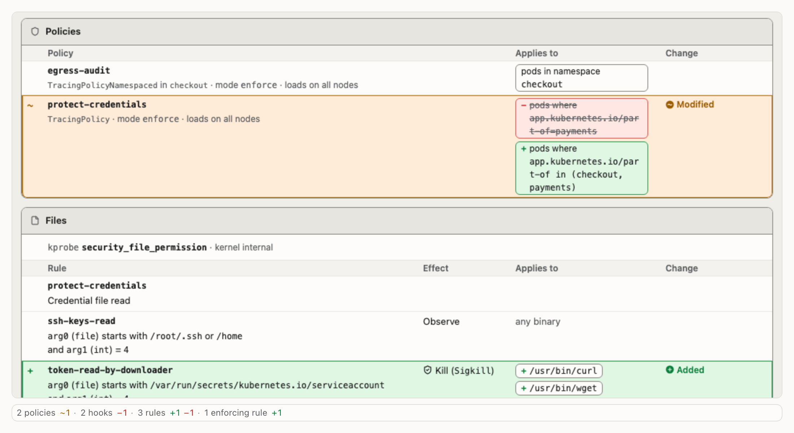

# Runtime security policies

Runtime security policies as a reviewer reads them: what each policy applies to,
then, for every kernel or user-space hook a policy attaches to, the rules that
act there, what each does (observe, or enforce by killing or blocking) and which
binaries or workloads it applies to. Compared across a pull request, it answers
"what will this change start or stop enforcing, and on what?"

<!-- generated: facts -->

- Name: `runtime-policy`
- Draws: [`architecture/v0`](../../reference/schemas/architecture.md) with the
  `runtime-policy/v0` vocabulary
- Comparison modes: Diff, Side by side; a comparison opens in Diff
- Package: `@githubnext/projections-renderer-runtime-policy`

<!-- end generated: facts -->

## When to use it

Use it to review changes to Tetragon tracing policies, or any extraction written
in the [runtime policy model](../../models/runtime-policy-model.md): a rule that
now kills instead of observing, a selector widened to more workloads, a hook no
policy covers any more. It draws only that model; for other `architecture/v0`
extractions use [`graph`](graph.md).

Built-in extractors that draw with it by default:

<!-- generated: extractors -->

| Built-in extractor                                        | Its default `renderer` |
| --------------------------------------------------------- | ---------------------- |
| [`tetragon-policies`](../extractors/tetragon-policies.md) | `runtime-policy`       |

<!-- end generated: extractors -->

## What it draws

Titled panels, each holding one table, with a muted icon for what it holds
beside its title (a server for the agent and kernels, a shield for policies, a
box for workloads, and one for each kind of hook):

- **Agent and kernels**, when the extraction has deployment facts: the Tetragon
  agent's configuration and the kernel profiles of the nodes policies load on.
- **Policies**: each policy's name, resource kind, namespace, mode (`enforce` or
  `monitor`) and the nodes that load it, and what it applies to
  (`pods in namespace checkout`).
- **Workloads**, when the extraction has them: each workload the repository
  deploys, with the policies that cover it (**Covered by**), whether each
  enforces or observes it, and on which containers.
- **A panel per kind of hook**, by what it observes: Credentials, Processes,
  Files, Network, Kernel modules, BPF, Namespaces and mounts, User space and
  Other. Each hook (`kprobe security_file_permission · kernel internal`) opens
  its lane, then lists each policy that attaches there and that policy's rules
  in order. A rule's row says when it acts (its conditions, such as "`arg0`
  (file) starts with `/root/.ssh`", or "every call"), its **Effect** (an icon
  marks enforcing effects such as **Kill**; **elided in `monitor` mode** when
  the policy's mode suppresses it) and what it **Applies to**.

**Binaries** are what a rule's **Applies to** column lists: each binary it
matches as a code chip (`/usr/bin/curl`), worded by how it matches (**except**
for a binary it excludes, **under** for a path prefix, **ending** for a suffix,
**launched by** for a parent binary), or **any binary** when the rule names
none. Policies' and workloads' scopes are chips the same way.

**Warnings** sit under the item they concern, labelled "Warning": a policy the
repository's CRD rejects, a policy that won't load because the agent's policy
filter is off, a hook or `Override` a node's kernel can't support. They describe
the revision shown, so they stay at every point of a comparison.

Identifiers, paths, values and label selectors are code, in the monospace font;
human text is sans. Below 640 px the columns stack under each row.

## Options

It declares no controls and has no zoom. It presents a comparison as Side by
side or Diff; it has no Animated or Swipe mode, since lists and tables would
only pop rows in and out. `presentation.mode` picks the one a comparison opens
in.

## What a comparison shows

- **Diff**: every policy, hook, rule and subject of both revisions, once and in
  place, with a sign in the gutter (`+`, `−`, `~`). A changed row is filled and
  edged in its change's color, and its **Change** column states the change as an
  icon and a word. A modified item shows its old value struck through before its
  new one: a rule's conditions or effect, a policy's mode or nodes. A scope
  change is the old chip struck through and the new one beside it, and a binary
  added to or removed from a rule is a `+` or `−` chip. An added or removed hook
  or probe marks its whole region once.
- **Side by side**: each pane draws one revision; while the host highlights
  changes, each marks its side of them.

Marks follow the host's highlighting, so Before, After and highlighting off
carry none, and the **Change** column is laid out on every changed row, so
status appearing never moves anything.

The **summary bar** counts policies, hooks and rules (and workloads, kernel
profiles and agent configurations, when the extraction has them), with their
changes, then how many rules enforce, with its change in a comparison
(`2 policies ~1 · 2 hooks −1 · 3 rules +1 −1 · 1 enforcing rule +1`). Probes and
the subjects rules match are structure, not figures.

**With the
[`runtime-policy`](../../../packages/comparators/runtime-policy/README.md)
comparator file**, each change also has interpretations in security terms:

- The **Change** column adds them after the status, as an outline icon and words
  (`Removed · No longer covered`, `Added · Newly enforced`,
  `Modified · Scope broadened`).
- The summary bar counts them, most severe first, each filtering to its changes:
  `1 newly enforced`, `1 no longer enforced`, `1 scope broadened`,
  `1 mode changed`, `1 new warning`, `1 hook no longer covered`,
  `1 hook newly covered` and others.

Without it, every change is still marked with its old and new values; only the
interpretations and their counts are absent.

Policies, hooks, probes, rules and chips are each selectable, and selecting one
selects it in every pane and in the host's table.

## Start from this definition

<!-- generated: definition -->

```json
{
  "extractor": "tetragon-policies",
  "id": "tetragon-policies",
  "inputs": {
    "paths": [
      "**/*.yaml",
      "**/*.yml"
    ]
  },
  "renderer": "runtime-policy",
  "title": "Runtime security policies"
}
```

<!-- end generated: definition -->

## Screenshot

A Diff with the default comparator: `protect-credentials` now applies to two
namespaces, and a new rule kills `/usr/bin/curl` and `/usr/bin/wget` when they
read a service-account token.



## Limitations

- It draws only the runtime policy model (`architecture/v0` with the
  `runtime-policy/v0` vocabulary).
- It shows what the policies declare, not what happened at run time: it has no
  events, alerts or traces.
- Without the `runtime-policy` comparator file, it marks changes but can't say
  whether one broadens, narrows or newly enforces anything.
- It has no Animated or Swipe mode.

## Related

- [`tetragon-policies`](../extractors/tetragon-policies.md), the extractor it
  draws by default.
- The [`runtime-policy`](../../../packages/comparators/runtime-policy/README.md)
  comparator file, and the
  [runtime policy model](../../models/runtime-policy-model.md) it and this
  renderer read.
- [`graph`](graph.md), which draws other `architecture/v0` extractions.
- [The default comparator](../comparators/default.md).

## How it works

The [package README](../../../packages/renderers/runtime-policy/README.md)
covers its layout, type and change marks.

## Build your own

This renderer is organized around hooks, the way a policy author thinks. Write
your own renderer when your reviewers think about it another way:

- **Organized by workload**: each service with every rule that can observe or
  kill it, or a matrix of workloads against hooks.
- **Your own emphasis**: your threat model's categories instead of the hook's
  subsystem, or the rules that enforce in production first.
- **Another policy engine's notation**: Falco rules, seccomp or AppArmor
  profiles, KubeArmor policies, drawn in the terms their authors use.

Try the lighter options first. To say what a change means in your terms (which
namespaces are sensitive, which effects need a second reviewer), start from the
`runtime-policy` comparator file: its interpretations reach this renderer's
**Change** column and summary bar. An extractor that writes the runtime policy
model for another engine is drawn here as it is. `presentation.mode` sets
whether a comparison opens side by side or as a diff.

**In VS Code**, choose **+ New Projection…** in the Projections view, then
**Write a custom extractor, renderer or comparator** › **Custom renderer**, and
pick the built-in extractor it draws. It writes the definition
(`.github/projections/<id>.json`) and a TypeScript, Vite and React renderer
package built on the renderer kit (`.github/projections/<id>/renderer`), and
opens the definition and the projection's tab. Or choose **Ask an agent to write
it** and describe what the projection should show.

**With the CLI**:

```sh
projections init <id> --extractor tetragon-policies --renderer custom
```

Then, in the renderer package, run `npm install`, then `npm run dev` for a
development server with hot updates, `npm run workbench` to open its scenarios
in the fixtures workbench in a browser, and `npm test` to run the renderer
checks on every scenario. In VS Code an open projection tab uses your
uncommitted definition edits ("Your edits"), and saving the renderer's sources
rebuilds it (in a trusted workspace, while its tab is open, with its `watch` or
`build` script) and reloads the view; the Testing view runs each projection's
checks (`projections check -p <id>`, renderer checks included).
[Develop a renderer](../../guides/develop-a-renderer.md) walks through it; the
[renderer kit guide](../../guides/renderer-kit.md) and the
[renderer kit API](../../reference/renderer-kit.md) cover the pieces.
