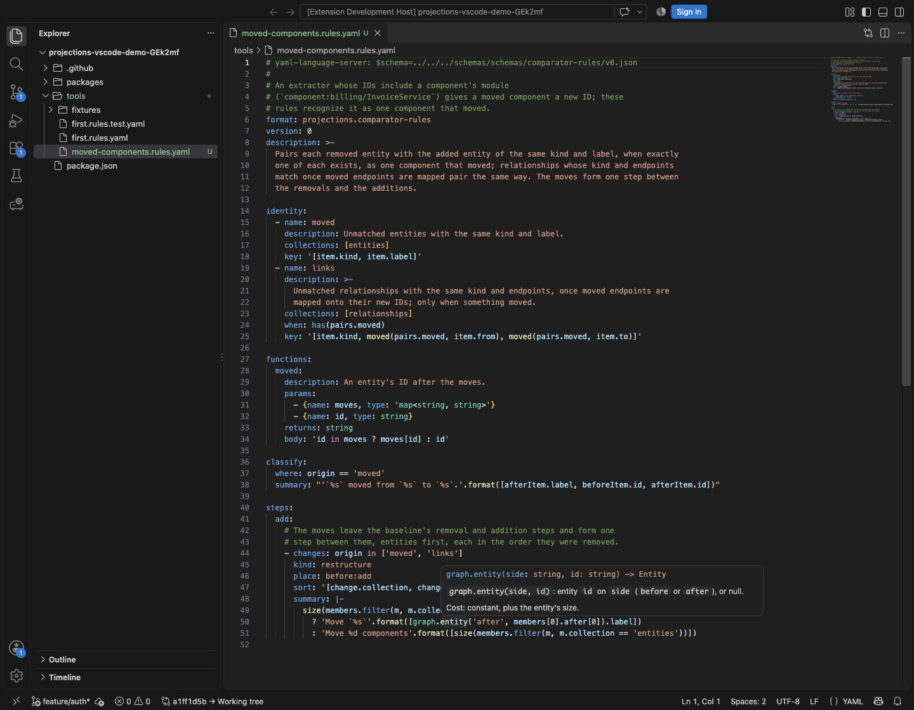

# Custom comparators

> **Current state:** comparator files are the only custom comparators —
> rules-only data interpreted by the engine on both clients and servers. The
> earlier JavaScript and WebAssembly comparator modules have been removed;
> sections comparing against them are marked historical.

Status: **the only custom comparator kind** (productionized from the
[feasibility study](#history), after removing JavaScript/WebAssembly comparators
and renaming `*.rules.yaml` to comparator files, `*.comparator.yaml`, before
release). Declarative comparators are the only customization mechanism because
comparators have to run in production — on browsers and servers rendering pull
requests — where arbitrary repository code cannot run. Rules are pure data
evaluated inside a sandboxed interpreter.

A comparator turns two extractions into the single comparison every view mode
renders: which items correspond, what changed, how each change is classified,
and what order the steps play in. The default comparator handles this natively.
A **custom comparator** is a **comparator file** (`<name>.comparator.yaml`) that
layers declarations on top: extra identity passes for items the default matcher
left unpaired, CEL rules that classify and summarize changes, declarative step
operations, and metadata. A projection definition points to one by path, with or
without options:

```json
"comparator": ".github/projections/api.comparator.yaml"
"comparator": {"file": ".github/projections/api.comparator.yaml", "options": {}}
```

A string or an object containing `file` selects a custom comparator; an object
without `file` (`{}` or `{"options": ...}`) uses the default comparator. The old
`{"rules": ...}` key and paths not ending in `.comparator.yaml` or
`.comparator.yml` are rejected with migration guidance. Internally, the
interpreter still uses its original names (`packages/comparators/rules`,
`rules.wasm`), since it evaluates the rules declared in a comparator file.

The implementation lives in
[`packages/comparators/rules`](../../packages/comparators/rules): the Rust
interpreter (built on [`cel`](https://crates.io/crates/cel) and
[`yaml-rust2`](https://crates.io/crates/yaml-rust2)), the
[JSON Schema](../../packages/schemas/schemas/comparator/v0.json) (published at
`/schemas/comparator/v0.json`), and its test suite. It compiles to `rules.wasm`,
a zero-import WebAssembly module that every host runs inside its sandbox.

- [The format](#the-format)
- [Variables](#variables)
- [Functions](#functions)
- [The standard library](#the-standard-library)
- [Types and load-time checking](#types-and-load-time-checking)
- [Step operations](#step-operations)
- [YAML, the subset](#yaml-the-subset)
- [The comparator's digest](#the-comparators-digest)
- [Testing comparators](#testing-comparators)
- [Editing comparator files](#editing-comparator-files)
- [The core and the comparator](#the-core-and-the-comparator)
- [Reference definitions](#reference-definitions)
- [Verdicts per comparator](#verdicts-per-comparator)
- [Equivalence](#equivalence)
- [Determinism, termination and cost](#determinism-termination-and-cost)
- [Performance: safety over speed](#performance-safety-over-speed)
- [The CEL and YAML implementations](#the-cel-and-yaml-implementations)
- [Comparator files only](#comparator-files-only)
- [Running comparators in a hosted view](#running-comparators-in-a-hosted-view)
- [History](#history)

## The format

Comparator files are YAML whose expressions use
[CEL](https://github.com/google/cel-spec) (the Common Expression Language used
in Kubernetes admission policies and Google Cloud IAM): a small,
side-effect-free, non-Turing-complete language with familiar C-like syntax. Here
is the complete moved-components comparator:

```yaml
# yaml-language-server: $schema=https://schemas.projections.githubnext.com/comparator/v0.json
format: projections.comparator
version: 0
description: >-
  Pairs each removed entity with the added entity of the same kind and label, when exactly
  one of each exists, as one component that moved; relationships whose kind and endpoints
  match once moved endpoints are mapped pair the same way. The moves form one step between
  the removals and the additions.

identity:
  - name: moved
    description: Unmatched entities with the same kind and label.
    collections: [entities]
    key: '[item.kind, item.label]'
  - name: links
    collections: [relationships]
    when: has(pairs.moved)
    key: '[item.kind, moved(pairs.moved, item.from), moved(pairs.moved, item.to)]'

functions:
  moved:
    description: An entity's ID after the moves.
    params:
      - {name: moves, type: 'map<string, string>'}
      - {name: id, type: string}
    returns: string
    body: 'id in moves ? moves[id] : id'

classify:
  where: origin == 'moved'
  summary: "'`%s` moved from `%s` to `%s`.'.format([afterItem.label, beforeItem.id, afterItem.id])"

steps:
  add:
    - changes: origin in ['moved', 'links']
      kind: restructure
      place: before:add
      sort: '[change.collection, change.before[0]]'
      summary: |-
        size(members.filter(m, m.collection == 'entities')) == 1
          ? 'Move `%s`'.format([graph.entity('after', members[0].after[0]).label])
          : 'Move %d components'.format([size(members.filter(m, m.collection == 'entities'))])
```

Here are the sections in evaluation order:

<!-- prettier-ignore -->
| Section | What it holds | Evaluated |
|---|---|---|
| `defaults` | Option values merged under the comparison's `options` ([defaults](#defaults)) | before anything |
| `checks` | `{assert, message, code?, path?}`; the first failing assertion fails the comparison (`invalid-options` at `/options` by default) | once |
| `variables` | `[{name, expression}]`, read as `variables.<name>` | once, in order |
| `functions` | Typed, named, parameterised expressions with their own `variables` | when called |
| `identity` | Ordered passes over what the default matching left unmatched: `key` (items whose key is unique on both sides correspond) or `claims` (IDs an item claims on the other side; each connected group is one change), with an optional `when` | per unmatched item |
| `classify` | Per change: `where`, `variables`, `summary` (a string) and `annotation` (any JSON value, readable afterwards as `annotations[id]`) | per selected change |
| `context` | Named rules: `name`, `description`, `where`, `variables`, and `before` and `after`, each a `list<string>` of item IDs added to the change's [context](#context-rules) | per selected change, after `classify` |
| `steps` | Declarative [step operations](#step-operations) with `variables`, or `value`, one CEL expression for the whole list | once |
| `metadata` | `values`, comparison metadata keys merged over the baseline's, with `variables` | once |

The default comparator always runs first: its exact-ID and `previousIds`
matching form the reserved initial passes (`exact` and `claims`), and its output
(including the default step order) is exposed as `baseline`. Every expression
can read `before` and `after` (normalized extractions), `options`, `baseline`,
and `lookup` (a prebuilt index with `lookup.before.entities[id]`,
`relationships[id]`, `incoming[id]`, and `outgoing[id]` in extraction order,
plus the `after` equivalents). Each section adds its own context: `item`,
`side`, and `pairs` (one-to-one before-to-after maps from earlier passes) in
`identity`; `change`, `origin` (matching pass name), `befores`, `afters`,
`beforeItem`, `afterItem`, and `item` (the after item, or the before item for a
removal) in `classify`; and `changes`, `pairs`, `changeOf`, and `annotations`
afterward. Every entity and relationship exposes `data` as a map (defaulting to
`{}` when omitted), so `item.data.mode` needs no null check while
`has(item.data.mode)` and `item.data.?mode` still test optional fields. Inputs
are materialized lazily — a comparator that never touches `lookup` pays nothing
for it.

Every `Change` carries `varied` for
[volatile](../contracts/extractions.md#volatile-data) differences: a
`list<Varied>` of `{path, within, reason}` (`reason` is set only when a rule
says why, and `change.varied` is always a list, `[]` when empty), so
`change.varied.exists(v, !v.within)` works without guards across `changes`,
`members`, `lead`, and `baseline.changes`. Pairs with only expected variation
(`exact`, `unchanged`, with `varied`) appear in `changes` but are skipped by
`classify` and step operations (`add`, `rank`, step summaries). A comparator
that wants to report noise can read it directly from `changes`, as
[`test-timings`](../../examples/comparators/test-timings/test-timings.comparator.yaml)
does with `changes.filter(c, c.status == 'unchanged' && size(c.varied) > 0)`. A
raw `steps` expression (`steps: <expression>` or `value`) builds the step list
itself and must exclude them or the Engine rejects it (`variation-in-step`).
Variation is always judged by the core, never by rules, so no comparator can
widen or narrow tolerance.

For [generated values](generated-values.md), every `Varied` entry carries
`generated: true` (`false` otherwise) and `because` (`[]` otherwise) — always
present, no guards needed. `generated.because(change)` collects all moved basis
parts across a change, and `generated.only(change, parts)` checks whether a
change differs _only_ in generated values whose bases moved in `parts`. Rules
can use these to classify and order changes (such as grouping model upgrades in
[`model-upgrades`](../../examples/comparators/model-upgrades/model-upgrades.comparator.yaml)),
but never to turn `modified` into `unchanged`.

## Context rules

A change's **context** is the surrounding detail a reviewer needs to understand
it — the declaration owning a changed parameter, the table owning a changed
column, or the two services joined by a new edge. In Changes scope, viewers show
changes plus their context and fold everything else. The core automatically
supplies structural context for every real change (a changed relationship's
endpoints, plus ancestors and containment relationships in each revision — see
[Comparisons](../contracts/comparisons.md)). `context` rules can add domain
context on top without ever removing structural context or hiding a change:

```yaml
context:
  - name: callers
    description: The tools that call a changed function, so a reviewer sees who is affected.
    where: change.collection == 'entities' && item.kind == 'function'
    after: |-
      change.after.size() == 1 && change.after[0] in lookup.after.incoming
        ? lookup.after.incoming[change.after[0]].filter(r, r.kind == 'calls').map(r, r.from)
        : []
```

Each rule runs in order on every real change (skipping expected variation) right
after `classify`, seeing the same variables as `classify` (`change`, `origin`,
`item`, `beforeItem`, `afterItem`, `befores`, `afters`, `changes`, `pairs`,
`changeOf`) plus `annotations` and the current `annotation`. `where` filters
changes, `variables` evaluate per change, and `before`/`after` (at least one
required) return `list<string>` of entity or relationship IDs from that
revision. Returning an unknown ID fails the comparison (`invalid-context`,
pointing to the rule's line), and the change's own IDs are automatically
stripped. Results are stored in UTF-16 order alongside `context.rules` (which
rule contributed each ID) so viewers and agents can explain why an item is
shown, capped at 1,000 context IDs per revision per change (`context-limit`).
Comparator tests can assert context via
`changes: [{id, context: {before?, after?, rules?}}]`.

## Variables

Variables follow the Kubernetes `ValidatingAdmissionPolicy` pattern:
`variables: [{name, expression}]`, evaluated once in order (each able to read
earlier ones) and referenced as `variables.<name>` so they never blur with
inputs or functions. They work at file level (once per comparison), in
`classify` (once per change), in `steps` and `metadata`, and inside functions
(once per call). Replacing the earlier study's `let` maps, they are the primary
way to avoid redundant work when a value is used more than once.

Before, in the study's API rules:

```yaml
body: |-
  parentOf(before) != null && counterpart(parentOf(before)) == null
  && kindOf(parentOf(before)) != 'assembly' ? breaking('removed', code(labelOf(before))
    + ' was removed with ' + code(labelOf(parentOf(before))))
  : breaking('removed', code(labelOf(before)) + ' was removed')
```

After:

```yaml
variables:
  - name: parent
    expression: parentOf(before)
body: |-
  variables.parent != null && counterpart(variables.parent) == null && kindOf(variables.parent) != 'assembly'
    ? breaking('removed', '%s was removed with %s'.format([prose.code(labelOf(before)), prose.code(labelOf(variables.parent))]))
    : breaking('removed', '%s was removed'.format([prose.code(labelOf(before))]))
```

## Functions

Since CEL has no user-defined functions, `functions` gives authors named,
parameterized expressions for reusable domain logic (`covers`,
`typescriptAssignable`):

```yaml
functions:
  policyFound:
    params: [{name: id, type: string}, {name: before, type: Item}, {name: after, type: Item}]
    returns: list<string>
    variables:
      - name: from
        expression: entity('before', graph.children('before', id, 'applies-to'))
    body: ...
```

Each parameter can be a bare name or `{name, type}` (checked at call sites and
in the body), and `returns` declares the return type. A function body sees its
parameters, its own variables, top-level inputs, and other functions — never its
caller's variables. Because the call graph is checked for cycles at load time,
functions behave like lazily expanded macros: anything they express is still a
pure, terminating CEL expression.

Parameter and variable names cannot shadow library namespaces (`ids`, `graph`).

## Defaults

Because functions don't see file-level `variables`, shared configuration (such
as lists a projection definition might override) belongs in `defaults` — a map
of JSON values merged underneath `options`. Every expression, including
functions, reads them as `options.<name>`, with definition options overriding
defaults key by key:

```yaml
defaults:
  impure: [filesystem, process, network]
functions:
  impure:
    params: [{name: capability, type: string}]
    returns: bool
    body: capability in options.impure
```

Defaults are static literals included in the file's digest; values computed from
other options belong in file-level `variables`.

## Macros

Beyond CEL's built-in macros (`has`, `all`, `exists`, `exists_one`, `map`,
`filter`), comparator rules add four macros that replace deeply nested `? :`
chains and list-building boilerplate. Like CEL's own macros, they rewrite the
parsed AST at load time
([`macros/`](../../packages/comparators/rules/src/macros)) rather than doing
text substitution, keeping diagnostics aimed at the author's original lines.
Only the selected branch evaluates, so branches can safely read fields absent on
other changes, and the cost meter charges only what actually runs. Because CEL
has no `=>` syntax, conditions use map literal keys, which preserve their
written order.

<!-- prettier-ignore -->
| Macro | For | Expands to |
|---|---|---|
| `match(subject, {'key': value, …}, default)` | A table keyed by one value | `subject == 'key' ? value : … : default` |
| `cond({condition: value, …}, default)` | Ordered conditions: the first that holds wins | `condition ? value : … : default` |
| `collect({condition: value, …})` | The values whose conditions hold, in order | `(condition ? [value] : []) + …` |
| `template('… {name} …', {'name': value, …})` | Text with named fields; without the map, `{name}` is the function parameter `name`, or else `variables.name` | `'… %s …'.format([value, …])` |

At load time, the checker verifies (with exact YAML line and column):

- `match` keys are unique string or int literals;
- all branches of a `match` or `cond` (including its default) share one type;
- every `{name}` in `template` matches its map's keys (`{{` and `}}` escape
  literal braces);
- no function shares a macro's name.

If a variable or parameter declares its allowed domain
(`values: [newly-enforced, enforcement-removed, …]`), a `match` over it warns on
out-of-domain keys or unhandled values falling through to the default.

Before, in runtime-policy's `sentence` (20 branches):

```yaml
body: |-
  found == 'newly-enforced' ? '%s now enforces: %s%s.'.format([rule, actions(after), variables.when])
  : found == 'enforcement-removed' ? '%s no longer enforces (was %s).'.format([rule, actions(before)])
  : found == 'scope-broadened' ? 'Policy %s now applies to more workloads: %s.'.format([name, after.?data.?scope.orValue('unknown')])
  : …
  : ''
```

After:

```yaml
body: |-
  match(found, {
    'newly-enforced': template('{rule} now enforces: {actions}{when}.', {'rule': rule, 'actions': actions(after), 'when': variables.when}),
    'enforcement-removed': template('{rule} no longer enforces (was {actions}).', {'rule': rule, 'actions': actions(before)}),
    'scope-broadened': template('Policy {name} now applies to more workloads: {scope}.', {'name': name, 'scope': after.data.?scope.orValue('unknown')}),
    …
  }, '')
```

And `collect` replaces the conditional-concatenation pattern:

```yaml
# Before
(!enforcing(before) && enforcing(after) ? ['newly-enforced'] : [])
  + (datum(before, 'conditions') != datum(after, 'conditions') ? ['condition-changed'] : [])
# After
collect({
  !enforcing(before) && enforcing(after): 'newly-enforced',
  differs(before, after, 'conditions'): 'condition-changed'
})
```

### Chained conditionals are a smell

Any chain of three or more `? :` expressions triggers the `chained-conditional`
lint warning, nudging authors toward `match`, `cond`, `collect`, or a helper
function. Files with warnings still run (reported under `warnings` alongside the
digest), while `npm run check:comparators` treats warnings as errors for in-repo
comparators and doc examples. Reach for, in order:

1. `match` when comparing one value against constants;
2. `collect` when assembling a list of matching items;
3. a named function when the logic represents a domain concept (`covers`,
   `implied`);
4. guaranteed `data`, `item`, and optional chaining (`x.?f.orValue(d)`) instead
   of null-guard ternaries;
5. `cond` for a genuine multi-condition if/else-if chain.

## The standard library

Functions belong in the engine's standard library when they are (a)
domain-neutral, (b) needed by multiple comparators, and (c) impossible or ugly
list surgery in plain CEL. Every function registers a signature, cost class, and
documentation ([`library/`](../../packages/comparators/rules/src/library)),
enforced at load time.

<!-- prettier-ignore -->
| Function | Signature | Why it's in the engine |
|---|---|---|
| `json(value)` | `dyn -> string` | Serialising a value of unbounded depth needs recursion; CEL's `string()` takes only scalars |
| `ids.sort(ids)` | `list<string> -> list<string>` | IDs sort by UTF-16 code units everywhere in the protocol; CEL's `sort()` uses code points |
| `ids.key(id)` | `string -> string` | The same order as a `sortBy` key |
| `lists.zip(a, b)` | `list, list -> list<list>` | Pairing parameters or overloads positionally is otherwise an index loop |
| `lists.zipLongest(a, b)` | `list, list -> list<list>` | The same, as long as the longer list, with null where one ends: an added or removed parameter |
| `lists.enumerate(items)` | `list -> list<list>` | `[index, item]` pairs, for positions in messages, otherwise `lists.range(size(xs)).map(i, …xs[i]…)` |
| `maps.fromEntries(entries)` | `list<list> -> map<string, dyn>` | **CEL can't build a map of computed size** |
| `maps.keys(map)` | `map<string, dyn> -> list<string>` | Keys in UTF-16 order; iterating a map follows hash order, which differs between runs |
| `graph.parents(side, id, kind)`, `graph.children(...)` | `string, string, string -> list<string>` | Graph navigation by relationship kind, otherwise a filter over `incoming` per call |
| `graph.entity(side, id)`, `graph.relationship(side, id)` | `string, string -> Entity`/`Relationship` | Lookup by ID without the whole `lookup` index |
| `graph.depths(nodes, edges)` | `list<string>, list<list<string>> -> map<string, int>` | **Longest-path depth is a fixed point**; comprehensions can't feed one iteration into the next |
| `graph.components(nodes, edges)` | `list<string>, list<list<string>> -> list<list<string>>` | **Connectivity is a fixed point** |
| `findings.classify(findings, levels)` | `list<Finding>, list<string> -> Classification` | "The most severe finding wins, with its kinds and distinct reasons" is generic, and was 40 lines of list surgery in the API rules |
| `prose.code(text)`, `prose.escape(text)` | `string -> string` | Every comparator that writes sentences quotes code spans in [protocol prose](../contracts.md) |
| `generated.because(change)` | `Change -> list<string>` | The basis parts that moved across a change's [generated values](generated-values.md), unique and in UTF-16 order: deduplicating and sorting is list surgery CEL can't do |
| `generated.only(change, parts)` | `Change, list<string> -> bool` | Whether a change differs only in generated values whose bases moved only in `parts`: it needs the core's content comparison modulo paths, which CEL can't express |

Only three are strictly required (`json`, `maps.fromEntries`, and the two graph
fixed points); the rest eliminate repetitive list surgery. Domain-specific
operators considered early on (`selectorContains`, `semverBump`,
`typeAssignable`) stayed out of the engine — the first two are tiny in CEL, and
real TypeScript assignability belongs in the extractor as a precomputed fact.
New library operations are [contributed to the engine](#comparator-files-only),
not shipped by individual repositories.

## Types and load-time checking

Because cel-rust 0.15 has no built-in type checker, the interpreter includes its
own ([`check/`](../../packages/comparators/rules/src/check), backed by
[`types.rs`](../../packages/comparators/rules/src/types.rs)) covering our domain
types (`Extraction`, `Entity`, `Relationship`, `Item`, `Change`, `Varied`,
`Step`, `Comparison`, `Lookup`, `Finding`, `Classification`) alongside CEL
scalars, `list<T>`, `map<K, V>`, `optional`, and `dyn`. All inputs, section
variables, and declared function signatures are checked, while `item.data` stays
`dyn`.

Loading a file checks every expression and reports all problems together:
unknown variables, fields, functions, or namespaces (with "did you mean"
suggestions), arity mismatches, invalid operator types, mismatched function
returns, and call cycles. Every diagnostic carries the exact YAML line and
column of the offending token, even inside block scalars:

```text
invalid-rules at /metadata/values/count: Line 5, column 17: Undeclared reference `chnages`; did you mean `changes`?
```

Because `projections_rules_inspect` runs inside the sandboxed interpreter, the
CLI, Inspector, and every host surface identical diagnostics.

## Step operations

Common step rearrangements are declarative, sparing authors from rebuilding step
lists by hand:

```yaml
steps:
  variables: [...]
  add:                                # new steps, each made of the changes a predicate selects
    - changes: <per change: bool>     # `change`, `origin`, `annotation`
      kind: restructure
      place: before:add               # start, end, before:<kind>, after:<kind>
      sort: <per change: key>         # optional; default entities, then relationships, by ID
      summary: <with `members`: string or null>
  rank: <per change: number, list of numbers or null>
  descending: false
  summary: <per step, with `step`, `members` and `lead`: string or null>
```

Starting from the baseline steps, the engine strips removed changes, moves
selected changes into newly added steps, drops empty steps, sorts members by
UTF-16 ID, stably orders steps by their best-ranked change (unranked steps
last), and passes each step's `lead` (best-ranked change) to `summary`. A raw
`value` expression remains available as an escape hatch, though no comparator
here needs it. The priority-order comparator reduces to a single `rank`
expression:

```yaml
steps:
  rank: |-
    change.collection == 'entities'
      ? lists.range(size(variables.priority)).filter(i, variables.priority[i] in change.before + change.after)
      : null
```

## YAML, the subset

YAML lets authors write unescaped CEL, use multiline block scalars (`|-`), and
add comments. To keep parsing predictable and safe, the engine accepts a tight
subset before validating against the JSON Schema:

- a single document with block or flow mappings, sequences, and scalars;
- at most 1 MiB and 32 levels of nesting;
- no anchors or aliases (preventing alias bombs and keeping values local), no
  tags, no merge keys (`<<`), no duplicate keys, and plain string keys only;
- narrowed YAML 1.2 plain scalars: `null`/`~`/empty → null, `true`/`false` →
  booleans, decimal ints/floats → numbers, and everything else (including YAML
  1.1's `yes`, `0x1F`, `.inf`, and all quoted/block scalars) → strings.

Editors get schema validation from the standard first-line comment:
`# yaml-language-server: $schema=https://schemas.projections.githubnext.com/comparator/v0.json`.

## The comparator's digest

A custom comparator's identity digest is `sha256:` over
`projections-rules-comparator\n`, the interpreter's identity + `\n`, and the RFC
8785 canonical JSON of the **parsed** rules (not the raw YAML bytes). That way,
fixing a comment typo, reflowing lines, or reordering keys never invalidates
saved comparisons, while any semantic change or interpreter change does. (Raw
YAML bytes are still covered by the projection definition digest, and whitespace
inside CEL strings still affects the digest since canonicalizing CEL isn't worth
the complexity.) The Rust runtime (`rules_digest`), interpreter (`digest`), and
JS runtime (`rulesComparatorDigest`) all produce identical digests, verified by
tests.

The interpreter's identity hashes the **language specification** rather than
`rules.wasm`'s binary bytes or Rust source. Compiling the same Rust on macOS vs.
Linux or arm64 vs. x86-64 produces different Wasm bytes, and hashing source
files would invalidate saved comparisons on every internal refactor. Instead, we
hash [`language.json`](../../packages/comparators/rules/language.json) — the
format, macros, standard library signatures and cost classes, declared types,
cost budget, and an explicit behavior `revision`
([`language.rs`](../../packages/comparators/rules/src/language.rs)) bumped
whenever semantics change without a signature change. A test verifies the
manifest matches the code, and
[`build.mjs`](../../packages/comparators/rules/scripts/build.mjs) embeds the
digest in `rules.wasm`'s `projections.interpreter` custom section (read via
`interpreter_digest` in Rust or `WebAssembly.Module.customSections` in JS).

Forgetting to bump `revision` can never let a bad comparison pass verification,
because verification reruns the rules and requires matching output. Hosts trust
the embedded section because they only execute the `rules.wasm` they ship.

## Testing comparators

Comparator files have data-driven sibling tests: `X.comparator.test.yaml` next
to `X.comparator.yaml`. Each test case supplies two extractions (fixtures,
inline, or revisions) and asserts the expected comparison — either partially
(step order, steps, changes, counts, metadata, or an expected error) or as a
full snapshot. `projections check` runs them in the same sandbox as every host
and fails CI on any mismatch, with zero npm or Rust dependencies required for
consumers. See [the contracts](../contracts/comparisons.md#comparator-tests) for
the format and [the runner](../runner/stdio-backend.md#comparator-tests) for the
`check` step and editor API.

**Why a sibling file instead of an inline `tests:` section?** Because the
comparator's digest covers the canonical file
([above](#the-comparators-digest)), inline tests would change the comparator's
identity on every test edit — invalidating saved comparisons and making hosted
views warn that the comparator changed. Sibling test files stay out of
definition digests and are never fetched by hosted views (which cap comparator
files at 1 MiB and shouldn't read local fixture paths).

**Why no `projections test` command?** `projections check -p <id> --no-render`
is already the fast verification loop that agents and CI run; adding another
command just gives people one more thing to forget. Tests run as a step of
`check` (with structured results in `--json`), and editors run them through the
Inspector API (`serve --stdio`).

Pure parsing and assertion logic lives in
[`suite/`](../../packages/comparators/rules/yaml/src/suite) inside
`projections-rules-yaml`, while the CLI resolves fixtures, executes the
sandboxed interpreter, and updates snapshots
([`comparator_tests/`](../../packages/cli/src/comparator_tests/mod.rs)). The CLI
never runs rules natively, and
`cargo test -p projections-cli --test comparator_tests` verifies every test file
in the repository.

## Editing comparator files



Editors get the exact same view of comparator files as the interpreter through
`rules-editor.wasm`
([`projections-rules-editor`](../../packages/comparators/rules/editor)), a
dedicated module built from the interpreter crate and kept separate from the
smaller `rules.wasm` viewers download. Its `projections_rules_editor` export
handles `{op, source, kind, line?, column?}` using the same YAML reader and type
checker:

- **`tokens`.** Highlights CEL inside expression fields only (`expression`,
  `body`, `assert`, `message`, `path`, `key`, `claims`, `when`, `where`,
  `summary`, `annotation`, `changes`, `sort`, `rank`, `value`, and metadata
  `values`), lexed via `cel`'s `parser_pratt` lexer (since ANTLR's isn't public)
  and mapped onto standard LSP token types and modifiers so every theme colors
  them cleanly:

  <!-- prettier-ignore -->
  | Token | Type and modifiers |
  |---|---|
  | The standard library (`json`, `graph.*`, `ids.*`, `lists.*`, `maps.*`, `findings.*`, `prose.*`) and CEL's own functions | `function` or `method`, with `defaultLibrary` |
  | The rules macros (`match`, `cond`, `collect`, `template`) | `macro` |
  | CEL's macros (`has`, `all`, `exists`, `map`, `filter`, …) | `macro`, with `defaultLibrary` |
  | The file's own `functions` | `function` |
  | `variables`, and a namespace before a library call | `namespace` |
  | `variables.<name>` | `variable`, with `readonly` |
  | Inputs and section names (`before`, `after`, `options`, `item`, `change`, …) | `parameter`, with `readonly` and `defaultLibrary` |
  | Function parameters | `parameter` |
  | Comprehension variables | `variable` (`declaration` where they are bound) |
  | Fields, and the keys of `options` | `property` |
  | Strings, numbers, keywords and comments | `string`, `number`, `keyword`, `comment` |
  | Operators and punctuation | `operator`, so the YAML string colour doesn't show through |
  | A `template` string's `{name}` | `variable` (`parameter` for a function's parameter), with its braces as `operator` |

  Types in `params` and `returns` get `type`, and declared variable/parameter
  names get `declaration`.

  Walking from each scalar's starting position through quotes, escapes, block
  indentation, and folding ensures every token lands on the exact source
  characters. Unparseable CEL still receives tokens; invalid YAML receives none.

- **`diagnostics`.** Matches `projections_rules_inspect`, `projections check`,
  and `npm run check:comparators` — covering YAML/CEL syntax errors, unknown
  names with suggestions, type errors, macro misuse, and lint warnings
  (`chained-conditional`, `match-values`) once errors clear. For test files
  (`kind: tests`), it reports test-format diagnostics.
- **`hover`.** Shows signatures, parameter names (`json(value: dyn) -> string`),
  docs, and cost class for library functions; signatures and docs for macros and
  CEL built-ins; params, return type, and `description` for user functions;
  inferred type, `description`, expression, and `values` for `variables.<name>`;
  and declared types for inputs, parameters, comprehension variables, and
  fields.
- **`complete`.** Context-aware completions based on what precedes the cursor:
  in-scope variables after `variables.`, keys referenced in the file after
  `options.` (`options.x`, `options['x']`, or option checks), library functions
  after a namespace, fields/methods after any typed value, or all in-scope
  names, functions, macros, and built-ins otherwise. Tolerant parsing turns
  incomplete expressions into `null` so completions still work mid-edit.

Positions use 1-based lines and Unicode code-point columns (editors convert to
UTF-16 as needed). Editor-only docs and parameter-name tables live solely in the
editor module, leaving `language.json` and the interpreter digest untouched, and
tests verify every library and CEL function is documented.

The VS Code extension
([`rules-language.ts`](../../packages/integrations/vscode/src/rules-language.ts))
runs `rules-editor.wasm` in a worker thread (compiled once, instantiated per
request) — no CLI, no workspace trust, and no typing lag. Using a semantic
tokens provider rather than a TextMate injection scopes highlighting strictly to
comparator and test files instead of every YAML file, and answering only inside
expression values lets the YAML extension's `yamlValidation`, hovers, and
completions keep working around them. **Why a separate Wasm module?** Bundling
the CEL lexer, test reader, tolerant parser, and scope recorder into
`rules.wasm` would add ~250 KB (~86 KB compressed) for every viewer. Instead,
the editor crate links the interpreter with `editing` enabled and `abi`
disabled, while `rules.wasm` builds without either (enforced by a build check
forbidding `projections_rules_editor` in `rules.wasm`). `rules-editor.wasm` is
~2.2 MB (~650 KB compressed) and ships only with the VS Code extension.

## The core and the comparator

Both comparators share one generic identity-pass core
([`matching.rs`](../../packages/comparators/default/src/matching.rs)): each pass
only sees items left unmatched by earlier passes, claim groups become
one-to-one/split/merge changes (or `ambiguous-correspondence`), one-to-one
statuses compare canonical content modulo volatile tolerance (via the Engine's
`volatility` module, mapping relationship endpoints through entity
correspondence), within-tolerance pairs emit as `unchanged` with `varied`,
remaining items become adds or removals, and change IDs are guaranteed unique.
Rules can add extra passes, but they can never mark an unchanged pair `modified`
or hide a real change.

**The default order stays native.** Although we expressed it in rules as an
executable spec
([`default-order.yaml`](../../packages/comparators/rules/tests/rules/default-order.yaml),
19 functions over `graph.depths` and `graph.components`, verified against native
order on 1,831 cases), it is an algorithm rather than configuration — and as
rules it is quadratic because it scans instead of indexing. Every comparator
file starts from the native `baseline` order.

## Reference definitions

_Historical: this records the migration away from the removed JavaScript and
WebAssembly comparators._

The rules are **reference** definitions of the comparators they replaced, not
bug-for-bug emulations of JavaScript or Rust quirks:

- **Runtime policy.** JS `?.`, `??`, and template-literal helpers (`field`,
  `orElse`, `text`) became CEL optional syntax
  (`entity.?data.?effect.orValue(null)`), the last-write-wins `Map` in `hookOf`
  became `graph.parents`/`graph.children`, and UTF-16 sorting became
  `ids.sort(maps.keys(...))` — shrinking from 32 functions to 20.
- **API compatibility.** Manual index loops became `lists.zip`, Rust's
  `Classification::from` became `findings.classify`, and .NET `BTreeSet` diffs
  became simple `filter`s over declared lists.

Equivalence is therefore [semantic](#equivalence), with five original quirks
pinned as divergence tests. Where an original had a genuine bug, we fixed it —
for instance, the moved-components JS comparator used an unsuffixed after ID for
paired relationships, colliding with changed entity IDs until we adopted the
core's uniqueness suffix.

What happened to the originals:

<!-- prettier-ignore -->
| Original | Fate |
|---|---|
| Runtime policy (`runtime-policy.js`) | **Deleted.** The rules ship as the comparator; its scope-containment tests run against the rules' `scopeChange` and `covers` |
| Moved components (JavaScript example) | **Replaced** by the rules example [`examples/comparators/moved-components`](../../examples/comparators/moved-components) |
| Priority order (Rust/WebAssembly and JavaScript examples) | **Replaced** by the rules example [`examples/comparators/priority-order`](../../examples/comparators/priority-order) |
| API compatibility (Rust module) | **Deleted; the rules replace it.** Two definitions of 4 ecosystems' rules would drift, the Rust was 2,650 lines against 1,138, and a module comparator can't run where rules must. Its 25 unit tests run against the rules ([`tests/api`](../../packages/comparators/rules/tests/api)), unchanged but for the harness |
| `projections init` starter and the guide's example (JavaScript) | **Deleted**; they had become rules before |

Before deleting them, we captured their outputs across every fixed equivalence
case (every fixture pair in both directions, option variants, and hand-written
cases) in [`tests/golden`](../../packages/comparators/rules/tests/golden) with
input digests. Rules must still match every golden case semantically (cases
whose fixtures changed since are skipped as stale), while seeded random cases
verify that rules always produce valid comparisons or clean comparator errors.

| Original                                                         | Golden cases |
| ---------------------------------------------------------------- | ------------ |
| Priority order (the Rust and JavaScript originals agreed on all) | 212          |
| `projections init` starter                                       | 312          |
| Guide example                                                    | 104          |
| Moved components                                                 | 52           |
| Runtime policy                                                   | 89           |
| API compatibility                                                | 93           |

## Verdicts per comparator

_Historical: verdicts from the feasibility study, measured before removing the
originals._

Here, "idiomatic" means configuration that reads like domain intent (identity
keys, predicates, rankings, findings, sentences), whereas "list surgery" means
CEL working around missing data structures or control flow (index loops, scans
replacing maps, emulated coercions).

- **Default (matching and options):** originally Rust; 2 reserved passes plus
  native option checks. Verdict: **Core**.
- **Default (order):** originally 428 lines of Rust; 168 lines / 19 functions as
  rules (spec only). Verdict: **Expressible with `graph.depths` and
  `graph.components`**, kept native because layering, waves, and relationship
  placement were all list surgery.
- **[Priority order](../../examples/comparators/priority-order/priority-order.comparator.yaml):**
  originally 110 lines Rust / 37 JS; 21 lines as rules (two checks + one
  `rank`). Verdict: **Fully expressible**, completely idiomatic.
- **[`projections init` starter](../../packages/cli/templates/starter.comparator.yaml):**
  originally 32 lines; 31 as rules. Verdict: **Fully expressible**, completely
  idiomatic.
- **[Guide example](../guides/order-of-changes.md#write-a-custom-comparator):**
  originally 10 lines; 8 as rules. Verdict: **Fully expressible**, completely
  idiomatic.
- **[Moved components](../../examples/comparators/moved-components/moved-components.comparator.yaml):**
  originally 116 lines; 40 as rules (two identity passes, a summary, one added
  step). Verdict: **Fully expressible**, completely idiomatic.
- **[Runtime policy](../../packages/comparators/runtime-policy/runtime-policy.comparator.yaml):**
  originally 272 lines; 315 lines / 23 functions as rules. Verdict: **Fully
  expressible** with `json`. Interpretations (`collect`, `cond`), selector
  containment (`implied` via `match`; `selects`, `covers` via nested
  `exists`/`all`), sentences (`match` + `template`), `rank`, and `summary` are
  all idiomatic.
- **[API compatibility](../../packages/comparators/api-compatibility/api-compatibility.comparator.yaml)
  (four ecosystems):** originally ~2,650 lines of Rust; 1,564 lines / 149
  functions as rules. Verdict: **Fully expressible** with `findings.classify`,
  `lists.zipLongest`, and `lists.enumerate`. Ecosystem rules (ApiCompat,
  TypeScript union assignability, Cargo SemVer, apidiff) express cleanly as
  `match` + `collect` + `template` over `api/v0`, with shared concepts reading a
  224-line `policy` table. The only remaining boilerplate is small accessors for
  optional facts (`fact`, `is`, `listed`) and open `contract.native` JSON
  (`holds`, `nativeText`, `field`).

Nothing required general-purpose computation — no comparator iterates to a fixed
point except the native default order, and nothing recurses over arbitrary depth
except json(). Notably, we didn't need **`typeAssignable`** (union checks are a
single nested `filter`/`exists`/`all`, and full structural assignability belongs
in the TypeScript extractor), **`selectorContains`** (~10 lines of CEL), or
**`semverBump`** (most severe finding wins).

## Equivalence

_Historical: equivalence runs for the first-party comparators, examples, and
`init` starter ended when the originals were deleted;
[golden comparisons](#reference-definitions) now guard those fixed cases._

Before deletion, [`tests/`](../../packages/comparators/rules/tests) ran every
original alongside its rules on every repo fixture pair (both directions, all
option variants) plus seeded generators: random graphs with renames, splits,
merges, ambiguous claims, and UTF-16 vs. code-point edge cases; moving
components; mutated Tetragon policies; and mutated API fixtures across all four
ecosystems.

Equivalence was **semantic**: identical correspondences, statuses,
classifications, counts, steps, and step order, with normalized text (collapsed
whitespace, `2.0` → `2`, JS `undefined` → `unknown`, `; `-separated lists and
findings/notices compared as sets), plus canonical RFC 8785 equality reported
alongside:

<!-- prettier-ignore -->
| Comparator | Cases | Byte-identical | Same failure | Canonically equal | Semantically equal | Mismatches |
|---|---|---|---|---|---|---|
| Default (native order) against the order rules | 1,831 | 1,782 | 49 | 1,831 | 1,831 | **0** |
| Priority order (Rust) | 1,389 | 1,353 | 36 | 1,389 | 1,389 | **0** |
| Priority order (JavaScript) | 1,389 | 1,353 | 36 | 1,389 | 1,389 | **0** |
| `projections init` starter | 2,112 | 1,705 | 407 | 2,112 | 2,112 | **0** |
| Guide example | 704 | 682 | 22 | 704 | 704 | **0** |
| Moved components | 852 | 439 | 8 | 852 | 852 | **0** |
| Runtime policy | 739 | 736 | 3 | 739 | 739 | **0** |
| API compatibility | 1,693 | 1,668 | 25 | 1,693 | 1,693 | **0** |

Across the entire corpus, even canonical equality held (moved-components bytes
differed only in `changes` order). Run
`cargo test --release -p projections-comparator-rules` for the full suite; debug
builds sample 10% of generated cases and 25% of fixture pairs
(`DECLARATIVE_FULL=1` restores full runs).

### Known differences

Five out-of-corpus inputs where an original diverged from its rules are pinned
in
[`tests/divergences.rs`](../../packages/comparators/rules/tests/divergences.rs)
to document the originals' quirks:

<!-- prettier-ignore -->
| Comparator | Smallest input | Original | Rules |
|---|---|---|---|
| Default, `order.by: data.<key>` | Two added steps whose values are `-0` and `0` | `f64::total_cmp` puts `-0` first | CEL compares them equal; the tie keeps the default order |
| Moved components | A moved entity's relationship arrives with an after ID that is also a changed entity's ID | Was an invalid comparison (a bug, now fixed): both agree | The core's uniqueness suffix (`e~1`) |
| Runtime policy | A `graph/v0` policy whose `scope` is an object (the `runtime-policy/v0` vocabulary requires a string) | `[object Object]` | `{pods: app=web}` |
| API compatibility | A `contract.native` fact `1` that becomes `1.0` while the signature changes | serde_json tells them apart: `unknown`, "its contract changed" | JSON (and the Engine's canonical content) doesn't: `compatible` |
| API compatibility (.NET) | A non-string constant `value` `1.0` → `2.0` | serde's `1.0` | JavaScript's `1`; since the facts are typed, the Engine rejects it first |

## Determinism, termination and cost

**Determinism.** CEL has no clock, randomness, or I/O. Because map iteration
uses hash order, `maps.keys` and `ids.sort` return sorted lists, and engine
collections plus identity passes run in canonical ID order. Tests run each
comparator repeatedly in fresh interpreters and require byte-identical output.

**Termination.** CEL isn't Turing-complete: comprehensions iterate over finite
lists, `lists.range` caps at 10⁶, and function call graphs are acyclic, so every
evaluation terminates.

**Cost.** Termination alone isn't a resource bound — a quadratic comprehension
over `lists.range(1000000)` still takes 10¹² steps, and 32 acyclic functions
`fN(s) = fN-1(s + s)` build a 4 GiB string. Three layered limits prevent abuse:

1. A **deterministic cost meter**
   ([`cost.rs`](../../packages/comparators/rules/src/cost.rs)) instruments every
   operation at load time, charging one unit plus result size. Exceeding 2×10⁸
   units fails with `cost-limit`, identically across every host and build.
2. The **sandbox**: `rules.wasm` runs zero-import in wasmi with fuel
   (`Limits::rules()`, 10¹² units) and a 256 MiB memory cap in the CLI, and in a
   Worker with a deadline and 256 MiB cap in browsers.
3. Static caps: 1 MiB max file size, 32 YAML nesting levels, and CEL's parser
   nesting limit.

A static per-expression complexity warning ("this rule is quadratic in
entities") is planned for the Inspector later.

## Performance: safety over speed

Because comparator files come from repositories, the interpreter always runs
**sandboxed** (wasmi with fuel and memory caps in the CLI, Worker in browsers)
as defense in depth against bugs in the interpreter or CEL crate — even on
servers where native execution would be faster. The sandbox costs 5–25× native
speed, which translates to tens or hundreds of milliseconds on real fixtures.

Two safety-neutral optimizations keep that comfortable:

- **Compile and check once per content.** Hosts compile `rules.wasm` once and
  cache checked files by content hash. Each comparison still instantiates a
  fresh sandbox (re-parsing the rules) so zero state leaks between runs.
- **Native baseline.** Default matching and ordering run as compiled Rust inside
  the interpreter, not as CEL rules.

Two internal fixes also cut the API comparator from 578 ms to 306 ms in the
sandbox: copying values once across function calls and variables (avoiding
double conversions/rehashes in `cel` 0.15) and splitting YAML lines once instead
of per block scalar.

Measurements on an Apple Silicon laptop under heavy load (sandbox = best of 3):

<!-- prettier-ignore -->
| Comparator, input | Native: check | Native: compare | Native default alone | Sandbox: check | Sandbox: compare | Sandbox default comparator module | Ceiling |
|---|---|---|---|---|---|---|---|
| Priority order, `file-packing` (1,582 entities, the largest fixture) | 1.5 ms | 55 ms | 54 ms | 9 ms | 419-452 ms | 370 ms | 2 s |
| API compatibility, TypeScript fixture | 18 ms | 11 ms | 1.1 ms | 183 ms | 306-337 ms | 11 ms | 500 ms |
| API compatibility, Go fixture | 14 ms | 4.6 ms | 1.1 ms | 201 ms | 233-259 ms | 8.5 ms | 500 ms |
| Runtime policy, Tetragon `credentials` | 4.3 ms | 1.7 ms | 0.6 ms | 54 ms | 58-67 ms | 6.6 ms | 500 ms |

On the largest fixture, rules match the default comparator natively (55 vs. 54
ms) and take 1.2× in the sandbox — most of the time is baseline matching and
ordering. On smaller API and runtime-policy fixtures, parsing dominates (the API
comparator has 1,138 lines of CEL). Loose regression ceilings live in
[`tests/module.rs`](../../packages/comparators/rules/tests/module.rs).

### At the extraction limit

The Engine caps extractions at 10,000 entities and 50,000 relationships.
[`examples/scale.rs`](../../packages/comparators/rules/examples/scale.rs) tests
the worst case — every relationship changed (100,000 changes), matching
[the engine evaluation](engine-evaluation.md):

<!-- prettier-ignore -->
| Comparator | Native | Native peak (process) | Sandbox (wasmi) | Fits 256 MiB | Fuel |
|---|---|---|---|---|---|
| Default comparator | 773 ms | 607 MiB | 6.0 s | Yes | < 10¹¹ |
| Empty comparator file (the default comparator through the interpreter) | 815 ms | 615 MiB | 6.5 s | Yes | < 10¹¹ |
| Priority order | 1,132 ms | 618 MiB | 10.5 s | Yes | < 2×10¹¹ |
| Moved components | 1,361 ms | 649 MiB | 9.9 s | Yes | < 2×10¹¹ |

Process peaks include the generated JSON inputs; the interpreter's own linear
memory stays within 256 MiB. Because default module fuel (10¹¹) isn't enough at
the limit, rules use `Limits::rules()` (10¹², 5× the peak measured). Priority
order spent just 200,003 cost units (0.1% of budget), and scaling from 1,250 to
10,000 entities is cleanly linear (2.0–2.2× per doubling: 126, 256, 538, and
1,129 ms natively for moved components), with no quadratic bottlenecks in
identity matching, `pairs`, step building, or copying. Taking ~10 s in the
sandbox on the largest legal input is a trade-off we gladly make for safety.

## The CEL and YAML implementations

<!-- prettier-ignore -->
| | Choice | Licence | WebAssembly |
|---|---|---|---|
| CEL | [`cel`](https://crates.io/crates/cel) 0.15 (cel-rust), without its `chrono`, `regex` and encoder features | MIT | Builds for `wasm32-unknown-unknown` with zero imports; its dependencies (`antlr4rust`, `nom`, `lazy_static`, `thiserror`, `serde`) are pure Rust |
| YAML | [`yaml-rust2`](https://crates.io/crates/yaml-rust2) 0.13, its event parser only | MIT or Apache-2.0 | Pure Rust, zero imports |

Since neither crate bundles its license file, [`notices`](../../notices) stores
the upstream texts and `rules.wasm` ships with `THIRD_PARTY_NOTICES.txt`. `cel`
0.15 provides the CEL standard library, optional types, and cel-go's string,
list, and math extensions; our interpreter adds type checking, cost metering,
and workarounds for missing two-variable comprehensions. The ANTLR-based CEL
parser is the slowest step at ~30 µs per expression.

## Comparator files only

Comparator files are now the sole custom comparator format. After rules shipped,
we removed `comparator.module`, the QuickJS runtime, the public module ABI and
`comparators/sdk`, the Rust API compatibility crate, and the JS/Rust comparator
examples without a deprecation shim (pre-1.0). wasmi remains solely to sandbox
Projections' own `rules.wasm` and `default-comparator.wasm` through an internal
interface
([the interpreter module](../contracts/comparisons.md#the-interpreter-module)),
while the default comparator stays native Rust.

Rules cover every comparator we need, and heavier work belongs elsewhere:

- **In the extractor**, computed per revision into `data` using the repo's real
  toolchain (type assignability, semver parsing, anything needing a compiler or
  parser), leaving the comparator to compare facts.
- **In the engine**, as a new standard-library function when an operation is
  generic, needed by multiple comparators, and awkward or impossible in CEL.
  Adding one means registering its signature, cost class, and docs in
  `library.rs`, adding checker and determinism tests, and updating
  [the table above](#the-standard-library).

## Running comparators in a hosted view

Hosted views of CI artifacts never execute untrusted code from artifacts.
Because comparator rules are pure data interpreted inside a sandbox — just like
rendering an extraction — hosted views can run them safely, given four decisions
(see [What changes](#what-changes) for what is built).

### Obtaining the comparator file

Hosted views already rerun the default comparator instead of trusting saved
comparisons. For custom comparators, there are two ways to get the comparator
file:

- **Fetch from GitHub at the recorded commit** via
  `GET /repos/{owner}/{repo}/contents/{path}?ref={commit}` using the viewer's
  token, where `{path}` is the definition's comparator file and `{commit}` is
  the definition revision (merge base by default, or head under
  `--definition head`).
- **Embed a copy in the artifact's comparison document.**

Recommendation: **always fetch, treating any embedded copy strictly as a
cache.** A PR author controls workflow artifacts, not the merge base. Before
running anything, the view verifies that the parsed file's canonical digest
matches `comparator.digest` and both extractions reference the same comparator
file — failing with `rules-mismatch` on any discrepancy, or `incompatible` if
restricted YAML parsing or schema validation fails.

### Base versus head

Choosing whose rules judge a PR follows the same trust rule as definitions: by
default, the **base** revision's comparator judges both revisions so a PR can't
rewrite its own verdict:

- The view fetches and runs the **base** rules from the merge base by default.
- If the head modifies, adds, or removes the comparator file, the view displays
  "This pull request changes the comparator file" — letting reviewers inspect
  the readable YAML diff directly — and offers an opt-in switch to view the
  head's rerun comparison (clearly labeled, never default).
- If the base has no comparator file yet, the view defaults to the default
  comparator with the same notice and opt-in switch.

Even though rules can't exfiltrate data, defaulting to base prevents a PR from
mislabeling a breaking change as compatible.

### Cost limits

Per artifact, a hosted view:

- caps comparator files at 1 MiB and 32 levels of YAML nesting;
- relies on the deterministic cost meter (2×10⁸ units per comparison);
- runs comparisons in a Worker capped at 256 MiB with a wall-clock deadline
  (e.g., 2 s per comparison, 10 s per artifact), reporting `limit-exceeded`
  rather than partial results;
- caches checked rules by content and verified comparisons by artifact SHA-256,
  rules digest, and interpreter digest.

Host-dependent deadlines are safe here: a slow device only fails verification
rather than altering results, while the cost meter guarantees reproducibility.

### What changes

As built:

- **Server-side sandbox.** Server verification runs rules in wasmi with CLI
  limits (fuel 10¹², 256 MiB) via `projections-rules`, spawned per call by
  `createNativeRulesRuntime()`
  (`@githubnext/projections-comparator-runtime/node`) with a 10 s deadline.
  Browsers keep the Worker sandbox (`createRulesRuntime()`); see
  [the security architecture](../guides/security.md#layer-3-comparators-are-data-interpreted-in-a-sandbox).
- **`verifyComparison`** (`packages/engine/js/src/artifacts`) accepts optional
  `rules` (bytes + runtime), verifies `comparator.id` and `comparator.digest`,
  reruns the comparator, validates output with the Engine, and compares. Missing
  rules still fail with `ARTIFACT_COMPARATOR`, and failing/invalid runs return
  `ARTIFACT_RULES`.

## History

The format started as a feasibility study asking whether every comparator in the
repo could be expressed as data. It turned out they could — byte for byte, with
just three generic primitives — provided we added scoped variables, a typed
standard library, load-time checking with YAML line/column diagnostics, a
deterministic cost meter, and a native default order. That made hosted custom
comparators possible.

A subsequent review of the runtime-policy and API-compatibility files spotted
recurring pain points: chained `? :` tables, `(c ? [x] : [])` list assembly, and
boilerplate null guards. Adopting the rule that chained ternaries are a smell
led to [macros](#macros), guaranteed `data`/`item`, `lists.zipLongest`, and
`lists.enumerate` — cutting chains of two or more conditionals from 64 (11 in
runtime policy, 52 in API compatibility, 1 in default-order spec) down to 1, and
chains of three or more from 24 to zero.

With rules proven, we removed the JavaScript and WebAssembly comparator kinds
and preserved 862 golden comparisons from the originals to keep the rules
honest.
