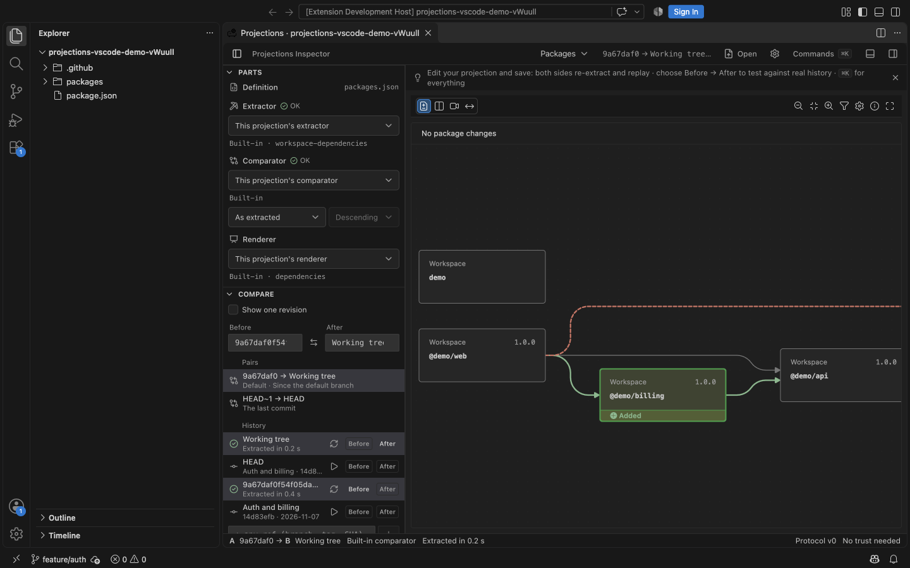
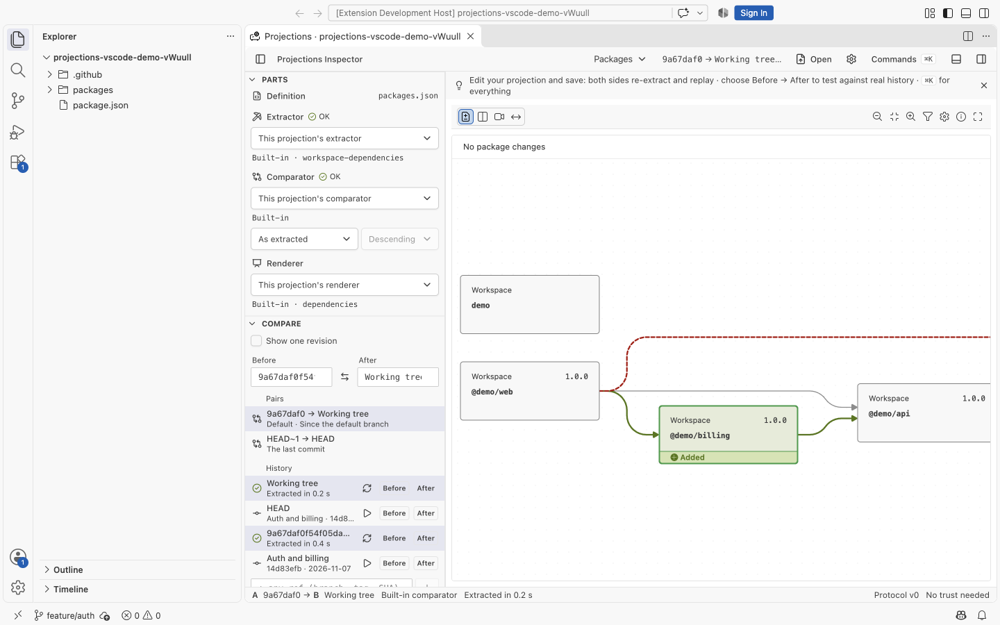
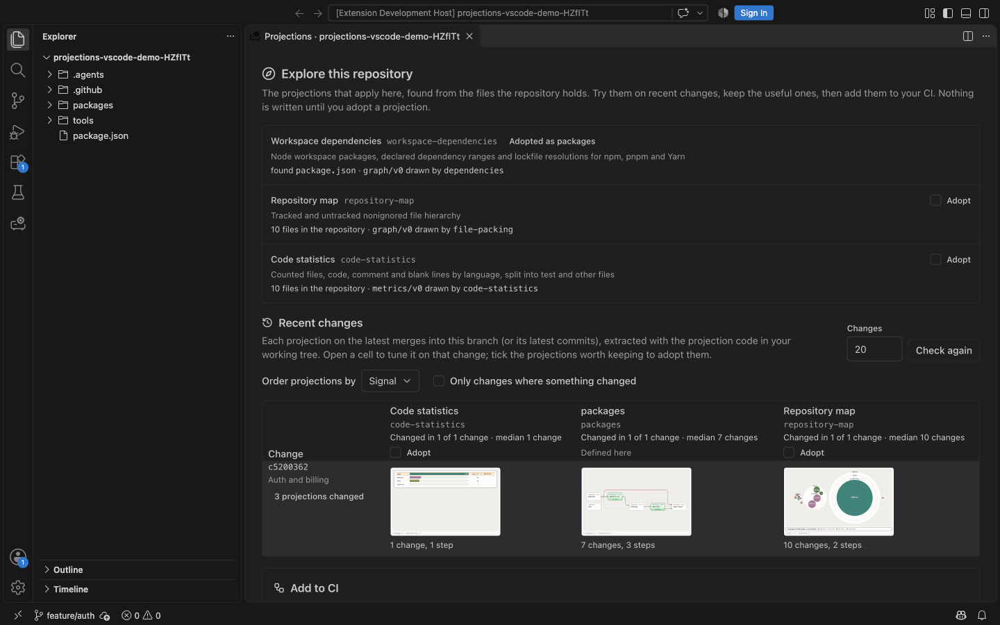

# Desktop surfaces

> **Current state:** `projections inspect` and its HTTP server are retired; the
> VS Code extension is the only interactive authoring surface, and
> `packages/host/inspector/` is a mountable UI it hosts. Mentions of the web app
> below are history.

Status: **decided and done: VS Code is the authoring experience.** All four
milestones below are done: the CLI's `serve --stdio` backend replaced the web
app's HTTP server, the VS Code extension replaced the web app as the place to
explore, inspect, adopt and add to CI. The Inspector was a local web app served
by `projections inspect`. This records whether it should also be a desktop
experience, which surfaces were tried, how one Inspector runs in all of them,
and the decision.

## Decision

Keep things general and well componentized for future expansion, but make the VS
Code extension the one authoring experience rather than the Inspector's local
web app: a surface is easier to add later than to remove.

So the VS Code extension becomes the product for visual work: exploring a
repository, the Inspector, adopting and adding to CI. The local web app is
retired, and the CLI stays the headless tool for agents and CI
(`explore --list`/`--sweep`, `adopt`, `check`, `compare`, `bookmark`). Reviewers
keep the GitHub Action's projections on pull requests. The restructure has four
milestones:

1. **Backend over stdio** (done). `projections serve --stdio` speaks JSON-RPC
   over stdin and stdout and serves the same operations the HTTP API did,
   through one service layer. The extension spawns it, so there's no port, token
   or listener; workspace trust maps to `--trust`. It replaced `inspect`'s
   loopback server and startup token
   ([Stdio backend](../runner/stdio-backend.md)).
2. **The extension is the product** (done). It hosts the Inspector, the Explore
   view, Adopt and Add to CI with the VS Code UI (`host-vscode`), saved
   artifacts (**Open Artifact…**), renderer scenarios (**Open Renderer
   Scenarios…**, replacing `inspect --fixtures`), comparator tests in the
   Testing view and offline JSON and YAML schemas, and plans Marketplace
   distribution with a bundled platform CLI
   ([`packages/integrations/vscode/`](../../packages/integrations/vscode/README.md)).
3. **Retire the web app** (done). `projections inspect`, its `--web`, `--json`
   and `--port`, and the HTTP server are gone. `packages/host/inspector/` is a
   mountable UI package. `projections explore` is headless: it prints the
   candidates and points to **Projections: Explore Repository**. Renderer
   authors who want a browser with hot updates use the fixtures workbench,
   `npm run workbench` (`projections-renderer-workbench` in
   `@githubnext/projections`), in place of `inspect --fixtures`.
4. **Docs and the agent skill** (done). The quick start is "install the VS Code
   extension, then explore your repository"; the agent skill and the agent
   prompt files have agents use the headless CLI and point people to the
   extension for visual work. Scaffolded comparator files and their tests carry
   no schema modeline, so the extension's bundled schemas validate them offline.

One narrow browser surface came back since: the [agent viewer](agent-viewer.md)
(`projections view`), a page a coding agent drives and a person watches, with no
editing. It mounts the same bundle over the same service.

The transport and host-capability seams and the mount API below stay documented,
so another host (a browser, an agent's panel, a desktop shell) can come back as
a transport and a host object rather than a fork.

## Options

<!-- prettier-ignore -->
| Surface | What it is | Verdict |
| --- | --- | --- |
| **Web app** | `projections inspect` served the Inspector on a loopback port with a startup token; any browser opened it | Retired: the extension is the host, and the CLI serves no page or HTTP API. |
| **VS Code extension** | The Inspector in a webview beside the code, started by the extension | The product (`packages/integrations/vscode/`): the Inspector's main job is "show me what my change does" while editing, and evidence links open the code. |
| **Tauri desktop app** | A native window around the same UI, bundling the runner | Deferred, see below. |

### Why Tauri is deferred

A desktop shell would give the Inspector a dock icon and a window, but little
the other surfaces lack:

- **No new capability.** The UI is already a web app, and the runner is already
  a native binary. Tauri adds a window around both, but not editor integration
  (opening files at evidence locations, source control) or agent integration,
  which are what make the other two surfaces worth having.
- **Real cost.** Signed and notarized builds for three platforms, an updater, a
  second release channel next to the CLI's, and WebKitGTK and WebView2
  differences on top of the browsers we already test. Renderers rely on
  sandboxed iframes, Workers and Wasm, which behave differently in each system
  webview.
- **Where people work.** People inspecting a change are in an editor or a pull
  request; agents are in their own tools. A standalone window is a third place
  to switch to.

Revisit if people want the Inspector without an editor or a browser (for
example, reviewing artifacts offline), or if a desktop-only capability appears
(system file associations for `.projections` artifacts, menu-bar status).
Because of the seams below, a Tauri host would be a transport and a host object
(`openFile` through the shell, `openExternal` through the opener), not a fork.

## Architecture: one Inspector, many hosts

```
                ┌───────────────────── Inspector UI (packages/host/inspector/) ──────────────────────┐
                │ mountInspector(element, {transport, host, assets, projectionView})   │
                │ → InspectorHandle {selectProjection, setPair, selectEntity, summary} │
                └───────────┬───────────────────────────────┬───────────────────────────┘
                InspectorTransport                    InspectorHost
     ┌──────────────────────┼──────────────────────┐   openFile · revealInScm · copyText
     │ postMessage bridge    │ same-origin fetch     │   openExternal · theme
     │ (VS Code webview)     │ (headless pages)      │
     └──────────┬───────────┴───────────┬──────────┘
                ▼ JSON-RPC over stdio   ▼ DevTools Fetch interception
   projections serve --stdio       --png, sweep thumbnails, check
                └──── one in-memory service: /api/*, renderer bundles ────┘
```

### Transport

Every runner call goes through an `InspectorTransport`:
`request({method, path, body?, signal?, responseType?})` to an `/api/` path,
plus an optional `next(channel, since)` change subscription (otherwise
`/api/changes` and `/api/fixtures/changes` are long-polled through `request`).
Components never call `fetch` or `EventSource` directly.

- `createMessageTransport({post, listen, subscriptions?})` carries the requests
  over `postMessage` to a bridge that forwards them (the extension: as JSON-RPC
  to `serve --stdio`). Bridges validate with `parseTransportMessage`: `/api/`
  paths only, no traversal, no schemes, `GET` without a body. Binary responses
  (sweep thumbnails) cross as `{type, base64}` and arrive as `Blob`s; with
  `subscriptions` the bridge answers `next` from change notifications.
- Any object with `origin` and `request` is a transport: the CLI's headless
  pages and the browser suite's harness use a same-origin `fetch` whose every
  request is answered in-process (DevTools Fetch interception or Playwright
  routes), with no listener.
- The HTTP transport and its startup token went with the web app. A browser host
  could return with a transport to a server of its own; the API it would serve
  is the service's (the request paths in [`docs/runner.md`](../runner.md)).

### Host capabilities

`InspectorHost` is optional, member by member; without a capability the
Inspector behaves as a plain browser page:

<!-- prettier-ignore -->
| Capability | Used by | Without it | VS Code |
| --- | --- | --- | --- |
| `openFile(path, line?, column?)` | Evidence locations, the definition path in Save to definition | Text | Opens the file beside, at the line (repository-relative paths only) |
| `revealInScm(ref)` | Command palette: Reveal Before/After in source control | Absent | Source Control view; the commit offered for copying |
| `copyText(text)` | Copy buttons | `navigator.clipboard` | `vscode.env.clipboard` |
| `openExternal(url)` | Cross-origin `http(s)` links | The browser | `vscode.env.openExternal` |
| `theme` (`{get, subscribe}` of `{colorMode, accent?}`) | The System theme choice; the lens (focus, selection, playback) | `prefers-color-scheme` | Body theme classes; `--vscode-focusBorder` |

### Mountable bundle

The client build emits `mount.js` and `mount.css` with the assets they load
(`packages/engine/`, `comparator/`, `packages/renderers/`). `mountInspector`
starts the engine (from `InspectorAssets`: Worker and Wasm URLs or bytes, and
the built-in renderer catalog), reads the runner through the transport, and
shows the Inspector, the Explore view, a saved document, a snapshot or fixtures
as the runner's mode requires. `initial` opens it on a projection and pair, and
`viewLinksInPlace` follows the pages' own `?view=` links without navigation. It
returns a handle that hosts use to drive it on someone's behalf. The handle does
only what the person could do in the page, and grants no trust. A host may also
pass its own `projectionView`, for example the VS Code UI's. There is no
standalone page any more: the extension's webview, the CLI's headless pages and
the browser suite's harness are its hosts.

`projections serve --stdio` answers the service's API as JSON-RPC over its
standard input and output, for hosts that start it as a child process
([Stdio backend](../runner/stdio-backend.md)); `--document` and `--fixtures`
serve a saved document or renderer scenarios instead of a repository.

## VS Code (`packages/integrations/vscode/`)

The extension starts `projections serve --stdio` in the workspace folder and
opens the Inspector in a webview. It is the authoring product: its commands are
**Explore Repository** (the Explore view: candidates, a sweep of recent changes,
opening a candidate on a change, adopting and Add to CI), **Open Inspector**,
**Compare Branch With Default** (the merge base with `origin/HEAD` → `HEAD`),
**Adopt…** (a quick pick, a preview in VS Code's multi-file diff, a modal
confirmation, then the write), **Add to CI…** (a quick pick that hands the Add
to CI prompt to the agent, copies it or opens the guide, writing nothing), and
evidence opens files at the line. It bundles the Projections JSON Schemas, so
definitions (and, with the YAML extension, comparator files) validate offline.
The webview mounts the Inspector with the message transport, and the extension's
bridge sends `/api/` requests to the backend as JSON-RPC requests over its
stdio. Its UI is the VS Code UI (`host-vscode`): VS Code's own controls (VSCode
Elements and codicons) in the projection view, and the Inspector's shell drawn
as VS Code's side bar sections, panel tabs, quick picks and status bar, all from
the webview's `--vscode-*` variables, so it follows the color theme, high
contrast included.








The Explore view uses the Inspector's own pages under the same `inspector.css`
token mapping, so its candidate list, sweep grid and Adopt and Add to CI panels
take VS Code's colors, fonts and buttons. Its links switch the mounted view in
place (`viewLinksInPlace`), and a sweep cell's projection and pair open the
Inspector there (`initial`). In a repository that already has projections,
candidates stay in the Explore view: the backend lists one beside the
repository's own only when the Explore view opens it. See
[Organizing the VS Code side bar](vscode-sidebar.md) for how setup, the gallery
and the Inspector could share the side bar as the extension grows.

Webview constraints and how the spike meets them:

- **No network from the webview.** It reaches the runner only through the
  bridge, so no `portMapping` is needed, and remote workspaces work the same way
  (the runner runs beside the extension host).
- **Workers.** A webview can't start a Worker from a resource URL (another
  origin). The engine and comparator Workers are single-file bundles started
  from Blob URLs, and the engine's Wasm modules are passed as bytes.
- **Renderers.** Renderers still run in `sandbox="allow-scripts"` frames with an
  opaque origin. A sandboxed frame can't load a webview resource, so each
  built-in renderer bundle (one self-contained HTML file) is opened from a Blob
  URL. A Blob document inherits the webview's policy on top of its own, so its
  script elements get the page's nonce, set on the parsed document. The
  renderer's own policy (`connect-src 'none'`, `frame-src 'none'`) still
  applies. Custom renderer bundles from the repository are relayed the same way:
  when a renderer frame's `src` is set to a `/custom-renderers/` URL, before it
  loads, the page fetches the bundle through the extension and gives the frame a
  Blob document of it with the same fragment. A renderer development server
  (`npm run dev`) isn't reachable from a webview; the built bundle is used.
- **Documents and scenarios.** **Open Artifact…** and **Open Renderer
  Scenarios…** open a panel on a saved document or a renderer package's
  scenarios, each with its own `serve --stdio --document` or `--fixtures`
  backend; fixture bundles are relayed like custom renderers, and the workbench
  runs their custom comparators and checks.
- **Changes.** The backend notifies working-tree changes; the bridge answers the
  transport's `next` from those notifications, so the webview doesn't long-poll.
- **Messages.** Messages from the extension come from the webview's own origin.
  Renderer frames post from `null`, so they can't pose as the transport.

### Three jobs

The extension is organized around three jobs: **Now** (the working tree, while
you work), **My changes** (the working tree or `HEAD` against a base, before
pushing) and **Authoring** (an edited definition on fixed, interesting commits).
What you're looking at is one choice, with an automatic default remembered per
repository: the side bar's **Viewing** section, which every tab follows (it
began as a control in each tab). The side bar has four sections, each answering
one question: Viewing, Projections, **Definition** (the only one that follows
the active tab) and **Suggested**; checks are tests in VS Code's Testing view
(D3's Develop tab was removed); refresh is manual, with an out-of-date notice.
The decisions are in
[Organizing the VS Code side bar](vscode-sidebar.md#jobs-to-be-done-decided) and
[its four sections](vscode-sidebar.md#four-sections-decided-reversible).

## Agent tools

Agents use Projections through one tool layer in the CLI
(`packages/cli/src/tools/`), built on the same in-process service as the
Inspector, with two surfaces:

- **VS Code.** The extension contributes the tools as `languageModelTools`
  (generated from the CLI's catalog) and answers them with `serve --stdio`'s
  `tools/list` and `tools/call` on the folder's shared backend, so an agent's
  comparison queues with the views' and its sweep is the one the Explore view
  shows. Writes (`adopt`, `set_part`, `update_snapshots`) preview in
  `prepareInvocation`, whose confirmation shows the files or the diff, and write
  only once the person approves, with that preview's token. `open_projection` is
  the editor's own: it opens a projection tab on a pair and selects an entity,
  so the agent can show the person what it found. `current_view` is too: it
  reads what the projection tab in front shows, which the other tools' omitted
  projection and revisions default to.
- **Other agents.** `projections mcp` serves the same tools, with the same
  schemas, as an MCP server over stdio; its [viewer](agent-viewer.md) answers
  the view actions `open_projection`, `current_view` and `refresh`. An agent
  confirms a write by calling again with the preview's `confirm` token.

Results are short text for a model (names, counts and summaries, bounded), with
the same facts as structured JSON. Trust is the backend's, as for the commands.
The extension doesn't register `projections mcp` with
`mcpServerDefinitionProviders`: VS Code's agent would see every tool twice, and
the server's writes would bypass the extension's confirmation. See
[Agent tools](../runner/agent-tools.md).

## Security

- **No listener.** The CLI binds no port: the extension's backend
  (`serve --stdio`) is reachable only through the pipes of the process that
  started it, and headless pages only through DevTools interception of their own
  reserved origin. There is no token to leak.
- **Bridges are narrow.** Only `/api/` paths, `GET` and `POST`, bounded bodies,
  and responses up to 64 MiB. Requests from the webview to open files are
  limited to repository-relative paths (no absolute paths, drive letters or
  `..`), and revisions to plain refs (never options).
- **Trust.** Repository extractor and renderer code runs only under the runner's
  `--trust`. VS Code passes it only in a trusted workspace
  (`untrustedWorkspaces: limited`) and restarts the runner when trust is
  granted. No host can grant trust from the page.
- **Content security policy.** The VS Code webview loads nothing from the
  network: nonce'd scripts from extension resources, `connect-src` limited to
  resources, Workers and frames from `blob:` only. Headless pages are
  same-origin only.
- **Sandboxed renderers everywhere.** Renderer frames keep
  `sandbox="allow-scripts"` (opaque origin), validated messages, a rate limit
  and a no-network policy in every host.

## What shipping each would take

**VS Code extension**

- **Marketplace and Open VSX.** One platform-specific `.vsix` per target
  (`darwin-arm64`, `darwin-x64`, `linux-x64`, `linux-arm64`, `linux-armhf`,
  `alpine-x64`, `alpine-arm64`, `win32-x64`, `win32-arm64`), each with the
  matching `projections` release in `bin/<platform>-<arch>/`
  (`packages/integrations/vscode/scripts/package.mjs` stages it), plus a
  universal `.vsix` without one for other platforms, which uses
  `projections.cliPath`, `PROJECTIONS_CLI` or `PATH`.
  `vsce publish --packagePath` and `ovsx publish --packagePath` publish them
  under the `githubnext` publisher.
- **Updates.** The Marketplace and Open VSX update extensions; the bundled CLI
  is pinned to the extension's version, so the backend updates with it. The
  extension refuses a CLI whose `initialize` protocol or version doesn't suit it
  (same major version, same minor while `0.x`) and says how to fix it, so a
  configured or `PATH` CLI can't drift silently.
- **Still to do:** release CI that builds each target's CLI, packages and signs
  (`vsce` signs for the Marketplace) and publishes; the README and changelog for
  the listing; CI that runs the `@vscode/test-electron` smoke test on Linux
  under `xvfb`; the side bar (see
  [Organizing the VS Code side bar](vscode-sidebar.md)); multi-root workspaces
  beyond one backend per folder; and renderer development servers in the
  webview.

**Tauri**

- Code signing and notarization, an updater, the runner as a sidecar, and
  testing in each system webview. Not planned (see above).

## Tests

- `packages/host/inspector/test/transport.test.mjs`: API path validation, the
  message transport end to end (including aborts, `Blob` responses and `next`
  subscriptions), and `including`.
- `packages/host/inspector/browser/`: the mounted Inspector in Chromium
  (`harness.ts`: the built bundle over a real `serve --stdio`, with every
  request answered by Playwright routes): the switcher, pairs, details, Explore
  with its sweep, Adopt and Add to CI, the fixtures workbench, loading states
  and the toolbar.
- `packages/integrations/vscode/test/extension.test.mjs`: the JSON-RPC client
  (ids, cancellation, notifications, a backend that exits), the bridge (status
  and body relay, binary bodies, the size limit, aborts, change subscriptions
  from notifications, custom renderer files), CLI resolution and version
  compatibility, Adopt previews, the real `serve --stdio` backend, the webview
  policy, and validation of host requests and the backend's `initialize`.
  `packages/integrations/vscode/test/smoke/` runs the extension in VS Code with
  `@vscode/test-electron`.
- `packages/cli/test/serve.test.mjs`: `serve --stdio`, including `--document`
  and `--fixtures`; `packages/cli/tests/snapshot.rs`: headless rendering without
  a listener.
- `packages/integrations/vscode/test/build.test.mjs`: the bundled schemas (for
  either `$id` base) and the packaging script.
- `packages/integrations/vscode/test/smoke/` (`suite.cjs` and its `workflows/`)
  in real VS Code: Explore's candidates, a sweep and a candidate opened on a
  change, Adopt with a dry run, the Inspector and a comparison, the Comparator
  part listing and running a `*.comparator.yaml`, evidence opening its file,
  Compare Branch With Default, a saved extraction (Open Artifact), a scenario
  whose custom comparator runs in the workbench (Open Renderer Scenarios), and a
  bad definition reported from the bundled schema with schema downloads off.
