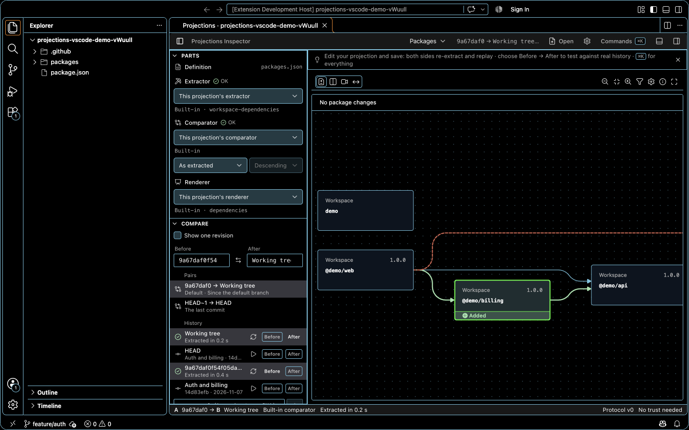
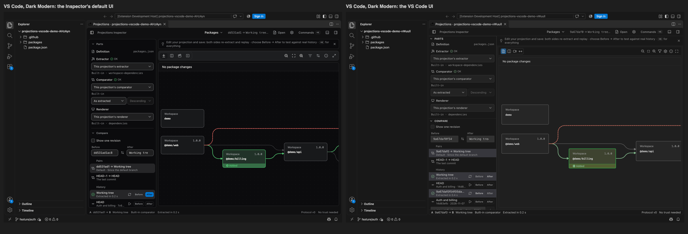

# Desktop surfaces

> **Current state:** `projections inspect` and its HTTP server have been
> retired. The VS Code extension is now the only interactive authoring surface,
> and `packages/host/inspector/` is a mountable UI package it hosts. References
> to the local web app below are historical.

Status: **decided and done: VS Code is the authoring experience.** All four
milestones below are complete: the CLI's `serve --stdio` backend replaced the
web app's HTTP server, and the VS Code extension replaced the web app for
exploring, inspecting, adopting, and adding projections to CI. The Inspector
started life as a local web app served by `projections inspect`; this document
records the desktop options we evaluated, how one Inspector runs across hosts,
and why we chose VS Code.

## Decision

Keep the architecture modular and reusable for future hosts, but commit to the
VS Code extension as the single authoring experience instead of maintaining a
local web app — it is always easier to add a surface later than to retire one.

That puts all visual authoring inside the VS Code extension: exploring a
repository, inspecting projections, adopting them, and adding them to CI. The
local web app is gone, while the CLI remains the headless tool for agents and CI
(`explore --list`/`--sweep`, `adopt`, `check`, `compare`, `bookmark`), and
reviewers keep seeing GitHub Action projections on pull requests. The transition
had four milestones:

1. **Backend over stdio** (done). `projections serve --stdio` speaks JSON-RPC
   over stdin and stdout and exposes the same operations the HTTP API used to,
   backed by a single service layer. Because the extension spawns it directly,
   there is no port, token, or network listener, and VS Code workspace trust
   maps cleanly to `--trust`. This replaced `inspect`'s loopback server and
   startup token ([Stdio backend](../runner/stdio-backend.md)).
2. **The extension is the product** (done). It hosts the Inspector, the Explore
   view, Adopt, and Add to CI using the VS Code UI (`host-vscode`), plus saved
   artifacts (**Open Artifact…**), renderer scenarios (**Open Renderer
   Scenarios…**, replacing `inspect --fixtures`), comparator tests in the
   Testing view, and offline JSON and YAML schemas. Marketplace distribution
   bundles a platform-specific CLI
   ([`packages/integrations/vscode/`](../../packages/integrations/vscode/README.md)).
3. **Retire the web app** (done). `projections inspect` — along with `--web`,
   `--json`, `--port`, and the HTTP server — has been removed.
   `packages/host/inspector/` is now a mountable UI package, and
   `projections explore` runs headlessly, printing candidates and pointing to
   **Projections: Explore Repository**. Renderer authors who want a browser with
   hot updates can use the fixtures workbench via `npm run workbench`
   (`projections-renderer-workbench` in `@githubnext/projections`) instead of
   `inspect --fixtures`.
4. **Docs and the agent skill** (done). The quick start now leads with
   installing the VS Code extension and exploring your repository. The agent
   skill and prompt files steer agents toward the headless CLI while pointing
   users to the extension for visual inspection. Scaffolded comparator files and
   tests omit schema modelines so the extension's bundled schemas validate them
   offline.

One focused browser surface has returned since: the
[agent viewer](agent-viewer.md) (`projections view`), a read-only page that a
coding agent drives while a person watches. It mounts the exact same bundle over
the same service.

The transport, host-capability, and mount seams documented below remain intact
so any future host — a browser, an agent panel, or a desktop shell — can plug in
with a transport and a host object rather than forking the UI.

## Options

<!-- prettier-ignore -->
| Surface | What it is | Verdict |
| --- | --- | --- |
| **Web app** | `projections inspect` served the Inspector on a loopback port with a startup token; any browser opened it | Retired: the extension is the host, and the CLI serves no page or HTTP API. |
| **VS Code extension** | The Inspector in a webview beside the code, started by the extension | The product (`packages/integrations/vscode/`): the Inspector's main job is "show me what my change does" while editing, and evidence links open the code. |
| **Tauri desktop app** | A native window around the same UI, bundling the runner | Deferred, see below. |

### Why Tauri is deferred

A standalone desktop shell would give the Inspector a window and a dock icon,
but not much else:

- **No new capability.** The UI is already a web bundle and the runner is
  already a native binary. Wrapping them in Tauri doesn't buy editor integration
  (jumping to files at evidence locations, source control) or agent integration,
  which are the real value drivers.
- **High maintenance cost.** Shipping Tauri means signed and notarized builds
  across three platforms, an updater, a second release channel alongside the
  CLI, and WebKitGTK/WebView2 quirks on top of the browsers we already test.
  Renderers depend on sandboxed iframes, Workers, and Wasm, which vary across
  system webviews.
- **Wrong context.** Developers inspecting changes are already in their editor
  or on a pull request, and agents live in their own tools. A standalone app is
  just a third window to switch to.

We can revisit Tauri if users need the Inspector without an editor or browser
(say, for offline artifact review) or if a genuinely desktop-only capability
emerges (like OS file associations for `.projections` artifacts or menu-bar
status). Thanks to the seams below, adding a Tauri host later would just mean
writing a transport and a host object (`openFile` via the shell, `openExternal`
via the opener), not forking anything.

## Architecture: one Inspector, many hosts

```
                ┌───────────────────── Inspector UI (packages/host/inspector/) ──────────────────────┐
                │ mountInspector(element, {transport, host, assets, projectionView})   │
                │ → InspectorHandle {selectProjection, setPair, selectEntity, summary} │
                └───────────┬───────────────────────────────┬───────────────────────────┘
                InspectorTransport                    InspectorHost
     ┌──────────────────────┼──────────────────────┐   openFile · revealInScm · copyText
     │ postMessage bridge    │ same-origin fetch     │   openExternal · theme
     │ (VS Code webview)     │ (headless pages)      │
     └──────────┬───────────┴───────────┬──────────┘
                ▼ JSON-RPC over stdio   ▼ DevTools Fetch interception
   projections serve --stdio       --png, sweep thumbnails, check
                └──── one in-memory service: /api/*, renderer bundles ────┘
```

### Transport

All runner calls go through an `InspectorTransport`:
`request({method, path, body?, signal?, responseType?})` targeting an `/api/`
path, plus an optional `next(channel, since)` subscription for change events
(when omitted, `/api/changes` and `/api/fixtures/changes` fall back to long
polling via `request`). UI components never call `fetch` or `EventSource`
directly.

- `createMessageTransport({post, listen, subscriptions?})` forwards requests
  over `postMessage` to a host bridge (in VS Code, translating them to JSON-RPC
  calls against `serve --stdio`). Bridges validate incoming requests with
  `parseTransportMessage`: `/api/` paths only, no path traversal, no URL
  schemes, and no body on `GET`. Binary payloads like sweep thumbnails travel as
  `{type, base64}` and arrive as `Blob`s, and when `subscriptions` is supplied,
  the bridge satisfies `next` directly from change notifications.
- Any object exposing `origin` and `request` qualifies as a transport. The CLI's
  headless pages and the browser test harness use same-origin `fetch` answered
  entirely in-process via DevTools Fetch interception or Playwright routes, with
  no network listener.
- The old HTTP transport and startup token left with the web app. If another
  browser host comes along later, it only needs a transport pointing at its own
  server implementing the service's API (see the request paths in
  [`docs/runner.md`](../runner.md)).

### Host capabilities

Every member of `InspectorHost` is optional; if a host omits one, the Inspector
falls back gracefully to plain browser behavior:

<!-- prettier-ignore -->
| Capability | Used by | Without it | VS Code |
| --- | --- | --- | --- |
| `openFile(path, line?, column?)` | Evidence locations, the definition path in Save to definition | Text | Opens the file beside, at the line (repository-relative paths only) |
| `revealInScm(ref)` | Command palette: Reveal Before/After in source control | Absent | Source Control view; the commit offered for copying |
| `copyText(text)` | Copy buttons | `navigator.clipboard` | `vscode.env.clipboard` |
| `openExternal(url)` | Cross-origin `http(s)` links | The browser | `vscode.env.openExternal` |
| `theme` (`{get, subscribe}` of `{colorMode, accent?}`) | The System theme choice; the lens (focus, selection, playback) | `prefers-color-scheme` | Body theme classes; `--vscode-focusBorder` |

### Mountable bundle

The client build outputs `mount.js` and `mount.css` alongside their runtime
assets (`packages/engine/`, `comparator/`, `packages/renderers/`). Calling
`mountInspector` boots the engine from `InspectorAssets` (Worker and Wasm URLs
or raw bytes, plus the built-in renderer catalog), connects to the runner over
the transport, and renders whichever surface the runner's mode calls for —
Inspector, Explore view, saved document, snapshot, or fixtures. Passing
`initial` opens straight onto a specific projection and pair, and
`viewLinksInPlace` handles internal `?view=` links without full page navigation.

`mountInspector` returns a handle that hosts can use to drive the view on the
user's behalf; it can only perform actions the user could perform in the page
and never grants trust. Hosts can also supply a custom `projectionView`, such as
the VS Code UI. There is no standalone HTML page left — the VS Code webview, the
CLI's headless pages, and the browser test harness are all consumers of this
mount API.

For hosts spawning the runner as a child process, `projections serve --stdio`
exposes the service API over JSON-RPC on stdin/stdout
([Stdio backend](../runner/stdio-backend.md)); `--document` and `--fixtures`
switch it to serve a saved document or renderer scenarios instead of a
repository.

## VS Code (`packages/integrations/vscode/`)

The extension spawns `projections serve --stdio` inside the workspace folder and
mounts the Inspector in a webview. As the primary authoring surface, it provides
commands for **Explore Repository** (candidates, recent-history sweeps,
inspecting a candidate on a change, adopting, and adding to CI), **Open
Inspector**, **Compare Branch With Default** (merge base with `origin/HEAD` →
`HEAD`), **Adopt…** (quick pick, preview in VS Code's multi-file diff, modal
confirmation, then write), and **Add to CI…** (quick pick that hands the CI
prompt to your agent, copies it, or opens the guide without writing files).
Evidence links open source files directly at the matching line, and bundled JSON
Schemas validate definitions (plus comparator files when the YAML extension is
installed) completely offline.

Inside the webview, the Inspector uses the message transport while the extension
bridge relays `/api/` calls over stdio JSON-RPC. Visually, it uses `host-vscode`
— VSCode Elements and codicons inside the projection view, and an Inspector
shell styled after VS Code's side bar sections, panel tabs, quick picks, and
status bar via `--vscode-*` CSS variables, so Light, Dark, and High Contrast
themes all work seamlessly.







The Explore view renders the Inspector's own pages through the same
`inspector.css` token mapping, so its candidate list, sweep grid, and Adopt /
Add to CI panels inherit VS Code's colors, typography, and buttons. Its links
navigate in place (`viewLinksInPlace`), and clicking a sweep cell opens the
Inspector on that projection and pair (`initial`). When a repository already has
projections, trial candidates stay tucked inside Explore and only appear next to
authored projections once opened from Explore. See
[Organizing the VS Code side bar](vscode-sidebar.md) for how setup, the gallery,
and the Inspector share the side bar.

VS Code webviews come with tight restrictions; here is how the extension handles
them:

- **No direct network access.** Everything talks to the runner over the bridge,
  so no `portMapping` is needed and remote workspaces work identically because
  the runner executes alongside the extension host.
- **Workers.** Webviews can't spawn Workers from extension resource URLs
  (different origin), so the engine and comparator Workers are single-file
  bundles loaded from Blob URLs, with Wasm binaries passed in as raw bytes.
- **Renderers.** Renderers stay inside `sandbox="allow-scripts"` frames with
  opaque origins. Because sandboxed frames can't load webview resources, each
  self-contained built-in renderer HTML bundle opens via a Blob URL. Blob
  documents inherit the webview's CSP on top of their own, so we stamp the
  page's nonce onto parsed script elements while keeping the renderer's own
  `connect-src 'none'` and `frame-src 'none'` intact. Custom renderer bundles
  from the repository follow the same path: when a frame's `src` is set to a
  `/custom-renderers/` URL, the page fetches it through the extension and hands
  the frame a Blob document preserving the fragment. Live renderer dev servers
  (`npm run dev`) aren't reachable from a webview, so the built bundle is used.
- **Documents and scenarios.** **Open Artifact…** and **Open Renderer
  Scenarios…** open panels backed by `serve --stdio --document` or `--fixtures`.
  Fixture bundles relay just like custom renderers, and the workbench runs their
  custom comparators and checks.
- **Changes.** The backend pushes working-tree change notifications, which the
  bridge feeds into the transport's `next` so the webview avoids long polling.
- **Messages.** Extension messages arrive from the webview's own origin, whereas
  sandboxed renderer frames post from `null` and can never impersonate the
  transport.

### Three jobs

The extension centers on three workflows: **Now** (your working tree while
coding), **My changes** (the working tree or `HEAD` against a base before
pushing), and **Authoring** (an edited definition tested on fixed commits). What
you're viewing is a single choice with a per-repository automatic default,
controlled from the side bar's **Viewing** section so every open tab stays in
sync (it originally lived inside each tab). The side bar has four sections, each
answering one question: Viewing, Projections, **Definition** (the only one that
tracks the active tab), and **Suggested**. Checks live in VS Code's Testing view
(D3's Develop tab was removed), and refresh is manual with an out-of-date
indicator. See
[Organizing the VS Code side bar](vscode-sidebar.md#jobs-to-be-done-decided) and
[its four sections](vscode-sidebar.md#four-sections-decided-reversible) for the
full rationale.

## Agent tools

Agents interact with Projections through a single tool layer in the CLI
(`packages/cli/src/tools/`), built on the same in-process service as the
Inspector and exposed through two surfaces:

- **VS Code.** The extension registers the tools as `languageModelTools`
  (generated from the CLI's catalog) and routes them to `serve --stdio`'s
  `tools/list` and `tools/call` on the folder's shared backend. That means an
  agent's comparison queues cleanly with open views, and its sweep matches what
  the Explore view displays. Mutating tools (`adopt`, `set_part`,
  `update_snapshots`) generate a preview in `prepareInvocation` so the user
  reviews the files or diff and confirms before writing with that preview's
  token. The editor also adds `open_projection` (opening a tab on a pair and
  selecting an entity so the agent can show its findings) and `current_view`
  (reading the active projection tab, which other tools use as their default
  when projection or revisions are omitted).
- **Other agents.** `projections mcp` exposes the exact same tools and schemas
  as an MCP server over stdio, while its [viewer](agent-viewer.md) handles
  `open_projection`, `current_view`, and `refresh`. Agents confirm writes by
  re-calling with the preview's `confirm` token.

Tool results return compact, bounded text for the model (names, counts,
summaries) paired with the same facts as structured JSON, under the backend's
trust rules. The extension intentionally does not register `projections mcp` via
`mcpServerDefinitionProviders`: otherwise VS Code's agent would see duplicate
tools and MCP writes would bypass the extension's confirmation UI. See
[Agent tools](../runner/agent-tools.md).

## Security

- **No network listener.** The CLI never opens a port. `serve --stdio` only
  communicates over its parent process's pipes, and headless pages use DevTools
  interception on a reserved origin, leaving no startup token to leak.
- **Narrow bridges.** Only `/api/` paths, `GET` and `POST`, bounded request
  bodies, and responses capped at 64 MiB are allowed. File-open requests from
  the webview must be repository-relative (no absolute paths, drive letters, or
  `..`), and revisions must be plain refs rather than CLI options.
- **Trust.** Repository extractor and renderer code only executes when the
  runner receives `--trust`. VS Code passes it only in trusted workspaces
  (`untrustedWorkspaces: limited`) and restarts the runner if trust is granted.
  Nothing inside the page can grant trust.
- **Content security policy.** The VS Code webview makes zero network requests:
  scripts require nonces from extension resources, `connect-src` is limited to
  resources, and Workers and frames come exclusively from `blob:`. Headless
  pages stay strictly same-origin.
- **Sandboxed renderers everywhere.** Across every host, renderer frames run
  with `sandbox="allow-scripts"` (opaque origin), validated messages, rate
  limiting, and a no-network policy.

## What shipping each would take

**VS Code extension**

- **Marketplace and Open VSX.** Build one platform-specific `.vsix` per target
  (`darwin-arm64`, `darwin-x64`, `linux-x64`, `linux-arm64`, `linux-armhf`,
  `alpine-x64`, `alpine-arm64`, `win32-x64`, `win32-arm64`) bundling the
  matching `projections` binary in `bin/<platform>-<arch>/` (staged by
  `packages/integrations/vscode/scripts/package.mjs`), plus a universal `.vsix`
  that falls back to `projections.cliPath`, `PROJECTIONS_CLI`, or `PATH`.
  Publish under the `githubnext` publisher with `vsce publish --packagePath` and
  `ovsx publish --packagePath`.
- **Updates.** Both marketplaces handle extension updates, and the bundled CLI
  is pinned to the extension version so the backend upgrades alongside it. On
  startup, the extension rejects any CLI whose `initialize` protocol or version
  doesn't match (same major version, and same minor while `0.x`) and explains
  how to fix it, preventing silent drift from a configured or `PATH` binary.
- **Remaining work:** release CI to build each target CLI, package, sign (`vsce`
  signs for the Marketplace), and publish; listing README and changelog; CI
  running the `@vscode/test-electron` smoke test on Linux under `xvfb`; the side
  bar ([Organizing the VS Code side bar](vscode-sidebar.md)); multi-root
  workspaces beyond one backend per folder; and renderer dev servers inside the
  webview.

**Tauri**

- Code signing, notarization, an auto-updater, shipping the runner as a sidecar,
  and cross-webview testing. Not planned (see above).

## Tests

- `packages/host/inspector/test/transport.test.mjs` covers API path validation,
  the message transport end to end (aborts, `Blob` responses, `next`
  subscriptions), and `including`.
- `packages/host/inspector/browser/` runs the mounted Inspector in Chromium
  (`harness.ts`, wiring the built bundle to a real `serve --stdio` via
  Playwright routes), testing the switcher, pairs, details, Explore and sweeps,
  Adopt and Add to CI, the fixtures workbench, loading states, and the toolbar.
- `packages/integrations/vscode/test/extension.test.mjs` exercises the JSON-RPC
  client (IDs, cancellation, notifications, exiting backend), the bridge (status
  and body relay, binary payloads, size limits, aborts, notification-backed
  change subscriptions, custom renderer files), CLI resolution and version
  checks, Adopt previews, the live `serve --stdio` backend, webview CSP, and
  validation of host requests and `initialize`.
  `packages/integrations/vscode/test/smoke/` runs the extension inside real VS
  Code via `@vscode/test-electron`.
- `packages/cli/test/serve.test.mjs` tests `serve --stdio`, including
  `--document` and `--fixtures`; `packages/cli/tests/snapshot.rs` verifies
  headless rendering without a network listener.
- `packages/integrations/vscode/test/build.test.mjs` checks the bundled schemas
  (for either `$id` base) and the packaging script.
- `packages/integrations/vscode/test/smoke/` (`suite.cjs` and its `workflows/`)
  runs end-to-end flows in real VS Code: Explore candidates, sweeping and
  opening a candidate on a change, dry-run Adopt, Inspector comparisons, the
  Comparator part listing and running a `*.comparator.yaml`, evidence opening
  source files, Compare Branch With Default, Open Artifact on a saved
  extraction, Open Renderer Scenarios running a custom comparator in the
  workbench, and schema diagnostics on an invalid definition with downloads
  disabled.
