# Organizing the VS Code side bar

Status: **built, then redesigned around three jobs** (see
[Jobs to be done](#jobs-to-be-done-decided), decided and in progress; it
supersedes the Compare section and pair-first tabs described below). The
recommended layout below was built; see [What was built](#what-was-built) for
where it differs. The VS Code extension is now the authoring experience and the
web Inspector is retired (see [Desktop surfaces](desktop-surfaces.md)); the
"Before" column below records where each job lived in the web app. This compares
ways to lay out the Projections VS Code extension once it does more than open
the Inspector. It assumes the extension grows to cover the whole loop: setup
(explore, sweep, adopt, add to CI), the example gallery, the Inspector,
authoring a projection's parts, reviewing a branch or pull request, and renderer
development with scenarios. The extension spike
(`packages/integrations/vscode/`) and [Desktop surfaces](desktop-surfaces.md)
describe how the Inspector itself runs in a webview.

Decided so far:

- **Projections gets its own activity bar item.** That rules out option 3 as the
  main layout, though its Source Control and Problems integrations still apply.
- **A projection is a document.** Each projection is the subject of its own
  editor tab, the way a file is, rather than a selection inside one Inspector
  tab per repository. The recommendation below works this through.

## What has to fit

<!-- prettier-ignore -->
| Job | Who, when | What it needs on screen | Before, in the web Inspector |
| --- | --- | --- | --- |
| **Setup** | Once per repository, early | Candidates and why they apply, a sweep grid across recent changes, adopt with previews, then Add to CI | The Explore view (`projections explore`), [onboarding loop](onboarding-loop.md) |
| **Gallery** | Before setup, or when choosing a renderer | Examples of each projection kind on real changes, the built-in extractors and renderers | `projections extractor list` |
| **Inspect** | Daily, while changing code | A projection's Before → After diff, large; selection details; evidence that opens files | The Inspector's stage, Details dock |
| **Navigate** | Constantly, while inspecting | Projection switcher, pair pickers, pairs and bookmarks, history | Inspector Explorer: Compare, Pairs, History |
| **Author** | When tuning a projection | Parts (extractor, comparator, renderer), the definition file, diagnostics, raw output | Inspector Explorer: Parts; bottom panel |
| **Review** | On a feature branch or pull request | What changed structurally in this branch, across every adopted projection | `Compare Branch With Default`; the GitHub Action's comment |
| **Develop a renderer** | Renderer authors | Scenarios, the renderer's development server, checks | Fixtures workbench (then `inspect --fixtures`; now **Open Renderer Scenarios…** or `npm run workbench`) |

Two facts shape every option:

- **Big content needs the editor area.** The Inspector's diff, the sweep grid
  and gallery examples are wide, animated, and run sandboxed renderers. A side
  bar is 250–400px wide, so these belong in editor tabs (webview panels), not in
  the side bar.
- **Each webview costs memory.** Each Inspector webview starts its own engine
  and comparator Workers and renderer frames. The side bar should be cheap
  native UI (tree views, welcome content, quick picks) that opens editor
  webviews, sharing one runner per repository. It should not become a second
  copy of the Inspector.

## VS Code's building blocks

<!-- prettier-ignore -->
| Block | Good for | Limits |
| --- | --- | --- |
| **View container** in the activity bar (`viewsContainers.activitybar`) | A "Projections" icon, and our own stack of views | One icon among many. Users can move it to the secondary side bar or the panel. |
| **Views in built-in containers** (`views.explorer`, `views.scm`, `views.test`) | Showing up where people already look (Source Control for review) | We share the space; collapsed by default unless useful |
| **Tree views** (`TreeDataProvider`) | Lists and hierarchies: projections, parts, pairs, bookmarks, candidates, history. Native keyboard, theming and accessibility; inline and context actions; badges; descriptions; `resourceUri` decorations | Text, icons and actions only; no custom drawing |
| **Webview views** (`type: "webview"` in a side bar container) | Rich but small UI: a mini summary, a thumbnail strip | Not native; each one is a webview with its own memory, focus and theming work |
| **Welcome content** (`viewsWelcome`) | Empty states with command links ("Explore this repository") | Shown only when a view is empty |
| **Walkthroughs** (`contributes.walkthroughs`) | A guided setup checklist on the Welcome page, steps completed by commands or context keys | Runs from the Welcome page, not the side bar |
| **Editor webview panels / custom editors** | The Inspector, the sweep grid, the gallery; a custom editor for `.github/projections/*.json` | Heavy; one per tab |
| **Quick picks** | The projection switcher, pair pickers, gallery search, adopt choices | Transient |
| **Panel views, Problems, Output** | Diagnostics (extractor and definition errors as `Diagnostic`s on the definition file), raw output, the run log | Bottom panel space is shared with the terminal |
| **Status bar items** | The current projection and pair, extraction state, trust | Very small |
| **SCM integration** (`scm/title`, resource context menus), **Comments API** | Review: "Show projections for this change", annotations on a pull request | No supported way to add a column to the SCM list itself |

## Option 1: One container with fixed sections

One "Projections" activity bar container holds every job as a collapsible view,
always present:

```
PROJECTIONS
▸ GET STARTED          (welcome: Explore · Open gallery)
▾ PROJECTIONS          packages ✓  ·  data-model ⚠  ·  api-surface
▾ COMPARE              main → HEAD   [Swap] [Open Inspector]
▸ PAIRS & BOOKMARKS
▸ HISTORY
▸ PARTS                extractor · comparator · renderer
▸ GALLERY
```

- **For:** simple, and easy to find. It mirrors the web Inspector's Explorer, so
  one mental model covers both.
- **Against:** seven sections compete for one column. Setup sections stay around
  long after setup is done. People will collapse most views and never reopen
  them. "Compare" and "Parts" duplicate the Inspector's own controls, so there
  are two places to change the same state, and they have to stay in sync.

## Option 2: Organized by lifecycle stage

Still one container, but its views change with the repository's state through
`when` clauses on context keys the extension sets (`projections.hasDefinitions`,
`projections.exploring`, `projections.renderer`):

<!-- prettier-ignore -->
| Stage | Context | Views shown |
| --- | --- | --- |
| New repository | no definitions | **Candidates** (from `explore`, each with its detection reason), **Gallery**; welcome content "Explore this repository" |
| Exploring | a sweep session | **Candidates** with sweep signal ("changed in 6 of 20"), **Adopt** (ticked candidates → Adopt…, then Add to CI…) |
| Adopted | definitions exist | **Projections**, **Pairs & bookmarks**, **History**; setup moves to a "Setup" walkthrough and a `…` menu |
| Renderer package | a `renderer.json` or scenarios file in the workspace | **Scenarios**, **Checks** |

- **For:** each stage sees only what applies, and the side bar stays short.
  Setup fades away once the work is done but is still reachable. This matches
  the onboarding loop: explore, then adopt, then use.
- **Against:** views that appear and disappear can disorient people, and
  documentation has to describe each state. Multi-root workspaces can mix
  stages, so the context has to be per folder (or the views group by folder). It
  needs careful welcome content so an empty view always says what to do next.

## Option 3: Spread into native containers (ruled out as the main layout)

There is no container of our own. Projections shows up wherever the job already
lives:

- **Explorer:** a "Projections" view listing definitions, collapsed by default.
- **Source Control:** a "Projection changes" view for the current branch (each
  adopted projection with its change counts against the default branch; opening
  one opens the Inspector on that pair), plus an `scm/title` action.
- **Testing-style checks:** renderer scenarios as tests (Test Explorer), if
  renderer development is in scope.
- **Problems:** extractor and definition diagnostics. **Output:** raw runner
  output.
- **Walkthrough:** setup. **Command palette / quick picks:** gallery and
  switching.

- **For:** feels the most native. Review lands where people already review
  changes. Nothing new to discover, and no activity bar icon.
- **Against:** no single home, so the product feels scattered and is hard to
  explain or screenshot. Setup and the gallery have no lasting place. It depends
  on tolerance for our views in shared containers. The Testing mapping is a
  stretch for renderers that aren't really tests.

## Option 4: A side bar webview running the Inspector shell

The container holds one webview view running the Inspector's own Explorer (the
React shell, styled by `host-vscode`). Selecting an item drives an editor-area
Inspector webview.

- **For:** maximum reuse; the side bar is identical to the web Inspector's
  Explorer and gets features for free.
- **Against:** not native (keyboard, screen readers, density, drag and drop,
  context menus all differ subtly from VS Code's). It's a second webview and
  engine to keep alive (`retainContextWhenHidden` or rebuild on every reveal).
  Two webviews have to sync state over messages. VS Code's guidance is to prefer
  tree views for navigation.

## Recommended: projections as documents, with a Projections activity bar item

Treat each projection the way VS Code treats a file. The activity bar item opens
a Projections view that lists them like the Explorer lists files. Opening one
opens a tab whose subject is that projection: its title, an icon for its kind,
preview (italic) until it's kept, split, moved, closed, and restored with the
window. The web Inspector's job (one projection at a time, with a switcher)
becomes VS Code's own tab model.

```
┌──┬──────────────────────────────┬───────────────────────────────────────────────────────────────┐
│  │ PROJECTIONS            ⟳ … │ ◇ Packages ×  ⬡ Data model ×  ⌁ API surface ×        ▣ ⇄ ▶ ⚙ … │
│◇ │ ▾ COMPARE                     │ main → HEAD · 3 added · 1 removed                             │
│  │   main → HEAD           ⇄     ├───────────────────────────────────────────────────────────────┤
│  │ ▾ PROJECTIONS                 │                                                               │
│  │   ◇ Packages      3 changes   │              (the projection: its renderer, full size)        │
│  │   ⬡ Data model    no change   │                                                               │
│  │   ⌁ API surface   ⚠ trust     │                                                               │
│  │ ▸ PAIRS & BOOKMARKS           │                                                               │
│  │ ▸ SET UP          2 candidates│                                                               │
└──┴──────────────────────────────┴───────────────────────────────────────────────────────────────┘
 ◇ main → HEAD · Packages: 3 changes                                        (status bar)
```

### The document

- **What a tab is.** A projection of a repository: `projection:/<folder>/<id>`,
  a read-only custom editor (`CustomReadonlyEditorProvider`) on a virtual URI.
  Because it's an editor on a resource, it gets VS Code's document behavior for
  free: preview tabs (single click opens in the reused italic tab, double click
  or any edit keeps it), Open to the Side, split and grid layouts, Reopen Closed
  Editor, editor history and Go Back, and restoring the window's tabs (a
  `WebviewPanelSerializer` / custom editor restore).
- **Title and icon.** The tab title is the projection's title ("Packages"). Its
  icon is a codicon for the renderer's kind (graph, database, API, file map),
  from the same icon map `host-vscode` uses. When two folders define the same
  projection, the description adds the folder, as VS Code does for files with
  the same name.
- **Editor title actions instead of a toolbar.** The projection's controls
  become `editor/title` actions, the native row at the top right of a tab: the
  comparison mode as a toggle (like the diff editor's inline and side by side
  toggle), swap Before and After, play, and settings and "Show as table or text"
  in the `…` menu. The webview then shows only the projection and its notices;
  the in-page toolbar stays for the web Inspector.
- **Dirty state is authoring.** Changing a part (extractor, comparator,
  renderer) is an edit: the tab shows as modified, Save writes
  `.github/projections/<id>.json` (previewed first, as Save to definition does
  today), and Revert drops the session overrides. The definition file can also
  open _as_ the projection: `Open With… → Projection`, with `Reopen as text` to
  get back to the JSON, the way Markdown preview and the settings editor pair a
  document with a view of it.
- **The pair is the data axis.** The Compare section, the status bar and a quick
  pick set one Before → After pair for the folder, and every open projection tab
  follows it, as the web Inspector keeps the pair when switching projections. A
  tab can pin its own pair (like a diff editor between two named revisions), and
  its title then carries it ("Packages · v1 → v2").
- **Details.** The selection's details show as a hover card in the tab and in an
  optional "Details" view (users can move it to the secondary side bar).
  Evidence opens the file beside the projection.

### The activity bar item

The Projections container (its own codicon, with a badge for the number of
projections that changed in the current pair) holds:

<!-- prettier-ignore -->
| Section | Contents | When |
| --- | --- | --- |
| **Compare** | The current pair with Swap and Change… (quick pick of suggested pairs, branches and recent commits) | Definitions exist |
| **Projections** | One row per projection, like files: the icon, the title, a description ("3 changes", "no change", "needs trust", "failed"), a tooltip with the extractor and renderer; children are its parts (since: flat leaves, with the parts in Configuration) | Definitions exist |
| **Pairs & bookmarks** | Suggested pairs, `.projections-bookmarks.json`, recent pairs | Definitions exist |
| **Set up** | Candidates from `explore` with their detection reason; Sweep, Adopt and Add to CI actions | Always; expanded while there are no definitions |
| **Scenarios** | A renderer package's scenarios | A renderer package is open |

With no definitions, welcome content leads: "Explore this repository", "Browse
the gallery", and a link to the setup walkthrough. The gallery is an editor
opened from there and from the `…` menu, not a permanent section. Diagnostics go
to Problems on the definition files, raw output to an output channel, and a
"Projection changes" view in Source Control serves branch review.

### Costs and how to contain them

- **Memory per tab.** Each projection tab is a webview with its own engine
  Worker and renderer frames. Preview tabs keep the count low (browsing reuses
  one tab). Hidden tabs drop their webview (no `retainContextWhenHidden`) and
  restore from saved state. A further step is to compute comparisons in the
  runner (it already runs comparison jobs) so a tab only renders.
- **One runner per folder.** It's shared by every tab and the side bar, which
  read it through the extension's bridge; the extension holds its token.
- **State ownership.** The runner owns definitions, pairs, bookmarks and
  changes; the extension owns the folder's current pair and each tab's pinned
  pair; a tab's webview owns only view state (mode, selection, playback), saved
  with `setState` so a restored tab comes back as it was.
- **Two UIs.** The web Inspector keeps its Explorer, switcher and toolbar. In VS
  Code those become the side bar, tabs and editor title actions, built on the
  same runner API and the mountable view. That's a native projection of the same
  model, not a port of the React shell.

- **Trust, remote and multi-root.** In Restricted Mode a projection whose
  extractor needs trust says so in its row and tab, with "Manage Workspace
  Trust" instead of a run action; granting trust restarts the runner with
  `--trust`. Nothing needs localhost from the webview, so remote workspaces and
  Codespaces work as locally. With several folders, the Projections view groups
  by folder, each with its own runner and pair.

## Jobs to be done (decided)

Status: **decided; built** (D1–D6). The extension serves three jobs, and the tab
and side bar are shaped around them rather than around a Before → After pair:

1. **Now: see the system while you work.** One view of the working tree, not a
   comparison.
2. **My changes: review before pushing.** The working tree (or `HEAD`) against a
   base.
3. **Authoring: build or tune a projection.** Your edited definition applied to
   fixed, interesting commits.

The decisions:

- **D1. A tab's top control is one choice of what you're looking at.** Not two
  pickers. The choices:
  - **Now**: the working tree alone, no comparison; Swap is hidden.
  - **Uncommitted**: `HEAD` → working tree.
  - **My branch**: the merge base with the default branch → working tree.
  - **Pull request…**: pick a pull request; uses its CI artifacts when they
    exist.
  - **More**: Last commit, a release range, bookmarks.
  - **Custom pair…**: the Before and After pickers, kept as the escape hatch.

  The control reads as one line, for example "My branch · 3 commits +
  uncommitted", with Swap and the mode beside it.

- **D2. New tabs open on an automatic choice, remembered per repository.**
  Automatically: My branch when the branch is ahead of the default branch, else
  Uncommitted when there are edits, else Now. Once a person picks, that pick is
  remembered for the repository and new tabs open on it.
- **D3. A separate "Develop projection" tab** for authoring.
  - **Opens from:** a Projections row's Develop action, or Open With… → Develop
    projection on a definition file.
  - **Uses** the working-tree definition, applied to fixed pairs.
  - **A grid of interesting pairs** (bookmarks and the sweep's picks) as
    thumbnails. Clicking one opens it large; adding a pair or saving it as a
    bookmark is one click.
  - **Beside the grid:** checks, comparator tests, the raw extraction and
    diagnostics.
  - **Edits invalidate by tier:**
    - a renderer edit only reloads;
    - a comparator edit only re-compares;
    - an extractor or definition edit re-extracts the pairs, with a visible
      queue and Cancel.
- **D4. A notice when edits aren't applied.** A normal tab on a projection whose
  definition has uncommitted edits says "You've edited this projection. These
  results use the committed version." with two actions:
  - **Develop it**;
  - **Use my edits here**, which applies the working-tree definition to both
    sides, as `--definition-revision working-tree` does. A tab doing that shows
    "Your edits" beside its choice.

  Now always uses the working-tree definition. (Replaced: edits now apply on
  their own; see **Revised: your edits apply** below.)

- **D5. Refresh is always manual, with an out-of-date notice.** Nothing
  re-extracts on its own; hidden tabs neither. When a result no longer matches
  the working tree:
  - the tab says "Out of date · N files changed · Refresh" in a pill floating
    over its stage (not in its toolbar: it isn't a tool);
  - the side bar row says "Out of date";
  - the status bar counts out-of-date projections (since: the status bar item
    ends with `$(warning)` while the tab in front is out of date; its tooltip
    says how many).

  A hidden tab shows the notice when it comes into view. There is no refresh
  setting. (Adaptive auto-refresh was proposed and rejected.)

- **D6. The side bar is a header line and a list.**
  - **Header:** one line for the repository's current choice; clicking it opens
    the same picker as a tab's control. It drives the side bar's counts and new
    tabs' default.
  - **Projections:** each row has its count ("7 changes", "no change", "Out of
    date") and inline Develop and Refresh actions.
  - **Pairs & Bookmarks, Set up and Scenarios:** unchanged, collapsed.
  - **Removed:** the Compare section, the `compareStyle` setting and its
    `control` and `rows` prototypes.

**Built so far: D1, D2 and D6** (the extension's
[README](../guides/vscode-side-bar.md#the-choice)). A tab's toolbar starts with
the choice ("My branch · 1 commit + uncommitted") and Swap, hidden on Now; the
picker lists Now, Uncommitted, My branch, Pull request… (open pull requests from
`gh`, compared locally from their merge base to their head and labelled `local`;
the CLI's isolated `projections pr` review and CI artifacts aren't used yet),
then Last commit, the release range and bookmarks, and Custom pair…. A choice
keeps its identity (`now`, `uncommitted`, `branch`, `pr:<n>`, `last-commit`,
`release`, `bookmark:<id>`, `custom`) and resolves to a pair, again whenever
refs move. New tabs open on the automatic choice until a pick, which is
remembered per repository; a pinned tab keeps its own choice. The side bar has
the header line above the Projections rows, each with its count and inline
Develop (a stub that opens the normal tab and says the Develop tab is coming)
and Refresh. The status bar names the choice.


**Built: D5** (the README's
[Out of date](../guides/vscode-side-bar.md#out-of-date)). Projection tabs mount
the Inspector with `refresh: 'manual'` (its default stays `auto` for other
hosts) and keep their webview while hidden, so nothing extracts again on its
own. The extension stamps each result with the `changes` generation its jobs
started at and decides with a small pure module
(`packages/integrations/vscode/src/staleness.ts`) that takes the identity when
the backend reports one (below) and the changes rule until then. M1's
extractions already carry `provenance.execution` (`source`, `fidelity`, `tree`
for an in-place run) and `provenance.definitionDigest`; `fidelity: "stale"` is
out of date at once, the result's tree is what "N files changed" counts from,
and `GET /api/identity` is asked once and used as soon as it answers. Renderer
changes reload the renderer (a view) without making the result out of date; a
comparator change makes only the comparison out of date, and Refresh compares
again. A choice whose pair moves with the refs makes the tab out of date instead
of following at once.

**Built: one switch, one update.** Picking another choice in the Viewing view
changed the open tabs in several uncoalesced steps, so the renderer drew the
graph blank and again a varying number of times (zero to nine in the acme demo,
depending on timing) and the Projections row stepped through its badge, "Not
compared yet", "comparing…" and back. Now a switch is one change everywhere:

- The side bar updates once a turn
  (`packages/integrations/vscode/src/updates.ts`'s `coalesce`) and tells a tree
  only when what it shows changed; each projection's tab reports are kept by
  pair, so a pair shown again has its count at once, and a pair being extracted
  says "comparing…" from the pick. The tab posts its pair to the page only when
  it changed.
- Each switch is numbered: the page reports the switch it shows, and a report
  sent before it applied the latest is ignored. A pair switched away from before
  it was extracted isn't extracted.
- The Inspector keeps presenting the pair it showed whole until the new pair's
  extractions are ready (never one side alone, nothing, or a loading state),
  compares by documents rather than by their labels, and keeps each projection's
  recent extractions by the definition they applied, so Now (the working tree's
  definition) and the other choices (the committed one) don't extract again on
  every switch between them.
- The graph canvas keeps the graph it drew while the next document is laid out,
  instead of an empty frame.

`packages/integrations/vscode/scripts/screenshots/switch-frames.mjs` records
each switch in real VS Code: what the extension did, every state the page and
side bar drew, and the screencast's frames, with how many show the view blank.


**Revised: the out-of-date notice floats over the stage.** It was a pill at the
toolbar's start (one warning button in a narrow toolbar), but it isn't a tool,
so it moved onto the canvas: a pill at the stage's top centre, 12px in, with a
widget shadow (in side by side and swipe, 12px below the panes' header bands, so
it covers no revision name), drawn by the VS Code UI (`VscodeProjectionView`'s
`stageNotice`, a `StageNotice`) rather than by each renderer. It overlays the
stage's container, outside the renderer's frame, so it takes no layout space
(fit-to-view framing is unchanged), never covers a toolbar control, and stays
put while a document-style view (API, code statistics, runtime policy, text
diff, the table and text views) scrolls under it. It keeps the `warning`
codicon, "Out of date · N files changed" and Refresh (the same command). Its
tinted fill is VS Code's warning validation background with an edge in the same
hue held to at least 3:1 against it (the contrast border in high contrast), and
its text is centred by cap height. On a narrow tab the count truncates first and
Refresh stays whole. Only VS Code's tabs show it; no other host has an
out-of-date notice. `packages/host/vscode-ui/browser/stage-notice.spec.ts`
measures it.

<!-- prettier-ignore -->
| | Dark Modern | Light Modern |
| --- | --- | --- |
| Before: in the toolbar | 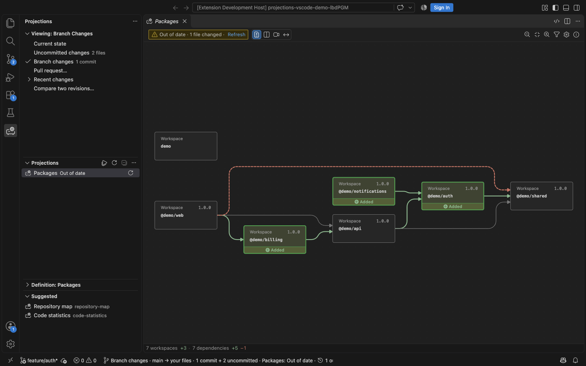 |  |
| After: over the stage |  | 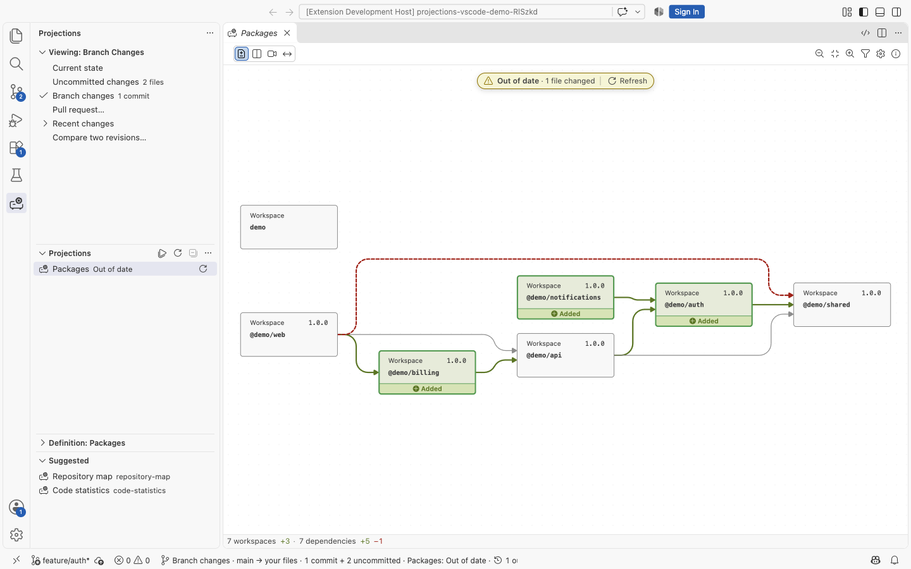 |


Side by side and swipe have a header band over the panes naming each revision;
centred over the stage's top the pill would cover both names. It sits 12px below
the bands instead (below the top pane's when side by side stacks the panes),
still centred over the whole stage, rather than in the gap between the panes: in
an editor tab the panes meet at a 1px divider, so there is no gap to sit in, and
below the bands keeps the same 12px from the content as in every other mode.

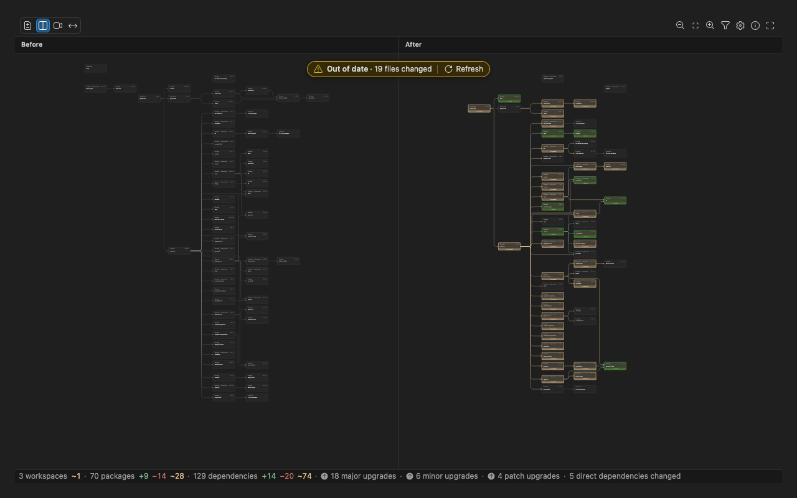

**Built: D4** (the README's
[Your edits](../guides/vscode-side-bar.md#your-edits)). Normal tabs apply the
committed definition (`HEAD`, through the Inspector's new `definitionRevision`
mount option and `setDefinitionRevision` handle); Now and a never-committed
definition apply the working tree's. When the definition or a file it declares
has uncommitted edits (git status, `packages/integrations/vscode/src/edits.ts`),
the tab shows the notice with Use my edits here (this tab then applies the
working tree's definition and says "Your edits") and Develop it.

**Revised: your edits apply (replaces D4).** Status: **decided; built** (the
README's [Your edits](../guides/vscode-side-bar.md#your-edits)). Chosen by the
user from the options: "once a projection's files have uncommitted edits, its
tabs use them and show 'Your edits' with a one-click 'Show committed'".

- **When:** the definition, or a file it declares (extractor script, comparator
  file, renderer bundle or sources), has uncommitted edits. Every tab of the
  projection then applies the working tree's definition to both sides
  (`definitionRevision: 'working-tree'`).
- **Indicator:** quiet text beside the choice, **Your edits · Show committed**
  (a codicon and muted text, like the provenance badge, not the badge-colored
  pill D4's "Your edits" was), with one action. **Show committed** sets this tab
  to the committed definition ("Committed version · Use my edits") until the
  edits change again (their `editKey`: each touched file's status and content
  hash) or the person switches back. It is kept with the tab's state while the
  edits are the same.
- **After a commit or a discard** there are no edits, and tabs return to the
  committed definition (Refresh applies it: the definition changed, so the
  result is out of date). A definition never committed works as before.
- **Out of date:** a definition change makes out of date every result whose tab
  applies the edits now, including a committed-definition result taken before
  the edits (Refresh applies them, and its tooltip says so). Only a tab on Show
  committed ignores definition edits. Refresh stays manual; the row keeps "·
  edited".

Why it changed from D4: D4 assumed people view far more than they author, so a
tab should say what the repository's projection shows until asked otherwise. In
use, the one who edits a projection's files is almost always developing it, and
D4 made them click **Use my edits here** in every tab, once per tab, after every
reload of the choice, while the notice above the toolbar took space and read as
an error. VS Code is now the only interactive authoring surface (the browser
Inspector is being retired), so the tab has to be the authoring loop: edits
apply by default, and the committed version is one click away for the rarer
check "what does the repository show?".


**Built: D3, since replaced** (see
[the side bar model](#the-side-bar-model-decided-reversible)). The Develop tab
was a custom editor on definition files with the grid (bookmarks, pairs added
and the sweep's picks, swept together through `POST /api/sweep`, which gained
`pairs` and `cancel`; its thumbnails are now kept per sweep, so a sweep after a
renderer edit renders them again), the Inspector large on the working tree's
definition with its own tiered refresh, and checks, comparator tests, the raw
extraction and diagnostics beside it. Edits sweep the grid again by tier. Its
pieces live on: the checks in the Checks view, the grid's pairs and thumbnails
in Pairs & Bookmarks, `/api/sweep`'s `pairs` and `cancel` and its per-theme
thumbnails behind Find Recent Changes….

The `compare-*.png` images in `images/desktop-surfaces/` were the Compare
section's prototypes (`control`, `rows` and `tabs`), which were removed with the
`compareStyle` setting.

**Out of date** depends on identity, agreed with the local execution work
([Local execution](local-execution.md#identity-from-git-and-a-persistent-cache)):

- **A result's identity:** every extraction carries `provenance.execution`
  (`{source, fidelity, tree?, strategy?, prepared?, scope?, ci?}`) and
  `provenance.definitionDigest`; a comparison carries both sides'. `tree` is the
  examined Git tree (for the working tree, what `git add -A` would commit, taken
  before the run). `fidelity: "stale"` means the tree changed during the run:
  out of date at once.
- **The working tree's identity:** `GET /api/identity?projection=ID` returns
  `{tree, definitionDigest, scope?, scopedTree?, scopeVerified?}` and runs
  nothing. `scopedTree` is compared instead of `tree` only when `scopeVerified`
  is true; otherwise `tree`.
- **Changes push it:** the `changes` notification carries `tree` (computed after
  the quiet period, at most once per generation, omitted if it can't be
  computed).
- **What `tree` can't see:** a toolchain extractor run in place can also read
  ignored files (installed dependencies, generated code). For those results the
  extension also keeps the `changes` rule below.

Until that lands in `serve --stdio`, the extension uses the existing `changes`
notification: a result taken before a generation whose changes touch its
projection (`working-tree`, `definitions`, `extractor:<id>`, …) is out of date.

## The side bar model (decided, reversible)

After D1–D6, use showed the side bar mixing viewing and developing. These
decisions replace the scattered ones before them; each is reversible. Its views
(Show, Configuration, Checks, Pairs & Bookmarks, Set up) have since become
[four sections](#four-sections-decided-reversible); what follows records how
they got there.

- **Every tool is its own view in the Projections view container**, so each can
  be dragged to the panel or the secondary side bar, as Ports can ("things like
  ports, which by default show up as a standalone um tab in a pane can actually
  be dragged over … into a left um panel section … many of the development
  controls fall into this category"). In order: **Show** (open), **Projections**
  (open), **Configuration** (open), **Checks** (collapsed), **Pairs &
  Bookmarks** (collapsed), **Set up** (shown as before); Configuration is
  collapsed too, so only Show and Projections are open by default. Each has an
  empty state, and none assumes its width or location: they are all native
  trees, which assume nothing about where they are.
- **Rows are flat leaves.** "If the main workflow … is viewing projections, then
  I'm less convinced we want the projections to have the carrots and to expand
  to these configurations underneath them … that sort of feels like it's mixing
  the viewing and the developing." A projection row has no chevron and no part
  children; a click opens it, Refresh stays inline, and its context menu has
  Open Definition.
- **Configuration**, a native tree like Outline ("similar to how the outline
  panel … shows details about the currently selected editor"): it follows the
  active projection tab (and stays while one of the projection's own files is
  the active editor), with a pin, like the Markdown preview's lock. Definition,
  Extractor (Show Extraction Output), Comparator (Configure…, the valid-JSON
  quick pick), Renderer (its `scenarios.json` as a Scenarios child: the side
  bar's Scenarios view is gone), Environment and Provenance
  (`provenanceBadge()`, and the pair shown).
- **Checks** is its own tree on the same projection and pin: each check and the
  comparator tests with status icons and their messages in tooltips, Run in its
  title.
- **No Develop tab (replaces D3).** "I was less sure there should be a specific
  tab type for um developing a projection separate from viewing it it seems like
  at least some of the infrastructure for developing a projection could be um in
  collapsed sections uh of the panel … and then you develop it by expanding
  those and getting access to the controls and then putting them away when you
  don't need them … where we don't necessarily have a separate development tab
  anymore." (Earlier: "it kind of feels here like we put a pane inside a tab
  which is a little bit odd".) The projection tab is the one tab type, and the
  Show view's choice the one state. Developing is the collapsed sections:
  Configuration, Checks, and **Pairs & Bookmarks**, which lists the projection
  in front's candidate pairs (bookmarks, pairs added with Add Pair…, and Find
  Recent Changes…' recent commits that change it, through `/api/sweep` with the
  pairs), each with its change count and a thumbnail in its tooltip; a click
  makes it the Show view's choice (a `bookmark:<id>` or `pair:<before>..<after>`
  choice), and Bookmark and Remove are inline. Extraction output goes to the
  **Projections** output channel and its diagnostics to Problems, on the
  definition file. Edit tiers apply in projection tabs: a renderer edit reloads,
  a comparator edit compares again, a definition edit shows D4's notice, whose
  Develop it is now **Show Configuration** (Configuration and Checks, focused
  and expanded). (Since revised: a definition edit applies, and the result is
  out of date; see **Revised: your edits apply** under
  [Jobs to be done](#jobs-to-be-done-decided).) (A bottom-panel webview for
  these details was considered and dropped for the native trees.)
- **Controls that open a quick pick look like VS Code's pickers:** a flat
  toolbar text button (icon, label, muted detail, the toolbar's hover and a
  focus outline), not a bordered drop-down with a chevron ("I'm not sure that
  things which trigger the VS Code QuickPick menu should look like drop downs").
- **The Viewing control (an experiment).** "I'd like to make a dedicated special
  control for controlling exactly what's being viewed and put it at the top of
  the projections panel at the left and remove it from within the tab … I'm not
  sure whether it's right, but I'd like to try it." The side bar's header line
  read as a list item but acted as a status indicator, and each tab had its own
  control. Now one repository-wide choice (remembered per repository, with the
  automatic default) is the Viewing view's control, every tab follows it, and
  the status bar mirrors it. Tabs have no choice control and no per-tab
  Pin/Follow for this experiment (an agent tool can still open a tab on its own
  pair). The Configuration view's pin, which is about which projection it
  follows, stays.
- **The Show view replaced the webview control.** The experiment's webview
  "Viewing" control became a native list, **Show**, first in the container: a
  native look, nothing to load, accessible (the current row's label ends ",
  selected"; state is its check, never the tree's selection or focus), and it
  reads correctly when collapsed (its description is the current choice). Rows:
  Current state; Uncommitted changes, Branch changes, Pull request…; a
  collapsible More (Last commit, Since <tag>, bookmarks); Custom pair… (Swap
  inline when it is the choice). A click sets the choice; Refresh is in its
  title; the status bar mirrors it and its click reveals the view. The tab's old
  choice control, its Pin/Follow and the `projections.experimental.choiceInTab`
  setting are gone.
- **The Viewing quick pick reads as a choice, not three look-alikes** ("my brain
  just has a hard time choosing between these three options"). Items are
  grouped: **Show** (Current state: "your files as they are now", formerly Now)
  and **Show changes** (Uncommitted changes, Branch changes, Pull request…, then
  More and Custom pair…). Each detail states the span with real ref names, then
  the size ("last commit → your files · 1 file", "main → your files · 3
  commits + 1 uncommitted"). Choices that resolve to the same pair are listed
  once (Branch changes on the default branch, or with no commits ahead, is
  Uncommitted changes), except the selected one, and the automatic default never
  picks a hidden one. The placeholder asks "What should projections show?"; the
  current item has only its check. The Show view and the status bar use the same
  names; the identities stay internal.
- **Swap only for Custom pair….** Reversing a named choice makes no sense; Swap
  stays in the command palette.
- **A provenance badge only when unusual** (From CI, Approximate, Stale,
  Observed), quiet as a codicon and muted text; an ordinary local result shows
  none, and Configuration's Provenance names it either way.
- **Loading from the first paint, small and late.** A tab shows VS Code's thin
  progress bar at its top, one per tab, after 300 ms; never the web Inspector's
  "No extraction loaded" or a ring that scales with a pane ("these are
  obnoxious"); a custom renderer is named by its projection, never "the Custom
  renderer".
- **A tab is never blank** ("when a projections tab is opened it shows a
  completely blank for a while. I'm wondering if there's anything we can show
  literally immediately, such as a centered spinner or even the skeleton of the
  toolbar since we know the toolbar is going to be there"). The editor gets its
  skeleton at once, before the folder's facts and the backend, and its page
  loads while the backend starts (requests wait for the bridge; nothing reloads
  when it arrives): the toolbar strip, empty, the summary bar's strip, and a
  centered 16px `loading` codicon with "Loading Packages…", at 0 ms (the
  skeleton is the real layout, so it doesn't flash). The page replaces it in
  place.
- **No stand-ins for controls while loading** ("there's a weird grayed out,
  poorly aligned version of the view switcher… this probably doesn't need to be
  there at all while the projection is loading"). The strip is the real
  toolbar's height and hairline, and nothing in it: no dimmed mode group, no
  dimmed actions. The smoke test's probe checks that it never held an element
  and is exactly as tall as the toolbar that replaces it.

  

  Before and after, Dark Modern then Light Modern:

  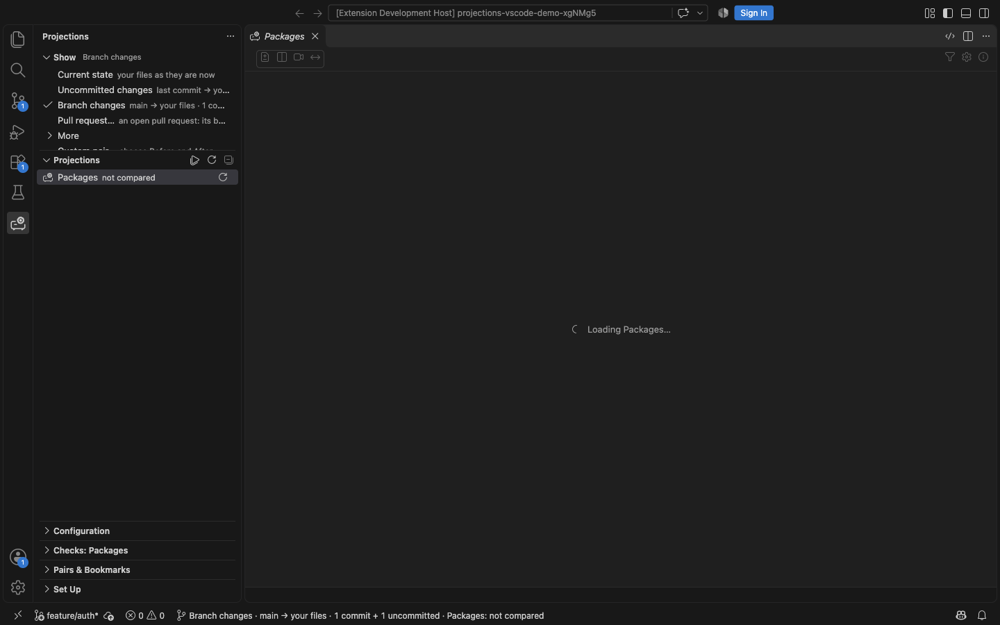

  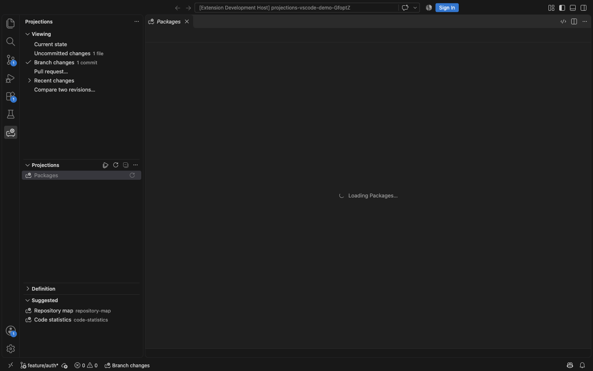

  

  

- **Side by side fills the tab:** no margin or gap around the panes, one 1px
  divider in the editor group border.
- **Swipe's divider is one control**, the same color as the grip's outline: its
  1px line takes the grip's outline color, VS Code's link foreground, and both
  change together, to the sash hover color (and a tinted grip) while pointed at
  or dragged and to the focus border under keyboard focus. Side by side keeps
  its neutral editor group border; the Default UI follows the same rule with its
  own accent, emphasis and focus colors.

  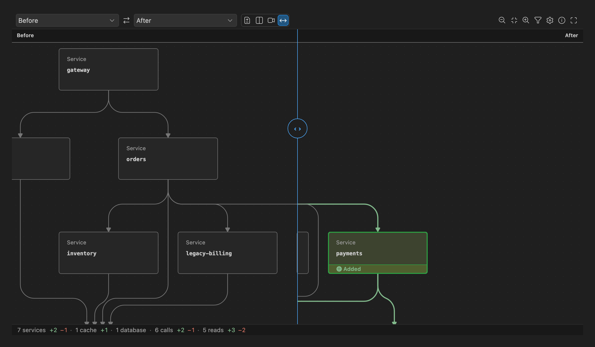

- **The UI never says "sweep"**, which means nothing to people in this context:
  **Find Recent Changes** (in Pairs & Bookmarks then, Viewing's Recent changes
  now, not Set up) checks the last commits and lists the ones that change a
  projection, saying "Checking recent commits… 4 of 10" meanwhile. `/api/sweep`
  and internal names stay.

## Four sections (decided, reversible)

The side bar had grown six views (Show, Projections, Configuration, Checks,
Pairs & Bookmarks, Set up), several following the active tab and two listing the
same kind of thing (Show's More and Pairs & Bookmarks both listed comparisons to
look at). The decision: make it clear which section to look in for whatever
someone is trying to do. **Each section answers one question, and only one
follows the active tab.** They replace the views above.

- **Viewing** (What am I looking at?): Everything that changes what the tabs
  show: Current state, Uncommitted changes, Branch changes, Pull request…;
  **Bookmarks**; **Recent changes** (Last commit, Since <tag>, and the recent
  commits that change any projection); **Compare two revisions…**. It absorbed
  Pairs & Bookmarks: bookmarks are choices, and "Find Recent Changes" checks the
  last commits with every projection (`/api/sweep` over all of them) and lists
  each commit that changes one, by its subject and short commit, with what it
  changes and a thumbnail in its tooltip. The commit at `HEAD` stands for Last
  commit. Compare two revisions… replaces both Custom pair… and Add pair….
  Bookmark and Remove are inline (Bookmark also on the current row); Swap only
  on Compare two revisions… when it is the choice.
- **Projections** (What is there, and what changed?): Unchanged flat rows in
  alphabetical order of the title they show (not their IDs, which are file
  names: "API database schema" before "CI pipeline"), with their counts as
  badges (below), **New Projection…** (`+`) in its title (below) and Add to CI…
  in the view's `…` menu.
- **Definition** (What is this projection made of?): Formerly Configuration, and
  the one section that follows the active tab (with the pin): the definition
  file by its name, Extractor, Comparator (its `.comparator.test.yaml` under
  it), Renderer (its scenarios under it), Environment. Provenance left the tree:
  it is the tab's badge when unusual. It shares one item model
  (`definitionModel`) with Go to Source…
- **Suggested** (What else could I add?): Formerly Set up: only the candidates
  not yet defined, each with Adopt inline, and shown only while there are some.
  With no definitions the Projections welcome carries the getting-started copy,
  so the two don't repeat each other; after the first adoption, Suggested's
  welcome offers Add to CI…

**Checks are tests.** The Checks view is gone; VS Code's **Testing** view has a
"Projections" controller with an item per projection whose children are its
checks (`projections check`'s steps: definition valid, extraction, determinism,
scope, renderer checks) and its comparator tests, one per case at its line in
the `.comparator.test.yaml`, so the editor's gutter runs a case. Runs go through
the same backend (`check`, `POST /api/comparator-tests/run`); results are in
Test Results; definition problems stay in Problems. This is VS Code's idiom for
"does it pass?", with its gutter, filters, history and keybindings, and nothing
to learn. There is no debug profile: there is nothing to step through.

**The word "pair" left the UI** (commands, tooltips, notifications and the
README): "Compare two revisions…", "Two revisions" as the choice's name,
"Compare These Revisions". Internal names (`setPair`, `pair:<before>..<after>`,
`/api/pairs`, `/api/sweep`) stay.

**Static titles; the status bar item names the choice (revised).** VS Code hides
a view's description while its section is collapsed
(`.pane-header:not(.expanded) .description {display: none}` in the workbench's
pane CSS), so a collapsed Show view no longer said what was shown, and for a
while Viewing and Definition set `TreeView.title` instead: "Viewing: Uncommitted
changes" and "Definition: Package cards". That workaround is reverted: both
titles are static again, "Viewing" and "Definition", so the side bar's headers
stay put while the choice or the active tab changes. The status bar item is the
readout of what is shown ("this is probably a better place to display what the
user is currently viewing rather than using dynamic text in the sidebar list
section"), and the editor tab names the projection the Definition view follows
("I think we can also remove this dynamic text and go back to a static label").
The pin is the one state the tab doesn't show, so while pinned the Definition
view's message names the projection ("Pinned to Packages"); a `view/title`
action's tooltip is its command's static title, so it can't. The current Viewing
row keeps its check. Their descriptions stay unset.

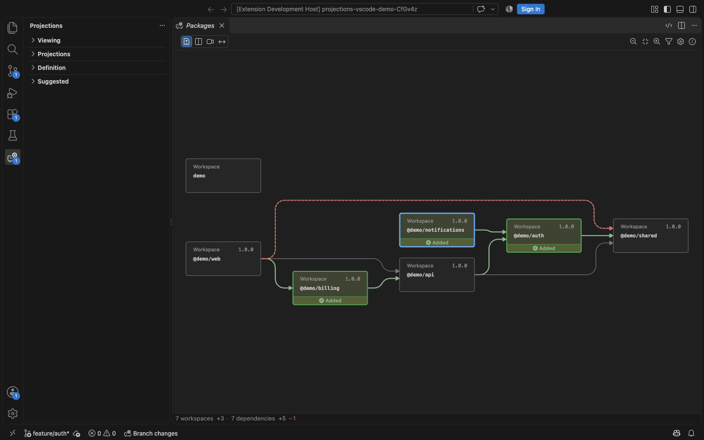

**The status bar item (decided).** "In the context of the status bar, it is not
obvious that this applies to us, so probably we want to use the projector icon",
and space there is tight, with "a high bar for text": commit hashes are
something "most users don't memorize", and nothing the editor tab already shows
(the projection, its change counts) is repeated. So the item is the Projections
mark, a product icon (`$(projections-mark)`, glyph U+E000 of the font
`tools/scripts/product-icons.mjs` writes from `brand/projections-mark.svg`; VS
Code only takes icon IDs of two segments or more), and the choice's short human
name:

<!-- prettier-ignore -->
| Choice | Text |
| --- | --- |
| Current state, Uncommitted changes, Branch changes, Last commit, Since v1.0 | the name |
| A pull request | `PR #123` |
| A bookmark, a recent change | the subject, cut at 24 characters with "…" |
| Two revisions | `main → feature/x`, each side cut at 20; a short commit only where nothing names it |
| The tab in front out of date | the same and `$(warning)`, in the item's normal colours |
| The tab in front extracting or comparing | the same and `$(sync~spin)` in the warning's place (`$(sync)` under reduced motion) |

Its Markdown tooltip carries the rest: the name in full, the revisions with
their commits (``main `a1b2c3d` → your files``), the span's size and the files
changed, why results are out of date, and a pinned tab in front. It is shown
only while the folder defines projections, and (decided: "does our status bar
item need to always be visible?") only where projections are in view: while a
projection tab is the active editor tab (`tabGroups`, the custom editor
`projections.projection`) or any of the four views is visible
(`onDidChangeVisibility`). Editing other code with the side bar closed, it is
hidden. Tab and visibility changes are coalesced into one placement a turn, so
focus moving between a projection tab and the side bar never hides and shows it
again; the quick pick (Choose What to Show…, with Show in Side Bar) stays in the
Command Palette.

**Out of date in the status bar (decided).** "If the projection is stale, I'd
kind of like a warning icon on the right edge of the status item. We'll have to
just cram it in with the View options." The stable API has no multi-segment item
(Git's are SCM `statusBarCommands`), so it stays one item: `$(warning)` at its
end replaces the earlier dot while the tab in front is out of date (the warning
follows that tab; the tooltip keeps the count of all), without
`statusBarItem.warningBackground`. Its one click still opens the Viewing quick
pick, which then starts with `$(refresh) Refresh · 19 files changed` and a
separator: the same Refresh as the stage's pill.

**Running in the status bar areas (decided).** "If an extractor is currently
running, that might make sense to add a little refreshing icon into our status
bar areas?" Both get one, and nothing else changes:

- **The status bar item** ends with `$(sync~spin)` while the tab in front's job
  runs (extracting a side of its pair, or its page comparing the two), in the
  warning's slot. Running takes precedence: during a Refresh the spinner
  replaces the warning until the job ends, and the warning comes back only if
  the new result is still out of date. Its tooltip says "Packages: Extracting…"
  (or "Comparing…") and its accessible name ends with ", extracting". Jobs in
  other tabs don't spin it; the tooltip counts them ("2 other tabs extracting").
- **The tab's summary bar** shows a small spinning `sync` codicon at its end, in
  a slot kept while nothing runs, so no figure moves or reflows; "Extracting…"
  or "Comparing…" is its tooltip and in a polite live region.
- **No flash.** Both show only once a job has run 300 ms and, once shown, stay
  at least 400 ms: one pure rule with injectable timers (`runningIndicator` in
  `packages/host/vscode-ui/src/running.ts`), which the extension host imports
  from `@githubnext/projections-host-vscode/running` and the summary bar uses as
  a hook.
- **Reduced motion** holds the icon still: in the webview by
  `prefers-reduced-motion` and VS Code's `vscode-reduce-motion` class; in the
  status bar by the extension, since VS Code's `workbench.reduceMotion` doesn't
  stop a status bar item's `~spin` (it only stops some of its own spinners):
  `$(sync)` while the setting is `on`, or `auto` and the tab's page reports that
  it moves less.
- **Where it comes from**: the Inspector knows what the shown pair's job is
  doing (a side queued or running, or the comparison computing). It passes it to
  the projection view as `running` and reports it in its summary, which the
  tab's page sends the extension every half second (with whether the page moves
  less); the extension puts it on the active tab (`ActiveTab.running`) for the
  status bar item.
- **Only the VS Code UI.** The headless controller has no job state, so the
  Default UI's summary bar shows none: the standalone Inspector already says
  "Extracting…" with Cancel in its own status.
- **Renderer builds** stay in the Definition view's Renderer row, not here: one
  signal for each.

"This control definitely needs to do something": its click opens the **Viewing**
quick pick, the same options and grouping as the side bar, from one item model
(`ViewingView.present` builds both the tree items and the quick pick's items
from `viewingRows`): Current state, Uncommitted changes, Branch changes, Pull
request…; Bookmarks and Recent changes under separators; Compare two revisions…;
and last **Show in Side Bar**, which reveals and focuses the Viewing view. It
opens on the current choice, which has the check; equivalents are hidden as in
the view. Choose What to Show… is the same pick.

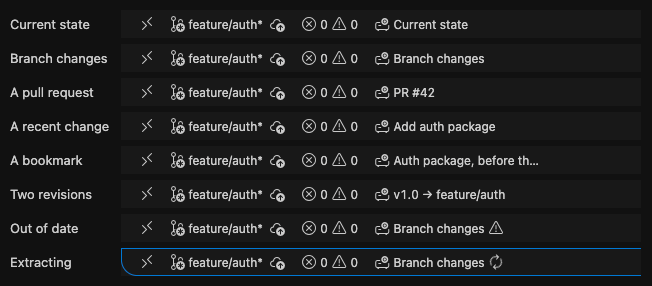


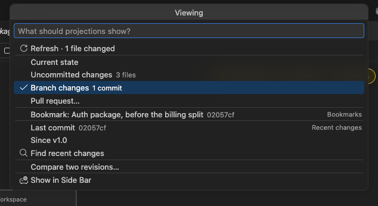

**Short facts, and counts as badges**, since most secondary text is truncated at
a default side bar width. A row's description is a short fact or nothing, about
12 characters at a 300 px side bar: `2 files`, `3 commits`, `#123` (this
branch's open pull request), a bookmark's or recent commit's short commit,
`a1b2c3d → e4f5a6b` when Compare two revisions… is the choice. Spans and
explanations ("last commit → your files", what the choice means) are in a
Markdown tooltip. A Projections row's change count is a badge at its right edge,
as a modified file's is: a `FileDecorationProvider` on the row's
`projections-row:/<folder>/<id>` resource (`TreeItem.resourceUri`, beside its
own `iconPath`), at most two characters (`9+`), in
`gitDecoration.modifiedResourceForeground`, which tints the label too. No
change, no badge; not compared yet, no badge and a muted label
(`disabledForeground`). The description says only what is unusual (Out of date,
needs trust, failed, edited); the tooltip has the full status ("3 changes
(Uncommitted changes)", "Not compared yet"). Definition and Suggested follow the
same rule.


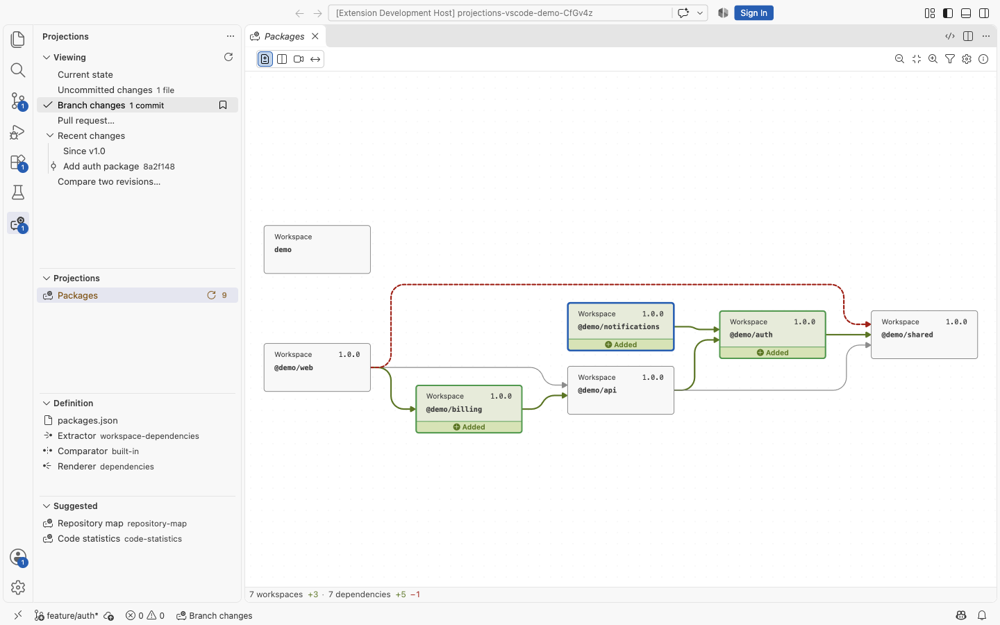


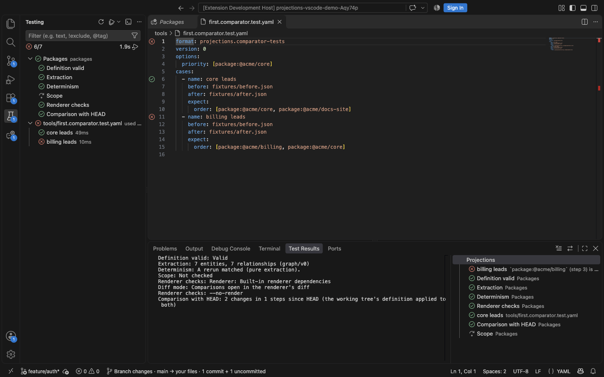

Every section is a native tree and works when dragged to another container. The
contributed order is Viewing, Projections, Definition, Suggested; VS Code keeps
an order a person changed (View: Reset View Locations restores it).

**Starting a projection: New Projection… (decided).** "Wants to get started on a
new projection. Where exactly do they go": once a repository had projections,
nowhere. The Projections welcome offered Explore only while there were none,
Suggested listed only what explore found, and writing your own was
`projections init` or an agent. The decision: a **New Projection…** (`$(add)`)
button in the Projections section's title bar, first among its actions. It is
also in the command palette and, beside Explore, in the Projections welcome
while the repository defines none. Suggested stays as it is, always present
while it has candidates. The button opens one guided quick pick:

- **Start from a suggestion**: Suggested's own candidates (the same source,
  `GET /api/explore` through the folder's model). With none, this item is
  **Explore this repository** instead.
- **Start from a built-in extractor and renderer**: The extractors in the CLI's
  catalog (`projections extractor list --json`), then the built-in renderers
  that present the extractor's schema (the backend's `GET /api/renderers`, their
  manifests' `accepts`). The extractor's default comes first, under the name its
  template uses (`dependencies`, a preset of the graph bundle). A renderer that
  needs a vocabulary fits only as the default, since the catalog doesn't say
  which vocabularies an extractor declares.
- **Write a custom extractor, renderer or comparator**: Which parts: a starter
  extractor (in the repository's toolchain, Node.js, Python or Go), a renderer
  package, both, or a comparator file. A custom renderer or comparator runs on a
  built-in extractor you pick.
- **Ask an agent to write it**: What it should show, then the projection is
  scaffolded. The chat opens in agent mode with the prompt `projections init`
  printed, your description in place of its placeholder, for you to send.
  Without a chat, the prompt is copied.

Then an ID, checked as you type against the definition schema's ID pattern (the
bundled `definition/v0.json`, the schema `projections init` validates with), the
environment file's name and the repository's projections and files. Then a
title, which may be left empty for the CLI's default from the ID. The extension
never writes the files itself: it runs the CLI's `projections init` with the
flags a person would pass (`--extractor`, `--renderer`, `--language`,
`--comparator custom`, `--definition-directory` where the repository keeps
definitions in `.projections`), behind a progress notification. It then opens
the definition, opens the projection's tab and selects its row
(`TreeView.reveal`). The CLI's output, with its next steps, goes to the
Projections output channel.

Errors say what to do. A Restricted Mode window is refused up front with
**Manage Workspace Trust**: init writes into the repository. A missing CLI
offers **Open Settings** on `projections.cliPath`. An ID that exists is refused
in the input box, or by the CLI if it appears meanwhile, with **Open
Definition**. A starter extractor whose toolchain the CLI can't tell offers
**Choose a Language…** and runs again. The model (`new-projection-model.ts`)
imports nothing, so its picks, renderer fit, ID checks and `init` arguments are
unit-tested. The smoke test runs the flow in real VS Code on a temporary
repository.

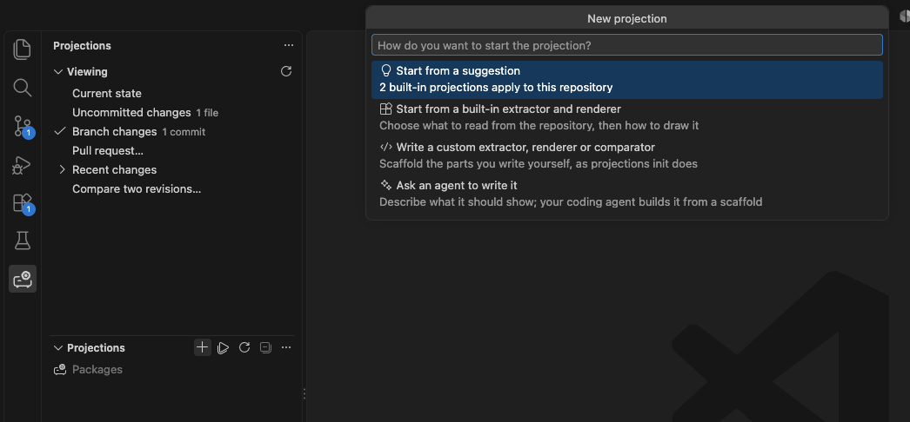


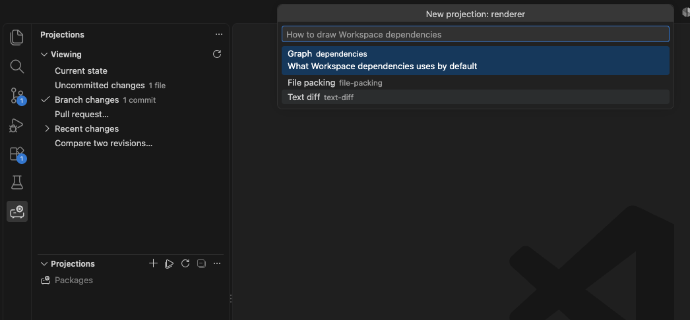


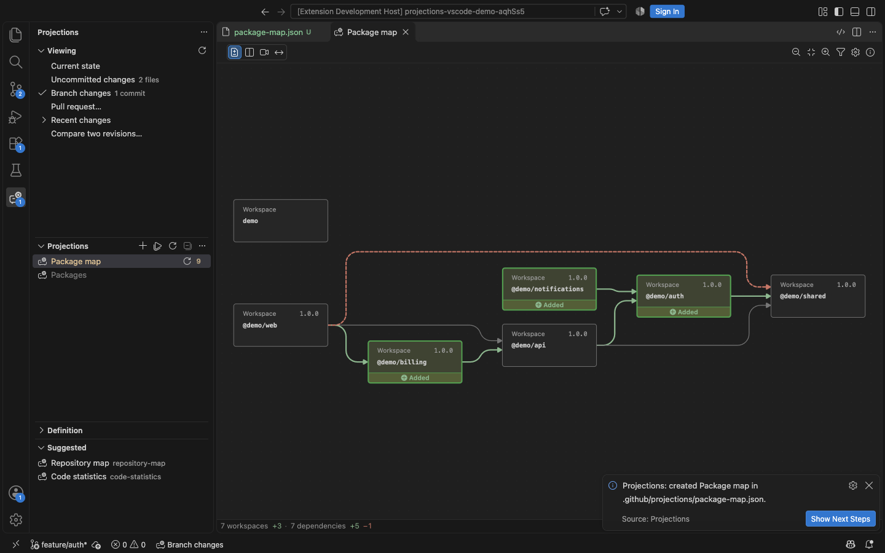

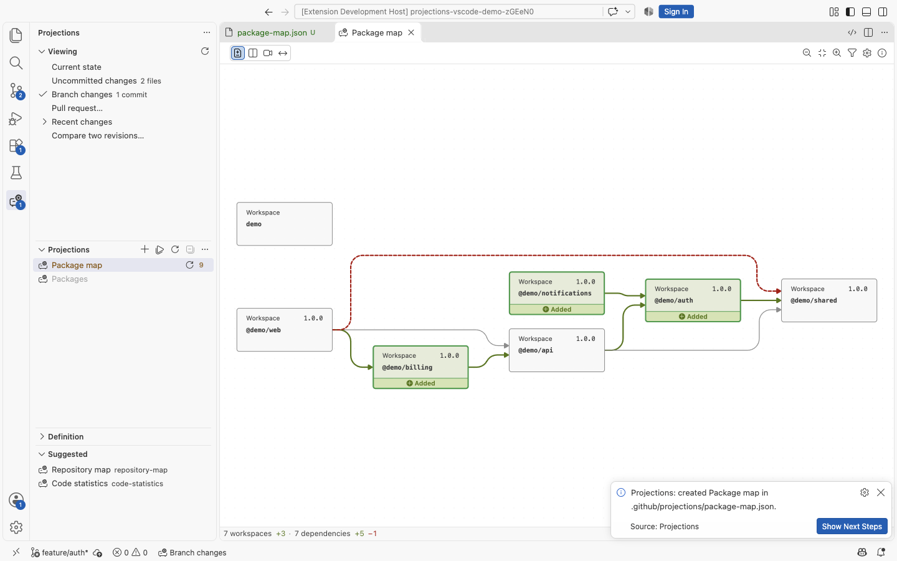

**The parts have their own icons (decided).** Definition drew Extractor,
Comparator and Renderer as codicons that mean something else: `inspect` reads as
the developer tools' element picker, `git-compare` implies a code diff, and
`eye` is show and hide everywhere in VS Code (and assumes the output is visual).
No codicon, Octicon or Lucide icon shows the three as one pipeline, so they are
drawn as one family ([brand/parts](../../brand/README.md#part-icons), derived
from no icon library):

- **The dot is the extraction,** the same size in all three icons, so it reads
  as the same thing; no stroke touches it, and every stroke stops the same
  distance from it.
- **Extract converges:** three strokes converge on the dot at the right, a
  larger thing abstracted into it.
- **Compare divides:** two dots, in the renderer's and the extractor's places,
  either side of a dashed divider: two extractions related, not overlaid.
- **Render diverges:** the extractor mirrored, three strokes leaving the dot at
  the left.

They are VS Code product icons (`projections-extractor`,
`projections-comparator`, `projections-renderer`, from a small generated font),
so they take the theme's icon color like a codicon, and icon tokens
(`--projections-icon-<part>`) wherever the Inspector shows the parts, which the
VS Code UI draws at codicon weight. The choices before them (thirty metaphors
and four families, from sieves to light paths, then shapes and dots) were
reviewed on a page of concepts; the chosen set is the dot family's D4 with a
three-dash divider.

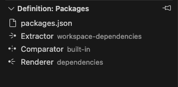


**Selecting a row never leaves VS Code (decided).** Definition's breakdown of
the projection into files and settings read as intended, but some of its rows
opened the browser: a built-in extractor, comparator or renderer linked to its
README on GitHub. "I generally don't expect selecting a list item to take me out
of the current application … I just don't think these should behave like
external launch links." So no row or quick pick item's primary action leaves VS
Code, in any of the side bar's views, the Testing view or the quick picks:

- A file row opens the file in an editor, as before.
- A built-in part's row (and Go to Source…'s built-in item, from the same item
  model) opens the part's documentation inside VS Code: a read-only Markdown
  preview of pages bundled with the extension. The default comparator's row
  reads its docs too; its gear stays Configure… (in Go to Source…, the item
  stays Configure…, with an Open Documentation button).
- The page on GitHub is only an explicit secondary action, **Open Documentation
  on GitHub** with the `link-external` icon: inline on the row's hover, in its
  context menu, and a button on Go to Source…'s item. A link clicked inside a
  page or a renderer is an explicit link click, so it may still open the
  browser.
- The welcome's "renderer catalog" link opens the bundled reference page too.

The audit found two row clicks that launched the browser, both built-ins' docs:
the Definition view's built-in rows (`vscode.open` on a GitHub URL) and Go to
Source…'s built-in items (`env.openExternal`). Viewing, Projections, Suggested
and the Testing view's rows open tabs, files or quick picks, and the other quick
picks (Viewing, pull requests, revisions, comparison mode, adopt) choose rather
than open; the webview's `openExternal` serves only links clicked inside a
renderer.

The mechanism: the build bundles the two generated reference pages, every
built-in extractor's and renderer's README they list, the default comparator's
README and the Markdown those link to directly into `dist/docs/` (about 50
pages, 0.6 MB, shipped in the package), each README named after its directory so
the preview's tab names the part (`renderers/graph.md`). Relative links between
bundled pages are rewritten to their bundled names and open in the preview;
links to anything else go to GitHub. A read-only file system provider serves
them on `projections-docs:` (the preview resolves relative links through the
workspace file system, which a text document content provider doesn't offer),
and they open in the Markdown preview editor (`vscode.markdown.preview.editor`),
whose tab carries the page's URI, so Definition stays on its projection while
the docs are open, as it does for the projection's own files. `index.json` maps
each extractor id, renderer handle and the default comparator to its page, so a
renderer named by an alias (`dependencies`) opens its renderer's page (`graph`),
which the old `renderers.md#dependencies` anchor missed.


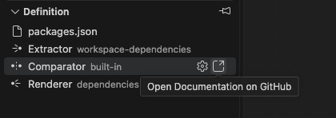

## The summary bar (decided, reversible)

The row the dependency graph drew under the toolbar in a diff ("⊕ 1 workspace
added · ⊖ 1 workspace removed") became a summary bar along the bottom of every
projection view. At the top it competed with the toolbar; at the bottom it can
always show, for one revision (counts of the domain's own nouns, such as
workspaces and dependencies) and for a comparison (the same counts with their
changes).

- **Always shown, at the bottom**, in every host and under the renderer, table
  and text alike: VS Code's status bar strip (22px, description foreground over
  the side bar background, a hairline above), the Default UI at its own small
  size. The plain count row the graph drew under the toolbar is gone, and so is
  every renderer's own summary line: findings the counts can't say are summary
  facts (below).
- **Totals per domain noun** for one revision, `7 workspaces · 7 dependencies`;
  **totals with deltas** for a comparison,
  `7 workspaces +3 · 7 dependencies +5 −1`, only the delta figures in their
  change colors (VS Code's Git decoration colors).
- **Every figure filters**, as "Changes only" does: the total to those items, a
  delta to those changed that way.
- **The varied toggle** ("N varied within tolerance") moves from the toolbar to
  the bar's end.
- **A running job** (the VS Code UI, in a tab): a spinning `sync` codicon in a
  slot kept at the very end (Running in the status bar areas, under
  [Four sections](#four-sections-decided-reversible)).
- **Narrow widths** collapse figures from the end into a "…" popover.
- **Text centred by its cap height**, not its line box: in the strip (its
  hairline included, as in VS Code's status bar) and in a figure's pill, a
  capital E has the same space above, below and to its left. The labels are
  trimmed to the cap height and baseline (`text-box: trim-both cap alphabetic`;
  VS Code 1.145's Chromium 150 and Safari 18.2+ have it), with a line box one
  cap high where it's missing; the toolbar's text labels follow the same rule.
  Each host's `cap-height.spec.ts` measures the E's ink at 2×.
- **The toolbar's edge controls are inset evenly** ("This control should have
  the same spacing on the top left and bottom"): the leading control has the
  same space to its left as above and below it, the trailing one the same to its
  right, measured inside the toolbar's bottom hairline (its edge, as the summary
  bar's is). In the VS Code UI the 26px mode group or pickers sit 4px in and a
  22px action 6px; the playback row's controls 4px; a first row of two keeps the
  one row's height; and a tab's start slot, empty for an ordinary result, no
  longer adds its gap (the mode group sat 16px in). The Default UI already held
  to it on its first row (4px around 32px controls, inside its border), and now
  on its playback row too, the lens leading it 4px in. Each UI's
  `toolbar-insets.spec.ts` measures border boxes in every mode at 320 to 1280px.
- **The vocabulary is the renderer's**: an optional `summary` message
  ([contracts](../contracts/renderer-frames.md)) names each kind in its words,
  and the kit sends it for every kit renderer (the dependency graph says
  workspaces, packages and dependencies). Bundles that send nothing get the
  host's words from the kind names (`depends-on` → dependencies). The host
  counts; the renderer checks hold a renderer's counts to the documents'. Items
  are counts or domain facts (`type: 'fact'`), so later findings join the bar
  additively.

### Every renderer's summary in the bar (decided, reversible)

The summary bar applies to every renderer with summary statistics, the runtime
policy renderer included, so each renderer's summary is standardized and moved
to the bottom.

Every built-in renderer now sends its summary and draws none of its own: no line
over a diff, header total or `(was n)`.

- **Counts in the domain's nouns**: the renderer names the kinds a reader counts
  (API declarations, runtime policy rules, database foreign keys) and leaves out
  structure the view draws rather than counts (`false`: containment drawn as
  boundaries, a column attached to its table, the relationships folding a
  service's parts into one card).
- **Facts for classifications**: an icon token, a count and a noun, muted like
  the counts: API compatibility levels (`2 breaking changes`), runtime policy
  verdicts (`1 newly enforced`), the infrastructure plan (`1 to replace`),
  dependency bumps (`18 major upgrades`), database and dependency injection
  changes in words (`2 column types changed`, `1 lifetime changed`). A fact with
  IDs filters like a count; its tooltip may name what decided it (the API
  rules).
- **Facts with changes**: a measure or a set has a value in each revision, so a
  comparison draws its change after it as a count's, in the change colors only
  (`39,882 lines of code +2,056`, `1 enforcing rule +1`, `5 enum values +2`).
- **The same everywhere**: one summary per document, the same at every progress
  and pane, and the text view opens with the bar's sentence.
- **What stays in the renderer**: legends that decode an encoding the figures
  can't (file packing's colors, dependency injection's instance lines) and
  notices that qualify a figure (the API classification's notices, entity
  limits). Legends that only listed words (architecture's component kinds,
  infrastructure's planned actions) are gone.


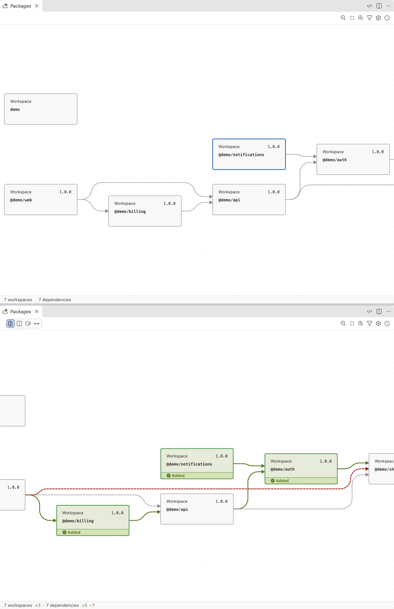


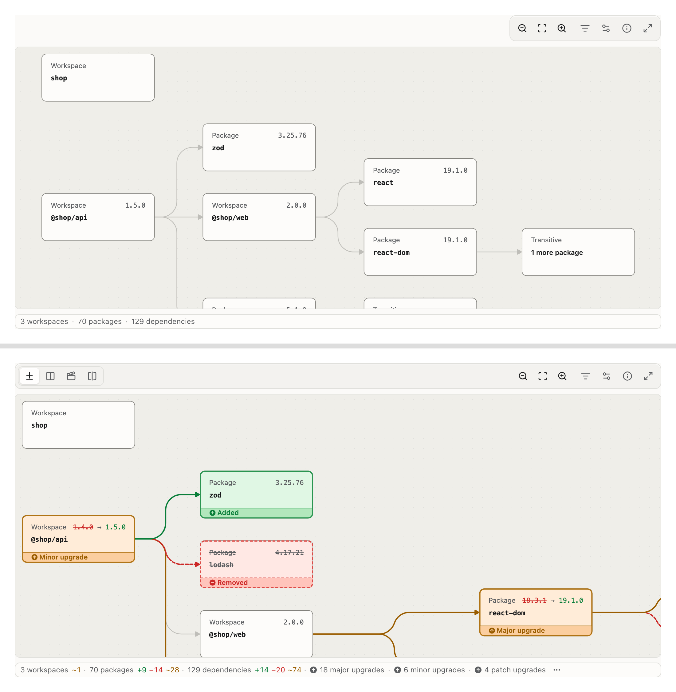

Before and after centring by cap height, a figure hovered (2×, Dark Modern then
Light Modern): the text sat low under the hairline with twice the space to its
left; now a capital E has the same space above, below and beside it.


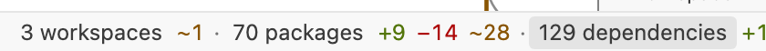

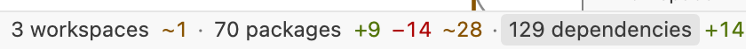

Before and after insetting the toolbar's edge controls evenly, a tab's toolbar
side by side (2×, Dark Modern then Light Modern): the mode group sat 16px from
the start and 4px from the top and bottom, the last action 8px from the end and
6px from the top and bottom; now the mode group is 4px from the start, top and
bottom, and the last action 6px from the end, top and bottom.


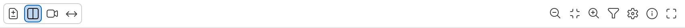

## Follow-ups (not scheduled)

An editor-title idea, recorded as a follow-up; none of it is built:

1. **The projection view as a custom editor** for `.github/projections/*.json`
   (`priority: option`), whose tab's identity becomes its definition file. Its
   title bar has **Show Projection** (toggles in place through reopen-with, as
   the Markdown preview does), **Open Projection to the Side** (the JSON beside
   a live projection) and **Show Definition** (toggles back).
2. **Native `editor/title` actions** replacing most of the in-webview toolbar:
   Refresh, a comparison-mode submenu (with `toggled`) and Swap.
3. **Open Projection to the Side** on `*.comparator.yaml` and renderer source
   files too.

**Done as a slice: Go to Source….** "If I'm currently viewing a projection How
do I get to the code behind it? … there could be a little code icon … there can
be multiple code files behind a projection so maybe it takes you to a quick pick
and you can jump to the config file or maybe like the implementation file for
the renderer." A native `editor/title` button (`$(code)`) on projection tabs,
and the palette's **Projections: Go to Source…**: one real file (the definition,
when the parts are built-ins) opens directly; several are a quick pick grouped
as Definition, Extractor, Comparator (with its tests, or Configure… the
built-in), Renderer (a custom renderer's source entry and `scenarios.json`, or a
built-in's docs, in VS Code's Markdown preview) and Environment, opening to the
side with an "Open in this group" button (and, on a built-in, Open Documentation
on GitHub). It is built on the Definition view's item model (`sourceParts`,
`definitionModel`, flattened by `sourceItems`).

## What was built

The extension (`packages/integrations/vscode/`;
[its README](../guides/vscode-side-bar.md)) implements the recommended layout:


- The **Projections** activity bar container (the brand glyph), with **Compare**
  (since replaced by the header line, D6, then by the Show view, now Viewing),
  **Projections**, **Pairs & Bookmarks** (since folded into Viewing), **Set up**
  (now Suggested) and **Scenarios** (since moved under Definition's Renderer;
  see [four sections](#four-sections-decided-reversible)), the badge,
  `viewsWelcome`, the status bar item and Problems diagnostics on definition
  files that don't load (each invalid file fails alone, at the offending field).
- **Projection tabs:** a read-only custom editor on `projection:` resources,
  preview on a single click and kept on a double click, restored with the
  window, following the folder's pair unless pinned, with the mode toggle, Swap,
  Play and Pin as `editor/title` actions and the rest in `…`. The webview mounts
  the Inspector with `chrome: 'none'` and the VS Code UI's projection view
  without its toolbar, and keeps its view state with `setState`.
- One backend per folder (`src/backends.ts`), shared by the side bar, every tab,
  the Inspector panel and the Testing view. Jobs from all of them queue in the
  runner.

Where it differs from the proposal:

- **Tab icon.** VS Code takes a custom editor tab's icon from the file icon
  theme, so tabs can't show the renderer kind's codicon; the rows in the side
  bar do.
- **Resource.** `projection:/<folder>/<title>?folder&id` rather than
  `projection:/<folder>/<id>`: VS Code titles a custom editor by its resource's
  name, so the title is the last segment and the ID is in the query.
- **A pinned tab's title** doesn't carry its pair ("Packages · v1 → v2"): the
  title is the resource's, which doesn't change while the tab is open. The
  status bar item's tooltip says the tab in front is pinned instead.
- **Change counts** aren't computed in the background (that would extract every
  projection twice per comparison): a row is muted, with no badge, until its tab
  or **Compare All** compared the folder's choice, and the view's badge counts
  what has been compared.
- **Opening framing.** A tab opens fitted, with the whole projection in view, as
  every host does, unless that draws text below the renderers' 8 px opening
  floor: then it opens at that floor, at the content's top left (or top centre),
  and scrolls. Fit to view, Zoom In and Zoom Out are in `…`. Until 2026-11-10 a
  tab opened at the renderer's 11 px readable floor when fitting drew smaller
  text, and asked graph renderers to frame the changes (their `framing` setting,
  now removed). The user superseded that on 2026-11-10: a tab that opened
  cropped needed scrolling before the change could be seen whole (the Package
  dependencies graph cut off its last column under an empty band), so
  projections always open fitted (always fit, 2026-11-10), and denser graph
  layouts keep their text readable wherever the content allows. Later that day
  measurements showed always-fit drawing the largest graphs' text at 1.6-7 px in
  a 1000×650 tab and 2-9 px at 390×700, so the user kept always-fit and added a
  minimum zoom: never below 8 px text, scrolling beyond it ("Keep always-fit;
  add a minimum zoom (e.g. never below 8px text) and scroll beyond it"). The
  Package dependencies tab still opens fitted at tab size.
- **Details** stay in the projection's own detail card; there is no separate
  Details view yet.
- **Scenarios** open the renderer workbench on the scenario file's directory,
  not at the scenario.
- **Not built yet:** parts as edits (dirty state, Save writes the definition,
  Revert), `Open With… → Projection` for definition files, the setup walkthrough
  and the gallery editor and "Projection changes" in Source Control.

## Next steps

1. ~~The activity bar container and its sections~~, ~~the `projection:` custom
   editor~~ and ~~editor title actions~~ are built (above).
2. Parts as edits: dirty state, Save and Revert, and `Open With… → Projection`
   for definition files.
3. The setup walkthrough (candidates, the sweep editor, adopt with diff-editor
   previews, and Add to CI, are built).
4. "Projection changes" in Source Control, then the gallery editor.
