# Organizing the VS Code side bar

Status: **built, then redesigned around three jobs** (see
[Jobs to be done](#jobs-to-be-done-decided), which superseded the Compare
section and pair-first tabs described earlier). The recommended layout below was
built (see [What was built](#what-was-built) for minor differences), and VS Code
is now the primary interactive authoring experience while the web Inspector is
retired (see [Desktop surfaces](desktop-surfaces.md); the "Before" column below
shows where each workflow lived in the web app). This doc explores how to
structure the Projections extension (`packages/integrations/vscode/`, see
[Desktop surfaces](desktop-surfaces.md) for how the Inspector runs in a webview)
as it covers the full loop: setup (explore, sweep, adopt, add to CI), the
gallery, inspection, authoring projection parts, branch/PR review, and renderer
development with scenarios.

Decided up front:

- **Projections gets its own activity bar item.** That rules out option 3 as the
  primary layout, though its Source Control and Problems integrations still fit
  well.
- **A projection is a document.** Each projection opens in its own editor tab —
  just like a file — rather than sharing one Inspector tab per repository.

## What has to fit

<!-- prettier-ignore -->
| Job | Who, when | What it needs on screen | Before, in the web Inspector |
| --- | --- | --- | --- |
| **Setup** | Once per repository, early | Candidates and why they apply, a sweep grid across recent changes, adopt with previews, then Add to CI | The Explore view (`projections explore`), [onboarding loop](onboarding-loop.md) |
| **Gallery** | Before setup, or when choosing a renderer | Examples of each projection kind on real changes, the built-in extractors and renderers | `projections extractor list` |
| **Inspect** | Daily, while changing code | A projection's Before → After diff, large; selection details; evidence that opens files | The Inspector's stage, Details dock |
| **Navigate** | Constantly, while inspecting | Projection switcher, pair pickers, pairs and bookmarks, history | Inspector Explorer: Compare, Pairs, History |
| **Author** | When tuning a projection | Parts (extractor, comparator, renderer), the definition file, diagnostics, raw output | Inspector Explorer: Parts; bottom panel |
| **Review** | On a feature branch or pull request | What changed structurally in this branch, across every adopted projection | `Compare Branch With Default`; the GitHub Action's comment |
| **Develop a renderer** | Renderer authors | Scenarios, the renderer's development server, checks | Fixtures workbench (then `inspect --fixtures`; now **Open Renderer Scenarios…** or `npm run workbench`) |

Two practical constraints shape every option:

- **Wide content belongs in editor tabs.** Diffs, sweep grids, and gallery
  examples are wide, animated, and host sandboxed renderers; they can't fit in a
  250–400px side bar.
- **Webviews aren't free.** Each Inspector webview runs its own engine,
  comparator Workers, and renderer frames. The side bar should stay lightweight
  native UI (tree views, welcome content, quick picks) sharing one runner per
  repository, rather than duplicating the Inspector.

## VS Code's building blocks

<!-- prettier-ignore -->
| Block | Good for | Limits |
| --- | --- | --- |
| **View container** in the activity bar (`viewsContainers.activitybar`) | A "Projections" icon, and our own stack of views | One icon among many. Users can move it to the secondary side bar or the panel. |
| **Views in built-in containers** (`views.explorer`, `views.scm`, `views.test`) | Showing up where people already look (Source Control for review) | We share the space; collapsed by default unless useful |
| **Tree views** (`TreeDataProvider`) | Lists and hierarchies: projections, parts, pairs, bookmarks, candidates, history. Native keyboard, theming and accessibility; inline and context actions; badges; descriptions; `resourceUri` decorations | Text, icons and actions only; no custom drawing |
| **Webview views** (`type: "webview"` in a side bar container) | Rich but small UI: a mini summary, a thumbnail strip | Not native; each one is a webview with its own memory, focus and theming work |
| **Welcome content** (`viewsWelcome`) | Empty states with command links ("Explore this repository") | Shown only when a view is empty |
| **Walkthroughs** (`contributes.walkthroughs`) | A guided setup checklist on the Welcome page, steps completed by commands or context keys | Runs from the Welcome page, not the side bar |
| **Editor webview panels / custom editors** | The Inspector, the sweep grid, the gallery; a custom editor for `.github/projections/*.json` | Heavy; one per tab |
| **Quick picks** | The projection switcher, pair pickers, gallery search, adopt choices | Transient |
| **Panel views, Problems, Output** | Diagnostics (extractor and definition errors as `Diagnostic`s on the definition file), raw output, the run log | Bottom panel space is shared with the terminal |
| **Status bar items** | The current projection and pair, extraction state, trust | Very small |
| **SCM integration** (`scm/title`, resource context menus), **Comments API** | Review: "Show projections for this change", annotations on a pull request | No supported way to add a column to the SCM list itself |

## Option 1: One container with fixed sections

One "Projections" activity bar container keeps every job visible as a
collapsible view:

```
PROJECTIONS
▸ GET STARTED          (welcome: Explore · Open gallery)
▾ PROJECTIONS          packages ✓  ·  data-model ⚠  ·  api-surface
▾ COMPARE              main → HEAD   [Swap] [Open Inspector]
▸ PAIRS & BOOKMARKS
▸ HISTORY
▸ PARTS                extractor · comparator · renderer
▸ GALLERY
```

- **Pros:** simple and discoverable, mirroring the web Inspector's Explorer so
  one mental model covers both.
- **Cons:** seven sections crowd one column, setup views linger forever, and
  Compare/Parts duplicate Inspector controls that have to stay in sync.

## Option 2: Organized by lifecycle stage

One container whose views adapt to repository state via `when` clauses
(`projections.hasDefinitions`, `projections.exploring`, `projections.renderer`):

<!-- prettier-ignore -->
| Stage | Context | Views shown |
| --- | --- | --- |
| New repository | no definitions | **Candidates** (from `explore`, each with its detection reason), **Gallery**; welcome content "Explore this repository" |
| Exploring | a sweep session | **Candidates** with sweep signal ("changed in 6 of 20"), **Adopt** (ticked candidates → Adopt…, then Add to CI…) |
| Adopted | definitions exist | **Projections**, **Pairs & bookmarks**, **History**; setup moves to a "Setup" walkthrough and a `…` menu |
| Renderer package | a `renderer.json` or scenarios file in the workspace | **Scenarios**, **Checks** |

- **Pros:** keeps the side bar short and focused on what applies right now,
  matching the explore → adopt → use onboarding loop.
- **Cons:** views appearing and disappearing can be jarring, multi-root
  workspaces can mix stages across folders, and empty states need careful copy.

## Option 3: Spread into native containers (ruled out as the main layout)

No dedicated activity bar icon — Projections lives inside existing containers: a
collapsed "Projections" view in **Explorer**, "Projection changes" plus an
`scm/title` action in **Source Control**, renderer scenarios in **Testing**,
diagnostics in **Problems**, raw logs in **Output**, setup in a **Walkthrough**,
and gallery/switching in **Quick Picks**.

- **Pros:** feels completely native, placing review right inside Source Control
  with zero extra activity bar clutter.
- **Cons:** scatters the product with no single home, leaves setup and the
  gallery homeless, competes for space in shared containers, and stretches the
  Testing metaphor for renderers.

## Option 4: A side bar webview running the Inspector shell

A single webview view inside the Projections container runs the Inspector's
React Explorer (styled via `host-vscode`) and drives editor-area webviews.

- **Pros:** maximum code reuse and instant feature parity with the web Explorer.
- **Cons:** subtly non-native keyboard, accessibility, density, and context
  menus; a second persistent webview (`retainContextWhenHidden` or constant
  rebuilds); cross-webview state sync; and directly against VS Code's guidance
  to prefer native tree views for navigation.

## Recommended: projections as documents, with a Projections activity bar item

Treat every projection like a file. The Projections activity bar container lists
them just like the Explorer lists files, and clicking one opens a dedicated
editor tab with its own title, icon, preview behavior, splits, and window
restoration — turning the web Inspector's projection switcher into VS Code's own
tab bar.

```
┌──┬──────────────────────────────┬───────────────────────────────────────────────────────────────┐
│  │ PROJECTIONS            ⟳ … │ ◇ Packages ×  ⬡ Data model ×  ⌁ API surface ×        ▣ ⇄ ▶ ⚙ … │
│◇ │ ▾ COMPARE                     │ main → HEAD · 3 added · 1 removed                             │
│  │   main → HEAD           ⇄     ├───────────────────────────────────────────────────────────────┤
│  │ ▾ PROJECTIONS                 │                                                               │
│  │   ◇ Packages      3 changes   │              (the projection: its renderer, full size)        │
│  │   ⬡ Data model    no change   │                                                               │
│  │   ⌁ API surface   ⚠ trust     │                                                               │
│  │ ▸ PAIRS & BOOKMARKS           │                                                               │
│  │ ▸ SET UP          2 candidates│                                                               │
└──┴──────────────────────────────┴───────────────────────────────────────────────────────────────┘
 ◇ main → HEAD · Packages: 3 changes                                        (status bar)
```

### The document

- **What a tab is.** A virtual URI `projection:/<folder>/<id>` backed by a
  `CustomReadonlyEditorProvider`. Being a real editor gives us preview tabs
  (single-click reuses, double-click keeps), Open to the Side, splits, Reopen
  Closed Editor, editor history, and window restore (`WebviewPanelSerializer`)
  for free.
- **Title and icon.** Uses the projection's title ("Packages") and a renderer
  codicon from `host-vscode`'s icon map, disambiguating duplicate names across
  folders with the folder name.
- **Editor title actions instead of a toolbar.** Controls move to native
  `editor/title` actions (mode toggle, swap, play, plus settings and "Show as
  table or text" in `…`), leaving the webview to show just the projection and
  notices.
- **Dirty state is authoring.** Changing an extractor, comparator, or renderer
  marks the tab dirty; Save previews and writes `.github/projections/<id>.json`,
  and Revert drops overrides. Definition files also support
  `Open With… → Projection` and `Reopen as text`, just like Markdown preview.
- **The pair is the data axis.** One folder-level Before → After pair drives all
  open tabs, while individual tabs can pin their own pair ("Packages · v1 →
  v2").
- **Details.** Selection details appear in a hover card and an optional moveable
  "Details" view; evidence links open source files beside the projection.

### The activity bar item

The Projections container (with a custom codicon and a badge counting changed
projections) holds:

<!-- prettier-ignore -->
| Section | Contents | When |
| --- | --- | --- |
| **Compare** | The current pair with Swap and Change… (quick pick of suggested pairs, branches and recent commits) | Definitions exist |
| **Projections** | One row per projection, like files: the icon, the title, a description ("3 changes", "no change", "needs trust", "failed"), a tooltip with the extractor and renderer; children are its parts (since: flat leaves, with the parts in Configuration) | Definitions exist |
| **Pairs & bookmarks** | Suggested pairs, `.projections-bookmarks.json`, recent pairs | Definitions exist |
| **Set up** | Candidates from `explore` with their detection reason; Sweep, Adopt and Add to CI actions | Always; expanded while there are no definitions |
| **Scenarios** | A renderer package's scenarios | A renderer package is open |

When a repo has no definitions yet, welcome content highlights "Explore this
repository", "Browse the gallery" (which opens an editor rather than taking a
permanent section), and the setup walkthrough. Diagnostics go to Problems, raw
logs go to Output, and branch review surfaces in Source Control's "Projection
changes" view.

### Costs and how to contain them

- **Memory per tab.** Preview tabs limit tab sprawl, hidden tabs release their
  webviews (no `retainContextWhenHidden`) and restore from saved state, and
  running comparisons in the backend lets tabs focus purely on rendering.
- **One runner per folder.** Shared across the side bar and all tabs through the
  extension's bridge (which holds the session token).
- **State ownership.** The runner owns definitions, pairs, bookmarks, and
  changes; the extension owns folder/pinned pairs; each webview owns only its
  view state (mode, selection, playback) persisted via `setState`.
- **Two UIs, one model.** The web Inspector keeps its Explorer and toolbar; VS
  Code projects the same runner API and mountable view into native side bar
  trees, tabs, and editor title actions.
- **Trust, remote, and multi-root.** Restricted Mode shows "Manage Workspace
  Trust" on trusted extractors and restarts with `--trust` once granted. Because
  webviews never hit localhost directly, remote workspaces and Codespaces work
  out of the box. Multi-root workspaces group Projections by folder, each with
  its own runner and pair.

## Jobs to be done (decided)

Status: **decided; built** (D1–D6). Real usage showed the extension serves three
distinct jobs rather than a generic Before → After pair picker:

1. **Now:** inspect the current working tree on its own, without comparing.
2. **My changes:** review your working tree (or `HEAD`) against a base before
   pushing.
3. **Authoring:** build or tune a projection by running your edited definition
   against fixed, interesting commits.

The resulting decisions:

- **D1. One choice control instead of two pickers.** A single control chooses
  what you're viewing: **Now** (working tree only, Swap hidden), **Uncommitted**
  (`HEAD` → working tree), **My branch** (merge base → working tree), **Pull
  request…** (using CI artifacts when available), **More** (Last commit, release
  range, bookmarks), and **Custom pair…** as the escape hatch — displayed as one
  line like "My branch · 3 commits + uncommitted".
- **D2. Smart default, remembered per repo.** New tabs default automatically to
  My branch (if ahead of default), else Uncommitted (if dirty), else Now — until
  you pick something else, which is then remembered per repository.
- **D3. A separate "Develop projection" tab** (opened from a row's Develop
  action or Open With… → Develop projection): applies the working-tree
  definition to a thumbnail grid of fixed pairs (bookmarks and sweep picks)
  alongside checks, comparator tests, raw extraction, and diagnostics, with
  tiered invalidation (renderer edits reload, comparator edits re-compare,
  extractor/definition edits re-extract with a cancellable queue).
- **D4. Notice for uncommitted definition edits.** Normal tabs warned "You've
  edited this projection. These results use the committed version." with
  **Develop it** and **Use my edits here**
  (`--definition-revision working-tree`, labeled "Your edits"), while Now always
  used working-tree edits. _(Superseded: edits now apply automatically — see
  **Revised: your edits apply** below.)_
- **D5. Manual refresh with an out-of-date notice.** Nothing re-extracts
  automatically (not even hidden tabs). When a result goes stale, the tab floats
  "Out of date · N files changed · Refresh" over the stage (not in the toolbar),
  the side bar row reads "Out of date", and the status bar shows `$(warning)`
  when the active tab is stale (with total stale count in the tooltip). There is
  no auto-refresh setting; adaptive auto-refresh was considered and rejected.
- **D6. Streamlined side bar.** One clickable choice header at the top driving
  counts and new tabs; flat **Projections** rows with counts ("7 changes", "no
  change", "Out of date") plus inline Develop and Refresh; collapsed **Pairs &
  Bookmarks**, **Set up**, and **Scenarios**; and removal of the Compare section
  and `compareStyle` prototypes (`control`, `rows`).

**Built so far: D1, D2, and D6** (see
[The choice](../guides/vscode-side-bar.md#the-choice)). Tabs open with the
choice control and Swap (hidden on Now), supporting `now`, `uncommitted`,
`branch`, `pr:<n>` (open PRs from `gh`, compared locally and labeled `local`
until `projections pr` CI-artifact review wires in), `last-commit`, `release`,
`bookmark:<id>`, and `custom`, re-resolving whenever refs move. New tabs follow
the remembered repo choice while pinned tabs keep their own, and the side bar
header and status bar mirror it.

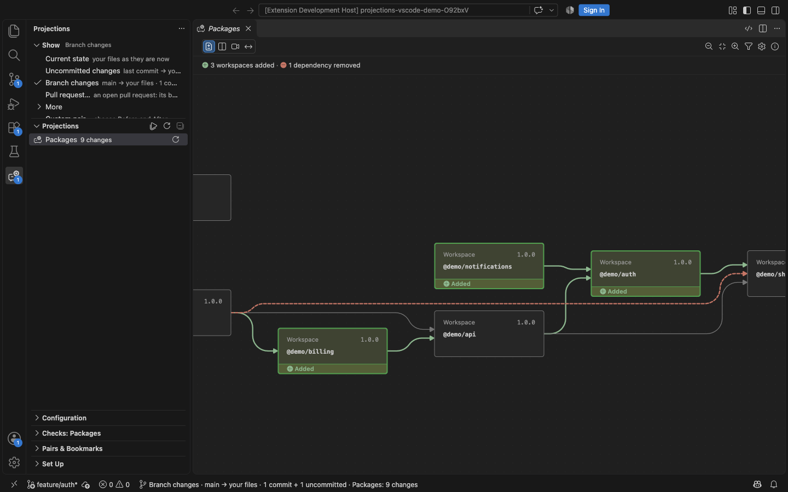

**Built: D5** (see [Out of date](../guides/vscode-side-bar.md#out-of-date)).
Tabs mount the Inspector with `refresh: 'manual'` and stay mounted while hidden
so nothing re-extracts unexpectedly. Staleness is decided in a pure module
(`packages/integrations/vscode/src/staleness.ts`) using `GET /api/identity` plus
`provenance.execution` (`source`, `fidelity`, `tree`) and
`provenance.definitionDigest` (falling back to the `changes` generation rule):
`fidelity: "stale"` is immediately out of date, renderer edits reload without
marking results stale, comparator edits re-compare on Refresh, and ref moves
mark tabs out of date instead of auto-re-extracting.

**Built: one switch, one update.** Switching choices used to flicker through
multiple intermediate renders and row badges (0–9 blank frames in the acme
demo). Switches now apply atomically:

- Side bar updates coalesce per turn
  (`packages/integrations/vscode/src/updates.ts`'s `coalesce`), caching tab
  reports by pair so revisiting a pair shows its count immediately and active
  extractions read "comparing…" from the click.
- Numbered switches ignore stale page reports and skip extracting pairs switched
  away from mid-flight.
- The Inspector keeps showing the previous pair whole until the new extractions
  are ready, compares by documents instead of labels, and caches recent
  extractions by definition so toggling between Now and other choices avoids
  redundant runs.
- The graph canvas retains its previous frame while laying out the next.

`packages/integrations/vscode/scripts/screenshots/switch-frames.mjs` records
real VS Code switches end to end, counting any blank frames.

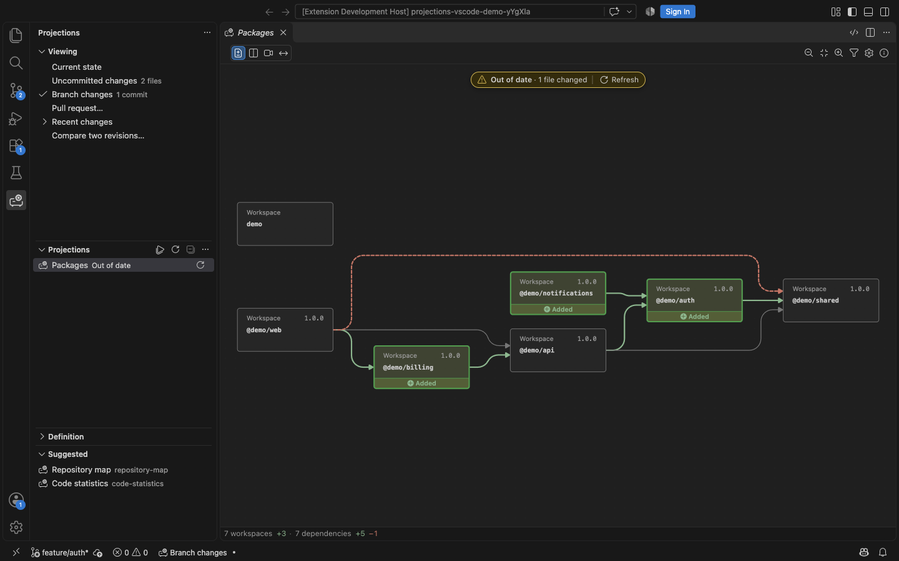

**Revised: the out-of-date notice floats over the stage.** Because it isn't a
toolbar tool, it moved from the toolbar onto the canvas as a centered pill 12px
from the top of the stage (or 12px below pane headers in side-by-side and swipe
so it never covers revision names), rendered by `VscodeProjectionView`'s
`stageNotice` (`StageNotice`) outside the renderer frame. That way it never
shifts fit-to-view layout, never crowds the toolbar, and stays pinned while
document-style views scroll underneath. It keeps the `warning` codicon, "Out of
date · N files changed", and Refresh, styled with VS Code's warning validation
background, a 3:1 contrast border, and cap-height centering; on narrow tabs the
count truncates first so Refresh stays intact. Verified in
`packages/host/vscode-ui/browser/stage-notice.spec.ts`.

<!-- prettier-ignore -->
| | Dark Modern | Light Modern |
| --- | --- | --- |
| Before: in the toolbar |  | 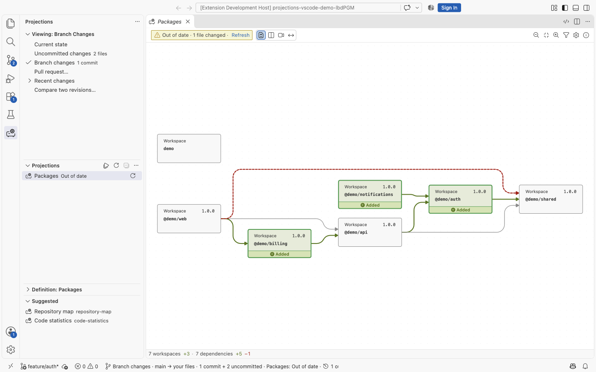 |
| After: over the stage | 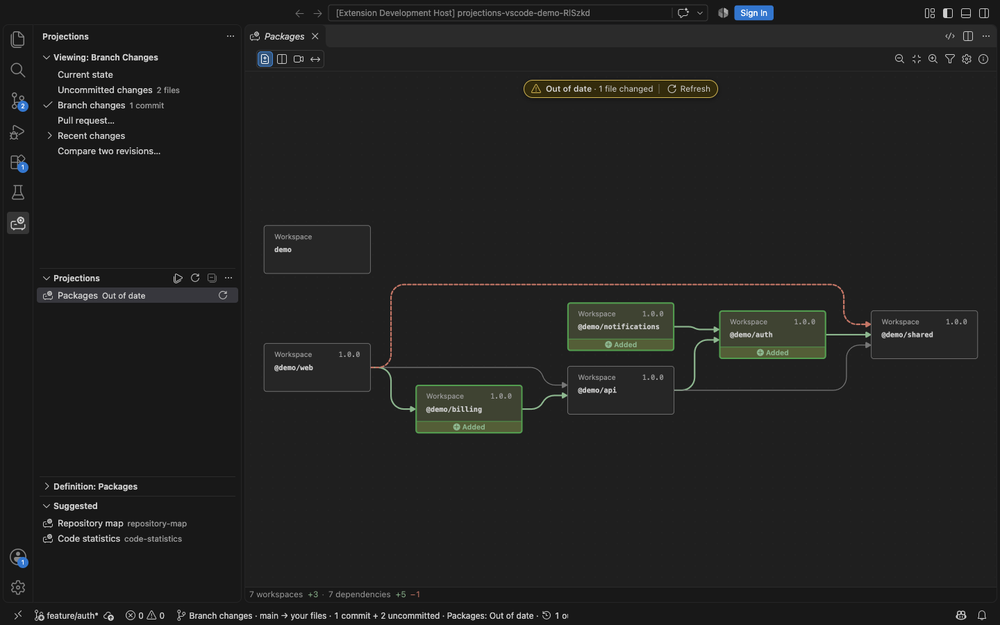 |  |

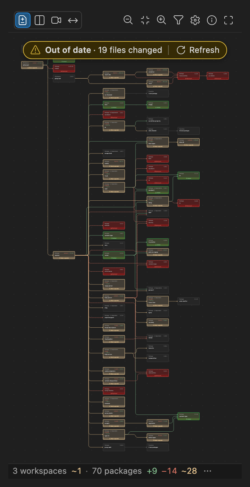

In side-by-side and swipe modes, sitting 12px below the Before/After header
bands keeps both revision titles legible and preserves the same 12px offset used
in every other mode (even when panes stack narrowly).


**Built: D4** (see [Your edits](../guides/vscode-side-bar.md#your-edits)).
Initially, normal tabs applied the committed `HEAD` definition (via
`definitionRevision` and `setDefinitionRevision`), showing a notice with Use my
edits here and Develop it whenever `packages/integrations/vscode/src/edits.ts`
detected uncommitted changes.

**Revised: your edits apply (replaces D4).** Status: **decided; built**
([Your edits](../guides/vscode-side-bar.md#your-edits)). Whenever a projection's
definition or declared files (extractor, comparator, renderer) have uncommitted
edits, all of its tabs automatically apply them
(`definitionRevision: 'working-tree'`) and display a quiet **Your edits · Show
committed** indicator beside the choice. Clicking **Show committed** flips that
tab back to `HEAD` ("Committed version · Use my edits") until the edits change
again (`editKey`) or you switch back. Committing or discarding returns tabs to
the committed definition and marks them out of date until Refresh; rows keep "·
edited". Since anyone editing projection files is actively authoring — and VS
Code is now the sole interactive authoring surface — applying edits by default
removes repetitive clicks while keeping the committed view one click away.

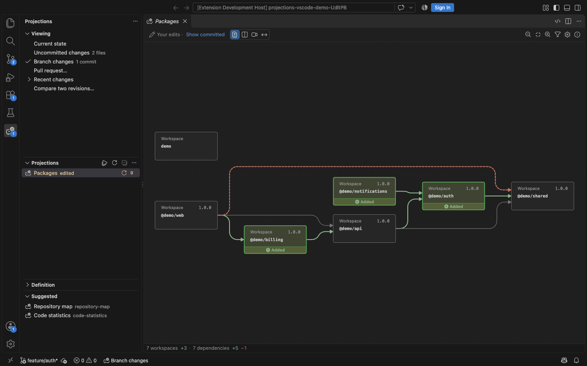

**Built: D3, since replaced** (see
[the side bar model](#the-side-bar-model-decided-reversible)). The standalone
Develop tab (with `POST /api/sweep`'s `pairs`, `cancel`, and per-sweep
thumbnails) was replaced by collapsible side bar sections, though its underlying
pieces live on in Checks, Pairs & Bookmarks, and Find Recent Changes…. The old
`compare-*.png` images in `images/desktop-surfaces/` document the removed
`compareStyle` prototypes (`control`, `rows`, `tabs`).

**Out of date** builds on the identity contract from
[Local execution](local-execution.md#identity-from-git-and-a-persistent-cache):

- **Result identity:** every extraction records `provenance.execution`
  (`{source, fidelity, tree?, strategy?, prepared?, scope?, ci?}`) and
  `provenance.definitionDigest`, where `tree` is the examined Git tree (what
  `git add -A` would commit for the working tree). `fidelity: "stale"` flags
  out-of-date immediately.
- **Working-tree identity:** `GET /api/identity?projection=ID` returns
  `{tree, definitionDigest, scope?, scopedTree?, scopeVerified?}` without
  running extractors (comparing `scopedTree` when `scopeVerified` is true, else
  `tree`).
- **Push updates:** `changes` notifications include `tree` after the quiet
  period; until identity lands in `serve --stdio` (and for in-place toolchain
  extractors that can read ignored files), the extension also keeps the
  `changes` generation rule (`working-tree`, `definitions`, `extractor:<id>`,
  …).

## The side bar model (decided, reversible)

Using D1–D6 in practice revealed that the side bar was still mixing viewing and
authoring. These reversible decisions cleaned that up before evolving into the
current [four sections](#four-sections-decided-reversible):

- **Every tool is its own native tree view** inside the Projections container,
  so users can drag any section to the panel or secondary side bar like Ports.
  By default only Show and Projections start expanded; Configuration, Checks,
  Pairs & Bookmarks, and Set up stay collapsed.
- **Projection rows are flat leaves.** Clicking opens the tab, Refresh stays
  inline, and Open Definition lives in the context menu — no expandable part
  children mixing viewing with authoring.
- **Configuration** acts like Outline: a native tree following the active
  projection tab (and its files) with a pin, listing Definition, Extractor (Show
  Extraction Output), Comparator (Configure…), Renderer (with `scenarios.json`
  underneath, replacing the separate Scenarios view), Environment, and
  Provenance (`provenanceBadge()`).
- **Checks** tracks checks and comparator tests for the active/pinned projection
  with a Run button in its title.
- **No separate Develop tab (replaces D3).** The projection tab is the only tab
  type; authoring lives in the collapsible sections (Configuration, Checks, and
  **Pairs & Bookmarks** with Add Pair…, Find Recent Changes… via `/api/sweep`,
  change counts, hover thumbnails, and inline Bookmark/Remove, selecting
  `bookmark:<id>` or `pair:<before>..<after>`). Extraction output goes to the
  **Projections** output channel, diagnostics to Problems, and edit tiers apply
  right inside projection tabs (with **Show Configuration** replacing Develop
  it, later simplified by **Revised: your edits apply** under
  [Jobs to be done](#jobs-to-be-done-decided)).
- **Quick-pick triggers look like VS Code buttons,** not bordered dropdowns with
  chevrons.
- **One repository-wide choice in Show** (replacing an earlier experimental
  webview "Viewing" control and removing per-tab choice controls, Pin/Follow,
  and `projections.experimental.choiceInTab`). Show is a fast, accessible native
  list (Current state; Uncommitted changes, Branch changes, Pull request…;
  collapsible More with Last commit, Since <tag>, bookmarks; Custom pair… with
  inline Swap) that sets the repo-wide choice, puts Refresh in its title, and
  mirrors to the status bar.
- **Grouped Viewing quick pick:** **Show** (Current state: "your files as they
  are now") vs. **Show changes** (Uncommitted changes, Branch changes, Pull
  request…, More, Custom pair…), with real ref spans and sizes ("last commit →
  your files · 1 file", "main → your files · 3 commits + 1 uncommitted"),
  deduplicating equivalent choices and asking "What should projections show?".
- **Swap only for Custom pair…** (plus the command palette), since reversing a
  named choice makes no sense.
- **Provenance badges only when unusual** (From CI, Approximate, Stale,
  Observed); ordinary local runs stay quiet.
- **Subtle, immediate loading states.** Tabs show VS Code's thin top progress
  bar after 300 ms — never "No extraction loaded", giant rings, or "the Custom
  renderer". Opening a tab paints its real layout skeleton at 0 ms (empty
  toolbar strip, summary strip, and centered 16px `loading` codicon with
  "Loading Packages…") with zero dimmed stand-in controls while the backend
  starts, then swaps cleanly in place.

  

  Before and after, Dark Modern then Light Modern:

  

  

  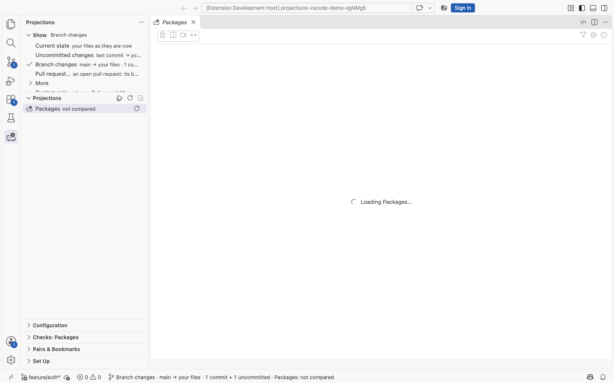

  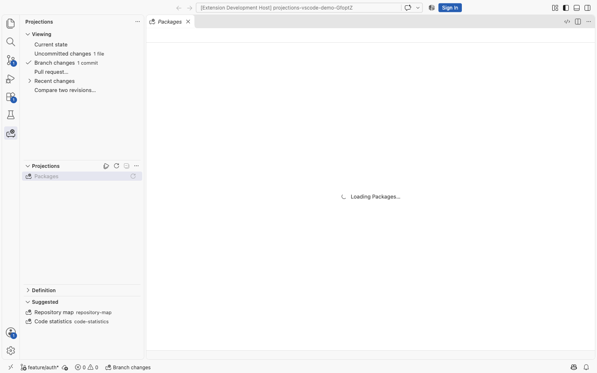

- **Edge-to-edge side-by-side panes** with one 1px editor-group divider, and a
  **unified Swipe divider** whose 1px line matches its grip outline (VS Code's
  link foreground, shifting together to sash hover or focus border on
  interaction — mirrored in the Default UI with its own accent/emphasis/focus
  tokens).

  

- **Plain language over "sweep".** The UI says **Find Recent Changes**
  ("Checking recent commits… 4 of 10"), keeping `/api/sweep` internal.

## Four sections (decided, reversible)

Six views (Show, Projections, Configuration, Checks, Pairs & Bookmarks, Set up)
proved two too many, with Show's More and Pairs & Bookmarks overlapping. We
consolidated into **four sections — each answering one clear question, with only
one following the active tab:**

- **Viewing** (_What am I looking at?_): Current state, Uncommitted changes,
  Branch changes, Pull request…, **Bookmarks**, **Recent changes** (Last commit
  at `HEAD`, Since <tag>, and recent commits that change any projection via
  `/api/sweep` with subjects, short hashes, and hover thumbnails), and **Compare
  two revisions…** (replacing Custom pair… and Add pair…, with inline
  Bookmark/Remove and Swap when active).
- **Projections** (_What is there, and what changed?_): Flat rows sorted
  alphabetically by title ("API database schema" before "CI pipeline") with
  right-edge count badges, **New Projection…** (`+`) in the title bar, and Add
  to CI… in `…`.
- **Definition** (_What is this projection made of?_): Renamed from
  Configuration and the sole section following the active tab (with pin):
  definition file, Extractor, Comparator (with `.comparator.test.yaml` under
  it), Renderer (with scenarios under it), and Environment — sharing
  `definitionModel` with Go to Source….
- **Suggested** (_What else could I add?_): Renamed from Set up; shows only
  unadopted candidates with inline Adopt, hiding itself once empty (after first
  adoption, its welcome offers Add to CI…).

**Checks moved to VS Code's Testing view.** A "Projections" test controller
lists each projection's `projections check` steps and individual
`.comparator.test.yaml` cases right at their source lines with gutter run
buttons, backed by `check` and `POST /api/comparator-tests/run`, reporting into
Test Results while definition errors stay in Problems (no debug profile needed).

**Retired the word "pair" from the UI** in favor of "Compare two revisions…",
"Two revisions", and "Compare These Revisions", keeping internal names
(`setPair`, `pair:<before>..<after>`, `/api/pairs`, `/api/sweep`).

**Static section titles; choice lives in the status bar.** Because VS Code hides
view descriptions when collapsed
(`.pane-header:not(.expanded) .description {display: none}`), we briefly tried
dynamic `TreeView.title` text ("Viewing: Uncommitted changes"), then reverted to
clean static "Viewing" and "Definition" headers (with Definition showing "Pinned
to Packages" in its message when pinned, since a `view/title` action's tooltip
is static). The status bar now carries the choice readout, and the active editor
tab already names the projection.


**The status bar item (decided).** Shows the Projections product icon
(`$(projections-mark)`, U+E000 generated by `tools/scripts/product-icons.mjs`
from `brand/projections-mark.svg`) plus the short choice name, without repeating
the tab title or raw hashes:

<!-- prettier-ignore -->
| Choice | Text |
| --- | --- |
| Current state, Uncommitted changes, Branch changes, Last commit, Since v1.0 | the name |
| A pull request | `PR #123` |
| A bookmark, a recent change | the subject, cut at 24 characters with "…" |
| Two revisions | `main → feature/x`, each side cut at 20; a short commit only where nothing names it |
| The tab in front out of date | the same and `$(warning)`, in the item's normal colours |
| The tab in front extracting or comparing | the same and `$(sync~spin)` in the warning's place (`$(sync)` under reduced motion) |

Its Markdown tooltip carries full details (``main `a1b2c3d` → your files``, span
size, changed files, staleness reasons, pinned tab note). It appears only when
projections are defined _and_ either a `projections.projection` tab is active
(`tabGroups`) or any of the four side bar views is visible
(`onDidChangeVisibility`), coalesced per turn so switching focus between tab and
side bar never flickers. Clicking it opens the **Viewing** quick pick
(`ViewingView.present` from `viewingRows`, shared with Choose What to Show…),
starting with `$(refresh) Refresh · 19 files changed` when stale and ending with
**Show in Side Bar**.

**Out of date and running indicators (decided).** Because VS Code's stable API
has no multi-segment status items (`statusBarCommands` is SCM-only), the single
item appends `$(warning)` when the front tab is stale (without
`statusBarItem.warningBackground`) or `$(sync~spin)` while its job is extracting
or comparing (taking precedence over warning during Refresh, with other active
tabs counted in the tooltip). Inside the tab, the summary bar reserves a slot at
the far end for a spinning `sync` codicon with a polite live region. Both share
`runningIndicator` (`packages/host/vscode-ui/src/running.ts`, imported via
`@githubnext/projections-host-vscode/running`), waiting 300 ms before appearing
and staying at least 400 ms to avoid flicker. Reduced motion stops the spin
(`prefers-reduced-motion` and `vscode-reduce-motion` in the webview; `$(sync)`
instead of `~spin` in the status bar when `workbench.reduceMotion` is `on` or
`auto` with reduced motion reported). Job state flows from the Inspector
(`running`) into `ActiveTab.running` every half second (VS Code UI only;
renderer builds stay in Definition's Renderer row).


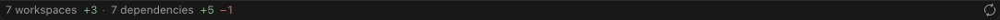

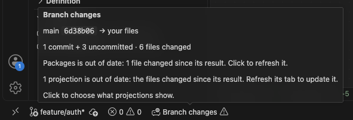


**Short descriptions and right-edge count badges.** At a 300 px side bar width,
row descriptions stay under ~12 characters (`2 files`, `3 commits`, `#123`,
`a1b2c3d → e4f5a6b`) with full spans in Markdown tooltips. Projections rows show
change counts as 1–2 character badges (`9+`) via a `FileDecorationProvider` on
`projections-row:/<folder>/<id>` (`TreeItem.resourceUri` alongside `iconPath`)
tinted with `gitDecoration.modifiedResourceForeground`; uncompared rows have no
badge and use `disabledForeground`, and descriptions surface only unusual states
(Out of date, needs trust, failed, edited).

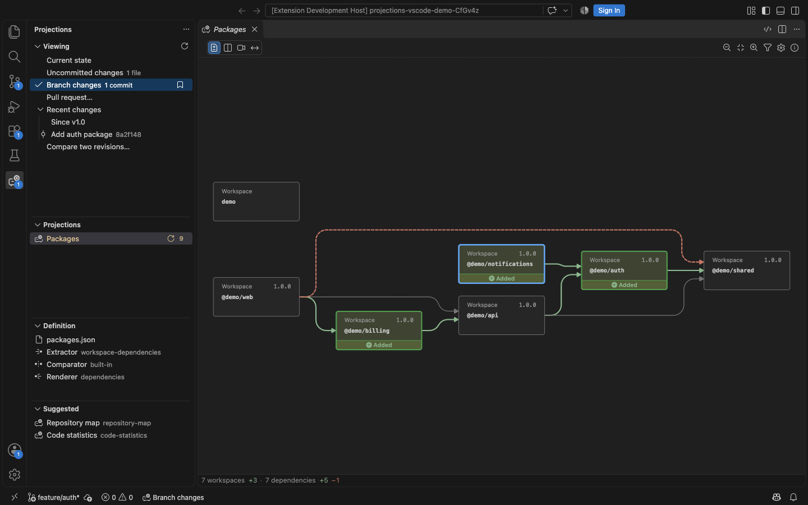


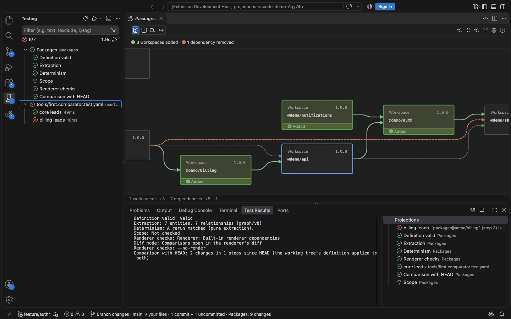


Every section is a native tree and can be dragged freely (default order:
Viewing, Projections, Definition, Suggested; resettable with View: Reset View
Locations).

**Starting a projection: New Projection… (decided).** Adding a **New
Projection…** (`$(add)`) button to the Projections title bar (plus the command
palette and empty-state welcome) gives developers a clear entry point even after
initial setup. It opens a guided quick pick with four paths:

- **Start from a suggestion** (`GET /api/explore`, or **Explore this
  repository** when none exist yet).
- **Start from a built-in extractor and renderer**
  (`projections extractor list --json` and `GET /api/renderers`' `accepts`,
  listing the extractor's default first, e.g. `dependencies`).
- **Write a custom extractor, renderer, or comparator** (starter extractor in
  Node.js, Python, or Go; renderer package; both; or a comparator file over a
  built-in extractor).
- **Ask an agent to write it** (scaffolds the projection and opens agent chat
  prefilled with `projections init`'s prompt, or copies it if chat isn't
  available).

Next it prompts for an ID (validated live against `definition/v0.json`,
environment file names, and existing projections/files) and an optional title,
then runs `projections init` (`--extractor`, `--renderer`, `--language`,
`--comparator custom`, `--definition-directory` when definitions live in
`.projections`) rather than writing files directly, opens the definition and
projection tab, reveals the row (`TreeView.reveal`), and logs next steps to the
Projections output channel. Clear error actions cover Restricted Mode (**Manage
Workspace Trust**), missing CLI (**Open Settings** for `projections.cliPath`),
existing IDs (**Open Definition**), and ambiguous toolchains (**Choose a
Language…**). Pure model logic (including `init` arguments) lives in
`new-projection-model.ts` with unit tests and a real-VS-Code smoke test.


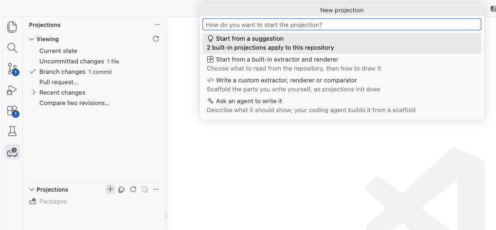


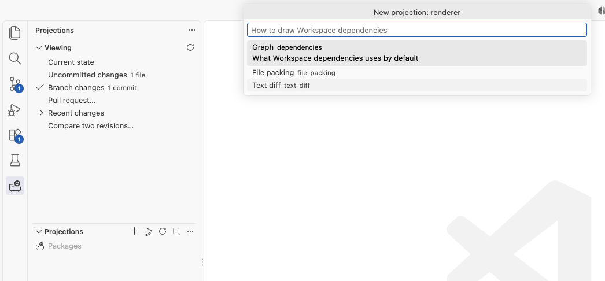


**Custom part icons (decided).** Generic codicons (`inspect`, `git-compare`,
`eye`) carried misleading meanings, so we designed one cohesive three-icon
pipeline family ([brand/parts](../../brand/README.md#part-icons)):

- **The dot is the extraction** — identical size and clearance in all three.
- **Extract converges:** three strokes converging onto the dot on the right.
- **Compare divides:** two dots flanking a three-dash divider.
- **Render diverges:** three strokes fanning out from the dot on the left.

Shipped as VS Code product icons (`projections-extractor`,
`projections-comparator`, `projections-renderer`) and Inspector icon tokens
(`--projections-icon-<part>`), adopting dot-family D4 after reviewing thirty
metaphors across four families.


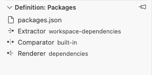

**Selecting a row never leaves VS Code (decided).** Clicking a side bar row
shouldn't unexpectedly launch a browser, so no row or quick-pick primary action
leaves VS Code:

- File rows open in an editor.
- Built-in parts (and Go to Source… items, plus the welcome's "renderer catalog"
  link) open bundled documentation inside VS Code's Markdown preview (the
  default comparator keeps its Configure… gear).
- **Open Documentation on GitHub** (`link-external`) is strictly a secondary
  hover/context/quick-pick action, while explicit links clicked inside a
  renderer or page still open the browser (`openExternal`).

During the audit, only Definition's built-in rows (`vscode.open`) and Go to
Source…'s built-in items (`env.openExternal`) launched externally. To fix both,
the build bundles ~50 reference pages (~0.6 MB) into `dist/docs/` (named after
each part, e.g., `renderers/graph.md`), served via a read-only
`projections-docs:` file system provider so `vscode.markdown.preview.editor`
resolves relative links in-app while keeping Definition locked on the active
projection. `index.json` maps aliases like `dependencies` straight to `graph`
(fixing the old `renderers.md#dependencies` miss).

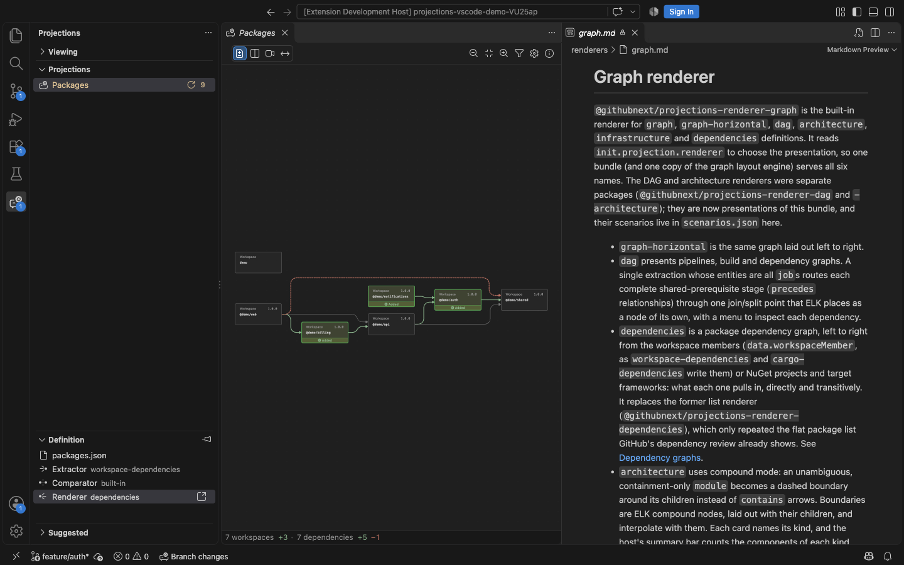

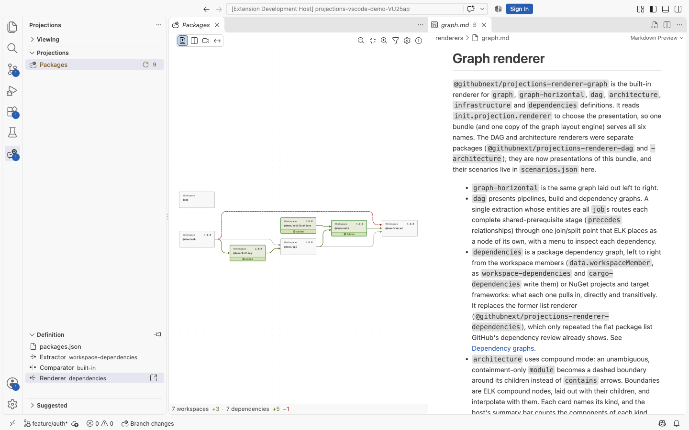


## The summary bar (decided, reversible)

The dependency graph's old top summary line ("⊕ 1 workspace added · ⊖ 1
workspace removed") became a standardized bottom summary bar across every host
and view (renderer, table, and text):

- **Always at the bottom** (22px status-bar strip in VS Code, compact band in
  the Default UI), replacing every renderer's ad-hoc summary line.
- **Domain totals and colored deltas:** `7 workspaces · 7 dependencies` for one
  revision, or `7 workspaces +3 · 7 dependencies +5 −1` for comparisons (only
  deltas use Git change colors). Every figure acts as a filter toggle, and the
  "N varied within tolerance" toggle sits at the end alongside the VS Code tab's
  reserved `sync` spinner slot (see
  [Four sections](#four-sections-decided-reversible)); narrow widths overflow
  cleanly into a "…" popover.
- **Cap-height centering and even toolbar insets.** Text trims to cap height and
  baseline (`text-box: trim-both cap alphabetic`, verified by
  `cap-height.spec.ts`), and leading/trailing toolbar controls sit at equal
  insets from top, bottom, and edge (4px for 26px mode groups and playback
  controls, 6px for 22px actions in VS Code; 4px around 32px controls in Default
  UI, verified by `toolbar-insets.spec.ts`).
- **Renderer-supplied vocabulary.** Renderers send an optional `summary` message
  ([contracts](../contracts/renderer-frames.md)) naming domain nouns and
  classified facts (`type: 'fact'`), with host fallbacks from kind names
  (`depends-on` → dependencies).

### Every renderer's summary in the bar (decided, reversible)

Every built-in renderer — including runtime policy — now sends its summary to
the bottom bar and renders no top-line totals or `(was n)` headers of its own:

- **Domain counts** list what a reader actually counts (API declarations,
  runtime policy rules, foreign keys) and omit structural scaffolding (`false`
  for containment boundaries, columns, or folded cards).
- **Classification facts** pair an icon token, count, and muted noun
  (`2 breaking changes`, `1 newly enforced`, `1 to replace`,
  `18 major upgrades`, `2 column types changed`, `1 lifetime changed`),
  filtering when given IDs.
- **Measured facts** show colored comparison deltas
  (`39,882 lines of code +2,056`, `1 enforcing rule +1`, `5 enum values +2`),
  staying consistent across all playback points and opening the text view.
- **What remains inside renderers:** encoding legends (file-packing colors, DI
  instance lines) and qualifying notices (API notices, entity limits); redundant
  word-only legends are removed.

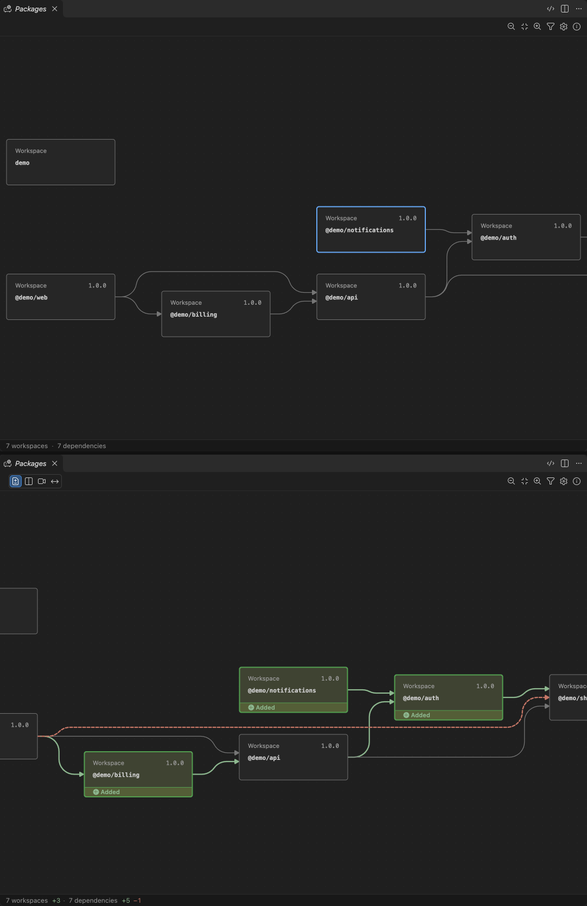


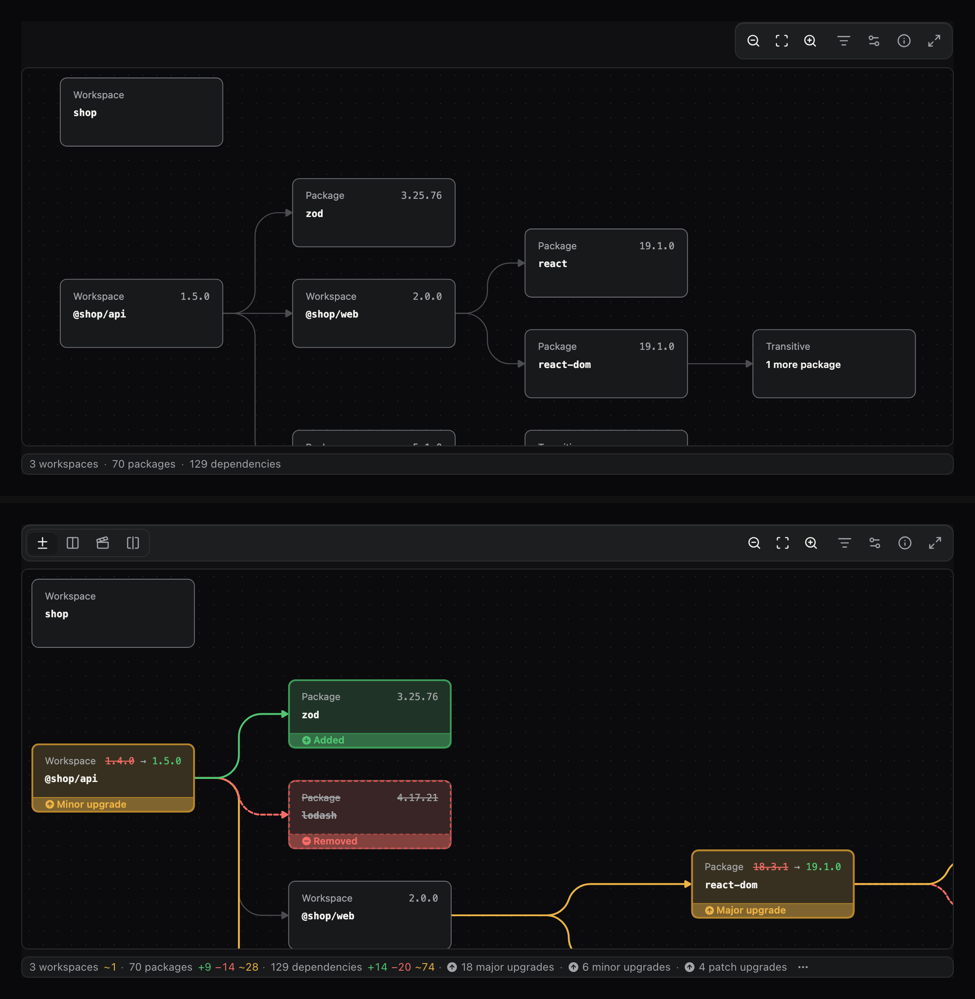


Before and after cap-height centering (2×, Dark Modern then Light Modern):

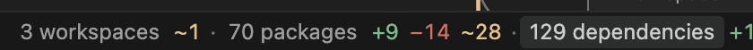

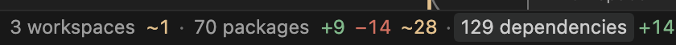


Before and after even toolbar insets (2×, Dark Modern then Light Modern):

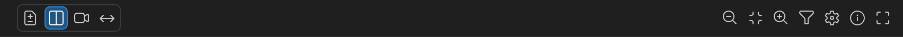

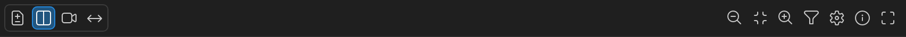

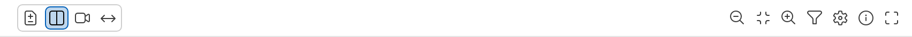


## Follow-ups (not scheduled)

An unscheduled editor-title concept for later:

1. Making the projection view an optional custom editor (`priority: option`) for
   `.github/projections/*.json` with **Show Projection**, **Open Projection to
   the Side**, and **Show Definition** toggles.
2. Moving Refresh, a `toggled` comparison-mode submenu, and Swap to native
   `editor/title` actions.
3. Adding **Open Projection to the Side** on `*.comparator.yaml` and renderer
   source files.

**Already shipped: Go to Source….** A native `editor/title` button (`$(code)`)
and **Projections: Go to Source…** command let you jump straight from a
projection tab to its backing files. When there's only one file (the definition
with all built-in parts), it opens immediately; otherwise it opens a grouped
quick pick (Definition, Extractor, Comparator, Renderer, Environment — built on
`sourceParts`, `definitionModel`, and `sourceItems`) that opens to the side,
with buttons for "Open in this group" and Open Documentation on GitHub for
built-ins.

## What was built

The extension (`packages/integrations/vscode/`,
[README](../guides/vscode-side-bar.md)) ships the recommended design:


- The **Projections** activity bar container with its evolved
  [four sections](#four-sections-decided-reversible) (Viewing, Projections,
  Definition, Suggested), Testing view integration, badge, `viewsWelcome`,
  status bar item, and per-file Problems diagnostics.
- **Projection tabs:** read-only custom editors on `projection:` URIs with
  preview/keep behavior, window restore, `editor/title` actions (mode, Swap,
  Play, Pin, `…`), `chrome: 'none'` Inspector mount, and `setState` persistence.
- **One shared backend per folder** (`src/backends.ts`) serving the side bar,
  tabs, Inspector panel, and Testing view.

Notable differences from the initial proposal:

- **Tab icon:** custom editors inherit file-icon theme icons, so renderer
  codicons appear on side bar rows instead of tabs.
- **Resource URI:** `projection:/<folder>/<title>?folder&id` (not
  `projection:/<folder>/<id>`) so VS Code uses the projection title as the tab
  name.
- **Pinned tab titles** stay fixed to the projection title; the status bar
  tooltip notes the pinned pair instead.
- **Change counts** populate lazily when a tab opens or **Compare All** runs,
  avoiding background extraction of every projection.
- **Opening framing:** tabs always open fitted to the viewport — unless fitting
  would shrink text below an 8 px readability floor, in which case they open at
  that floor at top-left/top-center and scroll (with Fit to view, Zoom In, and
  Zoom Out in `…`). This replaced an earlier 11 px / `framing`-setting approach
  on 2026-11-10 after testing showed cropped initial views on Package
  dependencies and unreadable 1.6–7 px text on huge graphs.
- **Details** remain in the projection's detail card (no separate Details view
  yet), and **Scenarios** open the workbench on the scenario directory.
- **Still to build:** parts as dirty edits (Save/Revert),
  `Open With… → Projection`, the setup walkthrough, the gallery editor, and
  "Projection changes" in Source Control.

## Next steps

1. ~~The activity bar container and its sections~~, ~~the `projection:` custom
   editor~~, and ~~editor title actions~~ are built.
2. Parts as edits (dirty state, Save/Revert) and `Open With… → Projection` for
   definition files.
3. Setup walkthrough (candidates, sweep editor, adopt diff previews, and Add to
   CI are already built).
4. "Projection changes" in Source Control, followed by the gallery editor.
