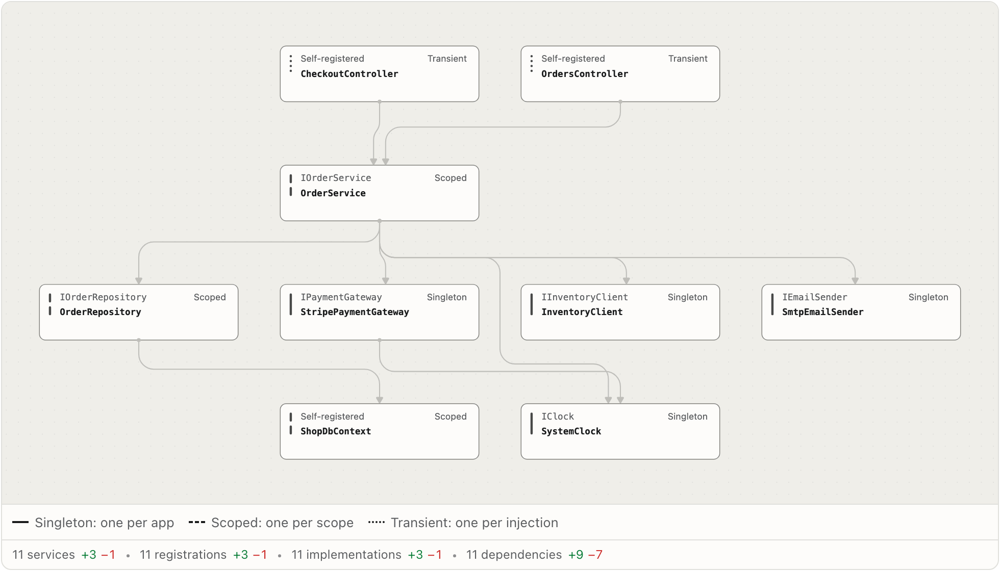
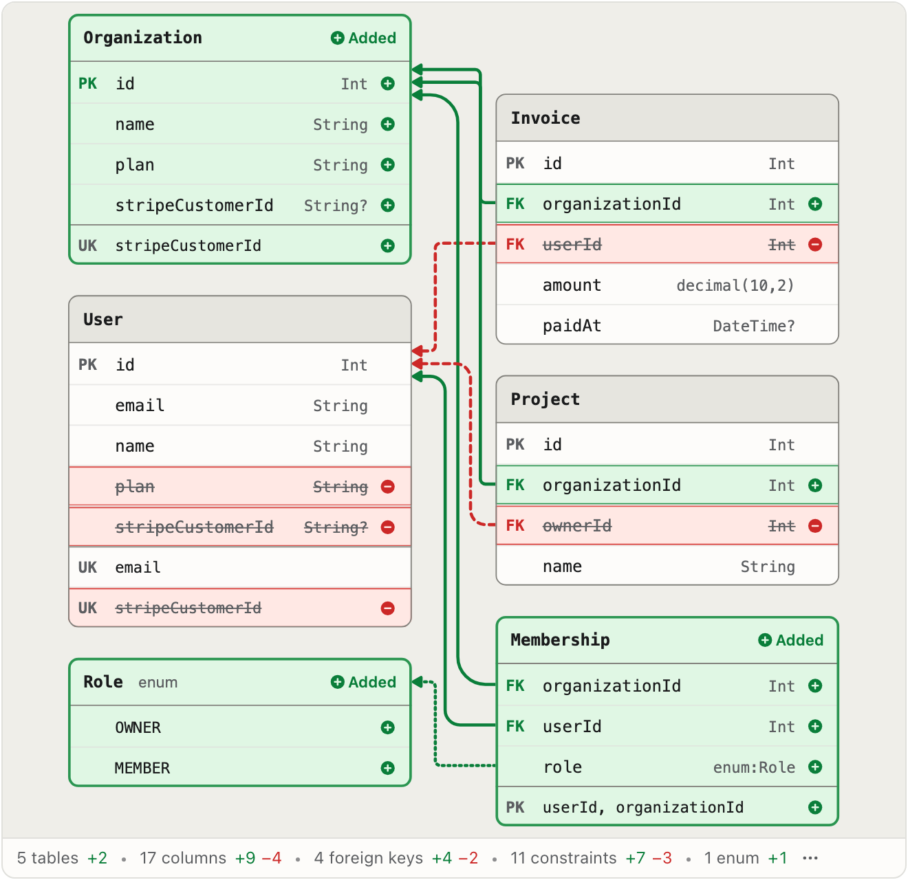
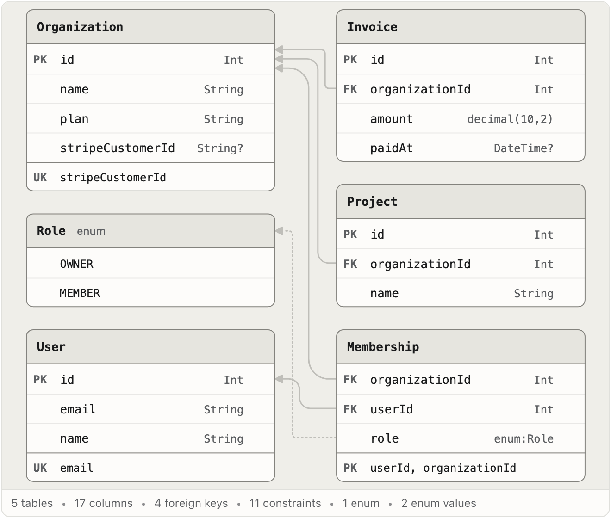
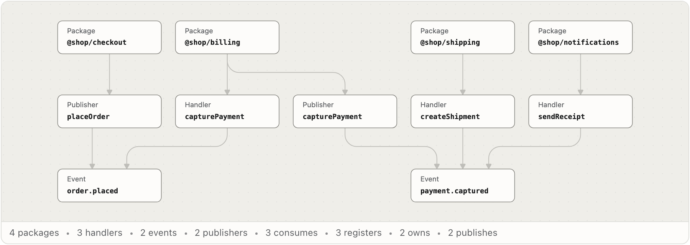
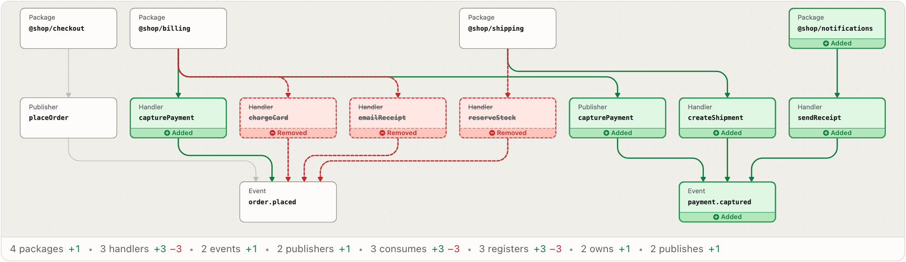
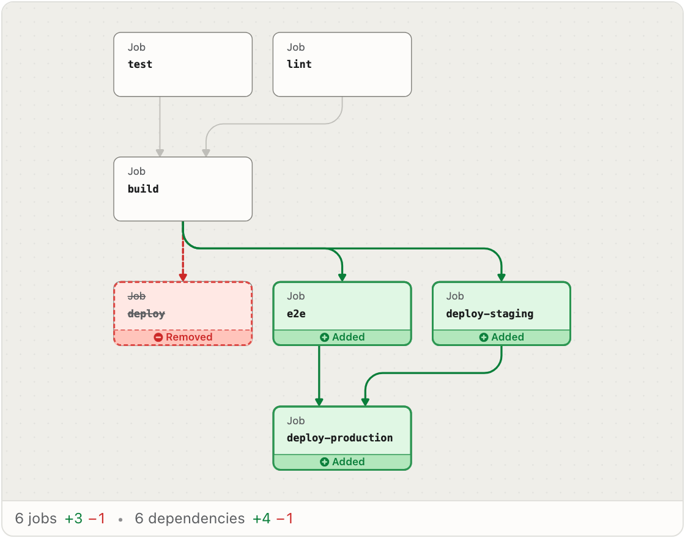
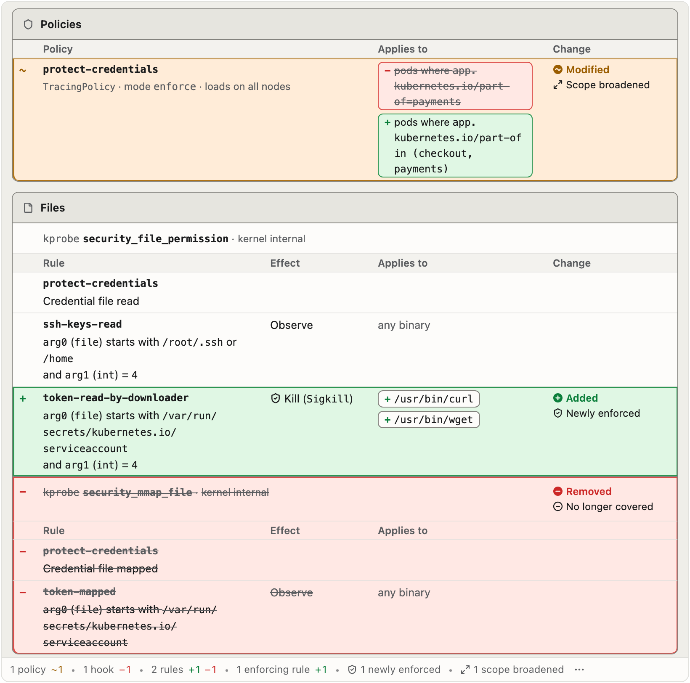

# Gallery

One example for each built-in renderer, drawn by the CLI with
`projections compare --png` and `projections show --png`. Most draw a change;
some draw a system at one revision. Most come from small, made-up projects in
[`images/sources`](images/sources), each linked below; the others are public
repositories at pinned commits. `node tools/scripts/readme-images.mjs` draws
them all again.

## Dependency injection

The [`dependency-injection`](builtins/renderers/dependency-injection.md)
renderer draws a container's registrations as a graph: each service, its
lifetime and what it injects.

<picture>
  <source media="(prefers-color-scheme: dark)" srcset="images/readme/di-split-dark.gif">
  
</picture>

`OrderService` split into three focused services, animated
([`docs/images/sources/order-service-split`](images/sources/order-service-split/README.md),
`dotnet-di`).

<picture>
  <source media="(prefers-color-scheme: dark)" srcset="images/readme/di-split-dark.png">
  
</picture>

The same change as one diff: each controller lists what it now injects instead.

## Database schema

The [`database`](builtins/renderers/database.md) renderer draws tables, columns,
keys and the foreign keys between them.

<picture>
  <source media="(prefers-color-scheme: dark)" srcset="images/readme/database-dark.png">
  
</picture>

Billing moves from users to organizations
([`docs/images/sources/billing-to-organizations`](images/sources/billing-to-organizations/README.md),
`prisma-schema`).

<picture>
  <source media="(prefers-color-scheme: dark)" srcset="images/readme/database-after-dark.png">
  
</picture>

The same schema at one revision.

## Architecture

The [`graph`](builtins/renderers/graph.md) renderer's `architecture`
presentation draws components and how they connect; here, events and the code
that publishes and handles them.

<picture>
  <source media="(prefers-color-scheme: dark)" srcset="images/readme/architecture-after-dark.png">
  
</picture>

A shop's event flow at one revision
([`docs/images/sources/order-event-flow`](images/sources/order-event-flow/README.md),
the `message-handlers` sample extractor).

<picture>
  <source media="(prefers-color-scheme: dark)" srcset="images/readme/architecture-dark.png">
  
</picture>

The change that made it: three handlers of `order.placed` give way to a
`payment.captured` chain.

## Infrastructure

The `infrastructure` presentation draws cloud resources, the references between
them and what a plan does to each.

<picture>
  <source media="(prefers-color-scheme: dark)" srcset="images/readme/infrastructure-dark.png">
  
</picture>

A Terraform plan that replaces a database
([`docs/images/sources/encrypt-database`](images/sources/encrypt-database/README.md),
`terraform-infrastructure`).

## Dependencies

The `dependencies` presentation draws packages, what depends on them and how
their versions move.

<picture>
  <source media="(prefers-color-scheme: dark)" srcset="images/readme/dependencies-dark.png">
  
</picture>

A React 18 to 19 upgrade across a workspace
([`docs/images/sources/react-19-upgrade`](images/sources/react-19-upgrade/README.md),
`workspace-dependencies`).

## Pipeline

The `dag` presentation draws jobs and what each waits for.

<picture>
  <source media="(prefers-color-scheme: dark)" srcset="images/readme/dag-dark.png">
  
</picture>

A workflow gains end-to-end tests and a staged deploy
([`docs/images/sources/deploy-pipeline-split`](images/sources/deploy-pipeline-split/README.md),
`github-actions-jobs`).

## Public API

The [`api`](builtins/renderers/api.md) renderer lists declarations with their
signatures; with the API compatibility comparator, it says which changes break
callers.

<picture>
  <source media="(prefers-color-scheme: dark)" srcset="images/readme/api-dark.png">
  
</picture>

A client library's breaking changes, and why each breaks
([`docs/images/sources/client-breaking-changes`](images/sources/client-breaking-changes/README.md),
`typescript-public-api`).

## Text

The [`text-diff`](builtins/renderers/text-diff.md) renderer compares captured
command output line by line.

<picture>
  <source media="(prefers-color-scheme: dark)" srcset="images/readme/text-diff-dark.png">
  
</picture>

A command line's help across a release
([`docs/images/sources/cli-help-release`](images/sources/cli-help-release/README.md),
`command-output`).

## Code statistics

The [`code-statistics`](builtins/renderers/code-statistics.md) renderer draws
lines of code by language.

<picture>
  <source media="(prefers-color-scheme: dark)" srcset="images/readme/code-statistics-dark.png">
  
</picture>

fish shell's port from C++ to Rust, 3.7.0 to 4.0.0
([fish-shell/fish-shell](https://github.com/fish-shell/fish-shell)).

## Files

The [`file-packing`](builtins/renderers/file-packing.md) renderer packs files as
circles sized by their bytes inside their folders.

<picture>
  <source media="(prefers-color-scheme: dark)" srcset="images/readme/file-packing-dark.png">
  
</picture>

Every file in fish shell 4.0.0, at one revision.

## Runtime security policy

The [`runtime-policy`](builtins/renderers/runtime-policy.md) renderer draws
runtime security policies, the hooks they attach to, their rules and who they
apply to; with the runtime policy comparator, it says what each change means.

<picture>
  <source media="(prefers-color-scheme: dark)" srcset="images/readme/runtime-policy-dark.png">
  
</picture>

A credentials policy starts killing downloaders that read the service account
token, and widens its scope
([`docs/images/sources/credentials-policy`](images/sources/credentials-policy/README.md),
`tetragon-policies`).

The [`graph`](builtins/renderers/graph.md) renderer's plain `graph` and
`graph-horizontal` presentations draw the same cards and arrows as the
presentations above, without their domain wording.
