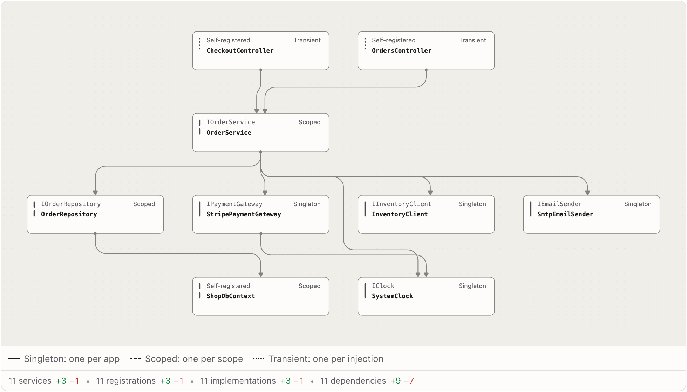
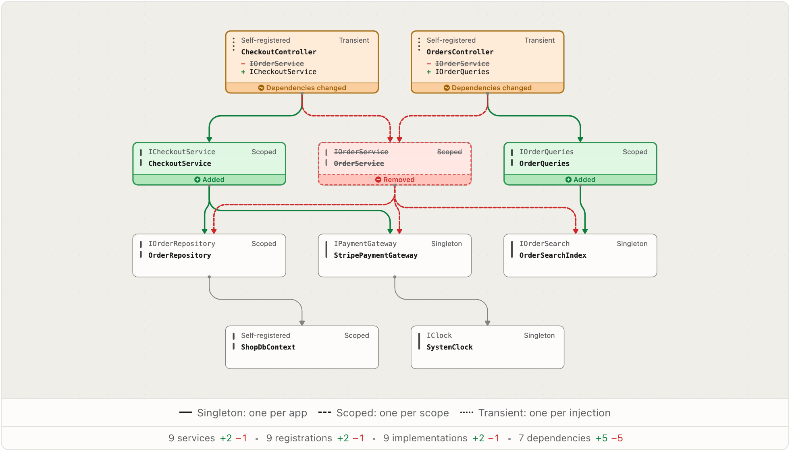
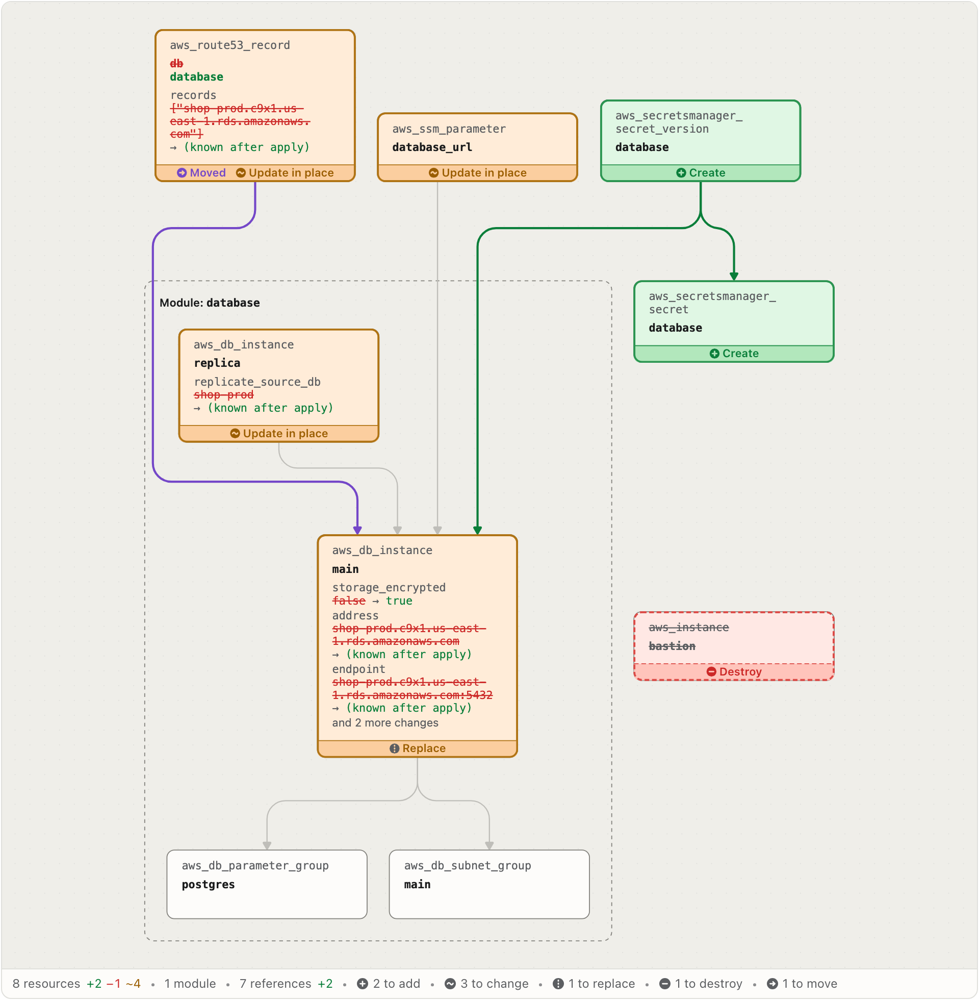
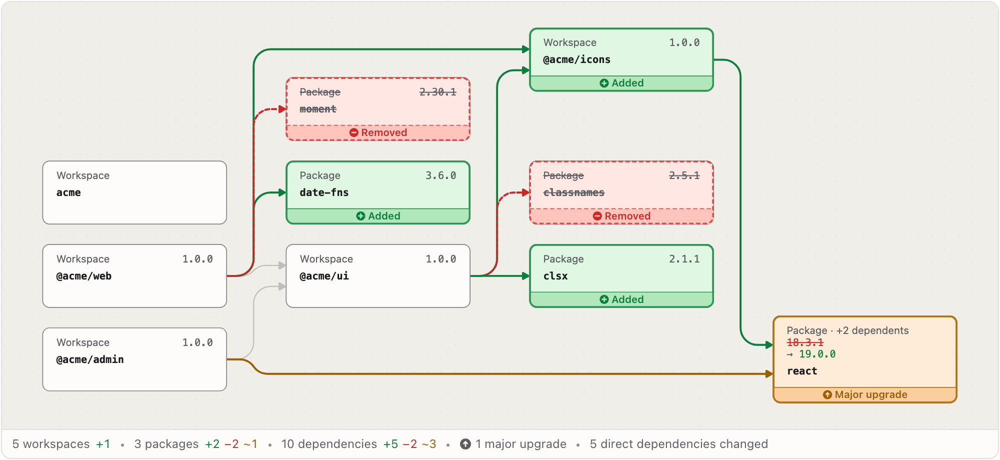
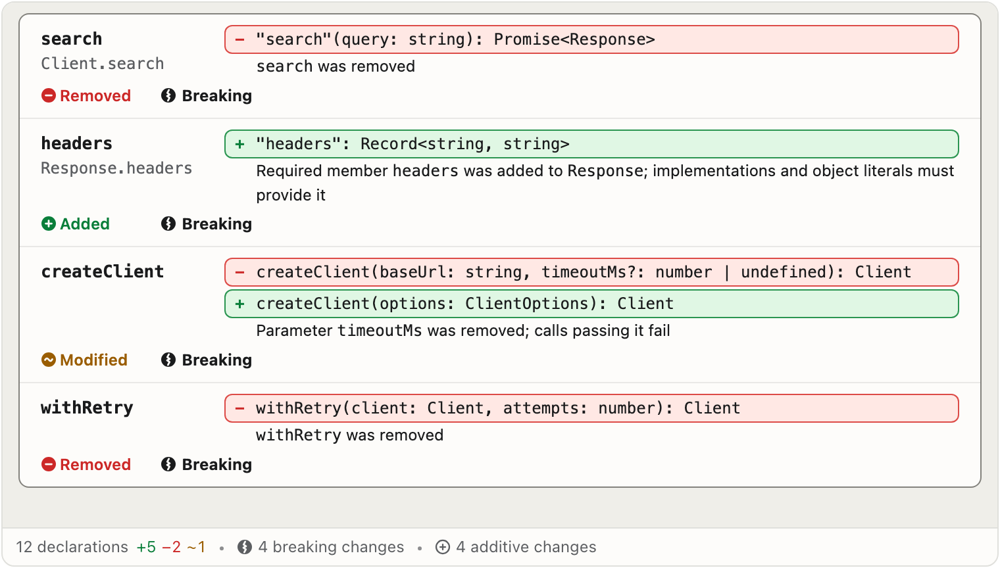
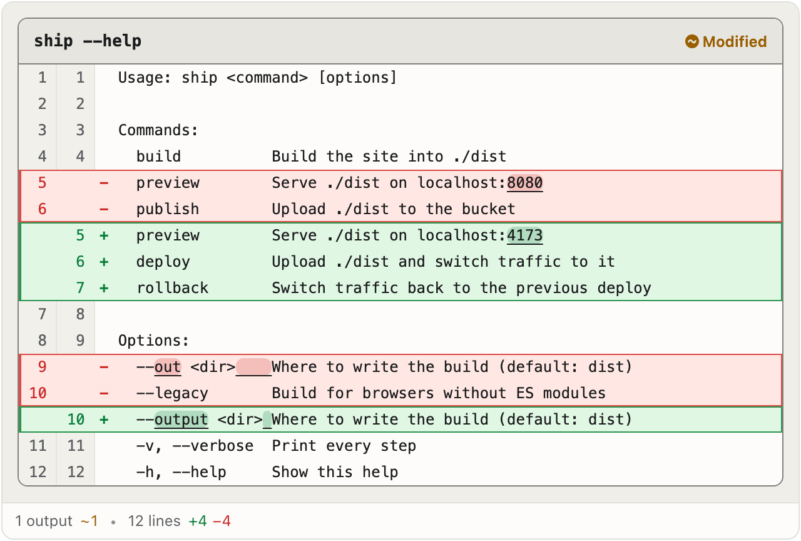
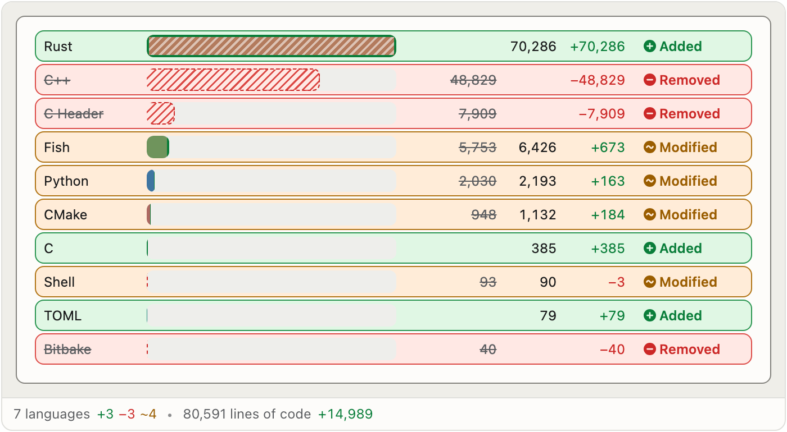
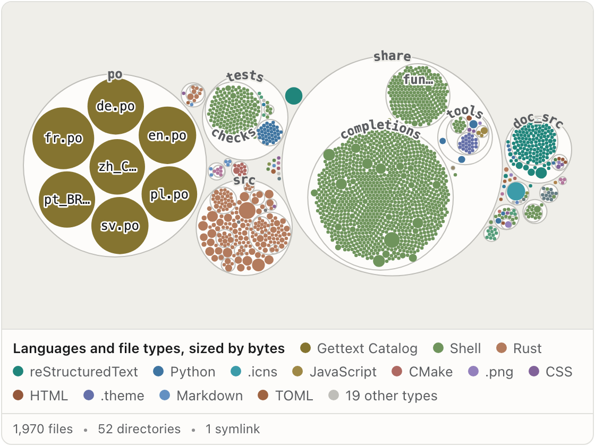
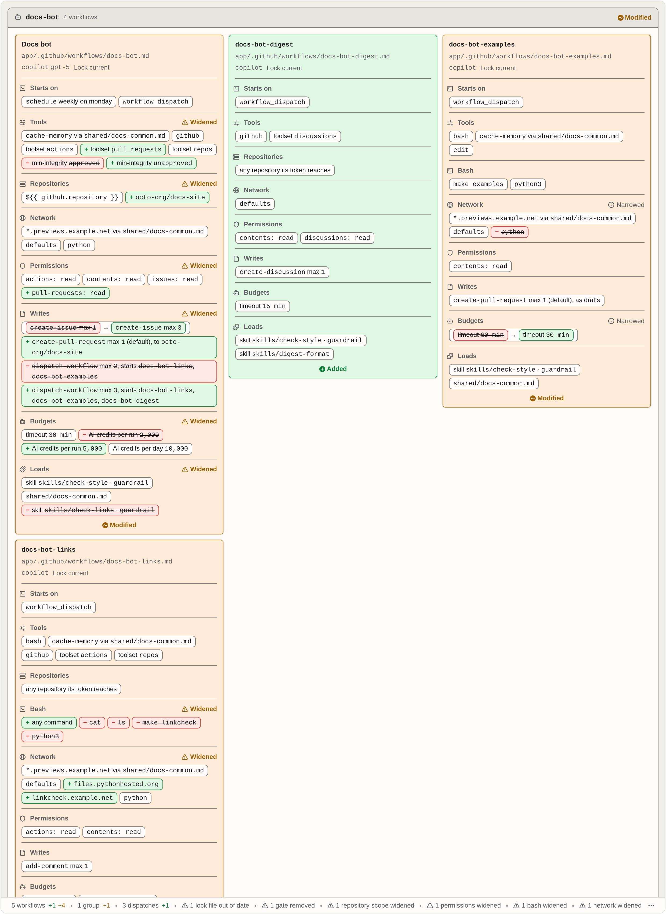

# Gallery

Here is one example of every built-in renderer, generated directly by the CLI
with `projections compare --png` and `projections show --png`. Most images show
a change between revisions, while a few capture a system at a single point in
time.

Most examples come from small sample projects under
[`images/sources`](images/sources) (linked under each image), and the rest come
from public repositories at pinned commits. You can regenerate the whole set
with `node tools/scripts/readme-images.mjs`.

## Dependency injection

The [`dependency-injection`](builtins/renderers/dependency-injection.md)
renderer maps a container's registrations as a graph showing each service, its
lifetime, and the dependencies it injects.

<picture>
  <source media="(prefers-color-scheme: dark)" srcset="images/readme/di-split-animated-dark.png">
  
</picture>

An animated view of `OrderService` splitting into two focused services
([`docs/images/sources/order-service-split`](images/sources/order-service-split/README.md),
using `dotnet-di`).

<picture>
  <source media="(prefers-color-scheme: dark)" srcset="images/readme/di-split-dark.png">
  
</picture>

The same split shown as a single diff, where each controller lists the
dependency it dropped and the one it injects now.

## Database schema

The [`database`](builtins/renderers/database.md) renderer lays out tables,
columns, keys, and the foreign-key relationships between them.

<picture>
  <source media="(prefers-color-scheme: dark)" srcset="images/readme/database-dark.png">
  
</picture>

Billing moving from individual users to organizations
([`docs/images/sources/billing-to-organizations`](images/sources/billing-to-organizations/README.md),
using `prisma-schema`).

<picture>
  <source media="(prefers-color-scheme: dark)" srcset="images/readme/database-after-dark.png">
  
</picture>

The resulting schema viewed at a single revision.

## Architecture

The `architecture` presentation of the [`graph`](builtins/renderers/graph.md)
renderer shows components and how they connect—in this case, domain events along
with the code that publishes and handles them.

<picture>
  <source media="(prefers-color-scheme: dark)" srcset="images/readme/architecture-after-dark.png">
  
</picture>

An online shop's event flow at one revision
([`docs/images/sources/order-event-flow`](images/sources/order-event-flow/README.md),
extracted with the `message-handlers` sample extractor).

<picture>
  <source media="(prefers-color-scheme: dark)" srcset="images/readme/architecture-dark.png">
  
</picture>

The diff that introduced it, where three `order.placed` handlers give way to a
`payment.captured` chain.

## Infrastructure

The `infrastructure` presentation maps cloud resources, the references between
them, and what a deployment plan will do to each one.

<picture>
  <source media="(prefers-color-scheme: dark)" srcset="images/readme/infrastructure-dark.png">
  
</picture>

A Terraform plan replacing a database to enable storage encryption
([`docs/images/sources/encrypt-database`](images/sources/encrypt-database/README.md),
using `terraform-infrastructure`).

## Dependencies

The `dependencies` presentation shows packages, what depends on them, and how
their versions shift across a change.

<picture>
  <source media="(prefers-color-scheme: dark)" srcset="images/readme/dependencies-dark.png">
  
</picture>

Upgrading a workspace from React 18 to 19
([`docs/images/sources/react-19-upgrade`](images/sources/react-19-upgrade/README.md),
using `workspace-dependencies`).

## Pipeline

The `dag` presentation shows pipeline jobs and which ones wait on each other.

<picture>
  <source media="(prefers-color-scheme: dark)" srcset="images/readme/dag-dark.png">
  
</picture>

A workflow gaining end-to-end tests and a staged deployment
([`docs/images/sources/deploy-pipeline-split`](images/sources/deploy-pipeline-split/README.md),
using `github-actions-jobs`).

## Public API

The [`api`](builtins/renderers/api.md) renderer lists exported declarations and
their signatures. Paired with the API compatibility comparator, it also flags
which changes break callers.

<picture>
  <source media="(prefers-color-scheme: dark)" srcset="images/readme/api-dark.png">
  
</picture>

Breaking changes in a client library, with an explanation of why each breaks
callers
([`docs/images/sources/client-breaking-changes`](images/sources/client-breaking-changes/README.md),
using `typescript-public-api`).

## Text

The [`text-diff`](builtins/renderers/text-diff.md) renderer diffs captured
command output line by line.

<picture>
  <source media="(prefers-color-scheme: dark)" srcset="images/readme/text-diff-dark.png">
  
</picture>

How a CLI's help text changed across a release
([`docs/images/sources/cli-help-release`](images/sources/cli-help-release/README.md),
using `command-output`).

## Code statistics

The [`code-statistics`](builtins/renderers/code-statistics.md) renderer breaks
down lines of code by language.

<picture>
  <source media="(prefers-color-scheme: dark)" srcset="images/readme/code-statistics-dark.png">
  
</picture>

The fish shell's port from C++ to Rust between 3.7.0 and 4.0.0
([fish-shell/fish-shell](https://github.com/fish-shell/fish-shell)).

## Files

The [`file-packing`](builtins/renderers/file-packing.md) renderer arranges files
as circles sized by byte count and nested inside their folders.

<picture>
  <source media="(prefers-color-scheme: dark)" srcset="images/readme/file-packing-dark.png">
  
</picture>

Every file in fish shell 4.0.0 shown at a single revision.

## Runtime security policy

The [`runtime-policy`](builtins/renderers/runtime-policy.md) renderer displays
runtime security policies along with their hooks, rules, and targets. With the
runtime policy comparator, it also spells out what each change means.

<picture>
  <source media="(prefers-color-scheme: dark)" srcset="images/readme/runtime-policy-dark.png">
  
</picture>

A credentials policy broadening its scope and beginning to kill downloaders that
read the service account token
([`docs/images/sources/credentials-policy`](images/sources/credentials-policy/README.md),
using `tetragon-policies`).

## Agentic workflows

The [`agentic-workflows`](builtins/renderers/agentic-workflows.md) renderer
presents each GitHub Agentic Workflow as a card covering its triggers, what the
agent can reach and write, its budgets, and what it loads. With the
agentic-workflows comparator, it highlights changes that widen what an agent is
allowed to do.

<picture>
  <source media="(prefers-color-scheme: dark)" srcset="images/readme/agentic-workflows-dark.png">
  
</picture>

A pull request widening permissions across a set of documentation workflows and
dropping a guardrail
([`docs/images/sources/docs-bot`](images/sources/docs-bot/README.md), using
`github-agentic-workflows`).

For generic graphs without domain-specific labels, the
[`graph`](builtins/renderers/graph.md) renderer also offers plain `graph` and
`graph-horizontal` presentations that use the same cards and arrows.
