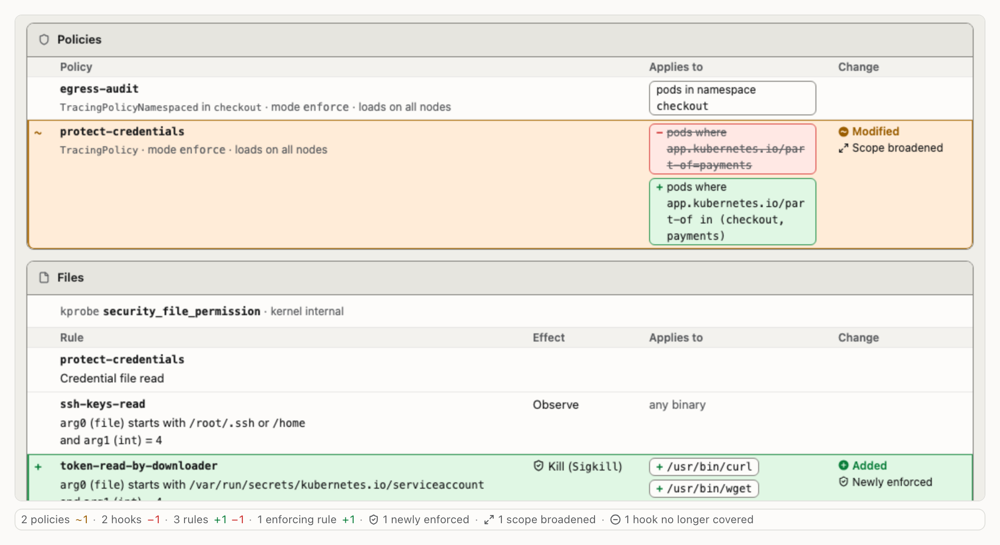
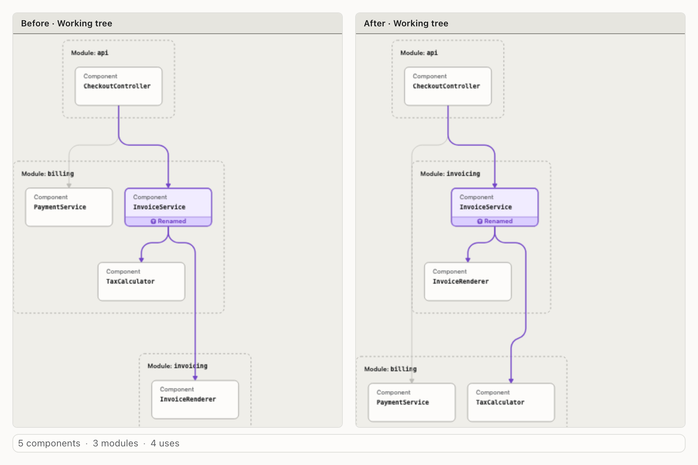

# Custom comparators: what they make possible

A comparator decides what a change _is_. Given the before and after extractions,
it produces the one comparison every view draws:

- **Correspondence:** which item became which. `exact` (same ID), `declared`
  (renamed or moved), `split` (one became several) and `merge` (several became
  one).
- **Status:** each item added, removed, modified or unchanged.
- **Interpretation:** a summary sentence per change and per step, and any domain
  metadata a renderer understands, such as "breaking" or "newly enforced".
- **Steps:** the order in which the change is told.

Side by side, animated, swipe and diff modes all draw that same comparison. Diff
mode is the comparison with time collapsed into one frame; animation also plays
its steps. So a custom comparator changes what _every_ mode shows, and the table
and text views too, without touching the renderer. The default comparator knows
nothing about your domain: it matches items by ID, marks what differs and orders
changes by the graph's structure. A custom comparator brings the knowledge only
your domain has.

Custom comparators are **comparator files** (`<name>.comparator.yaml`): YAML
declarations and [CEL](https://cel.dev) expressions layered over the default
comparator, which Projections interprets in a sandbox. This page shows what they
buy you with real comparators from this repository. Every image below is the
same pair of extractions compared twice, by the default comparator and by a
custom one, and drawn by the same built-in renderer.
[`tools/scripts/comparator-examples.mjs`](../../tools/scripts/comparator-examples.mjs)
draws them with the CLI.

## Domain verdicts: runtime security policies

A Tetragon policy change is YAML: label selectors, probes, actions. Whether it
makes a cluster safer depends on questions the YAML doesn't answer directly.
Does the new selector cover more pods or fewer? Does a rule now kill a process,
or only report it? Is any hook left without a policy?

In this pull request, `protect-credentials` gains a rule that kills `curl` and
`wget` when they read the service account token, its selector changes from
`part-of=payments` to `part-of in (checkout, payments)`, and the
`security_mmap_file` probe is dropped. The default comparator reports what it
can see: the policy is **Modified**, a rule is **Added**, a probe is
**Removed**.


The
[runtime policy comparator](../../packages/comparators/runtime-policy/README.md),
one comparator file, proves containment of the workload selectors (label
requirements compared as sets, a namespace covering only itself) and reads each
rule's action. The same change becomes **Scope broadened**, **Newly enforced**
and **No longer covered**, and the summary bar along the bottom counts them:



The comparator keeps the default correspondence and statuses and adds its
interpretations as `metadata.runtimePolicy.interpretations` and as summaries,
which every view and the CLI print:

```text
Step 1 of 4 (add): `protect-credentials` rule `token-read-by-downloader` at
  `security_file_permission` now enforces: Kill (`Sigkill`) for `/usr/bin/curl` or
  `/usr/bin/wget` when `arg0` (`file`) starts with
  `/var/run/secrets/kubernetes.io/serviceaccount` and `arg1` (`int`) = `4`.
Step 2 of 4 (restructure): Policy `protect-credentials` now applies to more
  workloads: pods where `app.kubernetes.io/part-of in (checkout, payments)`.
Step 3 of 4 (remove): No policy attaches to `security_mmap_file` any more.
```

Its verdicts are a function per kind of entity. This is the one for a rule (a
selector), from
[`runtime-policy.comparator.yaml`](../../packages/comparators/runtime-policy/runtime-policy.comparator.yaml):

```yaml
selectorFound:
  params: [{name: before, type: Item}, {name: after, type: Item}]
  returns: list<string>
  body: |-
    before == null ? [enforcing(after) ? 'newly-enforced' : observing(after) ? 'newly-observed' : '']
    : after == null ? [enforcing(before) ? 'enforcement-removed' : observing(before) ? 'observation-removed' : '']
    : (!enforcing(before) && enforcing(after) ? ['newly-enforced'] : [])
      + (datum(before, 'conditions') != datum(after, 'conditions') ? ['condition-changed'] : [])
```

It only claims what it can prove: when neither selector provably contains the
other, the verdict is **Scope changed**, never a guess. See
[the runtime policy model](../models/runtime-policy-model.md) for the
vocabulary.

## Classification: API compatibility

A public API change is a list of signatures. The question a reviewer has is
whether it breaks callers. The default comparator shows which declarations
changed and how their signatures differ:


The
[API compatibility comparator](../../packages/comparators/api-compatibility/README.md),
one comparator file, applies each ecosystem's own rules (.NET's ApiCompat,
TypeScript assignability, the Cargo SemVer reference and Go's apidiff) to the
contract facts the public-API extractors read from the compiler. Every rule is a
finding (a level, a rule name and a reason), and the standard library's
`findings.classify` keeps the most severe. Every change gets a level,
**Breaking**, **Additive** or **Compatible**, and a reason. The api renderer
leads with the breaking changes, and the summary bar along the bottom counts
each level:


```text
Changed entity delay: Breaking: Became optional; code reading it must handle `undefined`.
Changed entity createQueue: Breaking: Parameter `options` is now required.
Changed entity add: Additive: Optional parameter `signal` was added.
Changed entity get: Compatible: Returns the narrower `Job<T>`.
```

Because the classification is part of the comparison, anything that reads the
comparison can act on it. The comparison records the counts in
`metadata.compatibility.counts`, so a workflow step can fail a pull request that
breaks the API:

```sh
projections compare main...HEAD -p api --trust --json > api.comparison.json
jq -e '.comparison.metadata.compatibility.counts.breaking == 0' api.comparison.json
```

The [API compatibility design](../models/api-compatibility.md) explains which
rules each ecosystem reproduces and what is reported as unknown.

## Identity: renames, moves, splits and merges

Many extractors derive IDs from where things are: a file path, a module, a
namespace. Move a component to another module and its ID changes, so the default
comparator sees one component removed and an unrelated one added. An extractor
can declare the link itself with `previousIds` when it knows it. When only a
comparison of both revisions can tell, a comparator can declare it.

The
[moved components comparator](../../examples/comparators/moved-components/moved-components.comparator.yaml)
pair each removed component with the added one of the same kind and name, when
there is exactly one of each, and pairs the relationships between them the same
way. Here `InvoiceService` moves from `billing` to `invoicing`. With the default
comparator, the old card disappears and a new one is **Added**, along with every
relationship that touches it:


With the comparator, it is one component that moved, marked **Renamed**, and its
relationships carry over:



The comparator returns a `declared` correspondence for the pair, so the
animation moves one card from one module to the other instead of fading one out
and another in. The CLI goes from 10 changes to 6:

```text
Step 2 of 3 (restructure): Move `InvoiceService`
  Renamed entity InvoiceService [component:billing/InvoiceService] to InvoiceService
    [component:invoicing/InvoiceService]: `InvoiceService` moved from
    `component:billing/InvoiceService` to `component:invoicing/InvoiceService`.
```

This is the heart of it, two identity passes and a sentence:

```yaml
identity:
  - name: moved
    description: Unmatched entities with the same kind and label.
    collections: [entities]
    key: '[item.kind, item.label]'
  - name: links
    collections: [relationships]
    when: has(pairs.moved)
    key: '[item.kind, moved(pairs.moved, item.from), moved(pairs.moved, item.to)]'

classify:
  where: origin == 'moved'
  summary: "'`%s` moved from `%s` to `%s`.'.format([afterItem.label, beforeItem.id, afterItem.id])"
```

An identity pass pairs items the default matching left unmatched when their key
is unique on both sides. The engine derives each pair's status from the items'
content, so a moved component whose data also changed is still **Modified**.

`split` and `merge` work the same way with a `claims` pass: each item lists the
IDs it claims on the other side, and each connected group becomes one change,
one before ID with several after IDs when a service is split in two, or several
before IDs with one after ID when two are merged.

## Order: telling the change in the right sequence

Steps are the order a change is told: the animation plays them, the text view
numbers them and renderers group by them. The default order is structural,
removals first and additions last. A domain often has a better story.

The runtime policy comparator orders steps by severity. For the change above,
the default comparator starts with what was removed; the runtime policy
comparator starts with the rule that now kills processes:

| Step | Default comparator                                           | Runtime policy comparator                           |
| ---- | ------------------------------------------------------------ | --------------------------------------------------- |
| 1    | Remove the `security_mmap_file` probe, its hook and its rule | `token-read-by-downloader` now enforces: Kill       |
| 2    | `protect-credentials` is modified                            | `protect-credentials` now applies to more workloads |
| 3    | Add the new workload selector                                | No policy attaches to `security_mmap_file` any more |
| 4    | Add `token-read-by-downloader` and the binaries it matches   | Add the new workload selector                       |

Ordering is the easiest comparator to write: one `rank` expression moves the
steps that touch your platform packages to the front, and
[Control the order of changes](order-of-changes.md) walks through it, starting
with the default options that need no comparator file at all. The same idea
tells a database migration in its safe order (add the column, backfill it, then
drop the old one), or a deployment in the order its services roll out.

## When to write a comparator

Each part of a projection answers a different question:

| You want to…                                                                                                  | Change the… |
| ------------------------------------------------------------------------------------------------------------- | ----------- |
| Show something the code has that the projection doesn't: new kinds of things, new facts about them            | Extractor   |
| Draw the same facts differently: a new layout, a table instead of a graph                                     | Renderer    |
| Say what a change _means_: which items are the same thing, whether a change is safe, in what order to tell it | Comparator  |

A comparator is the right place for domain knowledge about _change_, because it
is the one part that sees both revisions at once. An extractor sees one
revision, so it can't tell that a selector broadened; a renderer draws what it
is given, so verdicts it computed itself would differ between renderers and
views, and couldn't be checked. Put them in the comparison and every renderer,
mode, the text view, the CLI and anything reading the JSON agree.

Custom comparators always start from the default comparison (`baseline`),
keeping its correspondence and statuses and adding pairs, interpretations or a
better order. Statuses account for
[volatile data](../contracts/extractions.md#volatile-data): a pair that only
varied within its declared tolerance is `unchanged`, listed with `varied` and in
no step, and a rule reads `change.varied` (each `{path, within}`) to say what
varied, as the
[`test-timings`](../../examples/comparators/test-timings/README.md) example does
for test durations that moved beyond tolerance.

### Comparator files

A custom comparator is one YAML file, `<name>.comparator.yaml`, named in the
definition by its path, alone or with options:

```json
"comparator": ".github/projections/api.comparator.yaml"
"comparator": {"file": ".github/projections/api.comparator.yaml", "options": {}}
```

A string or an object with `file` is a custom comparator; an object without
`file` is the default comparator (with its `options`). There is nothing to build
or install, and no runtime to choose: Projections interprets the comparator file
everywhere comparisons are viewed. Expressions are CEL, checked against declared
types when the file loads, with every problem reported at its line and column.
`projections init <id> --comparator custom` scaffolds a commented starter,
[Write a custom comparator](order-of-changes.md#write-a-custom-comparator) walks
through one, and [Custom comparators](../design/declarative-comparators.md) is
the full reference. Tests sit beside the comparator file, a
`*.comparator.test.yaml` of cases that state what the comparator must make of
two extractions
([Test a custom comparator](order-of-changes.md#test-a-custom-comparator)), and
`projections check` runs them.

Comparator files express every comparator in this repository. When a comparator
needs something a compiler or a resolver knows, such as whether one type is
assignable to another, compute it in the extractor and put it in `data`; the
comparator then compares facts. When a generic operation is missing, it belongs
in the engine's standard library: see
[contributing an operation](../../packages/comparators/rules/README.md#contributing-an-operation).

### Determinism, verification and the sandbox

Comparator files are data: expressions with no files, network, clock or
randomness, whose evaluation always terminates and is bounded by a cost budget
that is the same on every machine. The interpreter itself runs in a sandbox with
memory limits. So the same extractions always produce the same comparison, and
running a custom comparator never needs `--trust`.

That is what lets a viewer verify a comparison instead of trusting it: a saved
comparison names its comparator by digest (of the file's meaning, so
reformatting or a comment doesn't change it), and anyone with the comparator
file reruns it and gets the identical result. The Engine then checks every claim
against both extractions. A comparator can interpret and reorder changes, but it
can't hide one, invent one, or call something unchanged that differs; see
[Comparisons](../contracts/comparisons.md) for the rules.

### Where custom comparators run today

- **The CLI:** `show`, `compare`, `check` and `bookmark run` run the
  definition's comparator file, and `validate --comparator FILE` reproduces a
  saved comparison.
- **The Inspector:** live previews of your working tree, saved documents and
  fixtures mode, where you can develop a comparator against scenarios; its
  **Comparator** selector can try any comparator file in the repository.
- **Views you host yourself** with the
  [Projections host](../../packages/host/core/README.md), which runs comparator
  files in a browser Worker (`createRulesRuntime` from
  `@githubnext/projections-comparator-runtime`).

A **hosted view** of CI artifacts reruns custom comparators to verify a
comparison. It never takes the comparator from the artifact: it fetches the
comparator file from the repository at the pull request's merge base and head,
and the version whose digest the comparison records must reproduce it. The
**base** revision's comparator judges the pull request, so a pull request can't
change how it is judged. When a pull request changes its comparator file, the
view says so and offers the comparison under the head's version. On a server,
comparator files run sandboxed in wasmi with the CLI's fuel and memory limits
(`projections-rules`).
