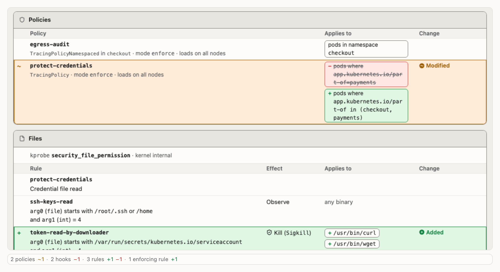
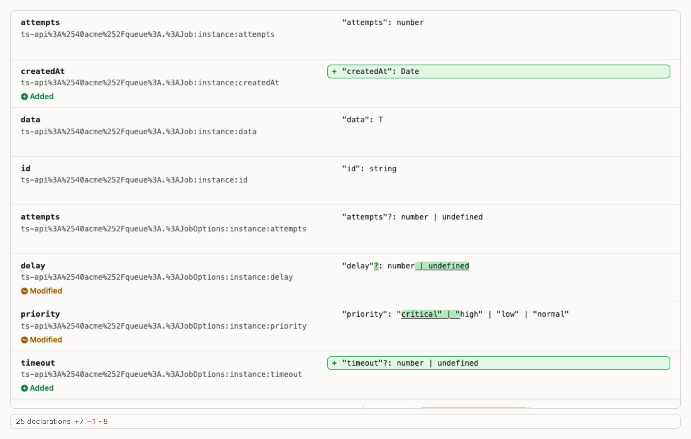
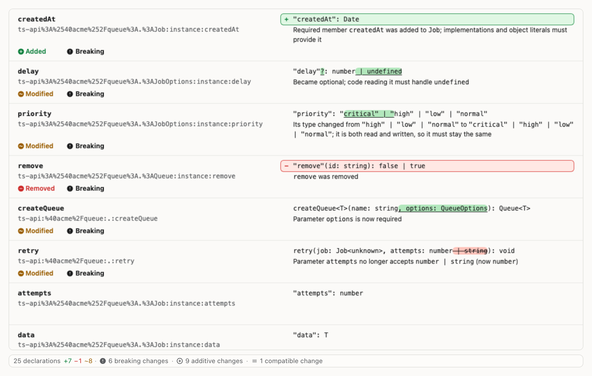
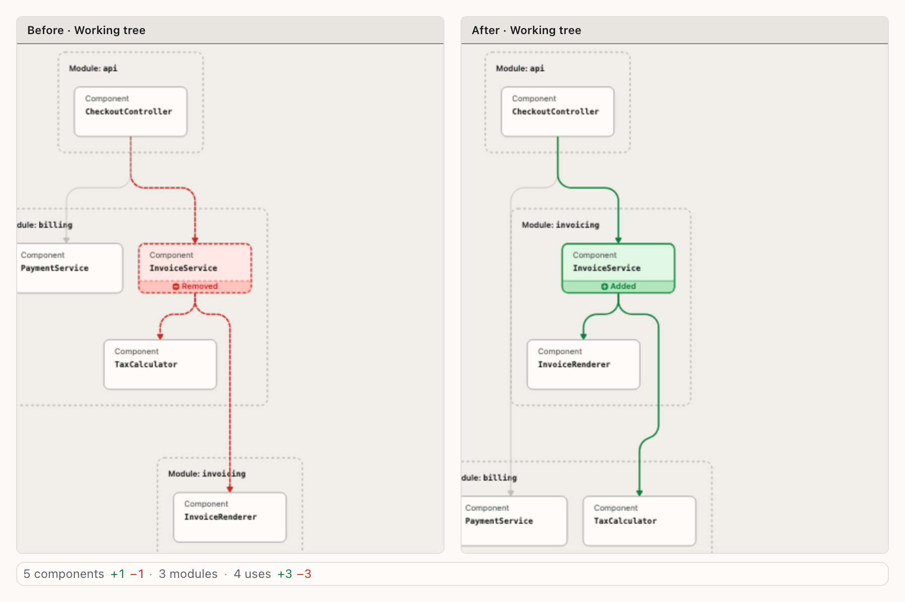

# Custom comparators: what they make possible

A comparator decides what a change actually _means_. Given the before and after
extractions, it builds the single comparison that every view displays:

- **Correspondence** maps which item became which: `exact` (same ID), `declared`
  (renamed or moved), `split` (one became several), or `merge` (several became
  one).
- **Status** marks each item as added, removed, modified, or unchanged.
- **Interpretation** attaches a human-readable summary to each change and step,
  plus any domain metadata a renderer knows how to highlight—like "breaking" or
  "newly enforced".
- **Steps** define the sequence in which the change is explained.

Side-by-side, animated, swipe, and diff modes all render that same comparison.
Diff mode collapses time into a single frame, while animation steps through it
in order. That means a custom comparator improves _every_ view—including the
table, text outline, and CLI—without changing a line of renderer code. Because
the default comparator knows nothing about your domain, it can only match by ID,
flag what changed, and order steps by graph structure. A custom comparator adds
the domain knowledge only your team has.

Custom comparators are written as **comparator files**
(`<name>.comparator.yaml`): YAML declarations and [CEL](https://cel.dev)
expressions layered over the default comparator, interpreted by Projections
inside a sandbox. Below are real examples from this repository showing what they
unlock. Each pair of screenshots compares the exact same extractions twice—once
with the default comparator and once with a custom one—rendered by the same
built-in renderer (generated via
[`tools/scripts/comparator-examples.mjs`](../../tools/scripts/comparator-examples.mjs)).

## Domain verdicts: runtime security policies

A Tetragon policy diff is just YAML: label selectors, probes, and actions. But
reviewers don't want to parse YAML—they want to know whether the cluster got
safer or riskier. Does the new selector cover more pods or fewer? Does a rule
now kill a process instead of just logging it? Is any kernel hook left
unprotected?

In this pull request, `protect-credentials` gains a rule that kills `curl` and
`wget` when they read the service account token, widens its selector from
`part-of=payments` to `part-of in (checkout, payments)`, and drops the
`security_mmap_file` probe. The default comparator can only report structural
facts: the policy is **Modified**, a rule is **Added**, and a probe is
**Removed**.



The
[runtime policy comparator](../../packages/comparators/runtime-policy/README.md)
is a single comparator file that checks set containment on workload selectors
(comparing label requirements as sets, where a namespace only covers itself) and
inspects each rule's action. With it, the same diff becomes **Scope broadened**,
**Newly enforced**, and **No longer covered**, tallied in the summary bar along
the bottom:


It keeps the default correspondence and statuses, layering its verdicts into
`metadata.runtimePolicy.interpretations` and step summaries that every viewer
and the CLI display:

```text
Step 1 of 4 (add): `protect-credentials` rule `token-read-by-downloader` at
  `security_file_permission` now enforces: Kill (`Sigkill`) for `/usr/bin/curl` or
  `/usr/bin/wget` when `arg0` (`file`) starts with
  `/var/run/secrets/kubernetes.io/serviceaccount` and `arg1` (`int`) = `4`.
Step 2 of 4 (restructure): Policy `protect-credentials` now applies to more
  workloads: pods where `app.kubernetes.io/part-of in (checkout, payments)`.
Step 3 of 4 (remove): No policy attaches to `security_mmap_file` any more.
```

Each entity kind has its own verdict function. Here is the one for a rule
selector from
[`runtime-policy.comparator.yaml`](../../packages/comparators/runtime-policy/runtime-policy.comparator.yaml):

```yaml
selectorFound:
  params: [{name: before, type: Item}, {name: after, type: Item}]
  returns: list<string>
  body: |-
    before == null ? [enforcing(after) ? 'newly-enforced' : observing(after) ? 'newly-observed' : '']
    : after == null ? [enforcing(before) ? 'enforcement-removed' : observing(before) ? 'observation-removed' : '']
    : (!enforcing(before) && enforcing(after) ? ['newly-enforced'] : [])
      + (datum(before, 'conditions') != datum(after, 'conditions') ? ['condition-changed'] : [])
```

It never guesses: when neither selector provably contains the other, the verdict
is simply **Scope changed**. See
[the runtime policy model](../models/runtime-policy-model.md) for the full
vocabulary.

## Classification: API compatibility

A public API diff is a list of changed signatures, but what a reviewer really
needs to know is whether callers will break. Left to itself, the default
comparator only shows which declarations changed and how their signatures
differ:



The
[API compatibility comparator](../../packages/comparators/api-compatibility/README.md)
applies each ecosystem's own compatibility rules—.NET's ApiCompat, TypeScript
assignability, the Cargo SemVer reference, and Go's apidiff—to the contract
facts extracted from the compiler. Each rule emits a finding with a severity
level, rule name, and reason, and `findings.classify` from the standard library
picks the most severe one. Every change is classified as **Breaking**,
**Additive**, or **Compatible** with an explanation; the api renderer puts
breaking changes at the top and totals each level in the summary bar:



```text
Changed entity delay: Breaking: Became optional; code reading it must handle `undefined`.
Changed entity createQueue: Breaking: Parameter `options` is now required.
Changed entity add: Additive: Optional parameter `signal` was added.
Changed entity get: Compatible: Returns the narrower `Job<T>`.
```

Because those classifications live in the comparison itself, automation can act
on them too. The counts are stored in `metadata.compatibility.counts`, so a CI
job can block pull requests that introduce breaking changes:

```sh
projections compare main...HEAD -p api --trust --json > api.comparison.json
jq -e '.comparison.metadata.compatibility.counts.breaking == 0' api.comparison.json
```

See [the API compatibility design](../models/api-compatibility.md) for which
rules each ecosystem implements and what gets flagged as unknown.

## Identity: renames, moves, splits and merges

Many extractors build IDs from locations—a file path, a module, or a namespace.
When you move a component to a new module, its ID changes, so the default
comparator thinks one component was deleted and an unrelated one was created. If
an extractor knows the old ID, it can set `previousIds` directly. When you can
only spot the move by looking at both revisions together, a comparator can link
them.

The
[moved components comparator](../../examples/comparators/moved-components/moved-components.comparator.yaml)
pairs each removed component with an added one of the same kind and name when
there's an unambiguous one-to-one match, then pairs their relationships the same
way. In this example, `InvoiceService` moves from `billing` to `invoicing`. With
the default comparator, the old card disappears and a brand-new **Added** card
appears along with all of its relationships:



With the custom comparator, it shows up as a single moved component—marked
**Renamed**—with its existing relationships preserved:


Because the comparator emits a `declared` correspondence, animated mode glides
the card across modules instead of fading one out and another in, and the CLI
summary shrinks from 10 changes down to 6:

```text
Step 2 of 3 (restructure): Move `InvoiceService`
  Renamed entity InvoiceService [component:billing/InvoiceService] to InvoiceService
    [component:invoicing/InvoiceService]: `InvoiceService` moved from
    `component:billing/InvoiceService` to `component:invoicing/InvoiceService`.
```

The whole thing comes down to two identity passes and a summary expression:

```yaml
identity:
  - name: moved
    description: Unmatched entities with the same kind and label.
    collections: [entities]
    key: '[item.kind, item.label]'
  - name: links
    collections: [relationships]
    when: has(pairs.moved)
    key: '[item.kind, moved(pairs.moved, item.from), moved(pairs.moved, item.to)]'

classify:
  where: origin == 'moved'
  summary: "'`%s` moved from `%s` to `%s`.'.format([afterItem.label, beforeItem.id, afterItem.id])"
```

An identity pass pairs previously unmatched items whenever their computed key is
unique on both sides. The engine still derives each pair's status from its
content, so if a moved component's data also changed, it is accurately marked
**Modified**.

`split` and `merge` work the same way using a `claims` pass: each item lists the
IDs it claims on the other side, and every connected group becomes a single
change—one before ID with several after IDs for a split, or several before IDs
with one after ID for a merge.

## Order: telling the change in the right sequence

Steps control the order in which a change is told: animations play them in
sequence, text views number them, and renderers group by them. The default order
is purely structural, putting removals first and additions last, whereas your
domain often has a much clearer narrative.

The runtime policy comparator orders steps by severity. For the security policy
diff above, the default comparator starts with the removed probe, while the
custom comparator leads with the new rule that kills processes:

| Step | Default comparator                                           | Runtime policy comparator                           |
| ---- | ------------------------------------------------------------ | --------------------------------------------------- |
| 1    | Remove the `security_mmap_file` probe, its hook and its rule | `token-read-by-downloader` now enforces: Kill       |
| 2    | `protect-credentials` is modified                            | `protect-credentials` now applies to more workloads |
| 3    | Add the new workload selector                                | No policy attaches to `security_mmap_file` any more |
| 4    | Add `token-read-by-downloader` and the binaries it matches   | Add the new workload selector                       |

Reordering is the simplest custom comparator you can write: a single `rank`
expression puts steps touching your platform packages first.
[Control the order of changes](order-of-changes.md) walks through that, starting
with built-in configuration options that don't require a comparator file at all.
The same pattern works for telling a database migration in its safe rollout
order (add column, backfill, then drop the old one) or walking through a service
deployment sequence.

## When to write a comparator

Each component in a projection answers a different question:

| You want to…                                                                                                  | Change the… |
| ------------------------------------------------------------------------------------------------------------- | ----------- |
| Show something the code has that the projection doesn't: new kinds of things, new facts about them            | Extractor   |
| Draw the same facts differently: a new layout, a table instead of a graph                                     | Renderer    |
| Say what a change _means_: which items are the same thing, whether a change is safe, in what order to tell it | Comparator  |

Put domain knowledge about _change_ in the comparator, because it's the only
component that sees both revisions at once. An extractor only sees one revision,
so it can't know that a selector broadened. A renderer only draws what it's
given, so verdicts calculated inside a renderer would diverge across views and
couldn't be verified. Put those verdicts in the comparison instead, and every
renderer, mode, text view, CLI run, and JSON consumer stays in sync.

Every custom comparator builds on the default comparison (`baseline`), keeping
its correspondence and statuses while adding new pairs, interpretations, or
ordering. Those statuses already account for
[volatile data](../contracts/extractions.md#volatile-data): a pair that only
drifted within its declared tolerance stays `unchanged`, records `varied`, and
appears in no step. Rules can inspect `change.varied` (entries of
`{path, within}`) to explain what shifted, as the
[`test-timings`](../../examples/comparators/test-timings/README.md) example does
when test durations cross their threshold.

### Comparator files

A custom comparator is a single YAML file, `<name>.comparator.yaml`, referenced
in the projection definition by path (optionally with `options`):

```json
"comparator": ".github/projections/api.comparator.yaml"
"comparator": {"file": ".github/projections/api.comparator.yaml", "options": {}}
```

A string or an object containing `file` selects a custom comparator, while an
object without `file` configures the default comparator. There's nothing to
compile, install, or configure for a runtime—Projections interprets the file
directly wherever comparisons are viewed.

CEL expressions are type-checked on load against declared schemas, reporting any
issues with exact line and column numbers. Run
`projections init <id> --comparator custom` to scaffold a commented starter,
follow
[Write a custom comparator](order-of-changes.md#write-a-custom-comparator) for a
walkthrough, or read [Custom comparators](../design/declarative-comparators.md)
for the full reference. Keep tests right next to the comparator in a
`*.comparator.test.yaml` file
([Test a custom comparator](order-of-changes.md#test-a-custom-comparator)), and
`projections check` will run them automatically.

Every comparator in this repository is written as a comparator file. If a rule
needs compiler or resolver knowledge—such as whether one type is assignable to
another—compute those facts in the extractor and store them in `data` so the
comparator only compares facts. If a generic helper is missing, it belongs in
the engine's standard library; see
[contributing an operation](../../packages/comparators/rules/README.md#contributing-an-operation).

### Determinism, verification and the sandbox

Comparator files are pure data: expressions with no access to files, the
network, clocks, or randomness, guaranteed to terminate under a cost budget that
is identical across machines. The interpreter itself runs inside a memory-capped
sandbox. Because of that, the same pair of extractions always yields the exact
same comparison, and custom comparators never require `--trust`.

That determinism is what lets viewers verify a comparison instead of blindly
trusting it. A saved comparison records the semantic digest of its comparator
file (so reformatting or editing comments doesn't invalidate it), allowing
anyone with the file to rerun it and confirm an identical result. The Engine
also validates every claim against both extractions: a comparator can interpret
and reorder changes, but it can never hide a change, invent one, or call
something unchanged when its data differs. See
[Comparisons](../contracts/comparisons.md) for the full verification rules.

### Where custom comparators run today

- **The CLI:** `show`, `compare`, `check`, and `bookmark run` all execute the
  definition's comparator file, and `validate --comparator FILE` reproduces a
  saved comparison.
- **The Inspector:** Live previews of your working tree, saved documents, and
  fixtures mode all support custom comparators, and the **Comparator** selector
  lets you try any comparator file in the repository against scenarios.
- **Self-hosted views:** Apps built with the
  [Projections host](../../packages/host/core/README.md) run comparator files in
  a browser Web Worker using `createRulesRuntime` from
  `@githubnext/projections-comparator-runtime`.

A **hosted view** of CI artifacts also reruns custom comparators to verify every
comparison. It never trusts a comparator file packaged inside the artifact;
instead, it fetches the file from the repository at the pull request's merge
base and head, requiring the version matching the recorded digest to reproduce
the comparison. The **base** revision's comparator always judges the pull
request so an author can't alter how their own PR is evaluated; if the PR edits
the comparator file, the view flags that and lets you opt into viewing the
head's version. On servers, comparator files run sandboxed in wasmi with the
same fuel and memory limits as the CLI (`projections-rules`).
