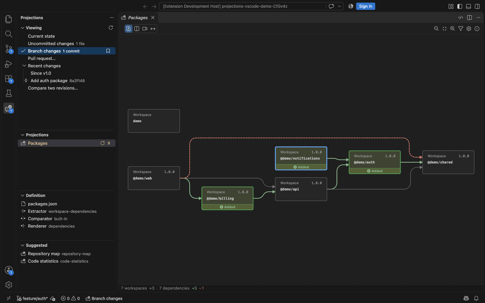
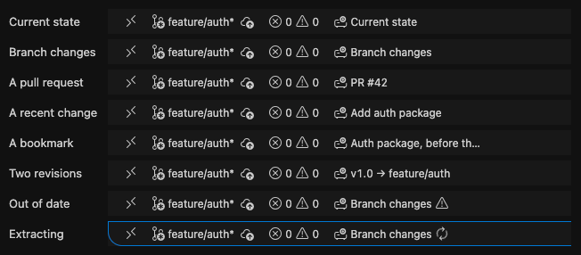
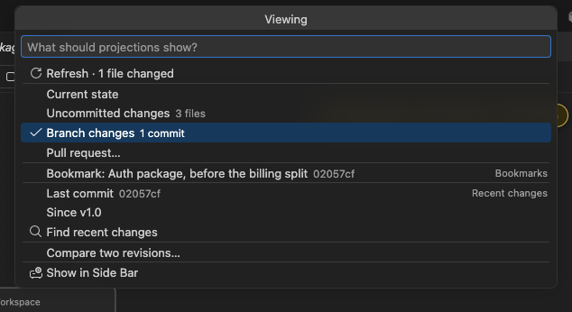
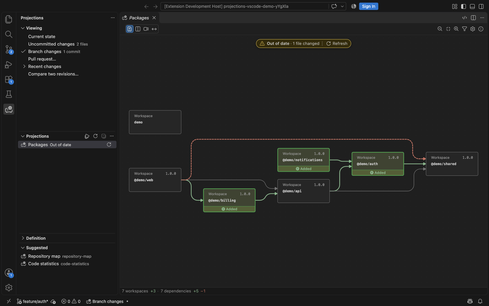
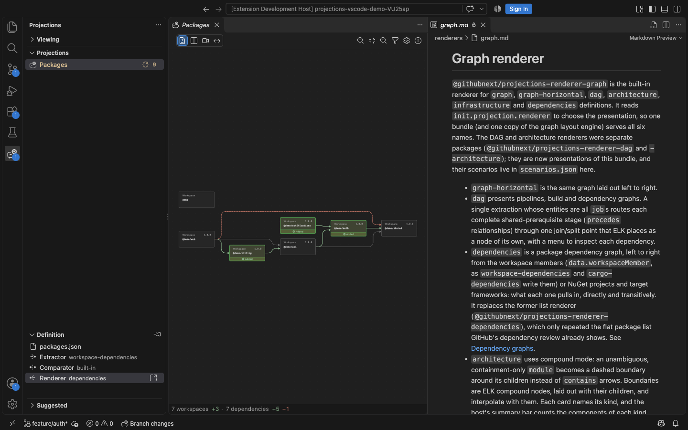

# The VS Code side bar

The
[Projections extension for VS Code](../../packages/integrations/vscode/README.md)
brings everything together in a dedicated side bar and opens each projection in
its own editor tab.

Clicking the Projections icon in the activity bar opens four views, each
designed to answer a single question (see
[the four-section model](../design/vscode-sidebar.md#four-sections-decided-reversible)).
Because each section is its own view in the Projections container, you can drag
any of them to the panel or the secondary side bar (just like Ports), and they
all share one backend per folder. Only **Definition** tracks the active tab.
Rows stay concise—showing short facts like a count, a short commit, or a
filename so they fit comfortably in a narrow side bar—while tooltips spell out
the details.

- **Viewing** _(What am I looking at?)_ — Controls what every projection tab
  displays (see [The choice](#the-choice)). It lists **Current state**,
  **Uncommitted changes** (`2 files`), **Branch changes** (`3 commits`), **Pull
  request…** (`#123` when the current branch has an open PR), **Bookmarks**
  (from `.projections-bookmarks.json`, shown by name and short commit), **Recent
  changes** (Last commit, Since <tag>, and recent commits that affect any
  projection—each showing its subject, short commit, what it changes, and a
  tooltip thumbnail, with `HEAD` standing in for Last commit), and **Compare two
  revisions…**. Choices that resolve to the same revisions are hidden. Clicking
  any row selects it, marking it with a checkmark (and ", selected" for screen
  readers); the view title stays "Viewing", while the
  [status bar item](#the-status-bar-item) names the active choice. Inline
  actions include **Bookmark** on the current row and recent commits, **Remove**
  on bookmarks and recent commits, **Swap** on Compare two revisions… when
  active, **Find Recent Changes** on Recent changes, and Refresh in the title
  bar. This view appears open whenever the repository defines projections.
- **Projections** _(What is there, and what changed?)_ — Lists one row per
  projection, sorted alphabetically by displayed title (case-insensitive, with
  natural numeric sorting, then by ID—matching the order in the Testing view,
  Adopt…, and New Projection…). Each row shows the Projections mark, its title,
  and a change-count badge on the right in the modified-file color (`9+` above
  nine) once a tab or Compare All has compared the current choice; unchanged
  projections have no badge, and uncompared ones appear muted. Descriptions call
  out only unusual states ("Out of date", "needs trust", "failed", "edited"),
  while tooltips show the full status ("3 changes (Uncommitted changes)", "Not
  compared yet"). Clicking a row opens its tab, and its context menu offers Open
  Definition; an invalid definition appears as a failed row whose children list
  its diagnostics. **Refresh** is available inline, **New Projection…**
  (`$(add)`), Compare All, and Refresh sit in the title bar, and **Add to CI…**
  lives in the `…` menu. The view's badge counts how many projections changed.
  This view is always visible, showing welcome actions ("Explore this
  repository", "New projection…", and the gallery) when no projections are
  defined yet.
- **Definition** _(What is this projection made of?)_ — Follows the active
  projection tab much like Outline follows the active editor, staying anchored
  while you edit any of that projection's own files (its title remains
  "Definition" since the tab already names the projection). It lists the
  definition file, **Extractor** (its ID or script name, with **Show Extraction
  Output** inline), **Comparator** (default or file name, with its
  `.comparator.test.yaml` nested underneath and **Configure…** inline),
  **Renderer** (revealing a custom bundle or opening docs, with its source entry
  and `scenarios.json` underneath so you can open the renderer workbench), and
  **Environment** (`environment.json`, if present). Selecting a row never kicks
  you out of VS Code: built-in docs open right in Markdown preview
  ([Built-in documentation](#built-in-documentation)) while keeping this view on
  the projection. Context menus include Open Definition Entry, and built-ins add
  Open Documentation plus **Open Documentation on GitHub** (`$(link-external)`,
  also shown inline on hover) for opening the page in a browser. You can click
  **Pin to This Projection** in the title bar to lock the view (showing a
  message like "Pinned to Packages"). It shares the same item model as Go to
  Source…, starts collapsed when projections exist, and prompts "Open a
  projection to see its definition" when no projection tab is active.
- **Suggested** _(What else could I add?)_ — Lists projections that fit your
  repository but aren't configured yet (from `projections explore`), sorted by
  title with a tooltip explaining why each applies (for example, "12 files match
  `**/*.prisma`"). Click a row to explore it, or use **Adopt** inline. After
  your first adoption, a welcome prompt offers **Add to CI…**. This view only
  appears while unadopted candidates remain, or after your first adoption until
  you use Add to CI…; when a repo has no definitions at all, the Projections
  view's welcome handles onboarding instead.

Projection checks show up as tests in VS Code's **Testing** view (see
[Testing](../../packages/integrations/vscode/README.md#testing)). If you drag
views around to customize the layout, VS Code remembers your order; run **View:
Reset View Locations** anytime to restore the defaults.

Raw extractions from any tab can be sent to the **Projections** output channel
via Show Extraction Output, and their diagnostics appear in Problems attached to
the definition file alongside any invalid-definition errors.

**A projection is a document.** Single-clicking a row opens it in a preview
(italic) tab, and double-clicking pins it open, just like files. Tabs can be
split, moved, reopened, and restored across window reloads. Each tab
(`projection:/<folder>/<title>`, a read-only custom editor) focuses solely on
that projection for the repository's active choice—no Inspector chrome, fitted
so the whole projection is visible right away. Rather than per-tab choice or pin
controls, the tab follows the Viewing view and reflects what it's showing in its
pane headers (for side-by-side and swipe modes) and summary bar, while the
status bar item names the choice.

The tab's toolbar provides comparison mode switches, Play/Pause in animated
mode, view controls, and quiet notices (such as your edits, or a muted codicon
provenance badge when the result is unusual: From CI, Approximate, Stale, or
Observed). The out-of-date notice isn't a toolbar button—it floats over the
stage ([Out of date](#out-of-date)). The editor's `…` menu includes Choose What
to Show… and Open Definition, and the Command Palette offers Show as Renderer,
Table or Text, Zoom to Fit, In and Out, Comparison Mode…, and Show Changes Only.
(Agent tools can still open tabs pinned to custom revisions.) Side-by-side and
swipe modes fill the tab edge to edge with no outer gap, separated by a single
1px divider in VS Code's editor group border color and half-width pane headers.

When a tab is hidden, VS Code tears down its webview (there is no
`retainContextWhenHidden`), but the extension preserves its data. It caches the
last extractions for the 8 most recently updated tabs (clearing an entry when a
tab closes) and passes them back via `initialResults` when the tab returns, so
it reappears immediately without re-extracting—showing the out-of-date notice if
files changed while it was hidden. If a tab's cached results were evicted or a
Refresh hadn't finished, it extracts again on return. View state—mode, view,
selection, and changes-only—is restored from VS Code's webview state. Opening an
invalid definition shows its diagnostics directly, each linked to its line.

**Loading.** Tabs paint immediately: as soon as a tab opens, the editor renders
a skeleton (`skeletonHtml`) before folder facts or the backend are ready. The
full page loads in parallel while the backend starts, queuing requests until the
bridge connects (the backend starting never forces a reload, though a replaced
backend after workspace trust or an exit still reloads as usual). The skeleton
matches the VS Code UI's exact colors and dimensions: an empty toolbar strip
with its hairline (no fake controls), the summary bar strip, and a centered 16px
spinning `loading` codicon reading "Loading <title>…" (static under reduced
motion).

Once mounted, the page replaces the skeleton piece by piece, and the Inspector's
status readout (with Cancel) reuses the same spinner. Subsequent loads display
VS Code's thin progress bar along the top edge of the tab instead of a
pane-scaled spinner—one bar per tab regardless of pane count, delayed by 300 ms
so fast loads don't flash. Because the Inspector mounts with the VS Code UI's
`loadingStatus` and stays in a loading state until the first result arrives, the
web Inspector's empty state ("No extraction loaded") never appears. Custom
renderers use the projection's name while loading (for example, "Loading Package
cards…").

**Problems.** Any invalid definition file reports an error in Problems right on
the offending field (such as "Module comparators were removed; name a comparator
file instead …"), while all other valid projections continue to load normally.

## The status bar item

The status bar item gives you a quick readout of what your projection tabs are
currently showing: the Projections mark (`$(projections-mark)`, from the
extension's icon font) followed by the choice's short name. It omits details
already shown inside the tab itself, like the projection name and change counts.

It only appears when the folder defines projections and you're actively working
with them—meaning either a projection tab is the active editor or one of the
Projections views (Viewing, Projections, Definition, Suggested) is visible.
Close the side bar and switch to normal code files, and it hides out of your
way. Visibility updates are deferred by a turn so moving focus between a
projection tab and the side bar won't make it flicker. **Projections: Choose
What to Show…** remains available in the Command Palette regardless.

<!-- prettier-ignore -->
| Choice | The item says |
| --- | --- |
| Current state, Uncommitted changes, Branch changes, Last commit, Since v1.0 | its name |
| A pull request | `PR #123` |
| A bookmark, a recent change | its subject, cut at 24 characters with "…" |
| Two revisions | their names, `main → feature/x`; a short commit only where nothing names one |
| The tab in front out of date | the same, then `$(warning)` (its normal colours: the icon alone says it) |
| The tab in front extracting or comparing | the same, then `$(sync~spin)` in the warning's place (`$(sync)`, still, under reduced motion) |

The label stays clean without hashes or counts; hover to see the Markdown
tooltip with exact revisions and commits (``main `a1b2c3d` → your files``), span
size, changed file count, why results are out of date, and whether the active
tab is pinned to another choice. Clicking it opens the **Viewing** quick
pick—built from the exact same item model as the Viewing view, with Bookmarks
and Recent changes grouped under separators, pre-focused on the current choice,
and ending with **Show in Side Bar** to reveal and focus the view. (**Choose
What to Show…** in a tab's `…` menu opens the same pick.)

When the active tab is out of date, the quick pick leads with **Refresh**
(`$(refresh) Refresh · 19 files changed`) above a separator, doing the same
thing as the floating Refresh pill. The status bar's warning icon tracks the
active tab (its accessible name ends with ", out of date"), while the tooltip
explains why it's stale, how many files changed, and how many tabs are out of
date overall. Everything stays in one status bar item rather than splitting into
segments.

While the active tab is extracting or comparing, the status bar appends a
spinning `$(sync~spin)` in place of the warning icon—running always takes
precedence during a Refresh, and the warning only returns if the fresh result is
still out of date. The tooltip reads "Packages: Extracting…" (or "Comparing…")
and mentions background work in other tabs ("2 other tabs extracting"), while
the accessible name ends with ", extracting" (or ", comparing"). To avoid visual
flicker, the spinner waits 300 ms before appearing and stays visible for at
least 400 ms once shown (`runningIndicator`, shared with the tab's summary bar).

Because VS Code doesn't automatically pause `~spin` in status bar items under
reduced motion, the extension handles it directly: it switches to a static
`$(sync)` when `workbench.reduceMotion` is `on`, or when it is `auto` and the
tab reports `vscode-reduce-motion` from the system preference. Each tab reports
job status alongside its summary every half second, and the tab's summary bar
displays the same `sync` codicon in a reserved trailing slot so numbers never
shift—complete with a tooltip and polite live region for "Extracting…" or
"Comparing…". Renderer builds are tracked separately on the Definition view's
Renderer row.

**Resource usage.** Each workspace folder runs a single shared backend for the
side bar, all tabs, panels, and the Testing view. Each visible tab owns its own
engine Worker and renderer frames, which are freed when the tab is hidden
(leaving only its latest extraction documents in the extension host), and
preview tabs naturally keep open tab count low. Nothing computes change counts
in the background—a projection row only shows its badge after its tab, Compare
All, or Refresh actually compares the current choice.

## Out of date

Refreshing is always manual: Projections never re-extracts automatically in the
background or for hidden tabs, and there's no auto-refresh toggle. Whenever a
tab's result falls behind the repository, a floating pill appears 12px from the
top center of its stage (just below the pane headers in side-by-side and swipe
modes) reading **Out of date · 1 file changed** with a **Refresh** button.
Keeping it out of the toolbar avoids shifting the layout and keeps it visible as
you scroll; on narrow tabs, the file count truncates first.

At the same time, the projection's row in the side bar displays "Out of date",
and the status bar item shows a warning icon whenever that tab is in front.
Clicking **Refresh** on either the pill or the row re-extracts the shown
revisions (or simply re-compares if only a comparator changed). While that runs,
the spinner replaces the warning in the status bar and spins in the summary bar
([The status bar item](#the-status-bar-item)); the warning only comes back if
the new result is immediately stale too. Under the hood, VS Code tabs mount the
Inspector with `refresh: 'manual'` (other hosts keep the default `auto`).

Staleness is tracked in `src/staleness.ts`. Currently, the backend emits
`changes` notifications, and any result captured before a generation that
touches its projection is marked out of date:

<!-- prettier-ignore -->
| Change | Makes out of date |
| --- | --- |
| `working-tree` (a file, the index or `HEAD`) | Results with a working-tree side (Current state, Uncommitted changes, Branch changes); symbolic refs (`HEAD`, `HEAD~1`) when `HEAD` moved |
| `definitions` | Every result of the projection that applies its edits, or whose tab now does ([Your edits](#your-edits)); not one on Show committed |
| `extractor:<id>` | Every result of the projection |
| `comparator:<id>` | Its comparison only |
| `renderer:<id>` | Nothing: the renderer reloads, which is a view, not a result |
| A gap in the generations, or changes the backend couldn't classify | Everything |

Any result whose `provenance.execution.fidelity` is `stale` (meaning the tree
changed mid-run) is marked out of date immediately. Once the backend exposes
working-tree identity (`GET /api/identity?projection=` or `tree` on `changes`,
introduced in local execution M2), staleness compares the working-tree side's
`provenance.execution.tree` and `provenance.definitionDigest` directly, while
the `changes` rules continue covering comparators, moved refs, extractor code,
and in-place toolchain extractors (which may read ignored files invisible to a
Git tree). Choices whose refs move—like Branch changes after a rebase—also mark
the tab out of date so Refresh picks up the new revisions. "N files changed"
counts the file differences between the result's tree (or the working tree when
it arrived) and the current working tree.

When a projection has a scope (local execution M5—either an explicit
`execution.scope` or the files named by a built-in's inputs),
`GET /api/identity` also returns `scope`, its `scopedTree` (`sha256:` across
each scoped path's Git object), and whether the scope is verified (enforced by
the SDK for built-ins or verified by `projections check`). When verified,
staleness compares the result's own scope identity (`src/scope.ts`, derived from
`provenance.execution.tree` and `scope` the same way the backend computes
`scopedTree`) instead of the entire tree, so edits outside the scope leave the
result fresh. Otherwise—or if the result was captured under a different scope—it
falls back to comparing the whole tree.

Execution provenance also controls the status badges shown beside the choice.
For an observation (`determinism: "observed"`, such as live timings), the tab
reads **Observed 5 minutes ago · Refresh** (based on `provenance.execution.at`)
rather than saying out of date, unless its `fidelity` is `stale`. Beside the
choice, a badge from `provenanceBadge()` (`src/environment-model.ts`, shared
with the environment view) indicates who produced the result and how faithfully:
**From CI** (authenticated as the repository's own CI run), **Imported** (from
an unauthenticated artifact, like an `--artifact` directory without a verified
attestation), **Local**, **Approximate**, **Stale**, or **Observed**. It picks
the most qualifying badge across both sides, with per-side details in the
tooltip.

## Developing a projection

There's no separate "Develop" tab (D3's Develop tab was removed): every
projection opens in the same standard projection tab. Authoring happens right
across the **Definition** view (parts, files, and scenarios), the **Testing**
view (checks and comparator tests), and the Viewing view's Bookmarks and Recent
changes (for jumping to interesting commits in one click). Raw extractions go to
the **Projections** output channel, and diagnostics land in Problems on the
definition file.

The day-to-day loop is straightforward: scaffold a projection with **New
Projection…** (or `projections init`), open its tab, and edit its files. Saving
updates the tab according to which layer you edited (respecting
[Out of date](#out-of-date)'s manual refresh):

- **Definition or extractor:** The tab applies [your edits](#your-edits) and
  marks the result out of date; click **Refresh** to re-extract with them.
- **Comparator file:** The tab automatically re-compares (using the Inspector's
  `refresh: 'compare'`) without marking the extraction out of date.
- **Custom renderer:** Saving a source file triggers a rebuild (see
  [Renderer builds](#renderer-builds)), and the tab hot-reloads the renderer
  once the bundle updates while keeping its current extraction result.

## Built-in documentation

Selecting a row never pulls you out of VS Code. In the Definition view and Go to
Source…, local files open in an editor while built-in parts (built-in
extractors, the default comparator, and built-in renderers by any handle) open
their documentation in VS Code's read-only Markdown preview right beside the
projection they explain. Opening the page in a browser is an explicit secondary
action—**Open Documentation on GitHub** (`$(link-external)`), available inline
on hover, in a built-in row's context menu, and as a button on built-in items in
Go to Source…. Links drawn by a renderer or clicked inside a doc page still open
in the browser as usual.

All built-in docs ship inside the extension. The build (`scripts/docs.mjs`)
bundles the [built-ins' pages](../builtins/README.md) (one per built-in
extractor, renderer, and the default comparator, plus their `index.md`), the two
generated reference catalogs, and any directly linked guides, contracts, and
schemas into `dist/docs/` (excluding package READMEs and images). Each built-in
keeps its relative path (such as `extractors/workspace-dependencies.md`) so the
preview tab displays a clear name. Relative links between bundled pages are
rewritten to stay inside the preview, while links to external docs, package
READMEs, or source files point to GitHub, and images turn into links. A build
test fails if any bundled link can't be opened by the preview.
`dist/docs/index.json` maps every extractor ID, renderer handle, and default
comparator to its bundled page and its repository path (for Open Documentation
on GitHub).

Pages open directly from the extension's disk files (`<extension>/dist/docs/…`,
effectively read-only) using VS Code's Markdown preview editor
(`vscode.openWith` with `vscode.markdown.preview.editor`, the same editor behind
**Open With… › Markdown Preview**). Real files are used instead of a virtual URI
scheme because Markdown preview resolves relative links natively on disk,
whereas virtual schemes broke cross-page links. Using the preview editor rather
than `markdown.showPreview` also keeps the page's URI on the tab, so the
Definition view stays anchored on the projection while you read. Because the
preview disables `command:` links, pages describe steps like running New
Projection… instead of invoking commands directly. If the Markdown extension is
disabled, the file opens as plain Markdown.

## Your edits

Whenever a projection's definition or any file it declares (its extractor
script, comparator file, renderer bundle, or their `sources`) has uncommitted
edits, every tab for that projection applies the **working tree's** definition
to both sides—just like `--definition-revision working-tree` (or
`definitionRevision: 'working-tree'` in the Inspector). A quiet toolbar notice
beside the choice reads **Your edits · Show committed**.

- Clicking **Show committed** switches that tab back to `HEAD`'s committed
  definition on both sides and re-extracts, changing the notice to **Committed
  version · Use my edits**. That choice sticks across window reloads until you
  either click **Use my edits** or save another change to the edited files.
- Once you commit or discard your edits, tabs automatically return to the
  committed definition on their next Refresh (since changing the definition
  marks the previous result out of date).

When there are no uncommitted edits, tabs use the committed definition so
results reflect what's actually checked in (**Current state** uses the working
tree's definition, which is identical in that case). A brand-new definition that
has never been committed simply runs as-is without any indicator.

Editing a definition marks any tab using your edits as out of date (via the
`definitions` kind or the identity's `definitionDigest`), including a tab still
displaying a pre-edit result whose **Refresh** will now pick up your changes.
Edits to a custom renderer's package/sources or a comparator file also change
the definition digest, but they never make extraction results out of date: the
renderer simply reloads and the comparator re-compares (and the Inspector stops
reusing cached extractions from the old digest that can no longer be compared
with new ones). Only a tab on Show committed ignores uncommitted definition
edits—changes inside `.github/projections` or `.projections` leave it current
until a commit moves `HEAD`. Refresh remains manual. In the side bar, the
projection keeps its committed title and appends "· edited" while uncommitted
edits exist.

## Renderer builds

If a projection uses a custom renderer (a `renderer.bundle` pointing to a
package's `dist`, as scaffolded by `projections init <id> --renderer custom`),
the extension builds it automatically so your edits reach the tab without
running a separate `npm run watch`. Saving any source file (from `sources`, or
the package's `src` by default) while a tab for that projection is open prompts
the folder's backend (the same CLI service used by `projections view`) to start
the package's `watch` script—or run its `build` script on each save. Each build
appears as a background task named **<projection> renderer** in its own task
terminal, with Vite and esbuild errors routed to Problems via the
`$projections-renderer` problem matcher. As soon as the bundle updates, the
backend picks it up and the tab reloads the renderer.

- **Status:** The Definition view's Renderer row displays `building` (with a
  spinning icon), `built`, or `build failed` (with the error details in its
  tooltip) right after the bundle name.
- **Trust:** Because build scripts are repository code, nothing runs in an
  untrusted workspace. The row displays `needs trust` and a notification offers
  **Manage Workspace Trust**; once trusted, the build starts automatically.
- **Lifecycle:** Opening a tab whose renderer sources are newer than its bundle
  also triggers a build. The watcher stops automatically once no tabs for that
  projection remain open.
- **Dependencies:** Run `npm install` once inside the renderer's folder; until
  dependencies are installed, the row reminds you.

## The choice

Every tab in a repository shares one active choice rather than managing
independent revision pairs. Each choice resolves to Before → After (or a single
revision for Current state) via `GET /api/pairs` and git while preserving its
own identity, so the **Viewing** view and the status bar show the friendly
choice name rather than raw refs. Both the Viewing view and the status bar's
quick pick are built from the same item model.

<!-- prettier-ignore -->
| Choice | Compares | Its row in Viewing (and quick pick) | Its detail (row tooltip) |
| --- | --- | --- | --- |
| **Current state** | Your files alone: no comparison | — | `your files as they are now` |
| **Uncommitted changes** | `HEAD` → the working tree | `2 files` | `last commit → your files · 2 files` |
| **Branch changes** | The merge base with the default branch → the working tree | `3 commits` | `main → your files · 3 commits + 1 uncommitted` |
| **Pull request…** | A sub-pick of the open pull requests (this branch's first), listed with the GitHub CLI (`gh`): the merge base of its base branch with its head commit → that commit, fetched from `origin` (`refs/pull/<n>/head`) when it isn't here. Compared locally | `#123` when this branch has one | `#12 Fix login · main → fix-login` |
| Bookmarks | The bookmark's revisions | its short commit | the revisions, by name |
| **Last commit**, **Since v1.0**, a recent commit | `HEAD~1` → `HEAD`; the previous tag → `HEAD`; the commit before it → the commit | a short commit | the revisions, by name |
| **Compare two revisions…** | Before, then After, from the working tree, branches, tags and recent commits | `a1b2c3d → e4f5a6b` when it is the choice | the revisions, by name |

If `gh` isn't installed or there's no remote, **Pull request…** stays in the
list marked unavailable with an explanation.

The **Viewing** quick pick asks "What should projections show?" and mirrors the
side bar: Current state, Uncommitted changes, Branch changes, and Pull request…,
followed by **Bookmarks** and **Recent changes** (Last commit, Since <tag>,
discovered recent commits, and Find recent changes) under separators, then
Compare two revisions… and Show in Side Bar. Each row shows its short fact (or
just a checkmark for the active one), while tooltips show the full span with
real ref names and size ("last commit → your files · 2 files"). Duplicate
choices that resolve to the same revisions are deduplicated—for example, Branch
changes hides on the default branch or when no commits are ahead, since it
matches Uncommitted changes—unless it's currently selected. Choices that don't
apply (like a release range in a repo with no tags) appear with a short note
explaining why.

Until you pick something explicitly, **new tabs open on an automatic choice**:
Branch changes if your branch is ahead of the default branch (its merge base
isn't `HEAD`), otherwise Uncommitted changes if the working tree is dirty, and
otherwise Current state—so it never lands on a hidden choice. Once you pick a
choice, VS Code remembers it per workspace folder and opens new tabs with it.
Remembered choices re-resolve automatically as refs move (such as after a commit
or rebase), falling back to the automatic choice if they temporarily stop
applying. Selecting revisions another way (via Swap or an agent tool) maps back
to the matching named choice if one exists, or otherwise to Compare two
revisions…. Internal choice IDs (`now`, `uncommitted`, `branch`, …) stay out of
the UI, though keybindings and other extensions can invoke
`projections.setChoice` with `now`, `uncommitted`, `branch`, `last-commit`,
`release`, or `bookmark:<id>`.
