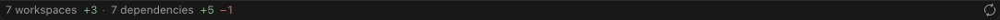
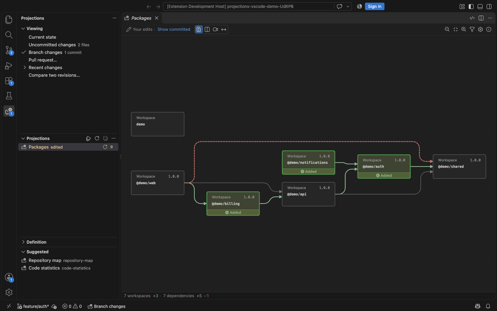

# The VS Code side bar

The
[Projections extension for VS Code](../../packages/integrations/vscode/README.md)
gathers everything in its side bar and opens each projection as a tab.

The Projections activity bar item (the brand glyph) holds four sections, each
answering one question (see
[the four-section model](../design/vscode-sidebar.md#four-sections-decided-reversible)):
every section is its own view in the Projections view container, so each can be
dragged to the panel or the secondary side bar (as Ports can), all on the
folder's one shared backend. Only **Definition** follows the active tab. Rows
say short facts (a count, a short commit, a file's name) so they fit a narrow
side bar; their tooltips explain.

- **Viewing** (What am I looking at?): Everything that changes what every
  projection tab shows (see [The choice](#the-choice)): **Current state**,
  **Uncommitted changes** (`2 files`), **Branch changes** (`3 commits`), **Pull
  request…** (`#123` when this branch has one open); **Bookmarks**
  (`.projections-bookmarks.json`, each by its name and short commit); **Recent
  changes** (Last commit, Since <tag>, and the recent commits that change any
  projection, each by its subject and short commit, what it changes and a
  thumbnail in its tooltip; the commit at `HEAD` stands for Last commit);
  **Compare two revisions…**. Equivalent choices are hidden. The current row has
  a check (and ", selected" for screen readers); the view's title stays
  "Viewing", and the [status bar item](#the-status-bar-item) names the choice. A
  click sets the choice. **Bookmark** is inline on the current row and on recent
  commits, **Remove** on bookmarks and recent commits, **Swap** on Compare two
  revisions… when it is the choice, **Find Recent Changes** on Recent changes;
  Refresh in its title. Shown: the repository defines projections (open).
- **Projections** (What is there, and what changed?): One row per projection,
  like a file, in alphabetical order of the title it shows (ignoring case,
  numbers by value, then by ID; the Testing view, Adopt… and New Projection…
  list projections in the same order): the Projections mark, its title and, at
  the right edge, its change count as a badge in the modified-file color (`9+`
  past nine), once a tab or Compare All compared the choice; no badge for no
  change; a muted label until it is compared. Its description says only what is
  unusual ("Out of date", "needs trust", "failed", "edited"); its tooltip says
  the full status ("3 changes (Uncommitted changes)", "Not compared yet").
  **Refresh** inline; **New Projection…** (`$(add)`), Compare All and Refresh in
  its title, **Add to CI…** in its `…` menu. Rows are for viewing: a leaf whose
  click opens the projection's tab; its context menu has Open Definition. A
  definition file that isn't valid is a failed row whose children are its
  diagnostics. The view's badge counts the projections that changed. Shown:
  always; welcome content ("Explore this repository", "New projection…", the
  gallery) while there are none (open).
- **Definition** (What is this projection made of?): The projection of the
  active projection tab, as Outline follows the active editor (it stays while
  one of the projection's own files is the active editor; its title stays
  "Definition", since the tab names the projection): the definition file (by its
  name; opens it), **Extractor** (its id or script's name: opens the file or its
  docs; **Show Extraction Output** inline), **Comparator** (default or a file's
  name: opens it or its docs; its `.comparator.test.yaml` under it;
  **Configure…** inline), **Renderer** (reveals a custom bundle or opens the
  docs; its source entry and `scenarios.json` under it, Scenarios opening the
  renderer workbench) and **Environment** (`environment.json`, when there is
  one). Selecting a row never leaves VS Code: a built-in part's docs open in the
  Markdown preview ([Built-in documentation](#built-in-documentation)), and the
  view stays on the projection while they are open. A part's context menu has
  Open Definition Entry; a built-in's also has Open Documentation and **Open
  Documentation on GitHub** (`$(link-external)`, also inline on hover), the only
  way to its page in the browser. **Pin to This Projection** in its title; while
  pinned, the view's message names the projection ("Pinned to Packages"). The
  same item model as Go to Source… Shown: the repository defines projections
  (collapsed); "Open a projection to see its definition" while no projection tab
  is active.
- **Suggested** (What else could I add?): The projections that apply here and
  aren't defined (`projections explore`), by title, each by its title and id
  with why it applies in its tooltip ("12 files match `**/*.prisma`"), **Adopt**
  inline; a click explores it. After the first adoption, a welcome offers **Add
  to CI…**. Shown: only while there are candidates not adopted (open), or after
  the first adoption until Add to CI… is used. With no definitions, the
  Projections view's welcome is the getting-started copy.

Checks are tests: each projection is an item in VS Code's **Testing** view (see
[Testing](../../packages/integrations/vscode/README.md#testing)). VS Code keeps
a view order you changed by dragging; **View: Reset View Locations** brings back
this one.

Elsewhere: the extractions a tab shows go to the **Projections** output channel
(Show Extraction Output), and their diagnostics to Problems, on the definition
file, beside an invalid definition's.

**A projection is a document.** A click on a row opens it in the preview
(italic) tab and a double click keeps it, as files do; tabs split, move, reopen
and restore with the window. The tab (`projection:/<folder>/<title>`, a
read-only custom editor) presents the projection alone on the repository's
choice, with no Inspector shell, fitted: the whole projection in view, as every
host opens it. The tab has no choice control or per-tab Pin: it follows the
repository's choice (the Viewing view), and says what it shows through its pane
headers (side by side and swipe) and its summary bar; the status bar item names
the choice. Its toolbar has the comparison mode, Play or Pause in animated mode,
the view controls and its notices (your edits, and a provenance badge only when
the result is unusual: From CI, Approximate, Stale or Observed, quiet as a
codicon and muted text). Out of date isn't a tool: it floats over the stage
([Out of date](#out-of-date)). The editor's `…` menu holds Choose What to Show…
and Open Definition, and the palette has Show as Renderer, Table or Text, Zoom
to Fit, In and Out, Comparison Mode… and Show Changes Only. (An agent tool can
still open a tab pinned to its own revisions.) Side by side and swipe fill the
tab edge to edge: no inset or gap around the panes, one 1px divider between them
in VS Code's editor group border, and each pane's header spanning its half.

A hidden tab drops its webview (no `retainContextWhenHidden`), but not its
result: the extension keeps the extractions each tab showed last (for the 8 most
recently updated tabs; closing a tab drops its own), and the reloaded page
mounts the Inspector with them (`initialResults`), so it comes back as it was,
with the out-of-date notice if something changed meanwhile, without extracting.
A tab whose kept results were dropped, or whose Refresh hadn't finished,
extracts when it comes back. A restored tab comes back with its mode, view,
selection and changes only from VS Code's webview state. A definition that isn't
valid opens as its diagnostics, each linking to its line.

**Loading.** A tab paints at once: the editor gets its skeleton the moment it
opens, before its folder's facts or the backend are ready (`skeletonHtml`), and
its page follows while the backend starts, its requests waiting for the bridge
(the backend's arrival never reloads it; a replaced backend, after trust or an
exit, reloads it as before). The skeleton is the real layout in VS Code's colors
and the VS Code UI's dimensions: the toolbar strip with its hairline, empty (no
stand-ins for controls that can't be used yet); the summary bar's strip; and,
centered, a 16px spinning `loading` codicon with "Loading <title>…" (still under
reduced motion). The page replaces it in place, part by part as the view draws
its own, and the Inspector's own status (what it's doing, with Cancel) shows the
same spinner. After that, a load shows VS Code's thin progress bar at the tab's
top, never a spinner that scales with a pane: one bar for the tab (however many
panes are loading), only after 300 ms so a fast load doesn't flash. The
Inspector mounts with the VS Code UI's loading state (`loadingStatus`), and a
tab opened for a projection is loading until its first result, so the web
Inspector's empty state ("No extraction loaded", with its title bar and Explorer
copy) never shows. A custom renderer is named by its projection ("Loading
Package cards…").

**Problems.** A definition file that isn't valid gets an error in Problems at
the offending field ("Module comparators were removed; name a comparator file
instead …"), and the other projections still load.

## The status bar item

The status bar item is the readout of what the tabs show: the Projections mark
(`$(projections-mark)`, a product icon from the extension's icon font) and the
choice's short name, nothing the tab already shows (the projection and its
counts are the tab's and its summary bar's). It is shown only while the folder
defines projections, and only where projections are in view: while a projection
tab is the active editor tab or any Projections view (Viewing, Projections,
Definition, Suggested) is visible. Editing other files with the side bar closed,
it is hidden. It is placed once a turn, so moving focus between a projection tab
and the side bar never hides it on the way. **Projections: Choose What to
Show…** (the same quick pick, Show in Side Bar last) stays in the Command
Palette either way.

<!-- prettier-ignore -->
| Choice | The item says |
| --- | --- |
| Current state, Uncommitted changes, Branch changes, Last commit, Since v1.0 | its name |
| A pull request | `PR #123` |
| A bookmark, a recent change | its subject, cut at 24 characters with "…" |
| Two revisions | their names, `main → feature/x`; a short commit only where nothing names one |
| The tab in front out of date | the same, then `$(warning)` (its normal colours: the icon alone says it) |
| The tab in front extracting or comparing | the same, then `$(sync~spin)` in the warning's place (`$(sync)`, still, under reduced motion) |

No hashes or counts: its Markdown tooltip has the revisions with their commits
(``main `a1b2c3d` → your files``), the span's size and the files changed, why
results are out of date, and whether the tab in front is pinned to another
choice. Its click opens the **Viewing** quick pick: the Viewing view's rows,
built from the same item model, its groups as separators (Bookmarks, Recent
changes), opening on the current choice, then **Show in Side Bar**, which
reveals and focuses the view. **Choose What to Show…** (a projection tab's `…`
menu) is the same pick. While the tab in front is out of date, the pick starts
with **Refresh** (`$(refresh) Refresh · 19 files changed`) and a separator; it
refreshes that tab, as its pill's Refresh does. The warning follows the tab in
front; the tooltip says why it is out of date and how many files changed, and
still counts the projections out of date in all tabs. Its accessible name ends
with ", out of date". It stays one item: the status bar has no segmented items
(Git's are the source control's own).

While the tab in front's job runs (it extracts a side of its pair, or its page
compares the two), the item ends with a spinning `$(sync~spin)` instead: running
takes precedence, so during a Refresh the spinner replaces the warning until the
job ends, and the warning comes back only if the new result is still out of
date. Its tooltip says "Packages: Extracting…" (or "Comparing…") and its
accessible name ends with ", extracting" (or ", comparing"). Other tabs' jobs
don't spin it; the tooltip counts them ("2 other tabs extracting"). It shows
only after a job has run 300 ms, so a short one doesn't flash, and once shown
stays at least 400 ms (`runningIndicator`, shared with the tab's summary bar).
VS Code doesn't stop a status bar item's `~spin` under its reduce motion, so the
item does: `$(sync)` holds still while `workbench.reduceMotion` is `on`, or
`auto` and the tab's page moves less (VS Code's `vscode-reduce-motion`, which
follows the system's setting). The tab's page reports what its job does with its
summary, every half second. The tab's summary bar shows the same at its end: a
spinning `sync` codicon in a slot kept while nothing runs, so no figure moves,
with "Extracting…" or "Comparing…" as its tooltip and in a polite live region
(still under reduced motion). Renderer builds aren't jobs here: the Definition
view's Renderer row says when one runs.

**Costs.** One backend per folder, shared by the side bar, every tab, the panels
and the Testing view; each tab's webview has its own engine Worker and renderer
frames, dropped while the tab is hidden (the extension host keeps only its last
extraction documents), and preview tabs keep their number down. Change counts
aren't computed in the background: a row's badge says how much changed once its
tab (or Compare All, or its Refresh) compared the choice.

## Out of date

Refresh is always manual: nothing extracts again on its own, hidden tabs
neither, and there is no setting for it. When a tab's result no longer matches
the repository, a pill floats over its stage, top centre and 12px in (below the
pane headers in side by side and swipe), saying **Out of date · 1 file changed**
with **Refresh** (out of the toolbar, since it isn't a tool; it takes no space,
so the framing doesn't move, and stays put while a document scrolls under it; on
a narrow tab the count truncates first), its row says "Out of date", and the
status bar item ends with a warning while that tab is in front (its tooltip says
why and how many are out of date; its quick pick starts with Refresh). Refresh
extracts the shown revisions again (a comparator change only compares again);
the row's Refresh does the same. While it runs, the status bar item's spinner
takes the warning's place and the tab's summary bar spins at its end
([The status bar item](#the-status-bar-item)); the warning comes back only if
the new result is out of date too. The tab's page mounts the Inspector with
`refresh: 'manual'` (other hosts keep its default, `auto`).

When is a result out of date (`src/staleness.ts`)? Today, by the backend's
`changes` notifications: a result taken before a generation whose changes touch
its projection.

<!-- prettier-ignore -->
| Change | Makes out of date |
| --- | --- |
| `working-tree` (a file, the index or `HEAD`) | Results with a working-tree side (Current state, Uncommitted changes, Branch changes); symbolic refs (`HEAD`, `HEAD~1`) when `HEAD` moved |
| `definitions` | Every result of the projection that applies its edits, or whose tab now does ([Your edits](#your-edits)); not one on Show committed |
| `extractor:<id>` | Every result of the projection |
| `comparator:<id>` | Its comparison only |
| `renderer:<id>` | Nothing: the renderer reloads, which is a view, not a result |
| A gap in the generations, or changes the backend couldn't classify | Everything |

A result whose `provenance.execution.fidelity` is `stale` (the tree changed
while it ran) is out of date at once. Once the backend reports the working
tree's identity (`GET /api/identity?projection=`, or `tree` on `changes`; local
execution M2), the working-tree side's `provenance.execution.tree` and the
result's `provenance.definitionDigest` are compared with it instead, and the
changes rule still covers the comparator, refs that moved, extractor code, and a
toolchain extractor run in place (which reads ignored files a tree doesn't see).
A choice whose revisions move with the refs (Branch changes after a rebase)
makes the tab out of date too; Refresh shows the new revisions. "N files
changed" counts the files between the result's tree (its own, else the working
tree's when it arrived) and the working tree's now.

For a projection with a scope (local execution M5: a declared `execution.scope`,
or the files a built-in's inputs name), `GET /api/identity` also reports the
`scope`, its `scopedTree` (`sha256:` of each scope path's Git object) and
whether the scope is verified (enforced by the SDK for a built-in, or checked by
`projections check`). When it is, the result's own scope identity
(`src/scope.ts`, computed from its `provenance.execution.tree` and `scope` as
the backend computes `scopedTree`) is compared instead of the whole tree, so an
edit outside the scope leaves the result current. Otherwise, or when the result
was taken over another scope, the whole tree decides.

Local execution's provenance also decides what a tab says beside its choice: an
observation (`determinism: "observed"`, live or varying data such as timings)
says **Observed 5 minutes ago · Refresh** (from `provenance.execution.at`)
instead of whether it is out of date, unless its `fidelity` is `stale`; and a
badge beside the choice says who observed the result and how faithfully: **From
CI** (the commit's official extraction: an artifact authenticated as the
repository's own CI run), **Imported** (from an artifact nothing authenticated,
such as an `--artifact` directory without a verified attestation), **Local**,
**Approximate**, **Stale** or **Observed**, from `provenanceBadge()`
(`src/environment-model.ts`, shared with the environment view), the one that
most qualifies either side, with each side's detail in its tooltip.

## Developing a projection

There is no separate tab for developing a projection (D3's Develop tab was
removed): a projection tab is the one tab type, and developing it is the side
bar's **Definition** view (its parts, files and scenarios), the **Testing** view
(its checks and comparator tests) and the Viewing view's Bookmarks and Recent
changes (the commits worth looking at, any of which becomes the choice in a
click). The extractions a tab shows go to the **Projections** output channel,
their diagnostics to Problems on the definition file.

The loop: start one with **New Projection…** (or `projections init`), open the
projection's tab, edit its files, and the tab follows (within
[Out of date](#out-of-date)'s manual refresh). Edits apply by tier:

- **Definition or extractor:** the tab applies [your edits](#your-edits) and its
  result is out of date; **Refresh** extracts again with them.
- **Comparator file:** the tab compares again on its own (the Inspector's
  `refresh: 'compare'`); the result isn't out of date.
- **Custom renderer:** saving a source rebuilds the renderer (see
  [Renderer builds](#renderer-builds)), and the tab reloads the renderer when
  its bundle changes, keeping its result.

## Built-in documentation

Selecting a row never leaves VS Code. In the Definition view and Go to Source…,
a file opens in an editor and a built-in part (a built-in extractor, the default
comparator, a built-in renderer by any of its handles) opens its documentation
in VS Code's Markdown preview, read-only, beside the projection it explains. Its
page on GitHub is an explicit secondary action: **Open Documentation on GitHub**
(`$(link-external)`), inline on hover and in a built-in row's context menu, and
a button on Go to Source…'s built-in items. Links a renderer draws, and links
inside a page, are explicit link clicks and may still go to the browser.

The documentation ships with the extension: the build (`scripts/docs.mjs`)
bundles into `dist/docs/` the [built-ins' pages](../builtins/README.md) (one per
built-in extractor, renderer and the default comparator, written for the people
using them, with their index as `index.md`), the two generated reference
catalogs, and the documentation pages those link to directly (guides, contracts,
schemas; no package README, no images). A built-in's page keeps its place
(`extractors/workspace-dependencies.md`), so the preview's tab names the part.
Relative links between bundled pages are rewritten to their bundled names, so
they open in the preview too; links to anything else (package READMEs, source
files, other docs) go to the file on GitHub, and an image becomes a link to it.
A test fails on any link in the bundle that the preview couldn't open.
`dist/docs/index.json` maps each extractor id, renderer handle and the default
comparator to its page, and each page to its file in the repository (for Open
Documentation on GitHub).

The pages open from the extension's own files (`<extension>/dist/docs/…`,
read-only in practice) with the Markdown preview editor (`vscode.openWith` with
`vscode.markdown.preview.editor`, which **Open With… › Markdown Preview** uses).
Files rather than a virtual scheme, because the preview resolves a file's
relative links natively, while links between pages of a virtual scheme led
nowhere; and the preview editor rather than `markdown.showPreview`, because its
tab carries the page's URI, which keeps the Definition view on the projection
while it is open. The preview doesn't enable `command:` links in these pages, so
a page can't start New Projection… directly; it names the steps instead. Without
the Markdown extension, the page opens as Markdown.

## Your edits

While a projection's definition, or a file it declares (its extractor script,
comparator file, renderer bundle or their `sources`), has uncommitted edits,
every tab of that projection applies the **working tree's** definition to both
sides, as `--definition-revision working-tree` does (the Inspector's
`definitionRevision: 'working-tree'`). Its toolbar says so quietly beside the
choice: **Your edits · Show committed**.

- **Show committed** applies the committed definition (`HEAD`'s) to both sides
  of this tab and extracts again; the tab then says **Committed version · Use my
  edits**. It holds until the edits change again (any save that changes them) or
  you choose **Use my edits**, and a tab restored with the window comes back on
  it while the edits are the same.
- **After a commit or a discard** there are no edits: tabs return to the
  committed definition (at their next Refresh, since the result is out of date
  when the definition changed).

Without edits, a tab applies the committed definition, so its results say what
the repository's projection shows (**Current state** applies the working tree's,
which is then the same). A definition that was never committed has no committed
version, so it is used as it is, with no indicator.

Out of date: a definition edit makes a tab that applies the edits out of date
(the `definitions` kind, or the identity's `definitionDigest`), including a tab
still showing a result from before the edits, whose **Refresh** then applies
them (its tooltip says so). Edits to the renderer's package and sources or the
comparator file change the definition's digest too, but never make a result out
of date: the renderer reloads and the comparator compares again (and the
Inspector stops presenting kept extractions of the old digest again, which
couldn't be compared with new ones). Only a tab on Show committed ignores
definition edits; there, a change to the definition files alone
(`.github/projections`, `.projections`) with `HEAD` where it was leaves the
result current, and a commit makes it out of date, since `HEAD`'s definition
moved. Refresh stays manual. The side bar's row names the projection as tabs do,
with the committed definition's title, and adds "· edited" while the definition
has uncommitted edits.

## Renderer builds

A custom renderer (a `renderer.bundle` that is a package's `dist`, as
`projections init <id> --renderer custom` scaffolds it) is built for you, so
edits reach the tab without a separate `npm run watch`. When you save one of its
sources (its `sources`, else its package's `src`) while a tab of its projection
is open, the folder's backend (the CLI service, which builds for
`projections view` too) starts the package's `watch` script (else runs its
`build` on each save), and the extension shows each run as a background task,
**<projection> renderer**, in its own task terminal, with its errors in Problems
(the `$projections-renderer` problem matcher, for Vite's and esbuild's output).
The backend sees the rebuilt bundle and the tab reloads the renderer.

- **The Definition view's Renderer row** says the build's state after its
  bundle: `building` (a spinning icon), `built`, or `build failed` with the
  error in its tooltip.
- **Trust:** the scripts are repository code, so nothing runs in an untrusted
  workspace: the row says `needs trust` and a notification offers **Manage
  Workspace Trust**; once trusted, it builds.
- **Lifetime:** a tab opened on a renderer whose sources are newer than its
  bundle builds it too. The watcher stops when no tab of its projection is open.
- **Dependencies:** install them once with `npm install` in the renderer's
  folder; until then the row says so.

## The choice

What every tab looks at is one choice for the repository, not two revisions.
Each resolves to Before → After (or, for Current state, one revision) from
`GET /api/pairs` and git, and keeps its identity, so the side bar's **Viewing**
view and the status bar name the choice rather than its refs. The Viewing view
and its quick pick (the status bar item's click) are the places to choose it,
one list built from one item model (the side bar's former header line read as a
list item, each tab had its own control, and a webview control replaced both
before this native list).

<!-- prettier-ignore -->
| Choice | Compares | Its row in Viewing (and quick pick) | Its detail (row tooltip) |
| --- | --- | --- | --- |
| **Current state** | Your files alone: no comparison | — | `your files as they are now` |
| **Uncommitted changes** | `HEAD` → the working tree | `2 files` | `last commit → your files · 2 files` |
| **Branch changes** | The merge base with the default branch → the working tree | `3 commits` | `main → your files · 3 commits + 1 uncommitted` |
| **Pull request…** | A sub-pick of the open pull requests (this branch's first), listed with the GitHub CLI (`gh`): the merge base of its base branch with its head commit → that commit, fetched from `origin` (`refs/pull/<n>/head`) when it isn't here. Compared locally | `#123` when this branch has one | `#12 Fix login · main → fix-login` |
| Bookmarks | The bookmark's revisions | its short commit | the revisions, by name |
| **Last commit**, **Since v1.0**, a recent commit | `HEAD~1` → `HEAD`; the previous tag → `HEAD`; the commit before it → the commit | a short commit | the revisions, by name |
| **Compare two revisions…** | Before, then After, from the working tree, branches, tags and recent commits | `a1b2c3d → e4f5a6b` when it is the choice | the revisions, by name |

Without `gh` or a remote, **Pull request…** is listed as unavailable, with why.

The quick pick, titled Viewing, asks "What should projections show?" and lists
the view's rows: Current state, Uncommitted changes, Branch changes, Pull
request…; **Bookmarks** and **Recent changes** (Last commit, Since <tag>, the
recent commits found, Find recent changes) under separators; Compare two
revisions…; then Show in Side Bar. Each item has the row's short fact, the
current one only its check; a row's tooltip says its span with real ref names,
then its size ("last commit → your files · 2 files"). The view and the quick
pick never list two choices that resolve to the same revisions (Branch changes
on the default branch, or with no commits ahead, is Uncommitted changes), except
the selected one. The identities (`now`, `uncommitted`, `branch`, …) stay
internal. A choice that doesn't apply here (a release range without tags) is
listed with why. **New tabs open on an automatic choice** until someone picks:
Branch changes when the branch is ahead of the default branch (its merge base
isn't `HEAD`), else Uncommitted changes when the working tree has edits, else
Current state (so never a choice the quick pick hides). A pick is remembered for
the repository (per folder, in the workspace's state) and new tabs open on it. A
remembered choice resolves again as refs move (a commit, a rebase that moves the
merge base); one that no longer applies gives way to the automatic choice until
it applies again. Choosing revisions another way (Swap, an agent tool) makes
them the choice they are, else two revisions. `projections.setChoice` sets one
by its identity (`now`, `uncommitted`, `branch`, `last-commit`, `release`,
`bookmark:<id>`), for keybindings and other extensions.
