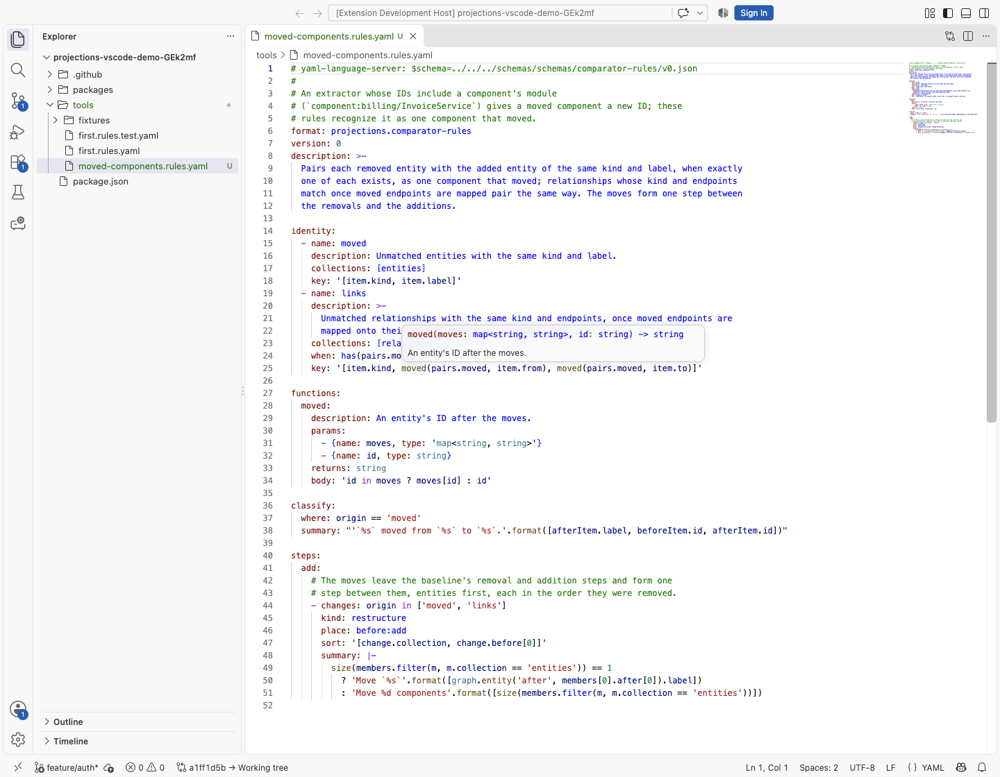
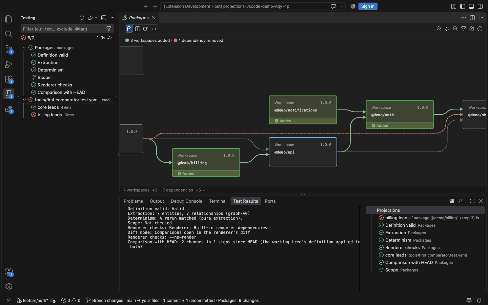
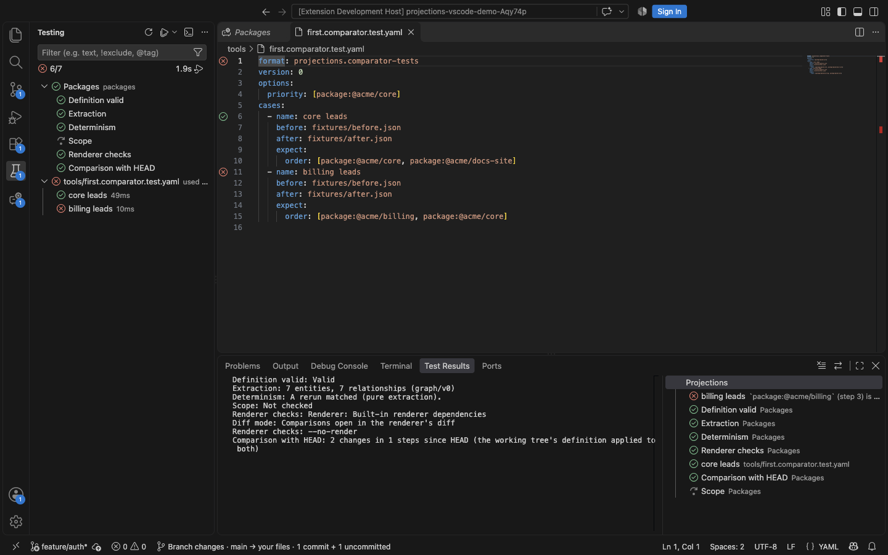

# Projections for VS Code

The Projections authoring experience: the Projections side bar, projection tabs,
the Inspector, the Explore view, Adopt and Add to CI in VS Code, backed by the
`projections` CLI. MIT; not on the Marketplace yet: every GitHub release
attaches a `.vsix` per platform (see [Distribution](#distribution)). See
[`docs/design/desktop-surfaces.md`](../../../docs/design/desktop-surfaces.md)
for why and how.

## Commands

- **View: Show Projections**: The Projections side bar (see
  [Side bar](../../../docs/guides/vscode-side-bar.md)): what you're viewing, the
  projections, the active one's definition, and the suggested ones.
- **Projections: Choose What to Show…**: What every projection tab looks at, as
  one choice (see
  [The choice](../../../docs/guides/vscode-side-bar.md#the-choice)): **Current
  state**, **Uncommitted changes**, **Branch changes**, **Pull request…**, then
  bookmarks, Last commit and Since <tag>, or **Compare two revisions…**.
  Remembered for the repository. Also the side bar's **Viewing** view and the
  editor's `…` menu.
- **Projections: Compare Two Revisions…**: Before, then After, from the working
  tree, branches, tags and recent commits. Also the Viewing view's last row.
- **Projections: Swap Before and After**: Reverses the repository's two
  revisions. Inline on the Viewing view's Compare two revisions… only when it is
  the choice (reversing a named choice makes no sense); always in the palette,
  not on Current state.
- **Projections: Go to Source…**: The projection tab's title button (`$(code)`),
  and the palette: the files behind the projection in front. One real file
  (built-ins leave only the definition) opens directly; several are a quick pick
  grouped as Definition, Extractor (its script, or a built-in's docs),
  Comparator (its file and its tests, or Configure… the default comparator, with
  an **Open Documentation** button), Renderer (a custom renderer's source entry
  and `scenarios.json`, or a built-in's docs) and Environment
  (`environment.json`). Files and docs open to the side, inside VS Code (a
  built-in's docs in the Markdown preview; see
  [Built-in documentation](../../../docs/guides/vscode-side-bar.md#built-in-documentation));
  each has an **Open in this group** button, and a built-in's an **Open
  Documentation on GitHub** button, the one way it leaves VS Code. The same item
  model as the Definition view (`definitionModel`).
- **Projections: Find Recent Changes**: Checks the last 10 commits with every
  projection and lists, under the Viewing view's **Recent changes**, the ones
  that change any (each with what it changes and a thumbnail in its tooltip).
  Inline on Recent changes; expanding it the first time runs it too.
- **Projections: Show Extraction Output**: The Definition view's Extractor
  action: the extractions the tab shows, in the **Projections** output channel.
- **Projections: Configure…**: The Definition view's Comparator action: its
  entry in the definition, or for the default comparator a choice (configure it,
  or use a comparator file) that inserts valid JSON.
- **Projections: Pin to This Projection**: Keeps the Definition view on the
  projection it shows, whatever tab is active (like the Markdown preview's
  lock); **Follow the Active Projection** undoes it.
- **Projections: Compare All Projections**: Compares the choice's revisions for
  every projection that can run here (built-in extractors, and repository code
  in a trusted workspace), one job at a time, so every row's badge and the
  view's badge say how much changed.
- **Projections: Refresh Projection**: A projection row's inline action (or the
  tab in front's): extracts its open tabs again (or shows the revisions their
  choice moved to), or counts its changes again when none is open. Nothing else
  refreshes: see
  [Out of date](../../../docs/guides/vscode-side-bar.md#out-of-date).
- **Projections: Prepare Environment**: Runs the repository's prepare steps
  (`.github/projections/environment.json`, such as `npm ci`) in the working tree
  or the workspace Projections keeps for a commit, as `projections prepare`
  does, with progress, cancellation and the **Projections: Prepare** output
  channel. In a trusted workspace only: the steps are repository code. The
  `projections.workspace` setting chooses the workspace strategy (passed as
  `--workspace`).
- **Projections: Refresh**: Reads the definitions, candidates and revisions
  again (they also refresh on every working-tree change).
- **Projections: New Projection…**: The Projections view's title button
  (`$(add)`), its welcome while the repository defines none, and the palette: a
  guided quick pick that starts a projection **from a suggestion** (Suggested's
  candidates; with none, it offers to explore the repository), **from a built-in
  extractor and renderer** (the extractors `projections extractor list --json`
  lists, then the built-in renderers that present its schema, its default
  first), as **custom parts** (a starter extractor in Node.js, Python, Go or the
  repository's toolchain, a renderer package or a comparator file, as
  `projections init --language`, `--renderer custom` and `--comparator custom`
  scaffold them) or **with an agent** (what it should show, then the chat in
  agent mode with the prompt `projections init` prints, for you to send). It
  asks for an ID, checked against the definition schema's pattern and the
  repository's projections, and a title, then runs the CLI's `projections init`
  with those flags (with progress; nothing is written in TypeScript) and opens
  the definition and the projection's tab and selects its row. Needs a trusted
  workspace; its errors offer their fix (Manage Workspace Trust, Open Settings
  for a missing CLI, Open Definition for an ID that exists, Choose a Language…
  when the toolchain isn't recognized). The CLI's output, with its next steps,
  goes to the **Projections** output channel.
- **Projections: Explore Repository**: Opens the Explore view: the projections
  that apply to this repository (`projections explore`), checked across recent
  commits, a cell opening that candidate on that change in the Inspector,
  adopting, and Add to CI.
- **Projections: Open Inspector**: Opens the Inspector beside the editor: the
  repository's projections, live on the working tree.
- **Projections: Compare Branch With Default**: Opens the Inspector on the merge
  base of the default branch (`origin/HEAD`, else `main`/`master`) → `HEAD`.
- **Projections: Adopt…**: A multi-select quick pick of the candidates not
  adopted yet, a preview of the definitions and bookmarks it writes in VS Code's
  multi-file diff, a modal confirmation, then the write (a `409`, files changed
  since the preview, offers to preview again).
- **Projections: Add to CI…**: Where the Projections GitHub Action step goes
  depends on the repository's CI, so it writes nothing: a quick pick hands the
  [Add to CI](../../../docs/setup/ci.md) prompt to the coding agent in VS Code's
  chat (which reads the workflows, proposes where the step fits and shows the
  diff before writing it), copies the prompt, or opens the guide. In the
  Projections view's `…` menu, the Explore view, and Suggested's welcome after
  the first adoption.
- **Projections: Open Artifact…**: A saved extraction, comparison or pull
  request review (`projections show --output`, `projections pr --output`), as it
  was saved, running nothing (`serve --stdio --document`); also in the
  Explorer's context menu on `.json` files.
- **Projections: Open Renderer Scenarios…**: The renderer and comparator
  workbench on a directory's `scenarios.json` (a renderer package, with its
  built bundle when it has one): every scenario through the real host view, its
  comparator (rules included) and the renderer checks
  (`serve --stdio --fixtures`); also in the Explorer's context menu on folders,
  and the Definition view's Renderer → Scenarios. The bundle reloads when it is
  rebuilt (by the extension while a tab of its projection is open, see
  [Renderer builds](../../../docs/guides/vscode-side-bar.md#renderer-builds), or
  by `npm run watch`); a renderer's development server isn't reachable from a
  webview (for hot updates, use the same workbench in a browser:
  `npm run workbench` in a scaffolded renderer: `projections-renderer-workbench`
  from `@githubnext/projections`).

A panel starts `projections serve --stdio` for its workspace folder, with
`--trust` in a trusted workspace; Adopt… uses the folder's running backend (the
side bar's, a panel's or the Testing view's), or starts one for the command. It
takes `{projections?, write?: false}` when another extension or a test runs it:
the candidates without asking, and a preview only.

Evidence locations and the definition file path open in the editor at their
line, **Reveal Before/After in source control** in the Inspector's command
palette (`⌘K`) shows the Source Control view, copying uses VS Code's clipboard
and the Inspector follows the color theme (its System choice) with VS Code's
focus color as its accent.

## Guides

- [The VS Code side bar](../../../docs/guides/vscode-side-bar.md): the side
  bar's views, projection tabs, the choice of what they show, out-of-date
  results, your edits and renderer builds.
- [Developing the VS Code extension](../../../docs/maintainers/vscode-extension.md):
  how the extension works, its webview content security policy, and how to
  develop and test it.

## Comparator files



The extension activates on `workspaceContains:**/*.comparator.yaml` (and
`.yml`), and edits custom comparator files, `*.comparator.yaml` and
`*.comparator.yml`, and their tests (`*.comparator.test.yaml`), with the
language service it ships, `dist/rules-editor.wasm`
([`packages/comparators/rules/editor`](../../comparators/rules/editor): the
rules interpreter's own reader and checker, built apart from the `rules.wasm`
viewers download; see
[Editing comparator files](../../../docs/design/declarative-comparators.md#editing-comparator-files)).
The service runs in a worker thread (`dist/rules-worker.cjs`), so it needs
neither the CLI, a backend nor trust:

- **Highlighting**: a semantic tokens provider for exactly the values that are
  CEL expressions. It marks library functions, the macros (`match`, `cond`,
  `collect`, `template`), the file's own functions, `variables.*`, inputs such
  as `before` and `change`, parameters, fields, strings with `template` fields,
  numbers and operators, all with LSP's standard token types, so every theme
  colours them. Prose, keys and the rest of the YAML keep the YAML grammar's
  colours, and other YAML files, such as workflows, are untouched.
- **Diagnostics** as you type (300 ms after the last change), from the checker
  that loads the file: errors and the `chained-conditional` and `match-values`
  warnings, at their line and column, under the source `projections rules`. Test
  files get the test format's errors.
- **Hovers**: library and CEL functions' signatures, documentation and cost, the
  file's functions with their parameters, result and description, variables with
  their type and expression, and the types of inputs, parameters and fields.
- **Completions** (also on `.`): after `variables.`, `options.` or a namespace
  such as `graph.`, what it holds; after a value of a declared type (`change.`,
  a comprehension variable), its fields and methods; otherwise everything in
  scope. Inside YAML strings, VS Code suggests while typing only when
  `editor.quickSuggestions` allows `strings`, which the YAML extension sets;
  otherwise type `.` or press Ctrl+Space.

These providers answer only inside expressions, so the YAML extension's schema
validation, hovers and completions (below) work around them.

## Testing

The **Testing** view has one controller, **Projections**: an item per projection
(by its title, its id beside it), whose children are its checks and its
comparator tests. A comparator file's tests (`X.comparator.test.yaml` beside
`X.comparator.yaml`; see
[Comparator tests](../../../docs/runner/stdio-backend.md#comparator-tests)) used
by no projection are an item of their own. The extension activates on
`workspaceContains:**/*.comparator.test.yaml` (and `.yml`) and starts the
folder's backend without opening a panel.

- **Checks** are `projections check`'s steps, through the backend's `check`
  tool: **Definition valid**, **Extraction**, **Determinism**, **Scope** and
  **Renderer checks** (the renderer's bundle, diff mode, drawing and image), and
  any other step a run reports (Comparison with HEAD, say), which becomes an
  item from then on. A failing step fails its test with its message; a warning
  passes, with its message in the run's output; a step the run skipped (or
  didn't report) is skipped.
- **Comparator tests** are one item per case, at its line in the test file, so
  the editor's gutter runs a case. Listing is `GET /api/comparator-tests`, which
  parses and runs nothing. A file that doesn't parse, or has an invalid case,
  shows its diagnostics (with their lines) as the file item's error. The view
  lists again when the backend's `changes` notification arrives, a test file is
  created, changed or deleted, or the projections change.
- **Running** (**Run**, the default profile) checks each projection once and
  runs `POST /api/comparator-tests/run` per file (for the projection the case is
  under): everything, a projection, a check, a file, or chosen cases. It needs
  no trust, since comparators run in the sandboxed interpreter (checks run what
  the workspace's trust allows). A failed case gets one message per failure, at
  the failure's location, with the expected and actual values as a diff when the
  failure has them (a snapshot's own diff follows its message). Skipped cases
  (revision cases whose extractor is repository code, in an untrusted workspace)
  say why in the run's output. A file's own problems mark it errored. Cancelling
  a run cancels its requests (`$/cancelRequest`). There is no debug profile.
- **Update snapshots**, a second run profile, sends `update: true` for the
  comparator tests, which writes snapshot files, so it exists only in a trusted
  workspace (the backend's `--trust`; it answers 403 without it). Snapshots
  written are listed in the run's output.

Results are in the Testing view and Test Results; definition problems stay in
Problems.





The panels, the Testing view and the Adopt command share one backend per folder:
whichever needs it first starts it, it restarts with `--trust` when the
workspace is trusted (the view lists again and an open panel reloads), and it
stops when nothing holds it.

## Agent tools

VS Code's agent (Copilot agent mode, or any chat participant that uses tools)
gets Projections' tools, so it can read and change a repository's projections
without the terminal, and show the person what it found:

<!-- prettier-ignore -->
| Tool | What it does |
|---|---|
| `#projections_list_projections` | The folder's projections, their parts and whether they run repository code, and invalid definitions |
| `#projections_compare` | One projection's comparison of two revisions (default: the suggested ones): steps, each change with its summary, counts, and the comparator's classification (such as API compatibility levels) |
| `#projections_explore` | The built-in projections that apply here, and why |
| `#projections_sweep` | Which recent changes each projection showed something on: changed in N of M, the median size, the changes it showed most on |
| `#projections_check` | `projections check`'s report |
| `#projections_run_comparator_tests` | Comparator tests, with failures and diffs |
| `#projections_describe_part` | A built-in extractor, renderer or the comparator, with a definition template |
| `#projections_open_projection` | Opens a projection's tab to show the person: on two revisions or a choice (setting the folder's choice, or pinned to the tab) or a renderer scenario, in a comparison mode and with an entity selected |
| `#projections_current_view` | What the projection tab in front (or shown last) shows: its projection and definition file, choice and resolved Before → After revisions, mode, selection, summary bar counts and changed items, and whether it is out of date or uses the definition's uncommitted edits |
| `#projections_refresh` | Refreshes the projection tab in front and says what it shows then |
| `#projections_screenshot` | A PNG of what the projection tab in front shows (its revisions, mode, playback, theme and size), drawn by the CLI's headless renderer, as an image the model sees |
| `#projections_adopt` | Adopt explore candidates |
| `#projections_set_part` | Set a definition's extractor, comparator or renderer |
| `#projections_update_snapshots` | Rewrite comparator tests' snapshots |

The tools are the CLI's (`serve --stdio`'s `tools/list` and `tools/call`; see
[Agent tools](../../../docs/runner/agent-tools.md)), answered on the folder's
shared backend, so a comparison an agent asks for queues with the views' and its
check of recent changes is the one the Explore view shows. Each takes an
optional `folder` (a workspace folder's name or path); the default is the active
editor's folder, else the projection tab in front, else the first. Read-only
tools run without asking. The writes (`adopt`, `set_part`, `update_snapshots`)
preview first: the confirmation shows the files they would write or the
definition's diff, and only once the person approves do they write exactly that
(if the files changed meanwhile, nothing is written and the agent gets the new
preview). Trust is the workspace's: in Restricted Mode, a projection whose
extractor is repository code doesn't run and the writes aren't offered (except
adopting while the repository defines no projections yet), as with the commands.
`package.json`'s `languageModelTools` are generated from the CLI's catalog:
`node scripts/tools.mjs` after changing a tool (`test/tools.test.mjs` fails
until they match).

**The projection in front.** When the person asks about "this projection", "this
view" or "what was removed", the agent calls `#projections_current_view` rather
than asking which one they mean: the tab in front is the active editor tab (it
stays so while the chat has focus), else the projection tab that was in front
last. `open_projection`, `current_view` and `refresh` are the CLI catalog's view
actions (`view: true`): the extension answers them itself, since only it knows
the tabs, and `projections mcp` answers the same tools, with the same schemas,
with its viewer (a page an agent drives elsewhere; see
[The viewer](../../../docs/runner/agent-tools.md#the-viewer)). The other tools
take what they omit from that tab: `compare`, `open_projection`, `set_part` and
`screenshot` its projection, `check` its projection rather than every one,
`compare` and `screenshot` without `before` and `after` the revisions it shows
(its choice, or the pair pinned to it, resolved to commits), and `screenshot`
its mode, playback position, theme and size. Their results begin by saying where
the projection and revisions came from:
`Revisions: caf6ab7e → d698c162, the ones the "CI pipeline" tab shows (Branch changes)`,
the suggested pair when no tab is open or it shows one revision, or that
revisions the agent named are not the comparison on screen. `describe_part`
without an `id` also names the part the tab's projection uses.

VS Code's stable API (as of 1.145) has no way for an extension to attach a
custom editor tab to the chat as implicit context, the way an open file is: that
is the proposed `chatContextProvider` API (`registerChatTabContextProvider`),
which a published extension can't use. Until it is stable, the agent learns
about the tab through `current_view` and the tools' defaults.

Other agents (GitHub Copilot CLI, Claude Code, any MCP client) get the same
tools from [`projections mcp`](../../../docs/runner/agent-tools.md), an MCP
server over stdio. The extension doesn't register it with
`mcpServerDefinitionProviders`: in VS Code's chat, the agent would see every
tool twice, once from the extension and once from the server, and the server's
writes would bypass the extension's confirmation and shared backend.

## Schema validation

The extension bundles the Projections JSON Schemas (`packages/schemas/schemas/`,
built into `dist/schemas/`), so validation works offline and needs no hosting:

- `contributes.jsonValidation`: `.github/projections/*.json` and
  `.projections/*.json` against `definition/v0`.
- `contributes.yamlValidation` (read by the
  [YAML extension](https://marketplace.visualstudio.com/items?itemName=redhat.vscode-yaml)
  when it is installed): `*.comparator.yaml` and `*.comparator.yml` against
  `comparator/v0`, and their tests, `*.comparator.test.yaml` and
  `*.comparator.test.yml`, against `comparator-tests/v0`.

The schemas' `$id`s name where they are published (`<base><name>/v<n>.json`);
the build takes the base from the `$id`s rather than a fixed URL, rewrites
references between schemas under it into relative file references and drops
`$id`, so VS Code's JSON service reads each referenced schema from the extension
instead of downloading it (`dist/schemas/index.json` maps each `$id` to its
file). A document's own `$schema` (JSON) or `# yaml-language-server: $schema=`
modeline (YAML) takes precedence over these associations, and VS Code's JSON
service and the YAML extension fetch such URLs from the network; no extension
can answer them short of writing `json.schemas`/`yaml.schemas` settings.
Definitions can't carry `$schema` (the CLI refuses unknown fields), so they
always use the bundled schema. The comparator and test files `projections init`
scaffolds carry no modeline, so they use the bundled schemas too; a file that
adds one uses its URL.

Evidence locations and the definition file path open in the editor at their
line, **Reveal Before/After in source control** in the Inspector's command
palette (`⌘K`) shows the Source Control view, copying uses VS Code's clipboard
and the Inspector follows the color theme (its System choice) with VS Code's
focus color as its accent.

## Distribution

Every [GitHub release](https://github.com/githubnext/projections/releases)
attaches a platform-specific `.vsix`,
`projections-vscode-<version>-<target>.vsix`, with that target's release
`projections` inside, its `.sha256` and a build provenance attestation. Install
one with `code --install-extension <file>.vsix` (or **Extensions: Install from
VSIX…**);
[Install the CLI](../../../docs/setup/install.md#the-vs-code-extension) lists
the files and how to verify them. It isn't on the Marketplace or Open VSX yet.
How it works:

- **Which CLI.** Explicit choices first: the `projections.cliPath` setting, then
  `PROJECTIONS_CLI`. Otherwise a platform-specific package's bundled
  `projections` release in `bin/<platform>-<arch>/` (Node's names, for example
  `darwin-arm64`, `linux-x64`, `win32-x64`), then a development build beside the
  extension (`../../cli/dist/projections`), then `projections` on `PATH`.
  `initialize` reports the backend's protocol and version; a protocol the
  extension doesn't speak, or a version of another major (or, while `0.x`,
  another minor), is refused with a message naming the executable and how to fix
  it.
- **Packaging.** `scripts/package.mjs` stages a package without adding `vsce` as
  a dependency:

  ```sh
  npm run build --workspace projections-vscode
  node scripts/package.mjs --target darwin-arm64 --binary ../../target/release/projections   # checks projections --version
  cd .package/darwin-arm64 && npx @vscode/vsce package --target darwin-arm64 --no-dependencies
  node scripts/package.mjs   # a universal package without a CLI: cd .package/universal && npx @vscode/vsce package --no-dependencies
  ```

  `--version` ships another version than `package.json`'s;
  `npm run tools -- install` uses it to package and install a development build,
  `<version>-dev.<commit>`, with the CLI it just built.

  Targets: `darwin-arm64`, `darwin-x64`, `linux-x64`, `linux-arm64`,
  `linux-armhf` (`bin/linux-arm`), `alpine-x64` and `alpine-arm64` (musl builds
  in `bin/linux-*`), `win32-x64` and `win32-arm64`, plus the universal package
  for any other platform. The staged manifest drops `scripts` and the
  dependencies (esbuild bundles them).

- **Releases.** The release builds the extension once (`release-inputs.yml`),
  then each native proof job (`release-proof.yml`) packages it for its target
  with the executable it just proved, installs it with VS Code's own CLI into an
  empty profile, and checks the installed extension and its CLI are the
  release's version; it's attested once the release is approved
  (`node scripts/release-asset.mjs --target T --binary FILE --out DIR`). Release
  targets: `darwin-arm64`, `darwin-x64`, `linux-x64`, `linux-arm64` (the static
  musl executables, which also run on Alpine), `win32-x64` and `win32-arm64`.
  The extension's version is the CLI's: the package step refuses another.

- **Publishing, later.** `npx @vscode/vsce publish --packagePath <each .vsix>`
  to the Visual Studio Marketplace and
  `npx ovsx publish --packagePath <each .vsix>` to Open VSX, as the `githubnext`
  publisher, from release CI with the publishers' tokens. There is no such step
  yet. `private: true` stays until then; the manifest already has the icon,
  repository, categories and keywords the listings use.
- **Updates.** A `.vsix` from a release doesn't update itself: install the next
  release's. Once on the Marketplace and Open VSX, they update installed
  extensions. The bundled CLI is pinned to the extension's version, so it
  updates with the extension; nothing downloads a CLI at runtime.
